# Evidence for the second set of lineara.xyz data fixes

This document accompanies a pull request to [mwenge/lineara.xyz](https://github.com/mwenge/lineara.xyz) from the branch `fix/second-errata` of [senegrom/lineara.xyz](https://github.com/senegrom/lineara.xyz). For each change it shows what the site shows now, what the source shows, and what the pull request changes. This branch (`pr2-evidence`) holds only this document and its images; none of it is part of the pull request.

**Conventions**

- "master (9c81beb)" is the state of the site before the pull request.
- Word numbers are those of the item pages and of `items_image_map.js`: line breaks and trace-only tokens are not counted.
- Image-map overlays: red boxes are the `items_image_map.js` entries, labelled "index:label (word)"; blue boxes are the explorer areas of `imagemaps.js`, numbered from 0; green marks the entries a change is about.
- GORILA = L. Godart and J.-P. Olivier, *Recueil des inscriptions en linéaire A* (Études crétoises 21, 1976–1985), cited by volume and printed page, with the page of the PDF in the site's `papers/` folder. Younger = J. G. Younger's Linear A texts, as quoted in the commentary on the item pages.
- In the figures of sections 9–11, "PR head (c0f074c)", "before (c0f074c)" and "now (PR #14 build)" mean the pull request as it stood with its first ten commits; for the records shown that is the state before the commit in question. c0f074c is the tenth commit as first pushed; because the messages of the sixth, eighth and tenth commits changed, the sixth to thirteenth commits now have other hashes, but the same files.
- In the figures of section 12, "before (PR head, b91dffd)" is the pull request with its first thirteen commits, as now pushed.

**Image credits.** GORILA crops are © École française d'Athènes. Most of the site's own pictures are crops of GORILA plates (© École française d'Athènes) and appear here with boxes drawn for this document. Renders, height fields and depth profiles marked INSCRIBE are made from the 3D models of the INSCRIBE project (ERC, University of Bologna; <https://www.inscribercproject.com/Linear_A.php>), named in each caption with, for renders, the light direction. All images are reproduced here only to document the corrections; none of them goes into the repository.

**Contents**

1. [Erased text shown as live text](#erased-text-shown-as-live-text)
2. [Readings, sign labels and data entries](#readings-sign-labels-and-data-entries)
3. [Image maps: boxes on the wrong signs](#image-maps-boxes-on-the-wrong-signs)
4. [Image maps and item pages: further corrections](#image-maps-and-item-pages-further-corrections)
5. [Ruling lines, pictures, MA4a, and a note on PA1](#ruling-lines-pictures-ma4a-and-a-note-on-pa1)
6. [GORILA page links](#gorila-page-links)
7. [Dividers, glyphs, sign labels and word divisions](#dividers-glyphs-sign-labels-and-word-divisions)
8. [Optional readings](#optional-readings)
9. [Readings, logograms, glyph strings and word divisions](#readings-logograms-glyph-strings-and-word-divisions)
10. [Misfiled pictures](#misfiled-pictures)
11. [More optional readings, and errata that depend on the tenth commit](#more-optional-readings-and-errata-that-depend-on-the-tenth-commit)
12. [Two readings from GORILA V's corrigenda, and a transliteration](#two-readings-from-gorila-vs-corrigenda-and-a-transliteration)

## Erased text shown as live text

GORILA prints erased signs between double square brackets, ⟦ ⟧. Its normalised copies follow the editorial rules used for Linear B (the Wingspread Convention; GORILA I p. XXXIV, PDF p. 34), and its drawings render erased strokes much finer than those of the later text (GORILA I p. XXXIII, PDF p. 33). Younger's commentary, the site's text source, writes the brackets as `[[ ]]`. Since bcfb77a (#13) the site marks an erased sign by wrapping its token in `[[ ]]` in `transliteratedWords` and `translatedWords`, one token at a time, and keeps the glyphs in `words`, `parsedInscription` and `transcription`; master (9c81beb) does this in HT34, HT36, HT46b, HT127b, KH8 and PKZg22. In the seven records below, both editions bracket signs that the site still shows as live text. The first commit of this PR marks them in the same way.

The derived files follow the text. `items_analysis/inscriptions.json` (the notebook's copy of the records) and `annotations.js` change for all seven records. For MA4b and ZAWc2, whose glyph words change too, so do `items_analysis/supplement.json` and `wordsInCorpus`, and their item pages are regenerated with the committed notebook, which reproduces all seven committed pages byte for byte from the master inputs. The other five item pages do not change, because the notebook builds them from the glyphs. "Before" figures show master (9c81beb).

### HT115a — erased signs shown as live text

The site shows `*301-U-RA` (line .2), `RI-SU-MA` (.6) and `SU 2 ¹⁄₅` (.7) of HT115a as live text. GORILA I p. 189 (PDF p. 225) notes '.1-9 Palimpseste' and, in both its normalised and its tabular copy, prints \*301-U-RA, RI-SU-MA and SU 2 D between erasure brackets, together with the traces on .6–.9; its drawing on p. 188 (PDF p. 224) has these signs in the fine stroke used for erased text. Younger's commentary has the same brackets and the note 'lines a.1-9: palimpsest'. The site's readings and glyphs already match GORILA, so this PR only wraps the five tokens in `[[ ]]` in `transliteratedWords` and `translatedWords`; glyphs, boxes and word numbers do not change.

*GORILA I p. 189 (PDF p. 225), HT 115a lines .2 and .6–.9 in both copies: the signs stand between double (erasure) brackets.* (GORILA I, © École française d'Athènes)

*GORILA I p. 188 (PDF p. 224), HT 115a drawing: \*301-U-RA (line .2) and lines .6–.9 are drawn in the fine stroke GORILA uses for erased signs.* (GORILA I, © École française d'Athènes)

### ARKH1b — erased NA 8 shown as live text

The site shows line .4 of ARKH1b, `NA 8`, as live text. GORILA III p. 5 (PDF p. 30) prints the line as `]⟦NA 8⟧` in both copies (normalised and tabular), and Younger has `][[NA 8]]`; GORILA V's corrigenda for ARKH 1b (p. 78, PDF p. 131) say only that its first two notes belong to ARKH 1a. This PR changes the two tokens to `[[NA]]` and `[[8]]` in `transliteratedWords` and `translatedWords`. No token is split, so the glyph fields, word numbers and boxes stay as they are.

*GORILA III p. 5 (PDF p. 30), ARKH 1b line .4 in the normalised and the tabular copy: ]⟦NA 8⟧ in both.* (GORILA III, © École française d'Athènes)

### ARKH3a — erased first \*317 2 shown as live text

ARKH3a lists \*317 2 twice, and the site shows both pairs as live text. GORILA III p. 9 (PDF p. 34) prints the first pair (line .3) between erasure brackets in both copies, with the apparatus 'Autre signe effacé après \*317 2', and leaves the second (line .5) live; Younger's a.3 has the same brackets (`[[*317 2]]`). This PR changes the first pair to `[[*317]]` `[[2]]` in `transliteratedWords` and `translatedWords`. On the drawing, box 11 of `ARKH3a-Facsimile` ('2', word 10) framed the erased vestige after the numeral; in `items_image_map.js` and in the matching `imagemaps.js` area it now sits on the numeral stroke after \*317.

*GORILA III p. 9 (PDF p. 34), ARKH 3a normalised copy: the first \*317 2 (line .3) stands between erasure brackets; the second (line .5) is live.* (GORILA III, © École française d'Athènes)

*Master (9c81beb): `ARKH3a-Facsimile` box 11 ('2') frames the erased vestige after the numeral; the erased pair \*317 2 (boxes 10 and 11) is in green.* (lineara.xyz image, a crop of the GORILA III plate; boxes drawn from `items_image_map.js`; © École française d'Athènes)

*This PR: box 11 on the stroke of the 2 after \*317; explorer area 11 moves with it.* (lineara.xyz image, a crop of the GORILA III plate; boxes drawn from the new `items_image_map.js` entries; © École française d'Athènes)

### ZA21b — erased ME shown as live text

The site shows the last sign of ZA21b, `ME` on line .7, as live text. GORILA III p. 197 (PDF p. 222) prints the line as `⟦ME⟧` in both copies (copie normalisée and copie tabulaire), with a dot under the sign, and Younger's ZA 21 table has the same reading in row b.7 (`[[ ME ]]`, ME underlined). This PR changes the token to `[[ME]]` in `transliteratedWords` and `translatedWords`; the glyph, the boxes and the explorer areas stay as they are.

*GORILA III p. 197 (PDF p. 222), ZA 21b line .7 in both copies: ⟦ME⟧, with a dot under the sign.* (GORILA III, © École française d'Athènes)

### HT86b — whole face erased, shown as live text

The site shows HT86b as ordinary text: `A-KA-RU 𐄁 / KU-NI-SU GRA+K+L 20 / SA-RU 20 / DI-DE`. GORILA I p. 135 (PDF p. 171) prints every line of side b between erasure brackets in both copies (.1–.3, then .4-6 ⟦vacant⟧), with the note 'Texte actuel sur premier palimpseste' under its normalised copy of HT 86b; Younger brackets b.1–b.3 the same way and calls the tablet a double palimpsest (after Schoep 2002, 79). Side b repeats the opening of HT86a and breaks off at DI-DE, where side a goes on with DI-DE-RU, and in the photograph on p. 134 (PDF p. 170) its strokes are much fainter than those of side a. This PR wraps every HT86b token in `[[ ]]` in `transliteratedWords` and `translatedWords`; glyphs, word numbers and boxes do not change. The divider becomes `[[𐄁]]` because both editions put it inside the brackets; bcfb77a has no example of an erased divider, so leaving it bare would be an equally valid choice.

*GORILA I p. 135 (PDF p. 171), normalised copies: HT 86a (live) beside HT 86b, where every line stands between erasure brackets; under HT 86b, the note 'Texte actuel sur premier palimpseste'.* (GORILA I, © École française d'Athènes)

*GORILA I p. 134 (PDF p. 170): photographs of HT 86a and HT 86b and the drawing of HT 86b; side b repeats the opening of side a in much fainter strokes.* (GORILA I, © École française d'Athènes)

### ZAWc2 — text stored twice; erased MI shown as live

ZAWc2 stores its one seven-sign text twice (A-TI-KA-A-DU-KO-MI, a line break, then the same again) and shows MI as live. GORILA II p. 98 (PDF p. 158) prints the inscription once, as `A-TI-KA A-DU-KO-⟦MI⟧`, and Younger gives the same text and word division; Anastasiadou (in Salgarella and Petrakis 2026, pp. 37–41) reads the last sign as the numeral 2, so on either reading it is not a live MI. This PR keeps one copy in `words`, `transliteratedWords`, `translatedWords` and `parsedInscription`, divided as GORILA divides it: A-TI-KA, A-DU-KO and `[[MI]]` as a token of its own. Both image maps lose the seven entries of the duplicate, none of which has a box, and the seven boxed entries become words 0–2; `transcription` and the explorer areas need no change. `supplement.json`, `wordsInCorpus` and `annotations.js` (one tag entry per word) follow, and `items/ZAWc2.html` is regenerated.

*GORILA II p. 98 (PDF p. 158): ZA Wc 2 (HM 84), one inscription of 4 + 3 signs, written once.* (GORILA II, © École française d'Athènes)

*GORILA II p. 98 (PDF p. 158), tabular copy: A-TI-KA A-DU-KO-⟦MI⟧, printed once.* (GORILA II, © École française d'Athènes)

*Master (9c81beb): `ZAWc2-Inscription` has seven boxes, all word 0, and seven entries without boxes for the duplicated text.* (lineara.xyz image, a crop of the GORILA II plate; boxes drawn from `items_image_map.js` and `imagemaps.js`; © École française d'Athènes)

*This PR: seven entries, A-TI-KA (word 0), A-DU-KO (word 1) and MI (word 2, `[[MI]]` in the text); boxes and explorer areas are unchanged.* (lineara.xyz image, a crop of the GORILA II plate; boxes drawn from the new entries; © École française d'Athènes)

### MA4b — whole face erased; first number 137, not 123

The site shows side b of MA 4 as a live entry, `A-JA HIDE+[?] 123 / 160`. GORILA I p. 273 (PDF p. 309), MA 4b .1, prints the whole face between erasure brackets, `⟦A-[· · ·]-JA *180 137⟧` with `⟦160⟧` beneath it, and Younger agrees (b.1 `[[A-[...]-JA *180 137]]`, the 7 underlined; b.1 `[[160]]`). The drawing on GORILA I p. 272 (PDF p. 308), from which `MA4b-Facsimile.jpg` is cropped, has three tens dots (30, not 20) and at least five unit strokes, two above and three below, which GORILA's copy draws as `I[II]I` over `III`, i.e. 7 with two strokes restored; the INSCRIBE 3D model `Clay_tablet_MA_4` (side b, lights az 90° and az 270°, el 35°) shows the three dots clearly, while the units lie on the spalled join and cannot be counted on it. This PR changes the number to `𐄙𐄒𐄍` (100 30 7) in `words`, `parsedInscription` and `transcription`, wraps each token in `[[ ]]` in `transliteratedWords` and `translatedWords` (`[[A-JA]] [[HIDE+[?]]] [[137]] [[160]]`), and in both image maps relabels entries 4 and 5 `30` and `7`, whose boxes and explorer areas now cover all three dots and both rows of strokes; on the drawing the `100` and `60` boxes are refitted too, and the photo's `7` box is approximate, because the strokes cannot be made out on the photo. `supplement.json` and `wordsInCorpus` follow, `items/MA4b.html` is regenerated, and the site-wide label `HIDE+[?]` and the spelling of A-JA without its gap mark are left as they are.

*GORILA I p. 273 (PDF p. 309), MA 4b: the normalised copy, whole face inside erasure brackets, and the tabular copy, .1 ⟦A-[· · ·]-JA \*180 137⟧ with ⟦160⟧ beneath it.* (GORILA I (L. Godart and J.-P. Olivier 1976), © École française d'Athènes)

*GORILA I p. 273, the first number in the normalised copy, enlarged 2×: circle (100), a column of three dots (30), and unit strokes drawn I[II]I over III, i.e. 7 with two strokes restored.* (GORILA I (L. Godart and J.-P. Olivier 1976), © École française d'Athènes)

*GORILA I p. 272 (PDF p. 308), MA 4b photograph (top) and drawing (bottom), numeral half; the site's `MA4b-Inscription.jpg` and `MA4b-Facsimile.jpg` are crops of these. Under the small circle, three dots in a column (30, not 20); in the stippled, damaged units area, two upper and three lower strokes (at least 5, so not 3); under the large circle, six dots (60).* (GORILA I (L. Godart and J.-P. Olivier 1976), © École française d'Athènes)

*INSCRIBE 3D model, MA 4 side b, ready-made renders under light 03 (az 90°, el 35°) and light 07 (az 270°, el 35°), turned 180° to GORILA's orientation: three round dot impressions in the tens column under both lights. The unit strokes lie on the spalled join to the right and cannot be counted on the model.* (INSCRIBE 3D model Clay_tablet_MA_4 (INSCRIBE project, ERC, University of Bologna; https://www.inscribercproject.com/Linear_A.php); © École française d'Athènes)

*`MA4b-Facsimile`, numeral half. Left, master (9c81beb): box 4 '20' cuts through the top tens dot, box 3 '100' also takes in that dot, box 5 '3' covers only the lower row of unit strokes, and box 7 '60' leaves the top-right dot outside. Right, this PR (green): 3 '100' tight on the circle, 4 '30' on all three dots, 5 '7' on both rows of strokes, 7 '60' on all six dots. The explorer areas equal these boxes, before and after.* (lineara.xyz image `MA4b-Facsimile.jpg`, a crop of GORILA I p. 272, © École française d'Athènes; boxes from `items_image_map.js` at 9c81beb and from the new entries)

*`MA4b-Inscription` (photo), numeral half. Left, master (9c81beb): box 4 '20' takes in the column of three holes and part of the crack, and box 5 '3' only the lower part of the units area. Right, this PR (green): 4 '30' tight on the three holes, 5 '7' over the units area beside and on the crack. The strokes cannot be made out on the photo, so this box was placed by carrying the drawing's strokes over to the photo (same scale, shifted by about 15 px in x and 20 px in y).* (lineara.xyz image `MA4b-Inscription.jpg`, a crop of GORILA I p. 272, © École française d'Athènes; boxes from `items_image_map.js` at 9c81beb and from the new entries)

## Readings, sign labels and data entries

Ten corrections to readings, sign labels and record entries; they make up the second commit of this PR. The derived files follow the records wherever the data they hold changes: `items_analysis/inscriptions.json` (the notebook's copy of the records), `items_analysis/supplement.json`, `annotations.js` and `wordsInCorpus`. In `annotations.js`, words that are split, merged or moved get tag entries of their own. Twelve item pages change and are regenerated with the committed notebook, which reproduces the committed pages byte for byte from the master inputs: HT24a, HT132, HTZd155, HTZd157+156, KNZg57a, KNZg57b, KNZg58, PE1, SYZa2, SKOZc1, ZA6a and GOWc3. Entry and area numbers count from 0, as in the files, and boxes are given as (x, y, width, height) in the image's own pixels. "Before" figures show master (9c81beb).

### HT24a — MA+RU monogram split into MA and RU

On master (9c81beb) the word arrays write the MA+RU monogram as one glyph, U+106E2, only in line .5. In .1–.4 they split it into MA + RU, which creates the words KI-MA-RU and MA-RU-ME (three times), and both image maps and the explorer give each of these monograms two boxes, RU on the horns and MA on the dome. GORILA I p. 43 (PDF p. 79) and its drawing on p. 42 (PDF p. 78), which `HT24a-Facsimile.jpg` reproduces, show the monogram as one sign in all five lines; GORILA V p. 266 (PDF p. 319, shown under the next item) numbers the groups A 546 (KI on MA+RU, .1), A 561 (MA+RU with ME, .2–.4) and A 560 (.5), and Younger has `KI MA+RU[ {*546}`, `MA+RU ME {*561}` three times and `MA+RU {*560}[`. This PR writes U+106E2 in `words`, `parsedInscription` and `transcription`, labels the groups `*546` and `*561` in `transliteratedWords` and `translatedWords` (.5 keeps `*560`), and merges each MA/RU box pair into one box labelled `*546` or `*561` (29 → 25 entries and explorer areas per image; the KI and ME boxes keep their labels). It also puts the .4 group back on the PA-SA-RI-JA line, as in GORILA, Younger and the record's `parsedInscription`, adds the .4 ME to `transcription` and its damage mark to `parsedInscription`, moves the drawing's .4 ME box, a copy of the RU box, onto the ME remains, and regenerates `items/HT24a.html`, which still labels the monogram `*560` (see the next item). HT117a's MA-RU, two separate signs, is not touched.

*GORILA I p. 43 (PDF p. 79), HT 24a .1–.5, normalised copy and apparatus. The monogram (RU's horns set on MA's dotted dome) is one sign in every line: .1 KU-PA₃-RI-JA · KI MA+RU[, .2 6 MA+RU ME 10[, .3 9 J MA+RU ME 6, .4 PA-SA-RI-JA · MA+RU ME[, .5 RU-I-KO · MA+RU[. Apparatus: '.1 KI inscrit après MA+RU', '.2 MA+RU sur ⟦ ⟧; trace à droite'.* (GORILA I (L. Godart and J.-P. Olivier 1976), © École française d'Athènes)

*The drawing `HT24a-Facsimile` (GORILA I p. 42) with its image-map boxes; the explorer areas are the same boxes. Left, master (9c81beb): in .1–.4 each monogram has two boxes, RU on the horns and MA on the dome, and the .4 ME box is a copy of the RU box. Right, this PR: one box per monogram, labelled `*546` (.1) and `*561` (.2–.4), and the .4 ME box on the ME remains at the break. Changed boxes are green.* (lineara.xyz image, a crop of the GORILA I p. 42 plate, © École française d'Athènes; boxes from `items_image_map.js` at 9c81beb and from the new entries)

*The photo `HT24a-Inscription` (GORILA I p. 42) with its image-map boxes. Left, master (9c81beb): paired RU and MA boxes on each monogram in .1–.4. Right, this PR: one box per monogram, labelled `*546` and `*561`; all other boxes are unchanged. Changed boxes are green.* (lineara.xyz image, a crop of the GORILA I p. 42 plate, © École française d'Athènes; boxes from `items_image_map.js` at 9c81beb and from the new entries)

*Line .4 right of the monogram, enlarged. Left, the drawing (`HT24a-Facsimile` x 230–330, y 250–365): master's ME box (entry 24, red) sits on the monogram's horns; the ME remains are the slanted stroke at x 259–266, y 308–325 and a short dash at x 288–290, y 274–279, at the edge of the break. Right, the photo with its ME box (entry 24 on master), which is kept.* (lineara.xyz images, crops of the GORILA I p. 42 plate, © École française d'Athènes; photo contrast-enhanced)

*HT24a `words` and `transliteratedWords` on master (9c81beb) and with this PR, one row per line break of the arrays, drawn in the site's own font. Red: the monogram split into MA + RU; green: the single glyph U+106E2, labelled `*546` (.1), `*561` (.2–.4) and, as before, `*560` (.5). The .4 group moves back to the PA-SA-RI-JA row.* (Rendered with lineara.xyz `assets/NotoSansLinearA-LinearB.ttf`, Noto fonts, SIL Open Font License 1.1)

### HT12, PH3a, KH43, HT132, HTZd155, HTZd157+156 — sign labels `*560` and `*904`

On master (9c81beb) the MA+RU monogram (U+106E2) is labelled `*560` on HT12, PH3a and KH43 (there `*560-RE`), and the capital-I sign (U+1066B) is labelled `*904` at all six of its occurrences. GORILA V p. 266 (PDF p. 319) gives each MA+RU occurrence its own number, A 558 = PH 3(a).3, A 559 = HT 12.4 and A 562 (MA+RU with RE) = KH 43.1, and Younger prints the same numbers at these lines (`]MA+RU {*558}`, `MA+RU {*559}`, `]MA+RU-RE {*562}`); the I-shaped sign is 319 in GORILA V p. 297 (PDF p. 350), Younger writes `*319`, and neither has a sign 904. This PR changes these labels in `transliteratedWords`, `translatedWords` and the matching boxes of both image maps (HT12 `*559`, PH3a `*558`, KH43 `*562` with its RE box still `RE`, and `*319` on HT132, HTZd155 and HTZd157+156), writes U+106E2 in KH43's `transcription`, which spelt the monogram as MA RU, and removes the duplicate `*904` row of U+1066B from `items_analysis/syllables.txt`, `ideograms.js` and `tags.js`. The item pages of HT132, HTZd155 and HTZd157+156 are regenerated and show `*319`, but those of HT12, PH3a, KH43 and HT24a still show `*560`: the notebook takes one label per glyph from `syllables.txt` (for U+106E2 the last row, `*560`), and re-running its image-map cell would set these map labels back to `*560`. On HTZd157+156 line 2 (entry 8) the stored glyph follows the all-319 reading that Younger quotes from Valério, while GORILA IV p. 133 (PDF p. 176) reads NE (dotted), so there the new label only follows the stored glyph; the thirteenth commit corrects it to NE ([HTZd157+156 — HT Zd 156's first NE missing, its second stored as \*319](#htzd157156--ht-zd-156s-first-ne-missing-its-second-stored-as-319)).

*GORILA V p. 266 (PDF p. 319), index of the MA+ ligatures with their attestations: A 546 '67'80+26 (KI on MA+RU) = HT 24a.1, A 558 ]80+26 = PH 3(a).3, A 559 80+26 = HT 12.4, A 560 80+26[ = HT 24a.5, A 561 80+26'13' (MA+RU with ME) = HT 24a.2.3.4, A 562 ]80+26'27' (MA+RU with RE) = KH 43.1. Each occurrence of MA+RU has its own number.* (GORILA V (L. Godart and J.-P. Olivier 1985), © École française d'Athènes)

*GORILA V p. 297 (PDF p. 350): sign 319 (capital I) at HT 132.1 and HT Zd 155, 156 (bis), 157, and in the groups 06-80-80-37-37-319 (NA-MA-MA-TI-TI-319, HT Zd 155) and 40-57-58-80-37-37-319 (WI-JA-SU-MA-TI-TI-319, HT Zd 157). Below: GORILA V's signary, cell A 319 (PDF p. 49), with the example HT 132.1.* (GORILA V (L. Godart and J.-P. Olivier 1985), © École française d'Athènes)

*GORILA's copies of the four MA+RU tablets: HT 12 .3–.5 (A 559; I p. 25, PDF p. 61, tabular copy), HT 24a .1–.5 (A 546, A 561, A 560; I p. 43, PDF p. 79), PH 3a .1–.4 (A 558 in .3; I p. 291, PDF p. 327) and KH 43 (A 562; III p. 71, PDF p. 96, with the note 'Ψ [= RE] peut-être ajouté après coup').* (GORILA I and III (L. Godart and J.-P. Olivier 1976), © École française d'Athènes)

*Image-map boxes on the MA+RU sign, master (9c81beb) in red and this PR in green: HT12 #17 `*560` → `*559` (photo and drawing), PH3a #7 `*560` → `*558` (photo), KH43 #0 `*560` → `*562` (photo and drawing; the grey RE box is unchanged). Boxes and word numbers do not change. For HT24a, see the previous item. `PH3a-Facsimile` #7 is not shown: on master that drawing is cut through the sign (see [PH3a](#ph3a--the-drawing-is-cropped-through-a-sign)).* (lineara.xyz images, crops of GORILA plates, © École française d'Athènes; boxes from `items_image_map.js`)

*All 12 image-map boxes labelled `*904` sit on signs stored as the capital-I sign A319: HT132 #3, HTZd155 #8 (written sideways), HTZd157+156 #6, #8, #11 and #14, each in both images (HTZd157+156 #8 is HT Zd 156's second NE in GORILA's reading, which the thirteenth commit relabels `NE`); master (9c81beb) in red, this PR (`*319`) in green. Boxes and word numbers do not change.* (lineara.xyz images, crops of GORILA plates, © École française d'Athènes; boxes from `items_image_map.js`)

### KH101 — duplicate empty entry

`LinearAInscriptions.js` lists KH101 twice: an empty stub after KH100 and the real entry after KE6. `new Map()` keeps the second, so the site already shows the right data; the duplicate was point 2 of #12, which was closed as completed on 2026-08-24 without the stub being removed. This PR removes the stub and the matching empty entries in `items_analysis/inscriptions.json`, `items_analysis/supplement.json`, `annotations.js` and `sitemap.xml`. No record value changes, and `items/KH101.html` stays as it is.

### KNZg57b, KNZg57a, KNZg58 — Face A text in the Face B record; photo credits

On master (9c81beb) the `parsedInscription` and `transcription` of KNZg57b (Face B of the Anetaki ivory ring) are a copy of KNZg57a's Face A text, pasted in when 5facf29 added the record, while its `words` hold a different ten-token reading and `transliteratedWords` and `translatedWords` are empty. The publication of the ring (Kanta, Nakassis, Palaima & Perna, in *KO-RO-NO-WE-SA*, Ariadne Supplement Series 5, Rethymno 2024, pp. 27–43; the site's `papers/KNZg57.pdf`) puts the rhyton A 664 and the vases on Face A (pp. 37–38) and describes Face B as sign groups with "AB 81 (KU), AB 40 (WI) and AB 60 (RA)" followed by three logograms, "GRA, probably FAR and OLIV" (p. 39); the record's `words` hold these syllabograms, but as single signs (see below). This PR sets both glyph strings to the record's own `words` and fills the two arrays with the site's values for these glyphs (`I, KU, WI, RA, KA, DU, 𐝫, GRA, GRA, OLIV`; GRA "grain", OLIV "olives"); the Face B reading itself could not be checked, as the article prints no transcription, drawing or legible photograph of it, has "probably FAR" where `words` has a second GRA, and counts "six groups of signs" where `words` has six single signs. KNZg57b also gets an entry in `annotations.js`, which had none, so that the explorer's word tip failed on its words; its tags are those the file gives the same signs elsewhere, except for RA, which stands alone in no other record, and the trace, tagged only 'lacuna' (elsewhere 'lacuna', 'lacuna at start' and 'lacuna at end'). The photo credits now follow the article's figure captions: 'Ph Sapirstein' (was 'Ph Saperstein') for KNZg57a and KNZg58, whose photo is Fig. 7, "Photo Ph. Sapirstein" (p. 35), and "Excavator's archive" for KNZg57b, whose photo is a crop of Fig. 6B (p. 33); 'Kanta', the excavator, would be a shorter form. The three item pages are regenerated with the new credits.

*KNZg57b on master (9c81beb): `parsedInscription` and `transcription` repeat KNZg57a's Face A string character for character (vases A652/A653/A651, rhyton A664, NI, VAS); `words` holds a different ten-token reading (I KU WI RA KA DU, trace, GRA GRA OLIV); `transliteratedWords` and `translatedWords` are empty. Below, in green: the new fields, built from the record's own `words` with the site's own labels.* (lineara.xyz data, `LinearAInscriptions.js` at 9c81beb; glyphs drawn in lineara.xyz's font, `assets/NotoSansLinearA-LinearB.ttf`)

*P. 39 (PDF p. 13), Face B (= KNZg57b): phonetic sign groups, with AB 81 (KU), AB 40 (WI) and AB 60 (RA) named, then three logograms, 'GRA, probably FAR and OLIV'; 'we have no such phonetic sign groups on Face A'.* (Kanta, Nakassis, Palaima & Perna, 'An archaeological and epigraphical overview of some inscriptions found in the Cult Center of the city of Knossos (Anetaki plot)', KO-RO-NO-WE-SA (Ariadne Supplement Series 5), Rethymno 2024, pp. 27–43; lineara.xyz `papers/KNZg57.pdf`)

*Pp. 37–38 (PDF pp. 11–12), Face A (= KNZg57a): signs in metopes, among them the 'rhyton' (Linear A sign A 664), at least ten vases, some with a ligatured syllabogram (VAS+PA, VAS+RU), and a tripod. These are the signs copied into KNZg57b's `parsedInscription` and `transcription`.* (Kanta, Nakassis, Palaima & Perna, KO-RO-NO-WE-SA (Ariadne Supplement Series 5), Rethymno 2024; lineara.xyz `papers/KNZg57.pdf`)

*Fig. 6, p. 33 (PDF p. 7). The red box marks the crop the site uses as `images/KNZg57b-Inscription.jpg` (normalised cross-correlation 0.996 at offset 983,7 in the embedded 1334×678 figure): panel B, 'The ivory scepter after mending (Excavator's archive)'. It is a view of the whole object in which no sign of Face B can be read, and not a Sapirstein photograph, as master's `imageRights` has it.* (Kanta, Nakassis, Palaima & Perna, KO-RO-NO-WE-SA (Ariadne Supplement Series 5), Rethymno 2024, Fig. 6 (Excavator's archive); red box added)

*Fig. 7 caption, p. 35 (PDF p. 9): 'Photo Ph. Sapirstein'. Fig. 7 is the photograph the site uses as `KNZg57a-Inscription.jpg` (and the byte-identical `KNZg58-Inscription.jpg`); master's `imageRights` reads 'Ph Saperstein'.* (Kanta, Nakassis, Palaima & Perna, KO-RO-NO-WE-SA (Ariadne Supplement Series 5), Rethymno 2024; lineara.xyz `papers/KNZg57.pdf`)

### PE1 — U-KA-RE-A-SE-SI-NA is two words

On master (9c81beb) the first word of PE1 is one seven-sign token, `U-KA-RE-A-SE-SI-NA` in `transliteratedWords` and `translatedWords`, and all seven signs are word 0 in both image maps; the word occurs nowhere else in the corpus. Issue #5 asks for `U-KA-RE A-SE-SI-NA`, Younger reads the same two words (`.1-2 U-KA-RE A-SE-SI-NA`), SigLA divides u-ka-re | a-se-si-na, and the site's own facsimile (line .1, about x 179–182, y 50–62) shows a short free-standing stroke between RE and A, with an incision at the same place in the photo. PE 1 was published after GORILA, so there is no GORILA page, and the editio princeps (Tsipopoulou & Hallager 1996: 25–30) was not available for checking. This PR splits the token in `words`, `transliteratedWords` and `translatedWords` (16 → 17 tokens) and renumbers the image-map words of `PE1-Inscription` and `PE1-Facsimile` (A-SE-SI-NA becomes word 1 and every later entry moves up by one); the glyph strings, boxes, labels and explorer areas do not change, and `items/PE1.html` is regenerated. No divider tokens are added: Younger writes dividers as `•` elsewhere (e.g. HT 1, `QE-RA2-U • KI-RO`, which the site has as `𐄁`) but marks none on PE 1. In `annotations.js` the numeral 72 of PE1 is now tagged `number` instead of `word`, like other numerals; HT127b and PK3, the two other records with 72, follow in the third commit.

*PE 1 line .1 in the site's own facsimile (top) and photo (bottom), enlarged 2.5×: U KA RE | A SE SI. The red arrow points at a short free-standing stroke between RE and A, separate from both signs, at the word boundary that issue #5 asks for.* (lineara.xyz images, `images/PE1-Facsimile.jpg` and `images/PE1-Inscription.jpg`)

*Image map of `PE1-Facsimile`, master (9c81beb) left and this PR right; labels read 'index:label (word)'. On master all seven signs U..NA are word 0. With this PR U KA RE are word 0 and A SE SI NA word 1 (green), and every later entry moves up by one (KU-PA-RI 2 … 30/6 word 12). Boxes and labels are unchanged.* (lineara.xyz image `images/PE1-Facsimile.jpg`; boxes drawn from `items_image_map.js`)

*Image map of `PE1-Inscription` (photo), master (9c81beb) left and this PR right. The renumbering is the same as on the facsimile; boxes are unchanged.* (lineara.xyz image `images/PE1-Inscription.jpg`; boxes drawn from `items_image_map.js`)

*Close-up between RE and A in the site's photo, the site's facsimile and SigLA's independent tracing: the same isolated stroke appears in all three.* (lineara.xyz images; SigLA drawing © Ester Salgarella & Simon Castellan, sigla.phis.me, CC BY-NC-SA 4.0)

*Lines .1–.2 in the site's photo (contrast stretched) and facsimile. 1: the stroke between U-KA-RE and A-SE-SI-NA. 2: a similar stroke after NA, before KU-PA-RI, at an existing word boundary. This matters only if divider tokens are wanted; this PR adds none.* (lineara.xyz images, `images/PE1-Inscription.jpg` and `images/PE1-Facsimile.jpg`)

### SYZa2 — logograms fused into words, divider read as 1, wrong GORILA page

On master (9c81beb) the site reads side a of the Syme libation table (HM 3429) as `A-TA-I-*301-WA-JA 𐄁 JA-SU-MA-TU-OLIV 1` and side b as `U-NA-KA-NA-SI-OLE`. GORILA V p. 65 (PDF p. 118) sets OLIV and OLE apart from the words, in the logogram column of its tabular copy (its apparatus notes that OLE is "curieusement rattaché à" SI), and Younger has `JA-SU-MA-TU OLIV •` and `U-NA-KA-NA-SI OLE`. The "1" is a word divider: in GORILA's drawing (V p. 64, PDF p. 117) the mark after OLIV is the same filled round dot as the divider after WA-JA, on p. 65 it is a short mark at mid-height, far shorter than a unit stroke, and image-map entry 12 and explorer area 11 sit on it. This PR splits OLIV and OLE off in the three word arrays (glossed "olives", "olive oil" and, for U-NA-KA-NA-SI, "requesting", as at their other occurrences on the site), turns the 1 into `𐄁` in all five text fields, makes entry 12 a box-less `*900` entry with the later word numbers following, and drops the explorer area on the dot (19 areas for 19 letters). It also points `imageRightsURL` to `papers/GORILA-Vol5.pdf#page=117` (p. 64, SY Za 2) instead of `#page=115`, which opens SY Za 1 (p. 62), and `items/SYZa2.html` is regenerated with the new words and link.

*GORILA V, four crops. (1) p. 64 (PDF p. 117), drawing of side a: …WA-JA • JA-SU-MA-TU OLIV •; the mark after the olive sign is the same filled round dot as the divider before JA-SU-MA-TU. (2) p. 65 (PDF p. 118), normalised copy of side a: after OLIV only a short, divider-sized mark at mid-height. (3) p. 65, tabular copy: OLIV (line a) and OLE (line b) stand apart in the right-hand logogram column, and OLIV is followed by the same short tick as the divider between the two JA; a unit stroke would be about sign height. (4) p. 65, apparatus: 'b dernier signe curieusement rattaché à [SI]'.* (GORILA V (L. Godart and J.-P. Olivier 1985), © École française d'Athènes; rendered from the copy lineara.xyz serves, `papers/GORILA-Vol5.pdf`)

*GORILA V p. 65 (PDF p. 118), the whole SY Za 2 page: the normalised copy of sides a–d, the apparatus note on b's last sign, and the tabular copy with OLIV and OLE in the right-hand logogram column.* (GORILA V (L. Godart and J.-P. Olivier 1985), © École française d'Athènes; rendered from the copy lineara.xyz serves, `papers/GORILA-Vol5.pdf`)

*Master (9c81beb): image map (red, 'index:label (word)') and explorer areas (blue) on `SYZa2-Facsimile.jpg`, in panels for the end of side a, side b and side d. Entry 12 '1' (word 3) and explorer area 11 sit on the divider dot after OLIV.* (lineara.xyz image `SYZa2-Facsimile.jpg`, a crop of GORILA V p. 64, © École française d'Athènes; boxes from `items_image_map.js` and `imagemaps.js`)

*This PR: JA-SU-MA-TU word 2, OLIV word 3, the final divider word 4 (a box-less `*900` entry, like every divider), U-NA-KA-NA-SI word 5, OLE word 6, A-JA word 7. The explorer area on the dot is dropped (20 → 19 areas, 19 letters). No coordinates change.* (lineara.xyz image `SYZa2-Facsimile.jpg`, a crop of GORILA V p. 64, © École française d'Athènes; boxes from the new `items_image_map.js` and `imagemaps.js` entries)

*Master's `imageRightsURL`, `papers/GORILA-Vol5.pdf#page=115`, opens SY Za 1 (left: PDF p. 115 = p. 62, HM 3459). SY Za 2 (right: HM 3429) is on PDF p. 117 = p. 64, the page `SYZa2-Facsimile.jpg` is cropped from.* (GORILA V (L. Godart and J.-P. Olivier 1985), © École française d'Athènes; rendered from the copy lineara.xyz serves, `papers/GORILA-Vol5.pdf`)

### SKOZc1 — fragment B reads ZU, not TI

On master (9c81beb) fragment B of SKO Zc 1 reads QA-KI-TI. The record's linked source and only edition, M. Perna, A. Kanta, L. Tyree, "An Unpublished Inscription in Linear A from the Skoteino Cave, Crete (SKO Zc 1)", in M. Perna (ed.), *Studi in onore di Enrica Fiandra*, Paris 2005, 321–333 (`papers/SKOZc1.pdf`), reads `]AB 16-AB 67-AB 79[`, i.e. QA-KI-ZU, with all three signs underdotted as uncertain (p. 327; the dotting is explained on p. 328). The third sign "is compatible with AB 79, particularly in its variant that appears in the painted clay inscription KN Zc 6.3 (fig. 11a)" and "presents a dot rather than a line within the oval" (p. 327); in fig. 10a–b (p. 330) and in the site's own crops (box 7) it is a pointed arch with a dot inside, whereas the site's TI boxes elsewhere (e.g. HT 8a, HT 7a, HT 10b) show the arch without a central dot, and the site itself reads the KN Zc 6.3 sign as ZU. This PR changes TI (U+10620) to ZU (U+10640) in the five text fields and in the label of entry 7 in both image maps, and `items/SKOZc1.html` is regenerated; boxes, word numbers and explorer areas stay. The site has no way to show the editors' underdot and already shows QA and KI plain, so ZU is shown plain as well.

*Edition of SKO Zc 1, p. 327: fragment B is read ]AB 16-AB 67-AB 79[ (QA-KI-ZU), each sign underdotted. The third sign is 'compatible with AB 79, particularly in its variant that appears in the painted clay inscription KN Zc 6.3', with 'a dot rather than a line within the oval'. P. 328: the dots mark doubtful recognition. TI (AB 37) is not mentioned.* (M. Perna, A. Kanta, L. Tyree, 'An Unpublished Inscription in Linear A from the Skoteino Cave, Crete (SKO Zc 1)', in M. Perna (ed.), Studi in onore di Enrica Fiandra (Paris 2005) 321–333, pp. 327–328; lineara.xyz `papers/SKOZc1.pdf`, PDF pp. 9–10)

*Top: fragment B in the edition's photo and drawing; the third sign is a pointed arch with a dot inside, broken off below. Bottom: box 7 on the site's two SKOZc1 images (labelled TI on master) beside ZU and TI boxes from the site's own image maps: KN Zc 6.3 ZU (the variant the editors cite, rotated on the cup), HT 26b.3 ZU (the usual rayed form), and TI on HT 8a, HT 7a and HT 10b (arches without a central dot).* (Top: Perna, Kanta, Tyree 2005, fig. 10a–b, p. 330, photo and drawing M. Perna; lineara.xyz `papers/SKOZc1.pdf`, PDF p. 12. Bottom: crops of lineara.xyz images at the `items_image_map.js` boxes of 9c81beb; the SKOZc1 images are cropped from the same figure, KNZc6, HT26b, HT8a, HT7a and HT10b from GORILA IV and I; © École française d'Athènes)

*Image maps on fragment B of `SKOZc1-Inscription` and `SKOZc1-Facsimile`: master (9c81beb) left, entry 7 'TI'; this PR right, entry 7 'ZU' (green). Boxes and word numbers are unchanged.* (lineara.xyz images `SKOZc1-Inscription.jpg` and `SKOZc1-Facsimile.jpg`, crops of Perna, Kanta, Tyree 2005, fig. 10; boxes from `items_image_map.js`)

### ZA6a — false divider and bunched line breaks on face a

On master (9c81beb) the word arrays of ZA6a end face a with five line breaks in a row, then `𐄁`, then `]OLIV[ ]25 *304[ ]20 I-SE-` on one row; the tabulation in `supplement.json` and both image maps give the '5' of 25 word 17 (entry 27) and SE of I-SE word 20 (entry 31), the number of the divider, so `items/ZA6a.html` groups `5 *304` as one word and splits I-SE into `I` and `SE 𐄁`. The record's own `parsedInscription`, Younger's rows a.7 to a.9-10 and GORILA's tabular copy (GORILA III p. 157, PDF p. 182) give each of these five entries its own line. The `𐄁` comes from Younger's `•` (one illegible sign) in `a.9-10 I-SE-[•`; GORILA reads `.9-10 I-SE-[` with only a trace `[·][` on line .10, and the site's drawing shows a sign fragment there, not a divider. This PR drops the divider from all five text fields, puts a line break before each of the five entries, gives OLIV its leading damage mark (`]OLIV[`, as in `parsedInscription` and both editions), renumbers entries 27 (17 → 16) and 31 (20 → 19) and removes entry 32 in both image maps; the explorer areas do not change (32 letters, 32 areas). `items/ZA6a.html` is regenerated and now shows 25 and I-SE as single words.

*GORILA III p. 157 (PDF p. 182). Top, the normalised copy of face a, lines .6–.10: .7 ]20[ ]OLIV, .8 ]25 \*304, .9 ]20 I-SE, and on .10 a single trace [·][. Bottom, the tabular copy on the same page gives each entry its own line (.7 ]20[ / .7 ]OLIV[ / .8 ]25 / .8 \*304[ / .9 ]20 / .9-10 I-SE-[). The word I-SE- runs on into the broken line .10, and there is no word divider.* (L. Godart and J.-P. Olivier, GORILA III (Études crétoises 21.3, 1976), p. 157, © École française d'Athènes; page as served at lineara.xyz/papers/GORILA-Vol3.pdf)

*The drawing `images/ZA6a-Facsimile.jpg`, bottom of face a, with its image-map boxes; the changed entries are green. Top, master (9c81beb): entry 27 (the '5' of 25) carries word 17, which is \*304's number, and entry 31 (SE) carries word 20; entry 32 `*900` (the divider, no box, not drawn) is also word 20. Bottom, this PR: 27 → 16 and 31 → 19, so the '20' and '5' boxes form the word 25 and the I and SE boxes the word I-SE; entry 32 goes with the divider. Box positions are unchanged.* (Drawing from GORILA III, © École française d'Athènes, as cropped by lineara.xyz; boxes drawn from `items_image_map.js` at 9c81beb and from the new entries)

*The photograph `images/ZA6a-Inscription.jpg`, bottom of face a, with the same two changes as on the drawing: entry 27 ('5' of 25) goes from word 17 to 16, entry 31 (SE) from word 20 to 19, and the box-less divider entry 32 is removed. Box positions are unchanged.* (Photograph from GORILA III, © École française d'Athènes, as cropped by lineara.xyz; boxes drawn from `items_image_map.js`)

*The drawing `images/ZA6a-Facsimile.jpg`, lower left corner (x 20–220, y 790–910, enlarged 3×). At line .10 it shows only a sign fragment at the broken left edge, an L-shaped pair of strokes, where GORILA's normalised copy has the trace [·][. There is no divider here.* (Drawing from GORILA III, © École française d'Athènes, as cropped by lineara.xyz)

*Schematic of the end of face a as the explorer builds its rows from the word arrays (`populateText` starts a new row at every line-break token). On master (9c81beb) there are four empty rows, then the divider and five entries crowded into one row. With this PR there is one entry per row, as in the record's own `parsedInscription`, Younger's rows and GORILA's tabular copy. Rendered from the arrays, not a browser screenshot; U+1076B shows as a box.* (Rendered from lineara.xyz `LinearAInscriptions.js` at 9c81beb, before, and the new arrays, after; © École française d'Athènes)

### GOWc3 — 20 and 2 stored as one token with a comma

On master (9c81beb) GOWc3 stores its number as one token, `𐄑,𐄈` (20, comma, 2), in `words`, `transliteratedWords` and `translatedWords`, the only comma in any glyph field of the corpus; the transliteration shows glyphs, `items/GOWc3.html` shows the comma as an unknown sign `*`, and `annotations.js` and `wordsInCorpus` count the pair as a word. Younger (`commentary/GOWc3.html`) reads '20 , 2': 'two horizontal strokes (20) are followed by two lightly incised vertical strokes (2)', 'the two sets of numbers'; the comma only separates them. The image maps give the comma an entry of its own: on the photo a box on bare clay (108, 209, 18, 25), on the drawing the box on the two short strokes (161, 84, 43, 81), which leaves the 2 there without a box and the drawing's explorer with 3 areas for 4 letters. This PR splits the token into 20 and 2, drops the comma from `parsedInscription` and `transcription` and its entries from both image maps and the photo's explorer, gives the 2 (now word 2) a box and explorer area on the drawing's two short strokes, (172, 100, 26, 37), keeps the 20's box on the long strokes, and regenerates `items/GOWc3.html`. In the drawing the long strokes stand vertical and the short ones horizontal, so Younger describes the roundel turned by 90 degrees; the assignment of 20 and 2 follows his order and the existing boxes, and swapping the two box labels would reverse it (the publication, Watrous et al. 2015, Hesperia 84, 446–448, was not available).

*Image map of `GOWc3-Facsimile`, master (9c81beb) left and this PR right, 2.7×. Master: box 1 '20' holds the two long strokes beside the logogram; box 2, labelled `*` (the comma), holds the two short strokes and one long stroke; entry 3 '2' has no box. This PR: the comma's entry is gone, the 20 keeps its box, and the 2 (now its own word) gets a box on the two short strokes (172, 100, 26, 37). The explorer's third area changes the same way.* (lineara.xyz image `images/GOWc3-Facsimile.jpg`, drawing of GO Wc 3; the roundel was published by Watrous et al. 2015, Hesperia 84, 446–448; boxes drawn from `items_image_map.js` at 9c81beb and from the new entries)

*Image map of `GOWc3-Inscription`, master (9c81beb) left and this PR right, 1.6×. Master gives the comma a box of its own (entry 2, green, 108, 209, 18, 25) on bare clay below the logogram. This PR removes that entry and the explorer area under it; the 20 and 2 boxes keep their coordinates, and the 2 becomes word 2.* (lineara.xyz image `images/GOWc3-Inscription.jpg`, photo of GO Wc 3; the roundel was published by Watrous et al. 2015, Hesperia 84, 446–448; boxes drawn from `items_image_map.js` at 9c81beb and from the new entries)

*Left: `GOWc3-Inscription.jpg`, contrast-stretched, 2×. Right: the same photo with the ink of `GOWc3-Facsimile.jpg` laid over it, fitted on three landmarks of the logogram (the two dots and the side loop): rotation 49° clockwise, scale 1.69, residuals of 2.5 px or less. The drawn logogram (orange) lies on the photographed one; the two long strokes (green, the 20) fall inside the photo's 20 box, and the right short stroke (blue, part of the 2) lies on a visible slanted incision inside its 2 box. Nothing falls near master's comma box (red), which sits on bare clay.* (lineara.xyz images `images/GOWc3-Inscription.jpg` and `images/GOWc3-Facsimile.jpg`, GO Wc 3, Watrous et al. 2015, Hesperia 84, 446–448; overlay made for this PR)

### HTW231d, HTW231e, HTW231f — 'None' stored as a word

These three records have no transcription: their `parsedInscription` and `transcription` are empty. On master (9c81beb) their `words`, `transliteratedWords` and `translatedWords` nevertheless hold the string `"None"`, a Python `None` written out as text, and the explorer, which shows every entry of these arrays, displays it as a word. This PR sets the three arrays to `[]`, as the eight other records with no words already have them (e.g. KE6, ZOZa1). `wordsInCorpus` never counted "None". The derived files hold only an older combined entry, HTW231d-f; its arrays in the notebook's copy are `"None"` too and become `[]` (its item page does not change).

## Image maps: boxes on the wrong signs

In each record below, image-map boxes sit on the wrong signs, or a sign has no box. The changes are to the boxes in `items_image_map.js` (item pages) and the matching areas in `imagemaps.js` (explorer). For SYZa3, HT24b and HT123+124a they also correct the record's tabulation in `items_analysis/supplement.json` and regenerate the item page from it with the committed notebook. No text field in `LinearAInscriptions.js` changes. Entry and area numbers count from 0, as in the files, and boxes are given as (x, y, width, height) in the image's own pixels. "Before" figures show master (9c81beb).

### HT154n — 6 and SI boxes swapped on the drawing

On `HT154n-Facsimile`, entry 1 (label `6`) is boxed on the SI sign at the right of line .2, and entry 2 (label `SI`) on the six unit strokes to its left; explorer areas 1 and 2 have the same swap. GORILA I p. 250 (PDF p. 286) draws the six strokes to the left of SI, and GORILA I p. 251 (PDF p. 287) reads `.2 ]6 SI[`. The site's photo map (`HT154n-Inscription`) already has 6 on the left and SI on the right. This PR swaps the two boxes in the drawing's image map and explorer areas and moves the SI box's left edge from x 221 to x 213, so that it takes in the sign's left arm; text fields and word numbers are unchanged.

*Master (9c81beb): the box labelled 6 sits on SI, and the box labelled SI on the six strokes.* (lineara.xyz images/HT154n-Facsimile.jpg, a crop of the GORILA I p. 250 drawing; boxes drawn for this PR; © École française d'Athènes)

*Proposed: 6 on the six strokes, SI on the sign.* (lineara.xyz images/HT154n-Facsimile.jpg, a crop of the GORILA I p. 250 drawing; boxes drawn for this PR; © École française d'Athènes)

*GORILA I p. 251 (PDF p. 287), HT 154 N, hand copy: line .2 has six unit strokes (the lower three dotted), then SI.* (GORILA © École française d'Athènes)

### SYZa3 — SI-RU-TE labels rotated; WA, JA and SE boxes on other signs

On `SYZa3-Facsimile`, entries 10–12 (word 2) hold SI, RU and TE from left to right but are labelled TE, SI, RU, and entries 4–6 (WA, JA, SE) sit on the first three signs of the second fragment, which Younger reads as illegible; the real WA (right after \*301) and SE (right before KA) have no box. GORILA V p. 67 (PDF p. 120) reads `A-TA-I-*301-WA-[ -- ca. 20 -- ]SI-RU-TE`, its drawing on p. 66 (PDF p. 119) shows SI, RU, TE in that order, and Younger (`commentary/SYZa3.html`) reads `A-TA-I-*301-WA-[JA -- ca. 8 --]•-•-•SE-KA-NA-SI[•]TE[-- ca. 10 --]SI-RU-TE`, so JA is restored in the break, not on the stone. The TE, SI, RU order was also copied into the SYZa3 tabulation in `items_analysis/supplement.json`, so `items/SYZa3.html` shows word 2 as TE-SI-RU, a sequence found in no inscription, and searches for it on click. This PR relabels entries 10–12 (boxes unchanged), moves WA to (137, 9, 17, 28) and SE to (253, 4, 19, 29), gives JA `"coords": {}` and a zero-size explorer area at the break, reorders the tabulation and regenerates the item page. The second fragment (ArchEph 2008) postdates GORILA V, so the SE box follows Younger, who marks SE as doubtful, and the site's own drawing.

*Master (9c81beb): the SYZa3-Facsimile sign strip (x 70–495, 2.3x), raw (top) and with the image-map boxes (bottom; wN = word number). Entries 10–12 hold SI, RU, TE but are labelled TE, SI, RU. Entries 4–6 (WA, JA, SE) sit on the first three signs of the second fragment, while the real WA (5th sign of the first group, after \*301) and the sign before KA (SE) have no box.* (lineara.xyz images/SYZa3-Facsimile.jpg (credited on lineara.xyz to © École française d'Athènes); boxes and labels drawn for this PR)

*Proposed, same strip: 10–12 relabelled SI, RU, TE (boxes unchanged); WA boxed on the 5th sign of the first group and SE on the sign before KA; JA has no box (coords {}) and a zero-size explorer area at the break (dashed marker). Word numbers unchanged.* (lineara.xyz images/SYZa3-Facsimile.jpg (credited on lineara.xyz to © École française d'Athènes); boxes and labels drawn for this PR)

*GORILA V p. 67 (PDF p. 120), SY Za 3, the transcription line (printed rotated; shown turned 90° clockwise): A-TA-I-\*301-WA-[ -- ca. 20 -- ]SI-RU-TE, with TA, I and \*301 underdotted. The break follows WA, so JA is not on the stone; the last word runs SI, RU, TE.* (GORILA V (L. Godart & J.-P. Olivier 1985) © École française d'Athènes; rendered from papers/GORILA-Vol5.pdf as served by lineara.xyz)

*GORILA V p. 66 (PDF p. 119), drawing of HM 3757, the two ends of the inscribed rim: left, SI, RU, TE in reading order; right, A, TA, I, \*301 and WA at the break.* (GORILA V (L. Godart & J.-P. Olivier 1985) © École française d'Athènes; rendered from papers/GORILA-Vol5.pdf as served by lineara.xyz)

*Which sign is in each box: the Noto Sans Linear A glyph and the same label in five other lineara.xyz facsimile maps, next to the SYZa3-Facsimile boxes (red = box on master with its label there; green = proposed box). On master, entry 10 'TE' holds SI, 11 'SI' holds RU and 12 'RU' holds TE, and entries 4 'WA' and 5 'JA' hold signs that are neither; the proposed WA and SE boxes hold WA- and SE-like signs.* (Crops of lineara.xyz facsimile images (HT and SYZa3 facsimiles, credited on lineara.xyz to their publishers, chiefly © École française d'Athènes); glyphs Noto Sans Linear A (SIL Open Font License))

### HT24b — photo boxes one sign off; line break one sign late

On `HT24b-Inscription`, a crop of the GORILA I p. 42 (PDF p. 78) photograph, entries 2 and 3 split the single fraction sign JE (³⁄₄) of line .1 into its two strokes; from entry 3 on, each label names the sign after the one it frames (entry 5, `1`, sits on the \*118 that opens line .2), and the final 1 of line .2 has no box. The explorer has the same split, 11 areas for the record's 10 letters, so from area 3 on it highlights the next sign's word, and area 10 (the final 1) falls back to word 0. GORILA I p. 43 (PDF p. 79) reads `.1 ]*118 1 JE *531` and `.2 *118 1 JE *539 *118 1`, the same ten signs in the same order as the record's text, Younger's commentary and the correctly mapped `HT24b-Facsimile`. The HT24b tabulation in `items_analysis/supplement.json` also ends line 1 after the \*118 that opens line .2, so both "Line breaks match the inscription" blocks of `items/HT24b.html` break one sign late. This PR merges the two ³⁄₄ boxes into one, so that each later entry moves onto its own sign, adds a box for the final 1 (labels and word numbers unchanged), gives the explorer the same 10 areas, moves the tabulation's row break to after SI+ME-KI, as in GORILA and the record's `transcription`, and regenerates the page.

*HT24b-Inscription with the image-map boxes. Left, master (9c81beb): boxes 2 and 3 split the ³⁄₄ of line .1, and from box 3 on each label names the sign after the one it frames (3 'SI+ME-KI' on the lower stroke of JE, 4 '\*118' on SI+ME-KI, 5 '1' on the \*118 that opens line .2, and so on to 9 '1' on \*118); the final 1 has no box. Right, proposed: one box for the ³⁄₄, every label on its own sign, and a new box 9 on the final 1.* (lineara.xyz images/HT24b-Inscription.jpg (crop of the GORILA I p. 42 photograph); boxes from items_image_map.js at 9c81beb and from this PR; © École française d'Athènes)

*The same photo with the explorer's areas, each labelled with the word explorer.js pairs it with (area i goes with letter i). Left, master (9c81beb): 11 areas for 10 letters, so from e3 on each area highlights the next sign's word, and e10 (the final 1) runs past the last letter and falls back to word 0 (\*118). Right, proposed: 10 areas, each on its own sign.* (lineara.xyz images/HT24b-Inscription.jpg (crop of the GORILA I p. 42 photograph); areas from imagemaps.js at 9c81beb and from this PR; © École française d'Athènes)

*GORILA I p. 42 (PDF p. 78), HT 24b photograph (top) and drawing (bottom): .1 [lost sign] \*118, 1, JE (³⁄₄: a short stroke over a long hook), \*531 (SI+ME-KI); .2 \*118 (damaged, at the left edge), 1, JE, \*539, \*118, 1. lineara's HT24b-Inscription.jpg is a crop of this photograph.* (GORILA I (L. Godart and J.-P. Olivier 1976), © École française d'Athènes; copy served at lineara.xyz/papers/GORILA-Vol1.pdf#page=78)

*GORILA I p. 43 (PDF p. 79), HT 24b: hand copy .1 ]\*118 1 JE \*531 / .2 \*118 1 JE \*539 \*118 1 / .3-5 vacant; apparatus '.1 Un seul signe perdu à gauche'; normalised list .1 ]\*118 1 JE / .1-2 \*531 \*118 1 JE / .2 \*539 \*118 1. Line .1 ends with \*531 (SI+ME-KI), and line .2 opens with \*118.* (GORILA I (L. Godart and J.-P. Olivier 1976), © École française d'Athènes; copy served at lineara.xyz/papers/GORILA-Vol1.pdf#page=79)

*Reference, not changed: the HT24b-Facsimile map (the GORILA I p. 42 drawing) on master (9c81beb) has one box for each ³⁄₄ and every label on its own sign. The proposed photo map uses the same label sequence.* (lineara.xyz images/HT24b-Facsimile.jpg (crop of the GORILA I p. 42 drawing); boxes from items_image_map.js at 9c81beb; © École française d'Athènes)

### HT22 — drawing boxes one sign late from the ruling on

On `HT22-Facsimile` the ruling has no box: its entry (entry 3, word 2, labelled `10` like every ruling on the site) is drawn on \*330+DA, the \*330+DA entry on the circle (100), the `100` entry on the bar (10) and the `10` entry on the three unit strokes, while the last entry (`3`) has `"coords": {}`. The explorer has 7 areas for the record's 8 letters. GORILA I p. 38 (PDF p. 74) has the drawing (HM 45) that `HT22-Facsimile.jpg` is cropped from, and GORILA I p. 39 (PDF p. 75) reads *sup. mut.* / `.1 GRA+L2 230` / ruling / `.2 *330+DA 113`, as do the record's text and the photo map `HT22-Inscription`, which is already right. This PR gives entry 3 a thin box on the ruling, (28, 88, 157, 12), moves entries 4–7 onto the current boxes 3–6, which already frame \*330+DA, the circle, the bar and the strokes, and gives the drawing's explorer the same 8 boxes in letter order. Word numbers, labels and the text do not change here; the ruling's label `10` becomes `—` in the separate [ruling change](#38-inscriptions--rulings-stored-as-the-numeral-10).

*HT22-Facsimile on master (9c81beb), x3.5 (left: the image; right: the image-map entries and explorer areas). The ruling has no box. Entry 3 (word 2, the ruling) sits on \*330+DA, entry 4 (\*330+DA) on the circle (100), entry 5 (100) on the bar (10), entry 6 (10) on the three unit strokes, and entry 7 ('3') has empty coords, so it is listed in the footer. The explorer has 7 areas for 8 letters.* (lineara.xyz images/HT22-Facsimile.jpg (a crop of the GORILA I p. 38 drawing); boxes from items_image_map.js and imagemaps.js at 9c81beb; © École française d'Athènes)

*Proposed, same scale (changed entries in green, the 8 new explorer areas in blue). Entry 3 (the ruling) is a thin box on the ruling, (28, 88, 157, 12). Entries 4–7 (\*330+DA, 100, 10, 3) take the old boxes 3–6 unchanged, each now on its own sign. Explorer areas e0–e7 are the same boxes in letter order. The ruling's label is still '10' here; it becomes '—' with the ruling change.* (lineara.xyz images/HT22-Facsimile.jpg (a crop of the GORILA I p. 38 drawing); proposed boxes; © École française d'Athènes)

*GORILA I p. 38 (PDF p. 74): photograph and drawing of HT 22 (HM 45), the sources of lineara's HT22-Inscription and HT22-Facsimile. Line .1: GRA+L2, two circles, three bars; a ruling; line .2: \*330+DA, one circle, one bar, three unit strokes (two above, one below).* (L. Godart & J.-P. Olivier, Recueil des inscriptions en linéaire A (GORILA) I (Paris 1976), p. 38; PDF as served at lineara.xyz/papers/GORILA-Vol1.pdf; © École française d'Athènes)

*GORILA I p. 39 (PDF p. 75), HT 22: sup. mut.; .1 GRA+L2 230; ruling; .2 \*330+DA 113. This matches the record's text, so only the drawing's boxes change.* (L. Godart & J.-P. Olivier, Recueil des inscriptions en linéaire A (GORILA) I (Paris 1976), p. 39; PDF as served at lineara.xyz/papers/GORILA-Vol1.pdf; © École française d'Athènes)

*Reference, not changed: HT22-Inscription (the photo) on master (9c81beb), x3. Its ruling entry (3, word 2) is a thin box along the ruling, entries 4–7 sit on \*330+DA, 100, 10 and 3, and the explorer has 8 areas for 8 letters. It is the model for the drawing's fix.* (lineara.xyz images/HT22-Inscription.jpg (a crop of the GORILA I p. 38 photograph); boxes from items_image_map.js and imagemaps.js at 9c81beb; © École française d'Athènes)

### HT31 — three drawing boxes of word 7 rotated

Word 7 of HT31, \*815-QA-PA₃ on line .2, is a conical vessel with QA and PA₃ written above it. On `HT31-Facsimile`, entries 9–11 and explorer areas 6–8 have the right boxes in the wrong order: the box labelled `*815`, (133, 76, 26, 36), frames QA; the box labelled `QA`, (169, 78, 24, 34), frames PA₃; and the box labelled `PA₃`, (139, 105, 49, 40), frames the vessel, so the explorer's word tip shows the signs as QA, PA₃, vessel (whole-word highlighting is not affected). GORILA I p. 58 (PDF p. 94), the drawing the facsimile is cropped from, and p. 59 (PDF p. 95), the normalised transcription, show QA on the left and PA₃ on the right above the vessel, followed by 10; Younger reads `.2 *402VAS+QA-PA₃ 10`, and the photo map (`HT31-Inscription`) already has this arrangement. This PR re-pairs the three existing boxes in the drawing's image map and explorer areas, so that `*815` gets the vessel's box, `QA` the left box above it and `PA₃` the right one; labels, word numbers, box sizes and the text are unchanged.

*HT31-Facsimile on master (9c81beb), line .2, with each entry's explorer area in brackets: entry 9 '\*815' (e6) frames QA, entry 10 'QA' (e7) frames PA₃, and entry 11 'PA₃' (e8) frames the conical vessel. The next word, entries 13–15 (\*415-VS, SU, PU), is boxed correctly: vessel first, then the signs above.* (lineara.xyz images/HT31-Facsimile.jpg (a crop of the GORILA I p. 58 drawing); boxes from items_image_map.js and imagemaps.js at 9c81beb; © École française d'Athènes)

*Proposed: the three existing boxes re-paired in both files. Entry 9 '\*815' (e6) frames the vessel, 10 'QA' (e7) the left sign above it, 11 'PA₃' (e8) the right sign; labels, word numbers and box sizes are unchanged.* (lineara.xyz images/HT31-Facsimile.jpg (a crop of the GORILA I p. 58 drawing); proposed boxes; © École française d'Athènes)

*GORILA I p. 58 (PDF p. 94), the drawing of HT 31, lines .2–.3 (lineara's HT31-Facsimile is a crop of it). In line .2, the crossed sign QA (left) and the ladder sign PA₃ (right) are written above the conical vessel, which is followed by '—' (10).* (L. Godart & J.-P. Olivier, GORILA I (1976), p. 58; crop of the PDF served at lineara.xyz/papers/GORILA-Vol1.pdf; © École française d'Athènes)

*GORILA I p. 59 (PDF p. 95), the normalised transcription of HT 31, lines .1–.3. In line .2, after the numeral 5, QA (left) and PA₃ (right) stand above the conical vessel, followed by '—' (10); next come SU-PU above the jar \*415VS and another '—' (10).* (L. Godart & J.-P. Olivier, GORILA I (1976), p. 59; crop of the PDF served at lineara.xyz/papers/GORILA-Vol1.pdf; © École française d'Athènes)

*Reference, not changed: HT31-Inscription (photo), line .2, on master (9c81beb). The photo map already puts entry 9 '\*815' (e6) on the vessel, and 10 'QA' (e7) and 11 'PA₃' (e8) on the two signs above it. Top: contrast-stretched crop at 3x; bottom: the same crop with the boxes.* (lineara.xyz images/HT31-Inscription.jpg (a crop of a GORILA I plate), contrast-stretched; boxes from items_image_map.js and imagemaps.js at 9c81beb; © École française d'Athènes)

### PH2 — drawing box for the numeral 1 misses its stroke

On `PH2-Facsimile`, the box of the numeral `1` after A-SE-TU-\*21F, entry 4 and explorer area 4 at (225, 35, 25, 46), covers only the tips of \*21F's arms and blank ground; the numeral, a thick slanting stroke at x 251–264, y 39–68, lies wholly inside the RA box, entry 5 at (249, 22, 63, 81). GORILA I p. 288 (PDF p. 324) draws the stroke on line .1, and its photo shows it as a wide groove; GORILA I p. 289 (PDF p. 325) copies it as a separate short stroke between \*21F and RA and reads `.1 A-SE-TU-*21F 1`, `.1-2 RA-O-DI-KI 60`, and Younger reads the same (A-SE-TU-QIf 1), with the note `.1: 1 or •`. The photo map (`PH2-Inscription`, entry 4) already puts `1` on this stroke, and the INSCRIBE 3D model Clay_tablet_PH_2 (INSCRIBE project, ERC, University of Bologna; https://www.inscribercproject.com/Linear_A.php), under raking light at azimuth 315°/elevation 20° and at 135°/20°, shows it as a deep groove outside the current box. This PR sets entry 4 and area 4 to (248, 35, 18, 37) and moves the left edge of entry 5 and area 5 off the stroke, to (263, 22, 49, 81); the text, word numbers and `PH2-Inscription` are unchanged.

*PH2-Facsimile, line 1, x3. Top, master (9c81beb): box 4 ('1', word 1) holds only the tips of \*21F's arms and blank ground, and the slanting stroke sits inside box 5 (RA). Bottom, proposed: box 4 (248, 35, 18, 37) on the stroke; box 5 (263, 22, 49, 81) starts at the stroke's top.* (Drawing from GORILA I p. 288, as cropped by lineara.xyz (images/PH2-Facsimile.jpg); boxes from items_image_map.js at 9c81beb (top) and from this PR (bottom); © École française d'Athènes)

*GORILA I p. 288 (PDF p. 324), line .1, photo (top) and drawing (bottom): A SE TU \*21F, then the thick slanting stroke whose top touches RA's arch, then RA.* (L. Godart & J.-P. Olivier, Recueil des inscriptions en linéaire A (GORILA) I (1976), p. 288; © École française d'Athènes)

*GORILA I p. 289 (PDF p. 325). Top: copy of line .1 in tablet layout, with a short separate stroke between \*21F and RA. Bottom: normalised transcription .1 A-SE-TU-\*21F 1 and .1-2 RA-O-DI-KI 60.* (L. Godart & J.-P. Olivier, Recueil des inscriptions en linéaire A (GORILA) I (1976), p. 289; © École française d'Athènes)

*INSCRIBE relief of PH 2, line 1, under raking light from azimuth 315°, elevation 20° (top) and azimuth 135°, elevation 20° (bottom). Facsimile boxes 4 and 5 are projected through the registration fit (score 0.673, about 1 mm accuracy). Left: master (9c81beb), with box 4 on blank surface. Right: proposed, with box 4 on the deep oblique groove.* (INSCRIBE 3D model Clay_tablet_PH_2 (INSCRIBE project, ERC, University of Bologna; https://www.inscribercproject.com/Linear_A.php))

*Reference, not changed: the photo map PH2-Inscription on master (9c81beb), x3. Box 4 ('1') already sits on the slanting groove left of RA's arch, overlapping box 5 by a few pixels.* (Photo from GORILA I p. 288, as cropped by lineara.xyz (images/PH2-Inscription.jpg); boxes from items_image_map.js at 9c81beb; © École française d'Athènes)

### KH88 — drawing box for the numeral 8 too narrow

On `KH88-Facsimile`, the numeral 8 on line .3 (entry 11, word 7) is two rows of four strokes at x 56–131, y 201–269; its box, (25, 186, 85, 83), which explorer area 9 repeats, ends at the third column, leaves both strokes of the fourth column (x 124–131) outside and takes in the tablet's outline on the left. GORILA V p. 40 (PDF p. 93) shows the numeral as 2 × 4 intact strokes in the photo and the drawing, and GORILA V p. 41 (PDF p. 94), line .3, gives 4 + 4 strokes, normalised `.2-3 PU-DE 8`, which is also Younger's reading. The INSCRIBE 3D model Clay_tablet_KH_88 (INSCRIBE project, ERC, University of Bologna; https://www.inscribercproject.com/Linear_A.php) shows all eight incisions intact under raking light at azimuth 90°/elevation 35° and azimuth 315°/elevation 20°, and the photo map (`KH88-Inscription`) already covers all four columns. This PR sets entry 11 and area 9 to (50, 195, 87, 80), which holds all eight strokes with a 5–6 px margin and no other ink; the text, word numbers and letter count are unchanged.

*KH88-Facsimile on master (9c81beb): the box for the numeral 8 (image-map entry 11, word 7, green; explorer area e9, blue, same box (25, 186, 85, 83)) runs over the tablet's outline on the left, stops at the third stroke column and leaves both strokes of the fourth column outside.* (lineara.xyz images/KH88-Facsimile.jpg (crop of the drawing in GORILA V p. 40); boxes from items_image_map.js and imagemaps.js at 9c81beb, enlarged x2.4; © École française d'Athènes)

*Proposed: entry 11 and explorer area e9 = (50, 195, 87, 80). The box holds all eight strokes (two rows of four) with a 5–6 px margin and no other ink, and leaves out the tablet outline and the dotted break line.* (lineara.xyz images/KH88-Facsimile.jpg (crop of the drawing in GORILA V p. 40); proposed boxes, enlarged x2.4; © École française d'Athènes)

*GORILA V p. 40 (PDF p. 93), KH 88, photo (left) and drawing (right): the numeral on line .3 is two rows of four strokes, all intact. The top stroke of the fourth column sits at the left end of a crack (the dotted break line in the drawing).* (L. Godart and J.-P. Olivier, GORILA V (1985), p. 40 (PDF p. 93), from lineara.xyz/papers/GORILA-Vol5.pdf; © École française d'Athènes)

*GORILA V p. 41 (PDF p. 94), KH 88: the hand copy's line .3 has 4 + 4 strokes; the normalised transliteration reads '.2-3 PU-DE 8'.* (L. Godart and J.-P. Olivier, GORILA V (1985), p. 41 (PDF p. 94), from lineara.xyz/papers/GORILA-Vol5.pdf; © École française d'Athènes)

*INSCRIBE relief of KH 88, numeral on line .3, under raking light from azimuth 90°, elevation 35° (left) and azimuth 315°, elevation 20° (right): eight intact incisions in four columns of two. The red dashes on the right mark the box on master (9c81beb), mapped onto the relief by an approximate registration; the fourth column falls outside it.* (INSCRIBE 3D model Clay_tablet_KH_88 (INSCRIBE project, ERC, University of Bologna; https://www.inscribercproject.com/Linear_A.php), renders enlarged x2)

### HT23b — drawing boxes 8 to 11 one sign off, no box for the 7

On `HT23b-Facsimile`, entries 8–11 each sit on the next sign: `QA2+[?]+PU` (word 7) on the QA2+[?]+RE ligature at the end of line .2 and its unit stroke, `QA2+[?]+RE` (word 8) on the vestiges that open line .3, `1` (word 9) on the syllable E and `E` (word 10) on the seven strokes of the numeral; entry 12 (`7`, word 11) has `"coords": {}`, the traces of QA2+[?]+PU in mid line .2 have no box, and the explorer has the same 12 boxes for the record's 13 letters. GORILA I p. 41 (PDF p. 77) reads line .2 as `MI+JA+RU[ ]MU[ ]QA2+?+PU[ ]QA2+?+RE 1` and line .3 as `vest.[ ]E 7[`, with the 7 written 4 over 3; the drawing on p. 40 (PDF p. 76), which the facsimile crops, Younger's edition, the record's text and the photo map `HT23b-Inscription` have the same order. This PR gives entries 8–12 new boxes on the QA2+[?]+PU traces (217, 129, 42, 47), QA2+[?]+RE (272, 92, 46, 96), the 1 (311, 140, 13, 22), E (187, 201, 51, 71) and the 7 (239, 197, 58, 74), drops the box on the line-.3 vestiges (a trace-only token, which has no word number) and gives the explorer the same 13 boxes; labels, word numbers, entries 0–7 and the text are unchanged. GORILA dots QA2+?+PU as uncertain: if only legible signs should be boxed, its image-map entry can keep `"coords": {}`, but the explorer still needs an area there, or every later area pairs with the wrong letter.

*HT23b-Facsimile on master (9c81beb), lines .2–.3 (2.5x). Entries 8–11 (green) are one sign off: 8 'QA2+[?]+PU' sits on the QA2+[?]+RE ligature and its unit stroke, 9 'QA2+[?]+RE' on the line-.3 vestiges, 10 '1' on E (cutting off E's left crossbars), 11 'E' on the 7. Entry 12 '7' has empty coords, the explorer has 12 areas for 13 letters, and the QA2+[?]+PU traces in mid line .2 have no box.* (lineara.xyz images/HT23b-Facsimile.jpg (crop of the GORILA I p. 40 drawing); boxes from items_image_map.js and imagemaps.js at 9c81beb; © École française d'Athènes)

*Proposed: entries 8–12 (green) on QA2+[?]+PU (traces, mid line .2), QA2+[?]+RE (the ligature at the line end), 1 (the unit stroke after it), E and 7 (4 over 3 strokes); the explorer's 13 areas are the same boxes in the same order. The line-.3 vestiges get no box.* (lineara.xyz images/HT23b-Facsimile.jpg (crop of the GORILA I p. 40 drawing); proposed boxes; © École française d'Athènes)

*GORILA I p. 41 (PDF p. 77), HT 23b. Line .2: MI+JA+RU[ ]MU[ then two QA2 ligatures, the first dotted and broken on both sides (lineara QA2+[?]+PU), the second followed by a single unit stroke (QA2+[?]+RE 1). Line .3: vest.[ ]E 7[, the 7 written as 4 over 3 strokes. Lines .4-5 desunt.* (L. Godart and J.-P. Olivier, GORILA I (Études crétoises 21.1, Paris 1976); PDF as served by lineara.xyz (papers/GORILA-Vol1.pdf); © École française d'Athènes)

*GORILA I p. 40 (PDF p. 76), drawing of HT 23b, lines .1–.3 (300 dpi). Line .2: MI+JA+RU, MU, a few traces in the damaged zone, then the branched ligature and one short stroke. Line .3: vestiges at the far left (a hook and a stroke), then E and 4 + 3 strokes.* (L. Godart and J.-P. Olivier, GORILA I (Études crétoises 21.1, Paris 1976); PDF as served by lineara.xyz (papers/GORILA-Vol1.pdf); © École française d'Athènes)

*GORILA I p. 40 (PDF p. 76), right half of lines .2–.3 at 300 dpi, registered to the lineara facsimile by template matching (scale 2.0); the tick labels are facsimile pixel coordinates. Traces at x 220–255, the ligature at x 276–316 with the unit stroke just to its right (x 314–320), E at x 191–234 and the 4 + 3 strokes of the 7 at x 241–292.* (L. Godart and J.-P. Olivier, GORILA I (Études crétoises 21.1, Paris 1976); PDF as served by lineara.xyz (papers/GORILA-Vol1.pdf); © École française d'Athènes)

### HT123+124a — photo boxes one sign late from line .4 on

On `HT123+124a-Inscription`, every image-map label from KI (start of line .4) to the end sits on the box of the sign before its own: `90` covers the olive sign that ends line .7, `3` the nine dots of 90, and the last sign, the 6 of KI-RO 6 (line .9), has no box. The cause is the first ³⁄₄ (word 16), which GORILA I p. 211 (PDF p. 247) writes in two parts, an underdotted E below the 8 that ends line .3 and an underdotted J that opens line .4; the map boxes both parts, (273, 197, 43, 45) and (11, 253, 21, 49), but labels the second one KI. The explorer's live list for this image (`imagemaps.js` line 3369) has the same extra box, 63 areas for 62 letters, so its last area, on the final 6, falls back to word 0 (KI-TA-I). This PR keeps one box per sign: the ³⁄₄ keeps the box below the 8, as on `HT123+124a-Facsimile` (not changed), the box at the left edge of line .4 is dropped from the map and from the live explorer list, every later label moves to the next box, and the 6 gets (202, 527, 65, 72), the box the explorer already has. No text changes; the two older `imagemaps.js` entries for these images (lines 441 and 1112) are never used and could be deleted. The tabulation in `items_analysis/supplement.json` had the same shift: from line .4 on, each of its rows (the physical lines) ended one sign late. The rows now follow GORILA I p. 211 (five cells move to the next row; signs, statuses and word numbers are unchanged), and `items/HT123+124a.html` is regenerated: 17 lines change, the row numbers of five signs in its reading list and rows .4–.9 of its two line-break blocks.

*HT123+124a-Inscription with its image map, master (9c81beb) left and proposed right; the boxes of word 16 (the first ³⁄₄) and of the final 6 are green. On master the box at the left edge of line .4 is labelled KI, every later label sits one box late, and the final 6 has no box. In the proposed map the ³⁄₄ keeps only its box below the 8, and the rows follow GORILA's lines: .4 starts with KI, .5 with \*308, .6 with DA, .7 with KI, .8 with 90, and .9 ends with 6.* (lineara.xyz image HT123+124a-Inscription.jpg (crop of the GORILA I p. 210 photo, Godart & Olivier 1976); boxes from items_image_map.js at 9c81beb and from this PR; © École française d'Athènes)

*Lines .7–.9 of the photo, enlarged. Master (top) labels the nine dots of 90 as '3', the olive sign ending line .7 as '90' and the 5 opening line .9 as '≈¹⁄₆', and the label '6' (green) sits on the box of RO. Proposed (bottom): each label sits on its own sign, and the 6 gets the box (202, 527, 65, 72) that the explorer already has.* (lineara.xyz image HT123+124a-Inscription.jpg (crop of the GORILA I p. 210 photo, Godart & Olivier 1976); boxes from items_image_map.js at 9c81beb and from this PR; © École française d'Athènes)

*GORILA I p. 211 (PDF p. 247), HT 123a. Hand copy .3–.4: a hooked mark with a dot below (an E with an underdot; it looks like '?') sits below the 8 that ends line .3, and an underdotted J opens line .4 before KI-RO. The summary of HT 123a gives entry 3-4 as PU-VIN OLIV 31 J \*308 8, then J stacked over the same underdotted mark, then KI-RO X: the ³⁄₄ (JE) is written in two parts.* (GORILA I (Godart & Olivier 1976), p. 211; scan as served by lineara.xyz, papers/GORILA-Vol1.pdf#page=247; © École française d'Athènes)

*GORILA I p. 210 (PDF p. 246), drawing of HT 123a, lines .3–.4. Below the 8 at the right end of line .3 is the 7-shaped mark on the join's dashed line; line .4 begins at the left edge with stippled traces before KI.* (GORILA I (Godart & Olivier 1976), p. 210; scan as served by lineara.xyz, papers/GORILA-Vol1.pdf#page=246; © École française d'Athènes)

*The two parts of the first ³⁄₄ on master (9c81beb), enlarged. Top, lineara's photo: box 22 below the 8 ending line .3 (incised strokes) and box 23 at the broken left edge of line .4 (red; blue is box 24, which holds KI). Bottom, lineara's facsimile: the 7-shaped mark below the 8 (the drawing map's box for this ³⁄₄) and, just left of the red KI box, an L-shaped trace (a vertical stroke and a foot), the J. The proposed photo map keeps box 22 for the ³⁄₄ and drops box 23, as the drawing map has it.* (lineara.xyz images HT123+124a-Inscription.jpg and HT123+124a-Facsimile.jpg; boxes from items_image_map.js at 9c81beb)

## Image maps and item pages: further corrections

These records came to light while this PR was being prepared. Most changes are to the boxes in `items_image_map.js` (item pages) and the matching areas in `imagemaps.js` (explorer). For the ten records split by #13 (bcfb77a) and by 9c81beb, and for HT119, they also bring the item-page generator's inputs in `items_analysis/` and the word tags in `annotations.js` up to date, and those pages and the HT42+59 page are regenerated with the committed notebook. No record in `LinearAInscriptions.js` changes; only its word counts (`wordsInCorpus`) follow the splits of bcfb77a. Entry and area numbers count from 0, as in the files, and boxes are given as (x, y, width, height) in the image's own pixels. "Before" figures show master (9c81beb).

### KH79+89 — drawing boxes miss all nine signs

On the drawing `KH79+89-Facsimile`, cropped from GORILA V p. 38 (PDF p. 91), the only boxes are entries 0–1 of `items_image_map.js` (MI, NA) and the explorer's two areas, and they lie on blank paper above and to the left of the fragment (x 72–167, y 6–81). Entries 2–9 (PA, TA, the divider, A, RA, PA, DA, NI) have empty coordinates, so none of the nine drawn signs can be highlighted. GORILA V p. 39 (PDF p. 92) gives the sign order `]MI-NA[ / ]PA-TA · A-RA-[ / ]-PA-DA-NI`, and the site's photo map (`KH79+89-Inscription`) already has one correct box per sign. This PR puts one box on each of the nine signs, in that order, and gives the explorer nine areas in letter order; the divider keeps `{}`, as elsewhere on the site, and words, labels and word numbers are unchanged.

*Master (9c81beb), 1.5x: the only two boxes (entries 0–1, MI and NA, and the explorer's 2 areas) sit on blank paper above and to the left of the fragment (x 72–167, y 6–81). Entries 2–9 have empty coords, so none of the 9 drawn signs can be highlighted.* (lineara.xyz images/KH79+89-Facsimile.jpg, a crop of the drawing in GORILA V p. 38 (© École française d'Athènes); boxes from items_image_map.js and imagemaps.js at 9c81beb)

*Proposed: one box on each sign, MI NA / PA TA A RA / PA DA NI, and 9 explorer areas e0–e8 in the explorer's letter order. The divider keeps empty coords (the site's convention), and the broken traces at the line ends stay unboxed, as in the photo's map.* (lineara.xyz images/KH79+89-Facsimile.jpg (GORILA V p. 38, © École française d'Athènes); proposed boxes)

*Reference, not changed: the photo KH79+89-Inscription with its map and explorer areas on master (9c81beb): 9 boxes in the same sign order, with the divider left empty. The drawing's fix follows them.* (lineara.xyz images/KH79+89-Inscription.jpg, a crop of the photograph in GORILA V p. 38 (© École française d'Athènes); boxes from items_image_map.js and imagemaps.js at 9c81beb)

*GORILA V p. 38 (PDF p. 91): the drawing of KH 79+89 that the lineara facsimile is cropped from. GORILA V p. 39 (PDF p. 92): the transcription .1 ]MI NA[ / .2 ]PA TA · A RA-[ / .3 ]-PA DA NI [ / .4 ] vacat [, the sign sequence the boxes follow.* (L. Godart and J.-P. Olivier, Recueil des inscriptions en linéaire A (GORILA) V, Études crétoises 21.5, Paris 1985, pp. 38–39 (© École française d'Athènes); rendered from lineara.xyz/papers/GORILA-Vol5.pdf)

### MA6a — drawing boxes only 2 of 7 signs, both misplaced

On the drawing `MA6a-Facsimile`, a crop of GORILA I p. 274 (PDF p. 310), only entries 0 (HIDE+[?]) and 1 (900) of `items_image_map.js` have coordinates, entries 2–6 (40, 1, HIDE+B, 30, 5) have none, and `imagemaps.js` has 2 areas for the record's 7 letters. Both existing boxes are misplaced: box 0 stops at y 123 and leaves out the lower part of HIDE+[?], and box 1, (42, 63, 408, 54), is a thin strip that holds only the two top-row circles of the 900 but runs on over the unit stroke and HIDE+B on the right-hand fragment. GORILA I p. 275 (PDF p. 311) reads `.1 ]HIDE+[?] 941` and `.1 HIDE+B 35`, and its typeset copy gives the layout: HIDE+[?] at the broken left edge, the circles, `[ ]1` and four dots, then HIDE+B, three dots and `||| / ||`. This PR gives each of the seven entries a box on its sign, in the order of the site's own `MA6a-Inscription` map, and gives the explorer the same seven areas; each box holds all of its sign's ink with up to 3 px of margin and none of a neighbour's, and word numbers, labels and the text are unchanged.

*MA6a-Facsimile on master (9c81beb), 1.5x: boxes for only 2 of the 7 entries, and 2 explorer areas for 7 letters. Box 0 (HIDE+[?], (8, 30, 92, 93)) stops at y 123 and misses the lower part of the sign; box 1 (900, (42, 63, 408, 54)) holds only the two top-row circles but runs on over the unit stroke and HIDE+B. Entries 2–6 (40, 1, HIDE+B, 30, 5) have empty coords.* (Drawing: GORILA I (L. Godart and J.-P. Olivier, Recueil des inscriptions en linéaire A, vol. 1, Paris 1976), p. 274, as cropped in lineara.xyz images/MA6a-Facsimile.jpg; boxes from items_image_map.js and imagemaps.js at 9c81beb; © École française d'Athènes)

*Proposed: 0 HIDE+[?], 1 900 (eight drawn circles), 2 40 (four dots), 3 1 (unit stroke), 4 HIDE+B, 5 30 (three dots), 6 5 (strokes ||| over ||), and the same 7 explorer areas. Each box holds all of its sign's ink with up to 3 px margin and none of a neighbour's.* (Drawing: GORILA I p. 274, as cropped in lineara.xyz images/MA6a-Facsimile.jpg; proposed boxes; © École française d'Athènes)

*GORILA I p. 274 (PDF p. 310), drawing of MA 6 face a, which lineara's MA6a-Facsimile crops: HIDE+[?] with two ticks at the broken left edge, eight circles in rows of 2/3/3, four dots; on the right-hand fragment a short unit stroke, HIDE+B (upright, top bar, wavy side, cross at the foot), three dots and ||| over ||.* (GORILA I (L. Godart and J.-P. Olivier, Recueil des inscriptions en linéaire A, vol. 1, Paris 1976), p. 274 (PDF p. 310); © École française d'Athènes)

*GORILA I p. 275 (PDF p. 311), MA 6a: typeset 'HIDE+[?] O O[O] [ ]1 / O O O :: / O O O HIDE+B : ||| / : ||' and transliteration '.1 ]HIDE+[?] 941', '.1 HIDE+B 35': the seven signs and their order, as in the record's words and the image map's seven entries.* (GORILA I (L. Godart and J.-P. Olivier, Recueil des inscriptions en linéaire A, vol. 1, Paris 1976), p. 275 (PDF p. 311); © École française d'Athènes)

*Reference, not changed: the site's photo map of the same face on master (9c81beb) (MA6a-Inscription, cropped, 1.4x): seven boxes in the same order and layout (HIDE+[?], 900, 40, 1, HIDE+B, 30, 5) and seven explorer areas equal to them. The proposed drawing map follows it.* (Photo: GORILA I p. 274, as cropped in lineara.xyz images/MA6a-Inscription.jpg; boxes from items_image_map.js (red) and imagemaps.js (blue) at 9c81beb; © École française d'Athènes)

### HT34, HT36 and eight more split records; HT42+59 — item pages and word tags out of date

The erasure splits of #13 (bcfb77a) and 9c81beb's split of \*304+PA changed only `LinearAInscriptions.js`, but the item pages and the word numbers in `items_image_map.js` are generated by the committed notebook from the tabulations in `items_analysis/supplement.json`, which still group the words the old way in ten records: HT34, HT36, HT46b, PKZg22, HT127a, HTWa1020, HTWa1021bis, HTWc3016, HTWc3017 and HTWeWc3020. Their pages show, for example, HT36 '20-40-4' as one number (now [[20]] and 44) and HTWa1021bis '\*304+PA-CYP+D' as one word; `annotations.js` has one tag entry fewer than words for each of these records, so the explorer's word tip fails on the last word, and `wordsInCorpus` still counts bcfb77a's split numbers as single words. This PR moves the signs of the ten tabulations into the current words (23 lines; signs and statuses unchanged), regenerates the ten pages with the notebook, renumbers the 60 affected entries in the 18 image maps of nine of these records (boxes and labels unchanged; `imagemaps.js` is not affected), gives each part of a split word its own tag entry and updates the counts. Pages and map numbers must change together, because `item.js` links each box to `<word number=N>` on the static page; one without the other drops boxes or points them one word too early. The PR also regenerates `items/HT42+59.html`, which still reads RE-TE although #13 (6214ffb) changed word 21 to RE-TU in `supplement.json` and both maps. In `annotations.js` it also adds KH103's three missing line-break entries, adds the missing word field to PORZf2's entry, stores PKZb26's word, a one-item list, as a string like every other entry, gives six entries whose transliterations predate earlier fixes the record's values (HT67, HT107, HT127b, HT131b, KH8, TY2), and tags the numeral 72 in HT127b and PK3 as `number` instead of `word`, as the second commit does for PE1.

*Word rows (parsed-reading-ascii) of the item pages of nine of the ten split records: committed at 9c81beb (red) and regenerated with the committed notebook after the supplement.json edit (green). [n] is the \<word number\> that item.js and items_image_map.js use. The committed pages still join HT 36 [[20]] 44 as '20-40-4', HT 46b 2 [[4]] as '2-4', PKZg 22 VIN [[VIN]] as 'VIN-VIN', and \*304+PA to the next word.* (Text rendered from lineara.xyz items/\*.html at 9c81beb and from the regenerated pages)

*items/HT34.html: the committed page still has word 26 '30-7' (the 30 and the erased 7 of KI-RO 30 [[7]] as one number). Regenerated: 30 and 7 are words 26 and 27, and the last four words become 28–31, as in LinearAInscriptions.js since bcfb77a.* (Text rendered from lineara.xyz items/HT34.html at 9c81beb and from the regenerated page)

*HT36-Facsimile image map on master (9c81beb) (left) and proposed (right). Entries 5–13 (green) get word numbers 3–8 instead of 2–7, following the split of '64' into [[20]] (word 2) and 44 (word 3); boxes and labels are unchanged. The new numbers work only together with the regenerated items/HT36.html.* (Drawing: GORILA I, © École française d'Athènes, crop served by lineara.xyz; boxes from items_image_map.js)

*items/HT42+59.html still reads RE-TE for word 21, although #13 (6214ffb) corrected it to RE-TU in supplement.json and both image maps. Regenerated from the current inputs, the page reads RE-TU; nothing else changes.* (Text rendered from lineara.xyz items/HT42+59.html at 9c81beb and from the regenerated page)

### HT119 — units of 68 still labelled 7; item page shows 67

PR #8 (b74138b) corrected HT119 line .1 from VIR+[?] 67 to 68 in `LinearAInscriptions.js` only. Entry 5 of both image maps (`HT119-Inscription`, `HT119-Facsimile`; word 3, the box to the right of the six ten-marks) is still labelled `7`, although it holds eight unit strokes, four over four, in the photo and in the drawing, and `items/HT119.html` still shows word 3 as 60 7 in all four reading blocks, while Younger's table on the same page says 68. GORILA I p. 203 (PDF p. 239) reads `.1 VIR+? 68`, and its apparatus calls 60 with 5 over 4 units (69) 'fort peu vraisemblable'. The map labels and the page come from the notebook's inputs, HT119's tabulation in `items_analysis/supplement.json` and the notebook's own copy of the record, `items_analysis/inscriptions.json`, which supplies the page's line breaks; both still have 67, as do HT119's entry in `annotations.js` and `wordsInCorpus`. This PR relabels entry 5 as `8` in both maps (boxes and word numbers unchanged), changes 67 to 68 (𐄍, U+1010D, to 𐄎, U+1010E, in the glyph fields) in the tabulation (`tabulatedWords` and the first `tabulation` row), in the five text fields of the notebook's copy and in the `annotations.js` entry, counts 68 instead of 67 in `wordsInCorpus`, and regenerates `items/HT119.html`, in which five lines change: one in the page's hidden list of signs and one in each of the four reading blocks.

*HT 119, photo, line 1 at the upper right, enlarged 2.5x. Top: the image without boxes. Middle: the image map on master (9c81beb); entry 5 (green, word 3) is labelled 7. Bottom: the proposed label 8. The box holds two rows of four unit strokes, to the right of the six ten-marks of entry 4 (60).* (lineara.xyz images/HT119-Inscription.jpg, from GORILA I p. 202; boxes from items_image_map.js at 9c81beb and from this PR; © École française d'Athènes)

*HT 119, drawing, line 1, enlarged 2.5x: image, map on master (9c81beb) with entry 5 labelled 7, proposed map with entry 5 labelled 8. After VIR+[?] come six ten-dashes (60) and then four unit strokes over four (8).* (lineara.xyz images/HT119-Facsimile.jpg, from GORILA I p. 202; boxes from items_image_map.js at 9c81beb and from this PR; © École française d'Athènes)

*GORILA I p. 203 (PDF p. 239), HT 119: line .1 of the transcription (\*327 34, VIR+? with six ten-marks and four over four units), the apparatus '.1 [60 and 5 over 4 units] fort peu vraisemblable' (69 is very unlikely), and the word list '.1 VIR 68'.* (L. Godart and J.-P. Olivier, Recueil des inscriptions en linéaire A (GORILA) I (Études crétoises 21, Paris 1976), p. 203; scan as served at lineara.xyz/papers/GORILA-Vol1.pdf, page 239; © École française d'Athènes)

### MA6c — no box for the 3 of 233 on the photo

On the photo `MA6c-Inscription`, the last entry of `items_image_map.js` (`3`, the units digit of 233 in line .2, word 5) has empty coordinates, while entry 4 (`7` of 87 in line .1, word 3; (509, 77, 76, 188)) reaches down to y 265, over line .2 where that 3 is written; `imagemaps.js` has 8 areas for the record's 9 letters. GORILA I p. 276 (PDF p. 312) draws the 3 (three strokes) directly below the 7, right of the three dots of 30, and GORILA I p. 277 (PDF p. 313) reads .1 `]HIDE+B 4[ ] HIDE+[?] 87̣[` and .2 `]HIDE+[?] 233̣[`; the site's own facsimile map already has separate boxes for the two digits (7: (507, 67, 75, 134); 3: (517, 195, 81, 77)). In a contrast-stretched crop of the photo, two strokes of the 3 show at x ≈ 537 and x ≈ 557, y ≈ 214–261, where GORILA's drawing puts them, and the INSCRIBE 3D model Clay_tablet_MA_6 (INSCRIBE project, ERC, University of Bologna; https://www.inscribercproject.com/Linear_A.php), face c, shows the same two grooves below the 7 under raking light at azimuth 315°/elevation 20° and 135°/20° (in the render's frame, turned 180° from the drawing). This PR shortens entry 4 to line .1 (height 188 → 125) and gives entry 8 the box (522, 204, 66, 68); the explorer's areas get the same edit plus a ninth area. The third stroke of the 3 (dotted in GORILA) is not visible on the photo, so the right edge of the new box is approximate.

*Master (9c81beb), MA6c-Inscription: entry 4 '7' (green; (509, 77, 76, 188)) runs from line .1 down over line .2; entry 8 '3' (units digit of 233, line .2) has empty coords, and the explorer has 8 areas for 9 letters.* (Photo: lineara.xyz images/MA6c-Inscription.jpg (crop of the GORILA I p. 276 photograph, © École française d'Athènes); boxes from items_image_map.js and imagemaps.js at 9c81beb)

*Proposed: entry 4 '7' shortened to line .1, now (509, 77, 76, 125); new entry 8 '3' in line .2, right of the 30, at (522, 204, 66, 68); the explorer gets the same 9 areas.* (Photo: lineara.xyz images/MA6c-Inscription.jpg (crop of the GORILA I p. 276 photograph, © École française d'Athènes); proposed boxes)

*Detail of the photo (x 488–613, y 60–300, x3.5, 1 px blur against the halftone, autocontrast). Left: clean; the strokes of the 7 (top) and two strokes of the 3 (bottom, x ≈ 537 and x ≈ 557) are visible. Right: the same with the strokes of GORILA's drawing moved +8, +6 px (fitted on the eight dots of 80) in cyan, the box of the 7 on master in red and the proposed boxes in green.* (Photo: lineara.xyz images/MA6c-Inscription.jpg (crop of the GORILA I p. 276 photograph, © École française d'Athènes); cyan strokes from lineara.xyz images/MA6c-Facsimile.jpg (crop of the GORILA I p. 276 drawing); overlay drawn for this PR)

*GORILA I p. 276 (PDF p. 312): drawing of MA 6c, right half: the 7 (four strokes over two) in line .1, and the 3 (three strokes) directly below it in line .2, right of the 200 (two circles) and the 30 (three dots). GORILA I p. 277 (PDF p. 313): .1 ]HIDE+B 4[ ] HIDE+[?] 87[ ; .2 ]HIDE+[?] 233[ (the last digit of each dotted as uncertain).* (L. Godart and J.-P. Olivier, GORILA I (1976), pp. 276–277, © École française d'Athènes; rendered from lineara.xyz/papers/GORILA-Vol1.pdf (labels added))

*INSCRIBE relief of MA 6, face c, under two raking lights (azimuth 315°, elevation 20° and azimuth 135°, elevation 20° in the render frame), turned 180° to the drawing's orientation; same area as the photo detail. The grooves of the 7 (top) and two grooves of the 3 (bottom) lie one above the other, as in the drawing.* (INSCRIBE 3D model Clay_tablet_MA_6 (INSCRIBE project, ERC, University of Bologna; https://www.inscribercproject.com/Linear_A.php); render made for this PR (labels added))

*Reference, not changed: the site's own facsimile map on master (9c81beb) (MA6c-Facsimile) has separate boxes for the 7 (507, 67, 75, 134) and the 3 (517, 195, 81, 77), one above the other, and 9 explorer areas.* (lineara.xyz images/MA6c-Facsimile.jpg (crop of the GORILA I p. 276 drawing, © École française d'Athènes); boxes from items_image_map.js and imagemaps.js at 9c81beb)

### HT9a — the 30 box of KU-RO 31 misses a ten

The total on the last line of HT9a, KU-RO 31 J/E, is written `= - |`: two stacked tens, then a third ten whose right end runs into the unit stroke. GORILA I p. 18 (PDF p. 54) draws it so, and GORILA I p. 19 (PDF p. 55) gives the transcription `.6 KU-RO = - | J/E`, the apparatus `.6 =-| : | ajouté après J/E` (the unit stroke was added after the fraction) and the normalised text `.6 KU-RO 31 J/E`. In `HT9a-Facsimile` the '30' box (entry 38, x 138–173) holds only the two stacked tens, and the third ten falls in the '1' box (entry 39, x 188–206); `HT9a-Inscription` splits the group the same way (x 225–265 and x 268–290). This PR widens '30' over the third ten (drawing x 138–197, photo x 225–281) and narrows '1' to the unit stroke (x 192–206 and x 276–290), in `items_image_map.js` and in explorer areas 34 and 35 of `imagemaps.js`, which copy these boxes. The two boxes overlap by a few pixels because the third ten touches the unit; on the photo the third ten is faint, so the photo boxes also rest on the drawing, and the text, labels and word numbers are unchanged.

*HT9a-Facsimile, last line, with the image-map boxes on master (9c81beb), 4x. The '30' box (entry 38, green, x 138–173) holds only the two stacked tens; the third ten, which runs into the unit stroke, sits in the '1' box (entry 39, x 188–206). Explorer areas 34 and 35 are the same two boxes.* (lineara.xyz images/HT9a-Facsimile.jpg, a crop of the drawing in GORILA I (Godart & Olivier 1976) p. 18; boxes from items_image_map.js at 9c81beb; © École française d'Athènes)

*Proposed: '30' (entry 38) at x 138–197 covers all three tens, and '1' (entry 39) at x 192–206 holds the unit stroke; the two boxes overlap a little because the third ten touches the unit. The y values, labels and word numbers are unchanged.* (lineara.xyz images/HT9a-Facsimile.jpg (crop of GORILA I p. 18); proposed boxes; © École française d'Athènes)

*HT9a-Inscription (photo), last line, with the boxes on master (9c81beb), 4x. The '30' box (entry 38, x 225–265) ends before the third ten; the '1' box (entry 39, x 268–290) takes in the third ten's junction with the unit stem.* (lineara.xyz images/HT9a-Inscription.jpg, a crop of the photograph in GORILA I p. 18; boxes from items_image_map.js at 9c81beb; © École française d'Athènes)

*Proposed: '30' (entry 38) at x 225–281 and '1' (entry 39) at x 276–290 on the unit stem; explorer areas 34 and 35 change in the same way.* (lineara.xyz images/HT9a-Inscription.jpg (crop of the GORILA I p. 18 photograph); proposed boxes; © École française d'Athènes)

*The total at 8x. Left, the photo (x 222–298, y 436–484, contrast stretched); right, the drawing (x 140–216, y 370–418). In the drawing the third ten runs into the unit stroke at about x 199–203. In the photo the third ten is faint, but a short stroke joins the unit stem from the left at about x 276–282, y 448–455: the Y-shaped mark that the '1' box on master encloses.* (lineara.xyz images/HT9a-Inscription.jpg and images/HT9a-Facsimile.jpg (crops of GORILA I p. 18); © École française d'Athènes)

*GORILA I p. 18 (PDF p. 54), drawing, line .6: KU-RO, two stacked tens, a third ten joined to the unit, then J/E. GORILA I p. 19 (PDF p. 55): transcription '.6 ... KU-RO = - | J/E'; apparatus '.6 =-| : | ajouté après J/E' (the unit stroke was added after the fraction); normalised text '.6 KU-RO 31 J/E'.* (L. Godart and J.-P. Olivier, Recueil des inscriptions en linéaire A (GORILA) I (Paris 1976), pp. 18–19, from the PDF that lineara.xyz serves (papers/GORILA-Vol1.pdf); © École française d'Athènes)

### HT94a — boxes take in erased strokes

GORILA I p. 151 (PDF p. 187) ends line .1 of HT94a with `*86`, an erased, underdotted ten above the `20`, and an erased `[[II]]`; the drawing on GORILA I p. 150 (PDF p. 186) puts those two erased strokes directly above the `TA 4` (two strokes over two) at the end of line .2. The site's text, like GORILA's normalised text (`.1 *86 20`, `.2 TA 4`), rightly leaves both erasures out, but in both maps the box for `4` (entry 13, word 10) reaches up into line .1 and encloses all three pairs of strokes, six strokes for a 4, and in the drawing the box for `20` (entry 6, word 4) also encloses the erased ten, three dashes for a 20. This PR lowers only the top edges, keeping x, width and bottom: `HT94a-Facsimile` entry 13 goes from y 45 to 66 (height 75 to 54) and entry 6 from y 22 to 40 (height 56 to 38), and `HT94a-Inscription` entry 13 from y 33 to 56 (height 85 to 62), with the matching explorer areas in `imagemaps.js` (6 and 13 for the drawing, 13 for the photo). The erased ten cannot be seen on the photo, so the photo's `20` box stays as it is; the text is unchanged.

*GORILA I p. 150 (PDF p. 186), drawing, top right: three dashes in the '20' column (the top one is GORILA's erased, underdotted ten) and three pairs of strokes at the right edge, the top pair level with line .1 and two pairs beside TA. GORILA I p. 151 (PDF p. 187), transcription: line .1 ends '\*86 [[10?]] over =' then '[[II]]'; line .2 ends 'TA ::' (2 over 2 = 4). Normalised text: '\*86 20', 'TA 4'.* (GORILA I (L. Godart and J.-P. Olivier, Recueil des inscriptions en linéaire A, vol. 1, 1976), pp. 150–151, from the copy served at lineara.xyz/papers/GORILA-Vol1.pdf; © École française d'Athènes)

*images/HT94a-Facsimile.jpg, end of lines .1–.2, magnified x4. Left, master (9c81beb): box 13 '4' (word 10) runs from y 45 and holds three pairs of strokes (six strokes); box 6 '20' (word 4) runs from y 22 and holds three dashes, the top one the erased ten. Right, proposed: box 13 from y 66 (the two pairs beside TA), box 6 from y 40 (the two live dashes); x, width and bottom edges unchanged.* (lineara.xyz images/HT94a-Facsimile.jpg (crop of the GORILA I p. 150 drawing); boxes from items_image_map.js at 9c81beb and from this PR; © École française d'Athènes)

*images/HT94a-Inscription.jpg, end of lines .1–.2, magnified x4. Left, master (9c81beb): box 13 '4' (word 10) runs from y 33 and includes the top pair of strokes (y about 35–52, level with the 20 of line .1). Right, proposed: box 13 from y 56, holding the two pairs beside TA (y about 59–80 and 83–103); x, width and bottom edge unchanged. Box 12 'TA' is shown in blue for orientation.* (lineara.xyz images/HT94a-Inscription.jpg (crop of the GORILA I p. 150 photograph); boxes from items_image_map.js at 9c81beb and from this PR; © École française d'Athènes)

### TY3b — OLE+NE 2 and the ruling boxed on the wrong line

On the photo `TY3b-Inscription`, entries 14 (OLE+NE, word 9) and 15 (2, word 10) of `items_image_map.js`, and the same explorer areas, sit at the right end of line .2 after OLE+MI 11, where GORILA I p. 329 (PDF p. 365) sees only unread traces ('.2 Traces à droite, non incompatibles avec [ideogram] suivi de chiffres'); entry 16, the ruling under .3 (word 11), lies between .2 and .3. The same page reads `.3 OLE+NE 2[ ] vacat` at the left edge under PI, with the second ruling below it, and Younger's text (`b.3 ]OLE+NE 2[`), the site's own transcription and the `TY3b-Facsimile` map, whose entries 14–16 sit at the start of .3, agree. This PR moves the three boxes and areas to (22, 169, 61, 98), (78, 186, 44, 56) and (27, 236, 531, 26): the drawing map's own boxes, carried onto the photo by an affine transform fitted on the other 17 boxes of the two maps (median residual 6 px), with the ruling box trimmed to the photo's thin ruling-box style. They are transferred rather than read off the photo, where line .3 is barely legible, so the maintainer may want to tighten them. Labels, word numbers and the text are unchanged here (the ruling labels of entries 5 and 16 change with the [other rulings](#38-inscriptions--rulings-stored-as-the-numeral-10)), and the explorer's 21 areas still pair with the 21 letters.

*TY3b photo with the image map on master (9c81beb) (green: entry 14 OLE+NE, 15 '2', 16 the ruling under .3). OLE+NE and 2 sit at the right end of line .2, after OLE+MI 11, and the ruling box lies between lines .2 and .3, on top of line .3.* (Photograph: GORILA I p. 328 (Godart & Olivier 1976), as cropped by lineara.xyz (images/TY3b-Inscription.jpg); boxes from items_image_map.js at 9c81beb; © École française d'Athènes)

*Proposed: OLE+NE (22, 169, 61, 98) and 2 (78, 186, 44, 56) at the start of line .3 under PI, and the ruling (27, 236, 531, 26) just below them. Only entries 14–16 and explorer areas 14–16 move; labels and word numbers stay the same (the ruling's label '10' becomes '—' with the ruling change).* (Photograph: GORILA I p. 328 (Godart & Olivier 1976), as cropped by lineara.xyz (images/TY3b-Inscription.jpg); proposed boxes; © École française d'Athènes)

*Reference, not changed: the site's drawing map on master (9c81beb) (TY3b-Facsimile). Entries 14–16 already sit at the start of line .3 under PI, with the ruling below them, and the traces at the right end of line .2 have no box. The proposed photo boxes are these drawing boxes transferred to the photo.* (Drawing: GORILA I p. 328 (Godart & Olivier 1976), as cropped by lineara.xyz (images/TY3b-Facsimile.jpg); boxes from items_image_map.js at 9c81beb; © École française d'Athènes)

*GORILA I p. 329 (PDF p. 365), TY 3b: .2 PI KU ZU OLE+KI 4 OLE+MI 11[ ; .3 OLE+NE 2[ ] vacat, with the second ruling under .3. The apparatus says '.2 Traces à droite, non incompatibles avec [ideogram] suivi de chiffres', so the traces at the right end of .2 are left unread. Below, the normalised column on the same page: .3 OLE+NE 2[ ] above the ruling.* (L. Godart & J.-P. Olivier, Recueil des inscriptions en linéaire A (GORILA) I (1976), p. 329; the copy at lineara.xyz/papers/GORILA-Vol1.pdf; © École française d'Athènes)

*Right end of line .2 at the same scale. Left: the drawing, which shows the unread traces after OLE+MI 11 and has no box on them. Right: the contrast-stretched photo, where entries 14 (OLE+NE) and 15 (2) on master (green) sit on those traces, with the ruling box 16 below them. Blue ticks give pixel coordinates in each image.* (GORILA I p. 328 (Godart & Olivier 1976) via lineara.xyz images/TY3b-Facsimile.jpg and images/TY3b-Inscription.jpg; boxes from items_image_map.js at 9c81beb; © École française d'Athènes)

### PKZa11 — I and NA boxes one sign too far left

On the photo `PKZa11-Inscription`, line 4 (GORILA's side d), entry 47 `I` of `items_image_map.js` (x 482, width 88) covers the damaged traces between SI-RU and I-NA-JA-PA-QA, entry 48 `NA` (x 554, width 90) covers the I sign (the trident), and the NA sign has no box; explorer areas 37 and 38 carry the same coordinates. GORILA IV p. 33 (PDF p. 76; PK Za 11 d, photo and drawing) shows the order SI-RU, traces, I, NA, JA, PA, QA, and the site's drawing map (`PKZa11-Facsimile`) places both signs correctly. This PR moves the two boxes onto their signs, I to (562, 1281, 64, 128) and NA to (628, 1281, 50, 128), in `items_image_map.js` and in explorer areas 37 and 38 of `imagemaps.js`. The NA sign is faint on the photo; its box rests on the visible stroke at x 645–665 and on its alignment with GORILA's photo and drawing. No text, word numbers or other boxes change, and the traces stay unboxed, like the unnumbered trace-only token they represent.

*Master (9c81beb): PKZa11-Inscription.jpg, line 4 (side d), x 300–903, y 1240–1445, scaled 1.5x. Entries 47 I and 48 NA (green) are one sign too far left: 47 I covers the damaged traces between SI-RU and I-NA-JA-PA-QA, and 48 NA covers the I sign (the trident); the NA sign is not boxed. Explorer areas 37 and 38 carry the same coordinates.* (Photograph from GORILA IV p. 33 (PK Za 11 d), as cropped by lineara.xyz (images/PKZa11-Inscription.jpg); boxes from items_image_map.js at 9c81beb; © École française d'Athènes)

*Proposed, same crop: entry 47 I = (562, 1281, 64, 128) on the trident and entry 48 NA = (628, 1281, 50, 128) on the NA sign. The traces before the word stay unboxed, as on the drawing map; explorer areas 37 and 38 get the same coordinates.* (Photograph from GORILA IV p. 33 (PK Za 11 d), as cropped by lineara.xyz (images/PKZa11-Inscription.jpg); proposed boxes; © École française d'Athènes)

*Line 4 of PK Za 11, top to bottom: the photo without boxes (x ticks in image pixels), the photo with its boxes on master (9c81beb), and the drawing PKZa11-Facsimile.jpg with its boxes on master, which are right. The drawing reads SI, RU, traces, I (trident), NA, JA, PA, QA; on the photo, the I and NA boxes start one sign early.* (Photograph and drawing from GORILA IV pp. 32–33 (PK Za 11), as cropped by lineara.xyz (images/PKZa11-Inscription.jpg, images/PKZa11-Facsimile.jpg); boxes from items_image_map.js at 9c81beb; © École française d'Athènes)

*Zoom on the photo, x 470–700, y 1275–1425, scaled 2.5x. Top: no boxes; the trident-shaped I is at x 583–611 and the faint NA stroke at x 645–665, and the strokes at x 490–550 are the damaged traces. Bottom: on master (9c81beb), 47 I (x 482–570) sits on the traces and 48 NA (x 554–644) on the I.* (Photograph from GORILA IV p. 33 (PK Za 11 d), as cropped by lineara.xyz (images/PKZa11-Inscription.jpg); boxes from items_image_map.js at 9c81beb; © École française d'Athènes)

*GORILA IV p. 33 (PDF p. 76), PK Za 11 side d, right part of the photograph and of the drawing, from the 150 dpi page scan, scaled 1.5x. Both show the order SI, RU, traces, I, NA, JA, PA, QA. This is line 4 on the site.* (L. Godart and J.-P. Olivier, Recueil des inscriptions en linéaire A (GORILA) IV, Études crétoises XXI.4, Paris 1982, p. 33 (scan served at lineara.xyz/papers/GORILA-Vol4.pdf, PDF p. 76); © École française d'Athènes)

### TY2 — KI and PU swapped, RI and JU misplaced on the photo

On the photo `TY2-Inscription`, three groups written around the vessel sign \*309 have boxes on the wrong signs. In line .2, `*309B-KI-PU`, the KI box (entry 9) is on the lower sign and the PU box (entry 10) on the upper one, while GORILA's drawing (GORILA I p. 324, PDF p. 360), the editors' hand copy (GORILA I p. 325, PDF p. 361), the site's own `TY2-Facsimile` map and the photo itself have the fan-shaped KI above the Pi-shaped PU. In lines .5, `*309-RI-WA-JU`, and .6, `*309B-RI-JU`, the box labelled RI (entries 41, 47) covers the hatched crescent, which is JU on this tablet (compare JU at entries 20, 25 and 33), and the JU boxes (43, 48) sit on the corner of WA and on damaged surface. This PR swaps the coordinates of entries 9 and 10, gives JU (43, 48) the two crescent boxes and puts RI (41, 47) on the hook above the vessel, where the drawing and the facsimile map have it (the site, with Younger, reads this hook as RI); the image's explorer areas change the same way. Labels, entry order and word numbers do not change, and the two RI boxes come from the drawing registered onto the photo (affine fit on 43 undisputed box pairs, rms 7.5 px), because the photo is barely legible at those spots.

*TY 2, the three \*309 groups (lines .2, .5, .6), 3x. Left: GORILA's drawing with the site's TY2-Facsimile boxes, which are right. Middle: the photo with the TY2-Inscription boxes on master (9c81beb), in red: in .2, KI and PU are swapped; in .5 and .6, the box labelled RI covers the hatched crescent JU, and the JU box sits on the corner of WA or on damage. Right: the proposed boxes (green): KI above PU, JU on the crescent, RI on the hook above the vessel as in the drawing.* (GORILA I p. 324 (PDF p. 360; L. Godart and J.-P. Olivier, Recueil des inscriptions en linéaire A I, 1976), as cropped by lineara.xyz (images/TY2-Facsimile.jpg, images/TY2-Inscription.jpg); boxes from items_image_map.js at 9c81beb and from this PR; © École française d'Athènes)

*GORILA's drawing warped onto the photo and shown as red ink, using an affine fit on the centres of 43 undisputed box pairs (rms 7.5 px). Line .2: the Pi-shaped PU lies on the arch at the lower right, with the fan-shaped KI above it. Lines .5 and .6: the JU ink lies on the hatched crescent, below WA and to the right of \*309B; the RI hook lies on top of the vessel, where the photo is barely legible.* (GORILA I p. 324 (PDF p. 360; L. Godart and J.-P. Olivier, Recueil des inscriptions en linéaire A I, 1976), as cropped by lineara.xyz; registration and overlay made for this PR; © École française d'Athènes)

*GORILA I p. 325 (PDF p. 361), the editors' hand copy of TY 2, lines .2–.6. Line .2: KI (fan) above PU, beside \*309b. Line .5: a hook on top of \*309, WA to its right and JU (hook plus hatched crescent) below WA. Line .6: JU to the right of \*309b.* (GORILA I p. 325 (L. Godart and J.-P. Olivier 1976), from the copy served at https://lineara.xyz/papers/GORILA-Vol1.pdf (page 361); © École française d'Athènes)

*Undisputed instances of the same signs on TY 2, each as a drawing crop with the site's facsimile box beside a photo crop: PU #2 (Pi shape), KI #21 (fan), RI #24 (hook on the vessel), JU #20, #25 and #33 (hook plus hatched crescent).* (GORILA I p. 324 (PDF p. 360; L. Godart and J.-P. Olivier, Recueil des inscriptions en linéaire A I, 1976), as cropped by lineara.xyz; boxes from items_image_map.js at 9c81beb; © École française d'Athènes)

*TY2-Inscription, lines .2–.6, with all boxes: master (9c81beb) on the left and proposed on the right. The six changed entries (9, 10, 41, 43, 47, 48) are in green.* (GORILA I p. 324 (PDF p. 360; L. Godart and J.-P. Olivier, Recueil des inscriptions en linéaire A I, 1976), as cropped by lineara.xyz (images/TY2-Inscription.jpg); boxes from items_image_map.js at 9c81beb and from this PR; © École française d'Athènes)

### HT70 — last drawing boxes one sign off

In `HT70-Facsimile`, entry 7 ('2', word 5) is a box drawn round the fraction sign, (247, 134, 33, 43), which the 2's stroke only touches at its left edge; entry 8 ('¹⁄₄', word 6) sits on the I, entry 9 ('I', word 7) on the 3, and entry 10 ('3', word 8) has no box, and `imagemaps.js` has the same shift, with 9 areas for 10 letters. GORILA I p. 123 (PDF p. 159) reads HT70 .2 `]QA *118 SA 2 E[` (2 underdotted) and .3 `]I 3[`, as do Younger and the record, so the text is unchanged. GORILA's drawing on p. 122 (PDF p. 158) shows line .2 ending with one vertical stroke (the 2) and then the 7-shaped fraction sign, and line .3 with I, then the unit strokes of the 3. This PR puts '2' on its stroke, (243, 128, 12, 48), and '¹⁄₄' on the fraction sign, (255, 127, 21, 48), and moves 'I' and '3' onto the old boxes 8 and 9; the explorer gets the same four areas, giving 10 areas for 10 letters. The photo map (`HT70-Inscription`) is already right.

*HT70-Facsimile, lines .2–.3, on master (9c81beb). Red label = the text word an items_image_map.js box highlights; blue = the letter the imagemaps.js area at the same place is paired with. Entry 7 ('2', w5) is drawn round the 7-shaped fraction sign, which the 2's single stroke only touches at its left edge; entry 8 ('1/4', w6) sits on the syllabogram I, and entry 9 ('I', w7) on the unit strokes of the 3. Entry 10 ('3', w8) has no box, and the explorer has 9 areas for 10 letters and none for the 3.* (Drawing © École française d'Athènes (GORILA I p. 122), as cropped in lineara.xyz images/HT70-Facsimile.jpg; boxes from items_image_map.js and imagemaps.js at 9c81beb)

*Proposed: '2' (w5) on its stroke (243, 128, 12, 48), '1/4' (w6) on the fraction sign (255, 127, 21, 48), 'I' (w7) and '3' (w8) on the boxes already drawn round those signs (old entries 8 and 9). imagemaps.js gets the same four areas (e6–e9), so its 10 areas pair one-to-one with the 10 letters.* (Drawing © École française d'Athènes (GORILA I p. 122), as cropped in lineara.xyz images/HT70-Facsimile.jpg; proposed boxes)

*GORILA I p. 122 (PDF p. 158), HT 70 drawing, lines .2–.3. Line .2 reads QA, \*118, SA, then one vertical stroke (the underdotted 2) and the 7-shaped fraction sign E. Line .3 has I, a dashed join line, and then the unit strokes of the 3 (two above, one below).* (GORILA I (Godart & Olivier 1976) p. 122, © École française d'Athènes; rendered at 400 dpi from lineara.xyz papers/GORILA-Vol1.pdf)

*GORILA I p. 123 (PDF p. 159), HT 70: .1 ]NI·TE 30[, .2 ]QA \*118 SA 2 (underdotted) E[, .3 ]I 3[, .4 ]vest.[. Younger's commentary has the same reading (.2 ]QA-\*118-SA 2 E[, .3 ]I 3[), and so does the lineara record, so only the boxes change.* (GORILA I (Godart & Olivier 1976) p. 123, © École française d'Athènes; rendered at 200 dpi from lineara.xyz papers/GORILA-Vol1.pdf)

### KH7a — last four drawing boxes one sign off

On the drawing `KH7a-Facsimile`, `items_image_map.js` gives the stacked J-over-E sign at the end of line .5 two boxes (45 `³⁄₄` on the J, 46 `L2` on the E), so the later boxes land one sign early: 47 `¹⁄₃` (word 35) sits on the L2 sign that ends line .5, 48 `cum𐙕` on the B cross, and the L6 sign has no box, so hovering L2 highlights word 35 instead of word 34. The explorer's areas in `imagemaps.js` repeat the split with 44 areas for 43 letters: areas 40–42 each pair with the next letter, and area 43 (on L6) runs past the last letter, where `wordIndexForLetterIndex` returns 0, so hovering L6 in the explorer highlights NE. GORILA III p. 29 (PDF p. 54) reads the end of line .5 as `1 JE L2[`, with J written over E in one sign position, and line .6 as `]B L6`; the record's words and the photo map `KH7a-Inscription` agree. This PR sets 45 to the whole J/E sign (588, 393, 40, 99), 46 to L2 (627, 394, 61, 101), 47 to B (160, 442, 54, 86) and 48 to L6 (215, 440, 83, 87), with labels and word numbers unchanged; the explorer gets the same four boxes as areas 39–42 and loses area 43, and entries 0–44 and the text are untouched.

*Master (9c81beb): the image map on KH7a-Facsimile, lines .5–.6 (green = entries 45–48). Entries 45 '³⁄₄' and 46 'L2' (both word 34) split the stacked J-over-E sign into a top and a bottom half; 47 '¹⁄₃' (word 35) sits on the L2 sign that ends line .5; 48 'cum𐙕' (word 35) sits on the B cross that opens line .6; the L6 sign beside it has no box.* (Drawing: GORILA III p. 28 (Godart & Olivier 1976, © École française d'Athènes), as served by lineara.xyz (images/KH7a-Facsimile.jpg); boxes from items_image_map.js at 9c81beb)

*Proposed: 45 '³⁄₄' on the whole J/E sign (588, 393, 40, 99), 46 'L2' on L2 (627, 394, 61, 101), 47 '¹⁄₃' on B (160, 442, 54, 86), 48 'cum𐙕' on L6 (215, 440, 83, 87). Labels and word numbers are unchanged.* (Drawing: GORILA III p. 28 (Godart & Olivier 1976, © École française d'Athènes), as served by lineara.xyz; proposed boxes)

*The explorer areas (imagemaps.js) for the same image. Master (9c81beb) has 44 areas for 43 letters, so areas 40–42 are each paired with the next sign's letter, and area 43 (on L6) runs past the last letter, where wordIndexForLetterIndex returns word 0 (NE). Proposed: 43 areas, one per letter.* (Drawing: GORILA III p. 28 (Godart & Olivier 1976, © École française d'Athènes), as served by lineara.xyz; areas from imagemaps.js at 9c81beb and from this PR)

*GORILA III p. 29 (PDF p. 54), KH 7a lines .4–.6: line .5 ends '1 JE L2[' with J written over E in one sign position; line .6 reads ']B L6'.* (L. Godart & J.-P. Olivier, Recueil des inscriptions en linéaire A (GORILA) III (1976), p. 29, © École française d'Athènes; PDF as served by lineara.xyz (papers/GORILA-Vol3.pdf))

*Reference, not changed: the photo map on master (9c81beb) (KH7a-Inscription) has one box per sign in the right order: 45 '³⁄₄' on J/E and 46 'L2' at the end of line .5, then 47 '¹⁄₃' and 48 'cum𐙕' on line .6.* (Photo: GORILA III p. 28 (Godart & Olivier 1976, © École française d'Athènes), as served by lineara.xyz (images/KH7a-Inscription.jpg); boxes from items_image_map.js at 9c81beb)

### TLZa1 — side-c boxes one sign out of step

In `TLZa1-Facsimile` the entries labelled NA, MA, SI and RU (23–26) sit on a trace, NA, MA and SI, and the RU trace has no box; in `TLZa1-Inscription` the box on the side-c NA is the entry of the side-b NA (21, word 6), the boxes on MA, SI and RU are labelled SI, NA and MA, entries 25 (SI) and 26 (RU) have no box, and the explorer has 22 areas for 26 letters. GORILA IV p. 59 (PDF p. 102) reads side b as `...U-NA-KA-NA-SI[` and side c as `]-NA-MA-SI-RU[`, and its drawing on p. 58 (PDF p. 101) shows, up the left rim from the damaged tip, a trace, NA, MA, SI and a curved trace of RU. This PR moves the four entries onto their own signs in both maps, keeping labels and word numbers (entry 25, SI, stays word 7, as on the item page, so on the item page this SI lights up with word 7, while the explorer, which pairs areas with the letters of `words`, lights it with SI-RU-TE): on the drawing, RU takes the box of explorer area e24 and the box on the trace is dropped; on the photo, the side-b NA and the SI at the tip, not clearly visible there, get no box. On the photo the end of side b, the restored I and PI at the tip and the restored TE are not visible, so the photo explorer gets zero-size placeholder areas at their places (the facsimile explorer's areas moved by (+52, +44) px), so that its 26 areas pair with the 26 letters without boxing blank clay. Word 6 still reads U-NA-KA-NA after this change, while GORILA, Younger (`[SI`) and the record's parsedInscription end it in SI; the eleventh commit adds the SI and a 27th explorer area (zero-size, at the restored I), so that areas and letters still pair ([TLZa1 — U-NA-KA-NA without its SI](#tlza1--u-na-ka-na-without-its-si)).

*GORILA IV p. 59 (PDF p. 102), sides b–c: side b ends U-NA-KA-NA-SI[ with the last NA and SI underdotted; side c reads ]-NA-MA-SI-RU[ with RU underdotted.* (L. Godart and J.-P. Olivier, GORILA IV (1982), p. 59; scan as served by lineara.xyz (papers/GORILA-Vol4.pdf), rendered at 200 dpi; © École française d'Athènes)

*GORILA IV p. 58 (PDF p. 101), drawing of the lower rim at 400 dpi. Side b runs down the right rim (KA, then strokes at the edge of the damaged, stippled tip). Side c runs up the left rim: a trace, NA, MA (the cat's-head sign), SI, and a small curved trace of RU where the lacuna begins.* (L. Godart and J.-P. Olivier, GORILA IV (1982), p. 58; scan as served by lineara.xyz (papers/GORILA-Vol4.pdf); © École française d'Athènes)

*Master (9c81beb), TLZa1-Facsimile, lower rim (2.5x): box 23 'NA' sits on the trace, 24 'MA' on NA, 25 'SI' on MA and 26 'RU' on SI; the RU trace has no box.* (lineara.xyz images/TLZa1-Facsimile.jpg (crop of the GORILA IV p. 58 drawing); boxes from items_image_map.js at 9c81beb; © École française d'Athènes)

*Proposed TLZa1-Facsimile map: NA, MA, SI and RU each on their own sign. RU takes the facsimile explorer's existing area e24, and the box on the unidentified trace is dropped; boxes 21 and 22 at the tip are unchanged.* (lineara.xyz images/TLZa1-Facsimile.jpg; proposed boxes)

*Master (9c81beb), TLZa1-Inscription (photo), lower rim (2.5x); blue = explorer areas with the letter and word each one pairs with. The side-c NA carries the entry of the side-b NA (21, word 6); MA is labelled SI, SI is labelled NA and RU is labelled MA (word 7). Entries 25 (SI) and 26 (RU) have no box, and explorer e19–e21 pair MA, SI and RU with I, PI and NA.* (lineara.xyz images/TLZa1-Inscription.jpg (crop of the GORILA IV p. 58 photograph); boxes from items_image_map.js and imagemaps.js at 9c81beb; © École française d'Athènes)

*This PR, TLZa1-Inscription map and explorer: the map boxes NA, MA, SI and RU each sit on their own sign; entries 21 and 22 at the tip have no box. The explorer has 26 areas for the 26 letters: e18–e20 (end of side b; the restored I and PI at the tip) and e25 (the restored TE) are zero-size placeholders, as these signs are not visible on the photo.* (lineara.xyz picture from GORILA IV; boxes and areas drawn for this document; © École française d'Athènes)

### KH9 — no box for the final 1 on the drawing

On the drawing `KH9-Facsimile`, entry 27 of `items_image_map.js` (word 19, the numeral 1 at the end of line .6) has empty coordinates, and `imagemaps.js` has 25 areas for the drawing's 26 explorer letters, so the last sign of line .6 cannot be highlighted. GORILA III p. 34 (PDF p. 59) draws a short vertical stroke right of \*304, hanging from the dotted break line, and GORILA III p. 35 (PDF p. 60) reads line .6 as `SI+TA2 *304 1[` with the 1 underdotted; the record's words include this 1, and the photo map (`KH9-Inscription`, entry 27) already has a box at the same place. The INSCRIBE 3D model Clay_tablet_KH_9 (INSCRIBE project, ERC, University of Bologna; https://www.inscribercproject.com/Linear_A.php) shows a short vertical groove at the broken edge there: its shading reverses between lights at azimuth 90° and 270° (elevation 35°), and it almost vanishes under the light at azimuth 0° (elevation 35°), which runs along it. This PR gives entry 27 the box (240, 548, 15, 25) and appends the same box to the image's areas in `imagemaps.js` (area 25), so that the explorer has 26 areas for 26 letters. The 1 is a damaged unit at the break, so the box marks what the drawing shows, not a certain reading; the text is unchanged.

*KH9-Facsimile on master (9c81beb), line .6: \*304 is boxed (entry 26), but the short stroke to its right, the numeral 1 (entry 27, word 19), has coords {} and no box. The explorer has 25 areas for the drawing's 26 letters.* (Drawing from GORILA III p. 34 (Godart & Olivier), as served by lineara.xyz (images/KH9-Facsimile.jpg); boxes from items_image_map.js at 9c81beb; © École française d'Athènes)

*Proposed: entry 27 (word 19, '1') gets (240, 548, 15, 25) (green), on the stroke; the same box is appended to imagemaps.js as area 25, so the explorer has 26 areas for 26 letters.* (Drawing from GORILA III p. 34 (Godart & Olivier), as served by lineara.xyz (images/KH9-Facsimile.jpg); proposed boxes; © École française d'Athènes)

*Reference, not changed: KH9-Inscription (photo) on master (9c81beb). The site's photo map already has a box for the 1 (entry 27, green, (289, 581, 32, 42)) at the broken edge right of \*304, and its explorer has 26 areas for 26 letters; only the drawing lacks the box.* (Photo from GORILA III p. 34 (Godart & Olivier), as served by lineara.xyz (images/KH9-Inscription.jpg); boxes from items_image_map.js at 9c81beb; © École française d'Athènes)

*GORILA III p. 34 (PDF p. 59), drawing of KH 9, lower right (line .6): SI+TA2, \*304 and, right of \*304, a short vertical stroke hanging from the dotted break line, the stroke that the site's facsimile crop shows without a box.* (L. Godart & J.-P. Olivier, GORILA III, p. 34 (lineara.xyz papers/GORILA-Vol3.pdf, PDF p. 59), rendered at 400 dpi; © École française d'Athènes)

*GORILA III p. 35 (PDF p. 60), transcription of KH 9, line .6, normalised (top) and in layout (bottom): the line ends '\*304 1[' with a dot under the 1, a damaged but read unit numeral before the break.* (L. Godart & J.-P. Olivier, GORILA III, p. 35 (lineara.xyz papers/GORILA-Vol3.pdf, PDF p. 60), rendered at 220 dpi; © École française d'Athènes)

*INSCRIBE relief of KH 9 at the broken edge right of \*304 (end of line .6), under four lights: azimuth 90° and 270° at elevation 35° (top row), azimuth 0° at elevation 35° and azimuth 135° at elevation 20° (bottom row). A short vertical groove runs down from the break edge; its shading reverses between azimuth 90° and 270°, and it almost vanishes under the azimuth 0° light, which runs along it, as a vertical incision does. Yellow corner ticks: the proposed facsimile box mapped into the render by an affine fit to the 25 boxed facsimile signs (median residual 2.3 render px).* (INSCRIBE 3D model Clay_tablet_KH_9 (INSCRIBE project, ERC, University of Bologna; https://www.inscribercproject.com/Linear_A.php); renders made for this PR)

## Ruling lines, pictures, MA4a, and a note on PA1

This part covers one correction that touches 38 inscriptions (the ruled lines), the pictures of HTWa1005, KHWa1017, KHWa1018 and KHWa1020 and the drawings of HTWa1002–1004, which show other nodules, and the PH3a drawing, which cuts off a sign. It ends with MA4a, where this PR reads a sixth ten-dot, and with PA1, a reading that was checked against the sources and is left as it is. Entry and area numbers count from 0, as in the files, and boxes are given as (x, y, width, height) in the image's own pixels. "Before" figures show master (9c81beb).

### 38 inscriptions — rulings stored as the numeral 10

`LinearAInscriptions.js` has the 56 rulings of 38 records as `—`, but `items_analysis/supplement.json` stores all 56 as U+10110 AEGEAN NUMBER TEN (`𐄐`). As a result, the 94 ruling entries in `items_image_map.js` (in the maps of 36 of the records; PEZg6 and PK1 have no maps) are labelled `10`, the 38 item pages show `𐄐` or `10` at every ruling (on HT9b, a 10 that is not one of the amounts in KU-RO 24), and on 31 pages the Tabulation views run every line after the first ruling together (HT9b: 3 lines instead of 12). GORILA draws rulings as long lines, not as numerals (HT 56 b, GORILA I p. 108, PDF p. 144; the double ruling after KH 50 .2, GORILA III p. 75, PDF p. 100), and so does Younger's commentary (twice after KH 50 .2; after HT 56 b.1; after MI 2 .1 and .3). This PR stores the rulings as `—` in `supplement.json` (`tabulation` and `tabulatedWords`), adds a `—` row to `items_analysis/syllables.txt` and to `ideograms.js` (the item pages' reading editor maps labels through `ideograms.js` and would otherwise show the ruling as an empty number), relabels the 94 entries, draws three ruling boxes that were missing (KH50-F #8 and TY3a-I #60 had none, HT96a-F #45 a zero-size point) and moves three onto their line (HT56b-F, KH50-F #7, MI2-F), with their `imagemaps.js` areas (figures below), and regenerates the 38 pages with the committed notebook, which reproduces the current pages byte for byte from master's inputs. The Tabulation views of these 31 pages now break their lines as `parsedInscription` does; on ARKH1b, HT49a and HT130 the notebook already stops at an empty, trace-only line before the ruling, so their Tabulation line breaks stay as on master.

*Top: HT 56 b, GORILA I p. 108 (PDF p. 144), photo and drawing; the numeral 20 is two short strokes, and the ruling is one long line across the face below them. Bottom: KH 50, GORILA III p. 75 (PDF p. 100); the double ruling after line .2 is printed as two lines in both transcriptions.* (GORILA I and III, © École française d'Athènes)

*HT56b-Facsimile. Left, master (9c81beb): the ruling entry #2 (word 2, label '10') sits on the numeral 20, almost the same box as #1, and the explorer has no area for it (2 areas, 3 letters). Right, this PR: #2 '—' on the ruling line; explorer area 2 added with the same box.* (lineara.xyz picture from GORILA, © École française d'Athènes; boxes drawn for this document)

*KH50-Facsimile. Top, master: one box (#7, '10') spans both lines of the double ruling, and the second ruling (#8) has no box (7 explorer areas, 8 letters). Bottom, this PR: #7 '—' on the upper line and #8 '—' on the surviving right part of the lower line; explorer area 6 changed and area 7 added.* (lineara.xyz picture from GORILA, © École française d'Athènes; boxes drawn for this document)

*MI2-Facsimile. Left, master: the second ruling (#6, '10') is a 23×23 box on the dotted break outline left of the drawn line. Right, this PR: #6 '—' on the line under \*401+RO; explorer area 5 likewise.* (lineara.xyz picture from GORILA, © École française d'Athènes; boxes drawn for this document)

*HT96a-Facsimile. Left, master: the second ruling (#45, '10') is a 0×0 point (circled) inside the box of the 20. Right, this PR: #45 '—' on the drawn line under NI 2; explorer area 39 likewise.* (lineara.xyz picture from GORILA, © École française d'Athènes; boxes drawn for this document)

*TY3a-Inscription (photo). Top, master: the fourth ruling (#60, '10') has no box (59 explorer areas, 60 letters). Bottom, this PR: #60 '—' on the incised line under the last row of signs, at the height where TY3a-Facsimile already boxes it; explorer area 59 added.* (lineara.xyz picture from GORILA, © École française d'Athènes; boxes drawn for this document)

### HTWa1005 — the photo and drawing show another nodule (Wa 1018)

The record reads DA-KA, but `images/HTWa1005-Inscription.jpg` and `images/HTWa1005-Facsimile.jpg` show GORILA II's Wa 1018 (HM 557.1), from group c) SI-KA on p. 6 (PDF p. 68), the nodule the site already shows under HTWa1018, so the box labelled DA sits on its trident-shaped SI. GORILA II p. 4 (PDF p. 66) prints Wa 1005 = HM 445.4 under group a) DA-KA, with Wa 1001–1004, as the record's text and Younger's commentary have it ("HT Wa 1005 (HMs 445.4) (GORILA II: 4)"). The record's `imageRightsURL` also points to p. 6 (`#page=68`), while HTWa1001–1004 link `#page=66`; #13 (bcfb77a, 6214ffb) listed this record under "Not changed". This PR replaces both images with 1:1 crops of Wa 1005 from the 150-dpi scan of PDF p. 66 in `papers/GORILA-Vol2.pdf` (photo 190×130; drawing 171×125 with its printed label HM 445.4; 8-bit greyscale JPEGs like HTWa1002–1013), redraws the DA and KA boxes in `items_image_map.js` and `imagemaps.js`, and sets `imageRightsURL` to `papers/GORILA-Vol2.pdf#page=66` in `LinearAInscriptions.js` and in the notebook's copy `items_analysis/inscriptions.json`, so the regenerated `items/HTWa1005.html` links that page. The reading DA-KA, its word number and its two explorer letters do not change.

*Row 1: lineara.xyz images/HTWa1005-Inscription.jpg and images/HTWa1005-Facsimile.jpg on master (9c81beb). Row 2: GORILA II p. 6 (PDF p. 68), group c) SI-KA and Wa 1018 = HM 557.1: the same photo and drawing. Row 3: GORILA II p. 4 (PDF p. 66), group a) DA-KA and Wa 1005 = HM 445.4, the nodule the record describes.* (GORILA II, © École française d'Athènes; lineara.xyz pictures)

*Master (9c81beb): the image-map boxes (red) and explorer areas (blue) on images/HTWa1005-Inscription.jpg, 3×. The photo is Wa 1018; the box labelled DA sits on its SI.* (lineara.xyz picture from GORILA II p. 6, © École française d'Athènes; boxes drawn for this document)

*This PR: the new images/HTWa1005-Inscription.jpg (the Wa 1005 photo, a 1:1 crop of x 435–625, y 1144–1274 of GORILA II PDF p. 66) with the new DA and KA boxes (image map red, explorer blue), 3×.* (GORILA II p. 4, © École française d'Athènes; boxes drawn for this document)

*Master: the image-map boxes (red) and explorer areas (blue) on images/HTWa1005-Facsimile.jpg, 3×. The drawing is Wa 1018 (SI-KA); the DA box sits on SI.* (lineara.xyz picture from GORILA II p. 6, © École française d'Athènes; boxes drawn for this document)

*This PR: the new images/HTWa1005-Facsimile.jpg (the Wa 1005 drawing with its printed label HM 445.4, a 1:1 crop of x 689–860, y 1156–1281 of GORILA II PDF p. 66) with the new DA and KA boxes, 3×.* (GORILA II p. 4, © École française d'Athènes; boxes drawn for this document)

### HTWa1002, HTWa1003, HTWa1004 — each drawing shows the nodule printed before it

The three records read DA-KA, and their photos show the right nodules, but `images/HTWa1002-Facsimile.jpg`, `HTWa1003-Facsimile.jpg` and `HTWa1004-Facsimile.jpg` are GORILA II's drawings of Wa 1001 (HM 442.60), Wa 1002 (HM 445.1) and Wa 1003 (HM 445.2), from group a) DA-KA on p. 4 (PDF p. 66), the page the three records link. HTWa1002's drawing is the same as HTWa1001's, HTWa1003's even shows Wa 1002's label HM 445.1, and the drawing of Wa 1004 (HM 445.3) is on no lineara image; each page therefore pairs the photo of one nodule with the drawing of another, and the boxes sit up to 15 px off the signs (two KA boxes run past the image edge). This PR replaces the three files with 1:1 crops of the drawings of Wa 1002, 1003 and 1004 from the 150-dpi scan of PDF p. 66, each with its printed label (159×138, 155×138, 168×136; greyscale JPEGs like the new HTWa1005 files), and redraws the DA and KA boxes in `items_image_map.js` and `imagemaps.js`. HTWa1001's drawing is the right one, but its two boxes sit about 10 px right of the signs; they are fitted the same way. Readings, word numbers, explorer letters, page links and photos do not change.

*Row 1: the site's photos and drawings of HTWa1002–1004 on master (9c81beb); each photo shows its own nodule, each drawing the nodule printed before it. Row 2: GORILA II p. 4 (PDF p. 66), the drawings of Wa 1001, 1002 and 1003, the same drawings. Row 3: Wa 1002, 1003 and 1004 with their photos and drawings, the nodules the records describe; their drawings are the new files.* (GORILA II, © École française d'Athènes; lineara.xyz pictures)

*Master: image-map boxes (red) and explorer areas (blue) on images/HTWa1002-Facsimile.jpg, 3×. The drawing is Wa 1001's, the same as HTWa1001-Facsimile.jpg; the KA box runs 10 px past the bottom of the image.* (lineara.xyz picture from GORILA II p. 4, © École française d'Athènes; boxes drawn for this document)

*This PR: the new images/HTWa1002-Facsimile.jpg, the Wa 1002 drawing with its label HM 445.1 (1:1 crop x 1014–1173, y 497–635 of PDF p. 66), with the new DA and KA boxes, 3×.* (GORILA II p. 4, © École française d'Athènes; boxes drawn for this document)

*Master: images/HTWa1003-Facsimile.jpg is Wa 1002's drawing, label HM 445.1 included; the DA box cuts through DA's upright and the KA box leaves out about a third of KA.* (lineara.xyz picture from GORILA II p. 4, © École française d'Athènes; boxes drawn for this document)

*This PR: the Wa 1003 drawing with its label HM 445.2 (x 348–503, y 816–954), with the new boxes, 3×.* (GORILA II p. 4, © École française d'Athènes; boxes drawn for this document)

*Master: images/HTWa1004-Facsimile.jpg is Wa 1003's drawing; the DA box misses most of DA's upright and the KA box runs 15 px past the right edge.* (lineara.xyz picture from GORILA II p. 4, © École française d'Athènes; boxes drawn for this document)

*This PR: the Wa 1004 drawing with its label HM 445.3 (x 1006–1174, y 820–956), until now on no lineara image, with the new boxes, 3×.* (GORILA II p. 4, © École française d'Athènes; boxes drawn for this document)

*Master: images/HTWa1001-Facsimile.jpg is the right drawing (Wa 1001, HM 442.60), but both boxes sit about 10 px right of the signs: the KA box leaves out the left of the KA circle and the DA box takes in KA's left edge.* (lineara.xyz picture from GORILA II p. 4, © École française d'Athènes; boxes drawn for this document)

*This PR: the same image with DA (54, 32, 43, 78) and KA (97, 34, 53, 59) fitted to the signs; the explorer areas equal the boxes.* (lineara.xyz picture from GORILA II p. 4, © École française d'Athènes; boxes drawn for this document)

### KHWa1017, KHWa1018, KHWa1020 — the photos and drawings show other nodules

All six pictures come from earlier entries of GORILA III. `images/KHWa1017-Inscription.jpg` and `KHWa1017-Facsimile.jpg` show KH Wa 1015 (p. 109, PDF p. 134; the photo is its face γ, the drawing its face α), KHWa1018's pictures show both faces of KH Wa 1016 (p. 110, PDF p. 135), and KHWa1020's show KH Wa 1017 (p. 110, PDF p. 135), the nodule that KHWa1017 describes; template matching finds each file in those entries (normalised cross-correlation 0.979–1.000). So KHWa1017's `*301` boxes frame KH Wa 1015's signs and KHWa1018's `*371` boxes frame face α of KH Wa 1016. The records' own entries are KH Wa 1017 (the lower entry on p. 110, PDF p. 135) and KH Wa 1018 and 1020 (the top and bottom entries on p. 111, PDF p. 136), the pages the records' links now open (they opened the pages before; this commit changes them together with the pictures). The records also credit the École française d'Athènes, like the other GORILA crops this PR adds (their neighbours KHWa1015 and KHWa1019 credit nobody, as on master). This PR replaces the six files with 1:1 crops of the records' own photos and drawings from the 150-dpi scans in `papers/GORILA-Vol3.pdf`, in the file format of KHWa1015 and KHWa1019, whose pictures show their own nodules (KHWa1017's crops take the areas of master's KHWa1020 files, which already show KH Wa 1017; KHWa1018's and KHWa1020's take KHWa1019's margins), redraws the boxes of KHWa1017 and KHWa1018 in `items_image_map.js` and `imagemaps.js`, and removes KHWa1020-Facsimile's one explorer area: the record's text, a trace and a divider, has no letters for the explorer. The readings do not change: KHWa1018's `*371` agrees with GORILA V p. 310; GORILA prints no reading for KH Wa 1017 and 1020, so KHWa1017's `*301` and KHWa1020's trace cannot be checked against it.

*Row 1: lineara.xyz on master (9c81beb), 0.75×: images/KHWa1017-, KHWa1018- and KHWa1020-Inscription.jpg and -Facsimile.jpg. KHWa1017's photo is face γ of KH Wa 1015 (the cross) and its drawing face α of the same nodule; KHWa1018's photo and drawing each hold both faces of KH Wa 1016; KHWa1020's photo and drawing are KH Wa 1017. Row 2: the GORILA III entries these pictures come from, KH Wa 1015 (p. 109, PDF p. 134) and KH Wa 1016 and 1017 (p. 110, PDF p. 135), each under its printed heading (heading 1×, entry 0.4×); the red frames mark the areas of the site's files (template matching, normalised cross-correlation 0.979–1.000). Row 3, this PR: the records' own nodules, KH Wa 1017 (p. 110, PDF p. 135) and KH Wa 1018 and 1020 (p. 111, PDF p. 136), photo and drawing as cut for the new files (0.75×).* (GORILA III, © École française d'Athènes; page scans from lineara.xyz papers/GORILA-Vol3.pdf; row 1: lineara.xyz pictures; frames drawn for this document)

*Master (9c81beb): images/KHWa1017-Inscription.jpg, 3×, with its items_image_map.js box (red) and imagemaps.js area (blue), which coincide. The photo is face γ of KH Wa 1015 (GORILA III p. 109, PDF p. 134), and the \*301 box frames that face's RO, the incised cross.* (lineara.xyz picture from GORILA III p. 109, © École française d'Athènes; boxes drawn for this document)

*This PR: the new images/KHWa1017-Inscription.jpg, 3×: the photo of KH Wa 1017, a 1:1 crop x 352–566, y 1124–1347 of GORILA III PDF p. 135 (p. 110), the area of master's KHWa1020-Inscription.jpg. The new \*301 box (image map red, explorer blue, coinciding) sits on the incised strokes below the break.* (GORILA III p. 110, © École française d'Athènes; boxes drawn for this document)

*Master (9c81beb): images/KHWa1017-Facsimile.jpg, 3×, with its items_image_map.js box (red) and imagemaps.js area (blue), which coincide. The drawing is face α of KH Wa 1015 (GORILA III p. 109, PDF p. 134), and the \*301 box frames that face's curved strokes.* (lineara.xyz picture from GORILA III p. 109, © École française d'Athènes; boxes drawn for this document)

*This PR: the new images/KHWa1017-Facsimile.jpg, 3×: the drawing of KH Wa 1017, a 1:1 crop x 777–951, y 1187–1310 of PDF p. 135 (p. 110), the area of master's KHWa1020-Facsimile.jpg. The new \*301 box (image map red, explorer blue, coinciding) holds the three strokes under the stippled break.* (GORILA III p. 110, © École française d'Athènes; boxes drawn for this document)

*Master (9c81beb): images/KHWa1018-Inscription.jpg, 2×, with its items_image_map.js box (red) and imagemaps.js area (blue), which coincide. The picture holds both photos of KH Wa 1016 (GORILA III p. 110, PDF p. 135): face α on the left (curved strokes) and face γ on the right (a cross). The \*371 box frames face α.* (lineara.xyz picture from GORILA III p. 110, © École française d'Athènes; boxes drawn for this document)

*This PR: the new images/KHWa1018-Inscription.jpg, 2×: the photo of KH Wa 1018, a 1:1 crop x 197–543, y 145–460 of GORILA III PDF p. 136 (p. 111). The new \*371 box (image map red, explorer blue, coinciding) frames the sign, a stem with pairs of branches.* (GORILA III p. 111, © École française d'Athènes; boxes drawn for this document)

*Master (9c81beb): images/KHWa1018-Facsimile.jpg, 2×, with its items_image_map.js box (red) and imagemaps.js area (blue), which coincide. The picture holds both drawings of KH Wa 1016 (GORILA III p. 110, PDF p. 135): face α on the left and face γ on the right (a cross). The \*371 box frames face α's strokes.* (lineara.xyz picture from GORILA III p. 110, © École française d'Athènes; boxes drawn for this document)

*This PR: the new images/KHWa1018-Facsimile.jpg, 2×: the drawing of KH Wa 1018, a 1:1 crop x 715–982, y 121–381 of PDF p. 136 (p. 111), the dimension line left out as in KHWa1019. The new \*371 box (image map red, explorer blue, coinciding) holds the whole sign: bar, stem, side strokes and two pairs of branches.* (GORILA III p. 111, © École française d'Athènes; boxes drawn for this document)

*Master (9c81beb): images/KHWa1020-Inscription.jpg, 3×: the photo of KH Wa 1017 (GORILA III p. 110, PDF p. 135), the same area as the new KHWa1017-Inscription.jpg. No boxes: the image has no items_image_map.js key and no imagemaps.js line.* (lineara.xyz picture from GORILA III p. 110, © École française d'Athènes)

*This PR: the new images/KHWa1020-Inscription.jpg, 2×: the photo of KH Wa 1020, a 1:1 crop x 207–520, y 1222–1494 of GORILA III PDF p. 136 (p. 111). Still no boxes: the record reads a trace and a divider.* (GORILA III p. 111, © École française d'Athènes)

*Master (9c81beb): images/KHWa1020-Facsimile.jpg, 3×, with its one imagemaps.js area (blue). The drawing is KH Wa 1017's (GORILA III p. 110, PDF p. 135). The area frames KH Wa 1017's three strokes and part of the stippled break, although the record has no letter for the explorer (a trace and a divider). The image map's one entry, the divider '\*900', has no coordinates, so there is no red box.* (lineara.xyz picture from GORILA III p. 110, © École française d'Athènes; boxes drawn for this document)

*This PR: the new images/KHWa1020-Facsimile.jpg, 3×: the drawing of KH Wa 1020 (a stippled break and one horizontal stroke near the top), a 1:1 crop x 689–924, y 1257–1394 of PDF p. 136 (p. 111), the dimension line left out. No boxes: the explorer area is dropped (0 letters), and the '\*900' entry stays without coordinates.* (GORILA III p. 111, © École française d'Athènes)

### PH3a — the drawing is cropped through a sign

`images/PH3a-Facsimile.jpg`, a crop of the PH 3a drawing in GORILA I p. 290 (PDF p. 326), cuts through the sign that opens line .3 (word 7; `*560` on master, `*558` after this PR): about three quarters of the sign lies outside the picture, and its box (1, 203, 26, 116) frames only the right corner of its triangle. The drawing shows the whole sign (triangle, stem, bowl) inside the tablet's dotted left edge, the transliteration on p. 291 (PDF p. 327) draws it in full at the start of .3 and gives no number (GORILA V p. 266, PDF p. 319, lists it as A 558), and the INSCRIBE 3D model Clay_tablet_PH_3 shows it incised in full under raking light (az 315°/el 20° and az 135°/el 20°). This PR replaces the file with a wider crop of the same 150-dpi scan, made the same way (−1.76° rotation, scale 1, greyscale JPEG with the original's quantisation tables): 361×456 instead of 273×428 (80 px more on the left, 8 on the right, 28 at the bottom), so it also shows the tablet's outline and the traces at the left of .2 and .4. The old picture sits in the new one at exactly (+80, 0), so the other 13 boxes and explorer areas of `PH3a-Facsimile` move by x + 80, and box 7 becomes (31, 199, 77, 126) around the whole sign (`item.js` and the explorer scale boxes by the image's natural size). The re-crop changes no text, word number or photo (`PH3a-Inscription`).

*GORILA I p. 290 (PDF p. 326), the PH 3a drawing, rendered at 250 dpi. Red: the area that PH3a-Facsimile.jpg shows on master, and its box 7 (\*560). The left edge runs through the sign that opens line .3 (triangle, stem, bowl), and box 7 holds only the triangle's right corner. Green: the new crop (the whole tablet, without GORILA's caption) and the new box 7 around the whole sign, labelled \*558 as in this PR.* (GORILA I, © École française d'Athènes; outlines drawn for this document)

*GORILA I p. 291 (PDF p. 327), PH 3a transliteration: after the opening bracket, line .3 begins with the sign, drawn in full and without a number. Apparatus: '.2 Trace à gauche.', '.4 Trace à gauche.'* (GORILA I, © École française d'Athènes)

*Master (9c81beb): images/PH3a-Facsimile.jpg (273×428, shown 2×) with the image-map boxes (red; box 7, '\*560', in green) and the explorer areas (blue). Box 7 (1, 203, 26, 116) frames a sliver at the cropped left edge.* (lineara.xyz picture from GORILA I p. 290, © École française d'Athènes; boxes drawn for this document)

*This PR: the re-cropped PH3a-Facsimile.jpg (361×456, shown 2×). The boxes and explorer areas move by x + 80, and box 7 (green, \*558; 31, 199, 77, 126) encloses the whole sign. The tablet's dotted left edge, the trace at the left of .2 and the traces at the lower left (.4) are now in the picture.* (GORILA I p. 290, © École française d'Athènes, re-cropped from the scan in papers/GORILA-Vol1.pdf; boxes drawn for this document)

*PH 3a, left end of line .3: the INSCRIBE 3D model Clay_tablet_PH_3 under two low raking lights (az 315°/el 20°; az 135°/el 20°). The sign is incised in full: triangle with a flat base, stem, bowl. Red dashes: the left edge of the master crop. Green: the new box 7. Both lines are approximate, mapped through an image registration, and are not used in the fix.* (INSCRIBE project, ERC, University of Bologna, <https://www.inscribercproject.com/Linear_A.php>; renders and lines made for this document)

### MA4a — HIDE+SA+L 63, not 53: a sixth ten-dot

The site reads HIDE+SA+L 53, as GORILA I p. 273 (PDF p. 309) and Younger do; GORILA prints no apparatus note on this numeral. GORILA's drawing (I p. 272, PDF p. 308; the site's `MA4a-Facsimile.jpg`) has five ten-dots, 2+1+1+1: it leaves out a round pit at the right of the second row, which GORILA's own photo (`MA4a-Inscription.jpg`) and the INSCRIBE 3D model Clay_tablet_MA_4 (six light directions, e.g. az 315° and az 135° at el 20°) both show clearly, and it draws its lowest dot on the edge of a break below the third row. There the relief keeps a dot-sized wall, steep and 1.7 mm deep, on the intact side, while the other half and the floor run into the break, so a rounded notch in the edge of the break would leave the same relief. This PR counts both the pit the drawing omits and the dot the draftsman drew at the break: six ten-dots, so the number is 63. 63 is therefore a new reading, against GORILA's and Younger's 53; since the spot is damaged, only an examination of the tablet (HM 1377) could settle it. The 50 becomes 60 in `words`, `parsedInscription` and `transcription`, 53 becomes 63 in `transliteratedWords` and `translatedWords`, the dot box is labelled `60` instead of `50` in both image maps (it already covers every dot position), and `wordsInCorpus`, `annotations.js`, the notebook's copy `items_analysis/inscriptions.json`, `items_analysis/supplement.json` and the regenerated `items/MA4a.html` follow. The change is its own commit (the eighth), which can be left out without affecting the commits before it; the ninth to eleventh would then need a small rebase (two lines of `wordsInCorpus` in the ninth and one in the eleventh, and MA4a's split in the tenth). Younger's commentary on that page keeps his 53.

*GORILA I p. 272 (PDF p. 308), MA 4a, the dot group after HIDE+SA+L (word 5), enlarged 4× from the site's own crops. Left, the photo (MA4a-Inscription.jpg x 378–468, y 22–182): four dark pits in a 2×2 block and a fifth below on the left, each with a bright crescent on its right wall; the three unit strokes lie to the right of the fifth; below it is the bright broken surface. Right, the drawing (MA4a-Facsimile.jpg x 352–427, y 0–135): five dots arranged 2+1+1+1, with nothing at row 2 right and the lowest dot drawn inside the stippled damage.* (lineara.xyz pictures from GORILA I p. 272, © École française d'Athènes)

*GORILA I p. 273 (PDF p. 309), MA 4a: the normalised line copies the drawing's five dots (2, then a column of 3) and three strokes, and the transliteration reads 53. The page has no apparatus note on this numeral.* (GORILA I, © École française d'Athènes)

*The same dot group on the INSCRIBE 3D model Clay_tablet_MA_4 under six light directions (az 315° and 135° at el 20°; az 0°, 180°, 90° and 270° at el 35°), 0.1 mm/px, 2×. Five clear round pits in rows of 2+2+1. Blue dashed: the pit at row 2 right that GORILA's drawing omits. Red dashed: GORILA's lowest drawn dot (r4L), at the corner of the break; its intact side keeps a dot-like wall, but with its other half broken away it never shows as a whole round pit.* (INSCRIBE project, ERC, University of Bologna, <https://www.inscribercproject.com/Linear_A.php>; © École française d'Athènes)

*Height field of the INSCRIBE 3D model Clay_tablet_MA_4: depth below the tablet surface (contours every 0.25 mm), with GORILA's drawing ink (red) warped on through an image registration. r2R (row 2, right) is a round pit with no ink. The ink of the lowest drawn dot (r4L) sits on a rounded lobe at the top edge of the deep broken area, and the lobe's floor is continuous with the break.* (INSCRIBE project, ERC, University of Bologna, <https://www.inscribercproject.com/Linear_A.php>; red ink from lineara.xyz MA4a-Facsimile.jpg, GORILA I p. 272, © École française d'Athènes)

*Depth profiles on the INSCRIBE 3D model Clay_tablet_MA_4, from each pit centre along the three directions in which the r4L spot is still intact (up, up-right, right). Grey: the five clear pits. Red: GORILA's drawn row-4 dot, from its drawn centre; orange: the same, from the centre of a circle fitted to its preserved arc. On this side the spot's wall is as steep and as deep as the dots', but a rounded notch in the edge of a break would give the same profile. In the other directions it opens into the 1.6–2.0 mm deep break.* (INSCRIBE project, ERC, University of Bologna, <https://www.inscribercproject.com/Linear_A.php>; © École française d'Athènes)

### PA1 — the doubtful JU: checked, not changed

GORILA I p. 284 (PDF p. 320) prints a dot under the third sign of A-KU-JU-PA-\*118 in the copie tabulaire; the copie normalisée draws that sign as preserved, without a dot. GORILA I p. XXXIV (PDF p. 34) explains that such dots mark mutilated signs the editors completed ("les signes mutilés, dûment pointés, ont été complétés", following the Wingspread rules for Linear B); it says this of the copies normalisées, although here only the copie tabulaire has the dot. Younger's commentary underlines the same sign. The site's word fields have no notation for a doubtful sign (they mark doubt in no record), so the plain `A-KU-JU-PA-*118` follows the site's convention, and the doubt is already recorded in PA1's per-sign Status of Reading: `items/PA1.html` has `1 1 0 JU doubtful`, and the PA1 `tabulation` in `items_analysis/supplement.json` marks 𐘶 (AB065, JU), and only that sign, as `"doubtful"`. The image maps and explorer areas of `PA1-Inscription` and `PA1-Facsimile` are also correct, so nothing in PA1 is changed.

*GORILA I p. 284 (PDF p. 320), 400 dpi: copie normalisée of PA 1 (left, prefix stencilled) and copie tabulaire (right, prefix in cursive, '.1-2 ... 35'). Zooms: the copie tabulaire prints a dot under the third sign, JU, and under no other sign; the copie normalisée draws that sign as preserved (a V with two short strokes), without a dot.* (GORILA I, © École française d'Athènes)

*GORILA I p. XXXIV (PDF p. 34), sections C–D: in the copies normalisées 'les signes mutilés, dûment pointés, ont été complétés', under the editorial rules used for Linear B (footnote: the Wingspread Convention). PA 1 is one of four documents whose four presentations share a single left-hand page, and the copie normalisée is told apart from the copie tabulaire by its prefix and number drawn 'au normographe et non en cursive'.* (GORILA I, © École française d'Athènes)

*Master (9c81beb) already flags the sign: the Status of Reading in items/PA1.html ('1 1 0 JU doubtful') and the PA1 tabulation in items_analysis/supplement.json (U+10636, AB065 = JU, 'doubtful'; the other six 'certain'), quoted verbatim, with glyphs shown as code points.* (text from lineara.xyz items/PA1.html and items_analysis/supplement.json at master (9c81beb); card made for this document)

*Master (9c81beb): the image maps (red, 'index:label (word)'; box 2, 'JU', in green) and explorer areas (blue, e0–e6) on PA1-Inscription.jpg (left) and PA1-Facsimile.jpg (right). Every box sits on the right sign, and the 7 areas pair with the 7 letters, so no map change is needed.* (lineara.xyz pictures from GORILA I p. 284, © École française d'Athènes; boxes drawn for this document)

## GORILA page links

### 319 records — the GORILA link opens a page outside the record's entry

For 1,468 of the 1,721 records the reference link (`imageRightsURL`, the 🔗 tag in the explorer and the source link of the item page) points into one of the GORILA PDFs in `papers/`. It should open a page of the record's own entry, best the page with the record's photo and drawing, from which the site's pictures were cut. For 319 records it opens a page outside the record's entry: in GORILA III almost every link opens the page before the pictures, often the transcription page of the previous tablet (KH50's link opens printed p. 73, the transcriptions of KH 46, 47 and 49, while KH 50's photo and drawing are on p. 74, PDF p. 99). In GORILA IV, 63 of the 74 links are wrong, most of them one page early (some open a section title page). In GORILA I and V the wrong links are single slips: the b face of a tablet (for MA 6, the c and d faces) linking the page of the a face, the HT 154 fragments all linking p. 242, and PYR 2 linking the blank page after its pictures (V p. 60). Two Khania joins published only in GORILA V (KH 79+89 on p. 38, KH Wc 2044 + fr. on p. 46) linked GORILA III pages and now link GORILA V; the counts go by the volume of the old link.

These links now open the page with the record's photo and drawing, found by matching the site's own pictures on the GORILA pages (the median match is 0.99); the few low matches are composite pictures, an entry spread over several pages, or a picture not taken from GORILA (THE Zb 5), and each was checked on the page. Links that already open a page of the record's own entry are left as they are, also where the pictures are on a neighbouring page of that entry (KNZc6, KNZc7, MA10b–d, PKZa8, PKZa10, PRZa1); ARZf2's link now opens its entry (IV PDF p. 186), although the site's photos come from the plate on PDF p. 205. Five more links change with other commits: SYZa2's in the second, with its other fixes, HTWa1005's in the fifth, and those of KHWa1017, KHWa1018 and KHWa1020 in the seventh, together with their pictures, which showed KH Wa 1015–1017; so this commit can be left out on its own; only the twelfth commit, whose credit lines for ten records stand next to links corrected here, would then need a small rebase. The other 1,144 links are right. The full list, with the page each link opened and what is printed there, is in [GORILA-links/links.md](evidence/GORILA-links/links.md). This commit changes `imageRightsURL` in `LinearAInscriptions.js` and in the generator's copy `items_analysis/inscriptions.json`, and regenerates the 319 item pages (each changes only in its links to GORILA, usually three: the photo, the drawing and the source).

*KH50: the link #page=98 opens GORILA III p. 73 (transcriptions of KH 46, 47, 49); KH 50's photo and drawing are on p. 74 (PDF p. 99), where the site's pictures match (0.99 and 0.96); p. 75 has KH 50's transcription* (GORILA © École française d'Athènes; lineara.xyz images)

*Examples from the other volumes: KNZb4's link opens the section title '3. KNOSSOS' (IV PDF p. 117), its pictures are on IV p. 75 (PDF p. 118); PKZa9's link opens the last page of PK Za 8, its pictures are on IV p. 28 (PDF p. 71); HT27b's link opens HT 27a (I p. 48), its pictures are on I p. 50 (PDF p. 86); SYZa2's link opens SY Za 1 (V p. 62), its pictures are on V p. 64 (PDF p. 117)* (GORILA © École française d'Athènes)

*KH79+89 and KHWc2044 link GORILA III pages without these pictures; the site's pictures are of the joins published in GORILA V p. 38 (PDF p. 91) and p. 46 (PDF p. 99)* (GORILA © École française d'Athènes; lineara.xyz images)

## Dividers, glyphs, sign labels and word divisions

Thirty-eight corrections make up the ninth commit: nine records whose word dividers are missing, misplaced or doubled (IO Za 2 instead repeats a sign in its transcription), two records with wrong glyphs, thirteen sign labels that do not name their glyph (from eight rows of the site's sign table), and fourteen records in which a complex sign, logogram or transaction sign is joined to the sign after it, or a word written round the corner of a stone vessel is cut in two. Each was checked in GORILA and in Younger's transliteration, the site's own source, which agree unless noted. Dividers are `𐄁` tokens with a box-less `*900` entry in both image maps, as in 422 of the 423 image maps of records with dividers after the earlier commits of this PR (the exception, PKZa12-Facsimile, is corrected below), and a break is the trace mark `𐝫`. Splits and joins change no glyph, so `parsedInscription` moves at most a line break and `transcription` stays as it is, as for PE1 and SYZa2 in the second commit (9c81beb put a space between the parts of the words it split). The derived files follow the records: the tabulations of `items_analysis/supplement.json` are rebuilt from the new words (rows and statuses kept), the notebook's copy `items_analysis/inscriptions.json` takes the new fields (except HT36's copy, which predates bcfb77a; the notebook does not read its word arrays), `annotations.js` gets tag entries for split, joined and moved words, `wordsInCorpus` is updated, the rows of the relabelled glyphs in `items_analysis/syllables.txt`, `ideograms.js` and `tags.js` and their entries in the `ligatures` table of `LinearAInscriptions.js` (the components that the explorer shows in its word tooltips) change with them, and 37 item pages are regenerated with the committed notebook. "Before" figures show the state before this commit, which is master (9c81beb) with the earlier commits of this PR; red boxes are image-map entries, green the entries that change.

### HT23b — divider after NI-RA missing

On master (9c81beb) line b.1 of HT23b runs from NI-RA straight into CYP in every text field (`words` 0–1; `parsedInscription` and `transcription` `𐘝𐘴𐙗`). GORILA I p. 40 (PDF p. 76) draws a dot between RA and CYP, which `HT23b-Facsimile.jpg`, a crop of that drawing, shows between the RA and CYP boxes; the normalised copy on GORILA I p. 41 (PDF p. 77) reads `NI RA · CYP`, and GORILA V p. 71 (PDF p. 124), the corrigenda to volume I, adds the tick that the tabular copy left out in row HT 23b.1. Younger has `b.1 NI-RA •`. This PR inserts `𐄁` after NI-RA in the three word arrays (22 → 23 tokens) and in both glyph strings, and gives both image maps a box-less `*900` entry for it (13 → 14 entries), so the later word numbers move up by one. No box moves; the explorer still pairs 13 areas with 13 letters.

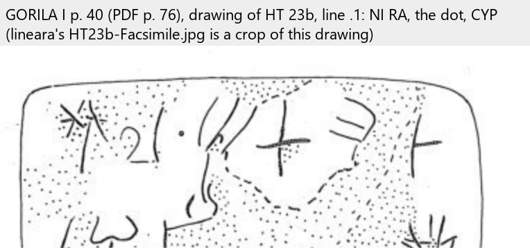

*GORILA I p. 40 (PDF p. 76), drawing of HT 23b, line .1: NI RA, a dot, CYP. `HT23b-Facsimile.jpg` is a crop of this drawing.* (GORILA I (L. Godart and J.-P. Olivier 1976), © École française d'Athènes)

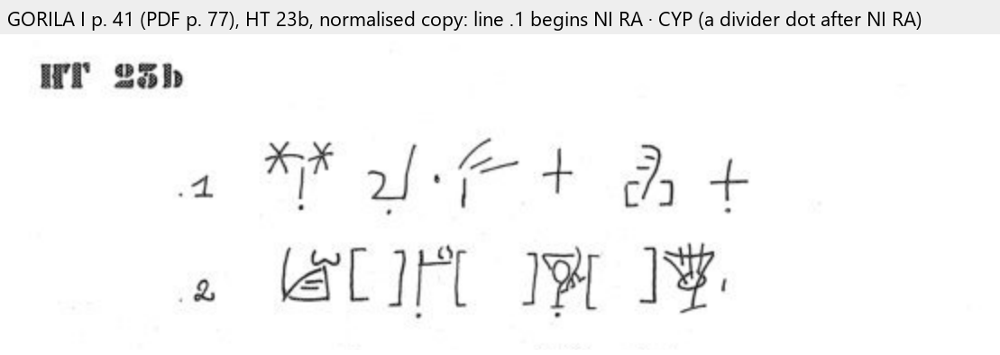

*GORILA I p. 41 (PDF p. 77), HT 23b, normalised copy: line .1 begins NI RA · CYP.* (GORILA I (L. Godart and J.-P. Olivier 1976), © École française d'Athènes)

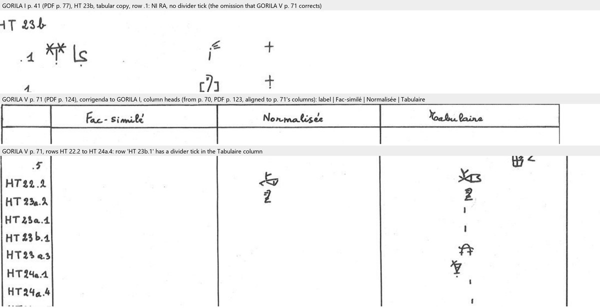

*Top: GORILA I p. 41, tabular copy, row .1: NI RA without a tick. Bottom: GORILA V p. 71 (PDF p. 124), corrigenda to volume I (columns Fac-similé, Normalisée, Tabulaire; the headings are those of p. 70): the row HT 23b.1 adds a divider tick in the Tabulaire column.* (GORILA I and V (L. Godart and J.-P. Olivier 1976, 1985), © École française d'Athènes)

### HT128a — divider after PA-RA missing

On master HT128a keeps the divider after \*326 on line a.1 but has none after PA-RA (`words` 3 is followed by the line break). The normalised copy on GORILA I p. 221 (PDF p. 257) reads `.1 *326 · PA RA · TU RU NU SE ME`, and the tabular copy on the same page has `.1 PA RA !`, a divider tick underdotted as uncertain (this copy writes numerals as digits, so the mark is not a 1). GORILA's tabular copy thus marks the divider as uncertain, and its drawing (I p. 220, PDF p. 256) shows the surface damaged at that spot, with no dot drawn; the page notes that the tablet has been damaged since the first edition. Younger has `a.1 PA-RA •`. This PR inserts `𐄁` after PA-RA, before the line break (28 → 29 tokens), adds it to both glyph strings and gives both image maps a box-less `*900` entry (29 → 30 entries); the later word numbers move up by one and the explorer is unchanged.

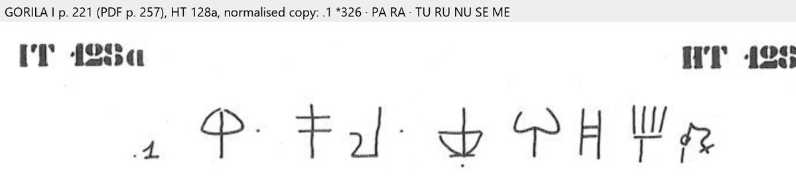

*GORILA I p. 221 (PDF p. 257), HT 128a, normalised copy: .1 \*326 · PA RA · TU RU NU SE ME.* (GORILA I (L. Godart and J.-P. Olivier 1976), © École française d'Athènes)

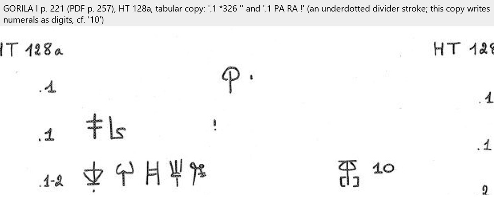

*Same page, tabular copy: '.1 \*326 '' and '.1 PA RA !', the second an underdotted (uncertain) divider tick; this copy writes numerals as digits (10), so the mark is not a 1.* (GORILA I (L. Godart and J.-P. Olivier 1976), © École française d'Athènes)

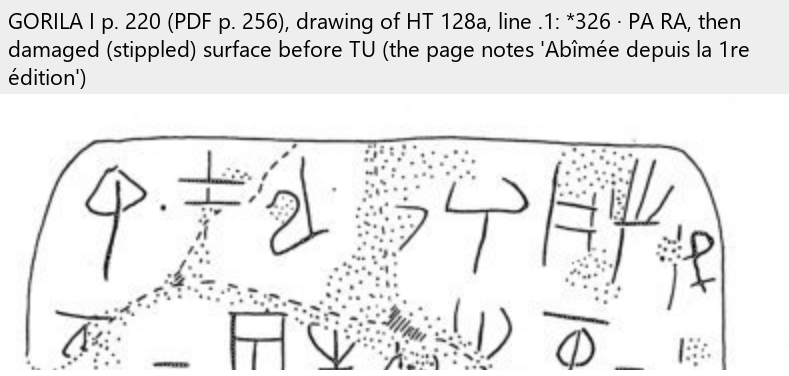

*GORILA I p. 220 (PDF p. 256), drawing of HT 128a, line .1: \*326 · PA RA, then damaged (stippled) surface before TU; the page notes 'Abîmée depuis la 1re édition'.* (GORILA I (L. Godart and J.-P. Olivier 1976), © École française d'Athènes)

### HT123+124b — divider before KA-NA missing

On master line b.4 of HT123+124b runs from the fraction J L2 straight into KA-NA. GORILA I p. 212 (PDF p. 248) draws a low dot after L2, before KA, which `HT123+124b-Facsimile.jpg`, a crop of that drawing, also shows; the normalised copy on GORILA I p. 213 (PDF p. 249) reads `.4 J L2 · KA NA[ ]SI DU`, and the tabular copy leaves an empty row .4 between `.3-4 … J L2` and `.4 KA NA[`, where GORILA V p. 74 (PDF p. 127), the corrigenda, puts a divider tick. Younger's second arrangement of side b has the row `b.4 •`; his main table, which the record follows row by row, leaves it out. This PR adds the divider on a line of its own between the fraction and KA-NA, as GORILA's tabular row and Younger's row have it (the site has such lines in HT140, KNWb51 and MI2): the line break after the fraction becomes line break, `𐄁`, line break in the three word arrays (36 → 38 tokens) and in `parsedInscription`, and the transcription's physical line .4 becomes `𐝆𐝉𐄁𐘾𐘅`. Both image maps get a box-less `*900` entry (43 → 44 entries), the later word numbers move up by one, and no box moves. A second divider, on line b.3, is an optional change in the tenth commit (see [HT123+124b — divider after \*188-DU in the transcription](#ht123124b--divider-after-188-du-in-the-transcription)).

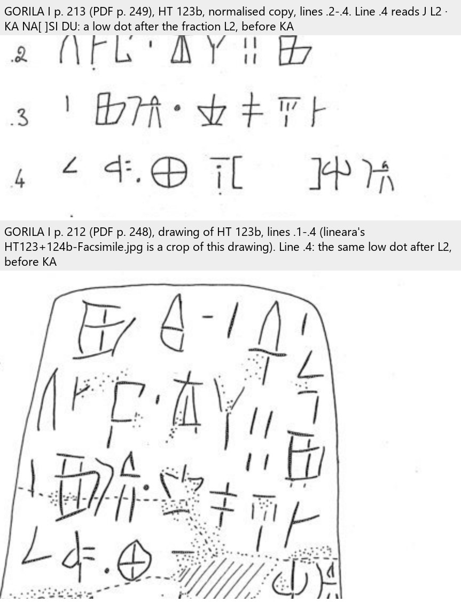

*Top: GORILA I p. 213 (PDF p. 249), HT 123b, normalised copy, lines .2–.4; line .4 reads J L2 · KA NA[ ]SI DU, a low dot after the fraction. Bottom: GORILA I p. 212 (PDF p. 248), the drawing (`HT123+124b-Facsimile.jpg` is a crop of it), with the same dot after L2, before KA.* (GORILA I (L. Godart and J.-P. Olivier 1976), © École française d'Athènes)

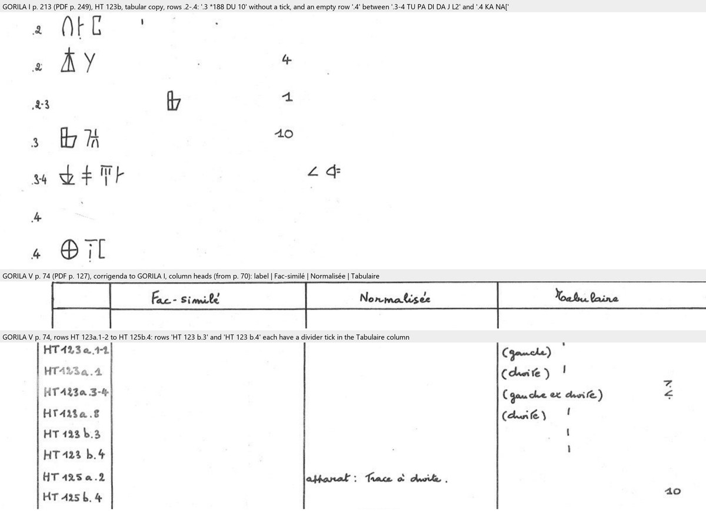

*Top: GORILA I p. 213, tabular copy, rows .2–.4: '.3 \*188 DU 10' without a tick, and an empty row .4 between '.3-4 TU PA DI DA J L2' and '.4 KA NA['. Bottom: GORILA V p. 74 (PDF p. 127), corrigenda to volume I: the rows HT 123 b.3 and b.4 each add a divider tick in the Tabulaire column.* (GORILA I and V (L. Godart and J.-P. Olivier 1976, 1985), © École française d'Athènes)

### HT33 — trace and divider before SA-RA₂ missing

On master every text field of HT33 begins with SA-RA₂. At the broken left edge of line .1, GORILA I p. 62 (PDF p. 98) draws a trace stroke and a dot before SA, which the site's `HT33-Facsimile.jpg` shows without boxes; GORILA I p. 63 (PDF p. 99) reads `.1 ] · SA RA2 · *401VAS+*304`, its apparatus notes 'Trace à gauche', and its tabular copy has a row `.1 ]vest. '` before `.1 SA RA2 ' …`. Younger has the rows `.1 ]vest. •` and `.1 SA-RA2 • *401VAS+*304`. This PR puts a trace-only token `𐝫`, a `𐄁` and a line break before SA-RA₂ in the three word arrays (27 → 30 tokens), as the site writes KH83's `] •` row, and `𐝫𐄁` before both glyph strings (with a line break in `parsedInscription`). Both image maps get a box-less `*900` entry as word 0 and every other word moves up by one; the trace-only token has no word number, and the explorer is unchanged. In `annotations.js` SA-RA₂ is no longer tagged as the record's head word, under the site's own rule (the head word is token 0, never a trace or a divider).

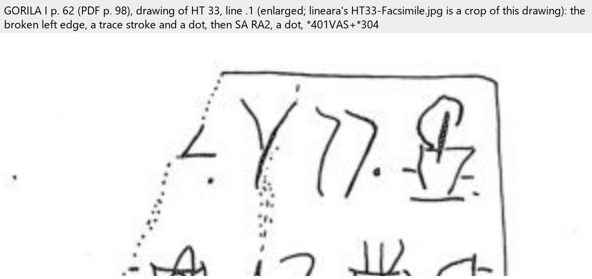

*GORILA I p. 62 (PDF p. 98), drawing of HT 33, line .1, enlarged (`HT33-Facsimile.jpg` is a crop of this drawing): the broken left edge, a trace stroke and a dot, then SA RA₂, a dot, \*401VAS+\*304.* (GORILA I (L. Godart and J.-P. Olivier 1976), © École française d'Athènes)

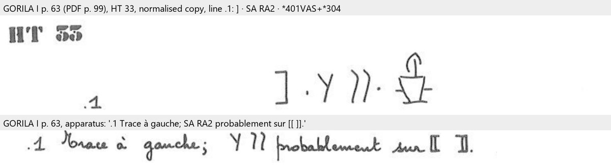

*GORILA I p. 63 (PDF p. 99), HT 33, normalised copy of line .1, '] · SA RA2 · \*401VAS+\*304', and the apparatus: '.1 Trace à gauche; SA RA2 probablement sur [[ ]]'.* (GORILA I (L. Godart and J.-P. Olivier 1976), © École française d'Athènes)

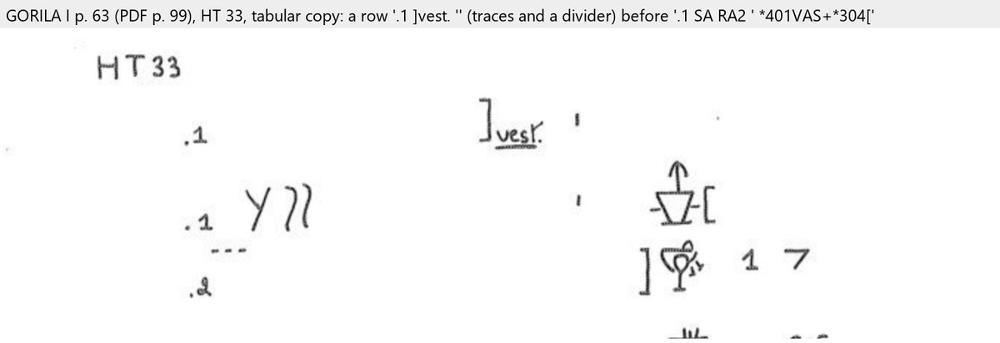

*Same page, tabular copy: a row '.1 ]vest. '' (traces and a divider) before '.1 SA RA2 ' \*401VAS+\*304['.* (GORILA I (L. Godart and J.-P. Olivier 1976), © École française d'Athènes)

### MA1a — divider after X I-DU-WI missing

On master MA1a's word arrays and `parsedInscription` run I-DU-WI straight into \*47, while the record's own transcription has the divider (`𐄂𐘚𐘬𐘣𐄁𐘨…`). GORILA I p. 268 (PDF p. 304) shows a short stroke between WI and \*47 in the photograph and in the drawing; GORILA I p. 269 (PDF p. 305) reads `X I DU WI · *47 · QE DE MI NU ·` in the normalised copy and `.1 X I DU WI · *47 ·` in the tabular copy, and Younger has `a.1 X I-DU-WI • *47`. In the site's `MA1a-Facsimile.jpg` the stroke lies just inside the right edge of WI's box. This PR inserts `𐄁` after WI in the three word arrays (5 → 6 tokens) and in `parsedInscription`; both image maps get a box-less `*900` entry (10 → 11 entries) and the later word numbers move up by one. The second divider, after \*47, which GORILA has and Younger does not, is an optional change in the tenth commit (see [MA1a — divider after \*47](#ma1a--divider-after-47)).

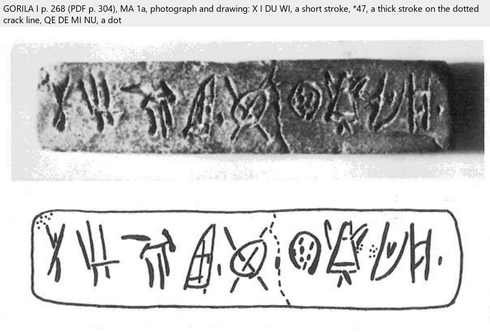

*GORILA I p. 268 (PDF p. 304), MA 1a, photograph and drawing: X I DU WI, a short stroke, \*47, a thick stroke on the dotted crack line, QE DE MI NU, a dot.* (GORILA I (L. Godart and J.-P. Olivier 1976), © École française d'Athènes)

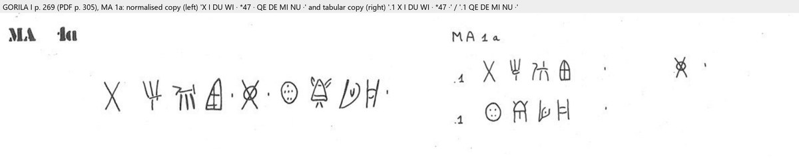

*GORILA I p. 269 (PDF p. 305), MA 1a: normalised copy (left) 'X I DU WI · \*47 · QE DE MI NU ·' and tabular copy (right) '.1 X I DU WI · \*47 ·' / '.1 QE DE MI NU ·'.* (GORILA I (L. Godart and J.-P. Olivier 1976), © École française d'Athènes)

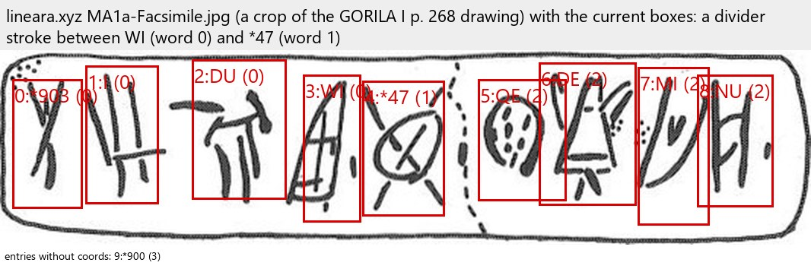

*`MA1a-Facsimile.jpg` with its boxes before this commit: the stroke between WI (word 0) and \*47 (word 1) lies just inside the right edge of WI's box (entry 3).* (lineara.xyz image `MA1a-Facsimile.jpg`, a crop of the GORILA I p. 268 drawing, © École française d'Athènes; boxes from `items_image_map.js`)

### ZAZb3 — dividers after DI-DI-KA-SE and A-SA-MU-NE missing

On master the word arrays and `parsedInscription` of ZAZb3's line .1 run DI-DI-KA-SE, A-SA-MU-NE and A-SE together without dividers, while the record's own transcription has both (`𐘆𐘆𐘾𐘈𐄁𐘇𐘞𐘕𐘗𐄁𐘇𐘈`). GORILA IV p. 113 (PDF p. 156) reads `VIN 32 DI DI KA SE · A SA MU NE · A SE` in both copies, and Younger has `.1: VINa 32 DI-DI-KA-SE • A-SA-MU-NE • A-SE`. This PR inserts the two dividers in the three word arrays (12 → 14 tokens) and in `parsedInscription`, which then equals the transcription; both image maps get two box-less `*900` entries (29 → 31 entries) and the later word numbers follow. No box moves.

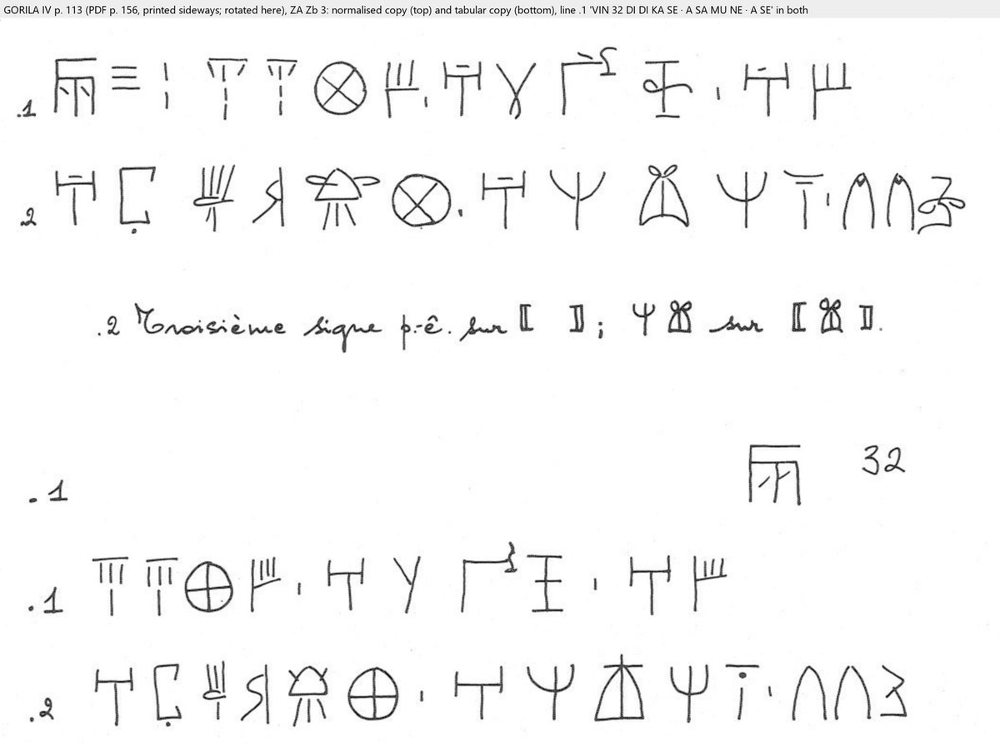

*GORILA IV p. 113 (PDF p. 156, printed sideways and turned here), ZA Zb 3, normalised copy (top) and tabular copy (bottom): line .1 'VIN 32 DI DI KA SE · A SA MU NE · A SE' in both.* (GORILA IV (L. Godart and J.-P. Olivier 1982), © École française d'Athènes)

### PKZa12 — RA-ME and two dividers on the wrong lines

On master PKZa12's word arrays put both dividers of face c on a line of their own and RA-ME on face c's line: `… SI, line break, 𐄁, 𐄁, line break, RA-ME, A-NE, U-NA-RU-KA-JA-SI …`. GORILA IV p. 38 (PDF p. 81) has RA-ME on face b (`]SI-[ ]RA ME[`) and face c as `A[ ]-NE ! U NA RU KA[ ]JA SI`, with a divider after JA-SI in the continuous copy (the `!` is an underdotted divider); Younger reads `b: … ]RA-ME[` and `c: ]A-[ 2? ]-NE • U-NA-RU-KA[ 1? ]JA-SI •` (the small numbers are his estimates of lost signs), and the record's own `parsedInscription` has the same lines. This PR reorders the seven tokens to `RA-ME, line break, A-NE, 𐄁, U-NA-RU-KA-JA-SI, 𐄁, line break` in the three word arrays; no token is added or removed. The transcription does not change, and `parsedInscription` loses only a stray `𐄇` (1) between the two trace marks of U-NA-RU-KA … JA-SI, Younger's estimate `1?` taken for a numeral; GORILA has a lacuna there, and neither the words nor the transcription have the 1. In `PKZa12-Facsimile` only word numbers change, since its divider entries already stood after NE and after SI (`PKZa12-Inscription` has no entries). The tabulation in `supplement.json`, rebuilt from the new words, now numbers the words as the record does, and the item page keeps its four lines (with the 1 left in, the notebook's line tracking would stop after face c).

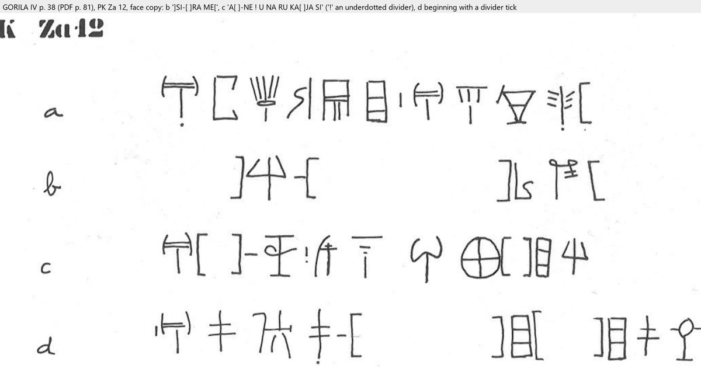

*GORILA IV p. 38 (PDF p. 81), PK Za 12, copy by face: b ']SI-[ ]RA ME[', c 'A[ ]-NE ! U NA RU KA[ ]JA SI' ('!' is an underdotted divider), d beginning with a divider tick.* (GORILA IV (L. Godart and J.-P. Olivier 1982), © École française d'Athènes)

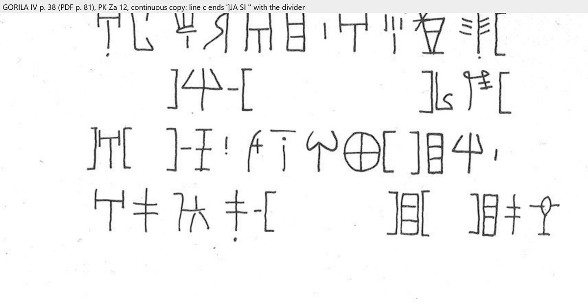

*Same page, continuous copy: line c ends ']JA SI '' with the divider.* (GORILA IV (L. Godart and J.-P. Olivier 1982), © École française d'Athènes)

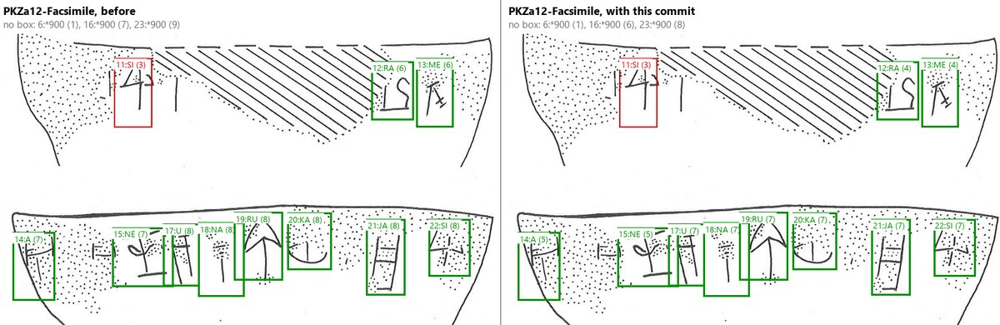

*`PKZa12-Facsimile`, faces b and c, before (left) and with this commit (right); the box-less divider entries are listed under each panel. Only word numbers change (green): RA and ME 6 → 4, A and NE 7 → 5, U to SI 8 → 7, and the two divider entries 7 → 6 and 9 → 8, now right after A-NE and U-NA-RU-KA-JA-SI. No box moves.* (lineara.xyz images `PKZa12-Facsimile.jpg`, crops of GORILA plates, © École française d'Athènes; boxes from `items_image_map.js` before and with this commit)

### HT37 — one divider written twice

On master every text field of HT37 has two dividers in a row between KA-KI and SU on line .1 (`words` 4 and 5). GORILA I p. 70 (PDF p. 106) draws one dot between KI and SU, as `HT37-Facsimile.jpg` shows; GORILA I p. 71 (PDF p. 107) reads `.1 MI+JA+I · KA KI · SU[` and `.1 KA KI ' SU[` with one divider, and Younger has `.1 KA-KI • SU[`. This PR removes the second `𐄁` from the three word arrays (31 → 30 tokens) and from both glyph strings, and drops the second of the two box-less `*900` entries from both image maps (28 → 27 entries); the later word numbers move down by one.

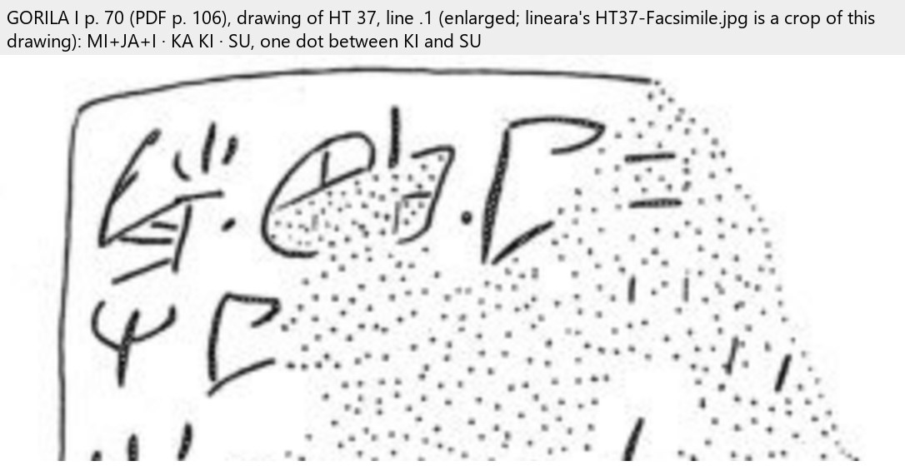

*GORILA I p. 70 (PDF p. 106), drawing of HT 37, line .1, enlarged (`HT37-Facsimile.jpg` is a crop of this drawing): MI+JA+I · KA KI · SU, one dot between KI and SU.* (GORILA I (L. Godart and J.-P. Olivier 1976), © École française d'Athènes)

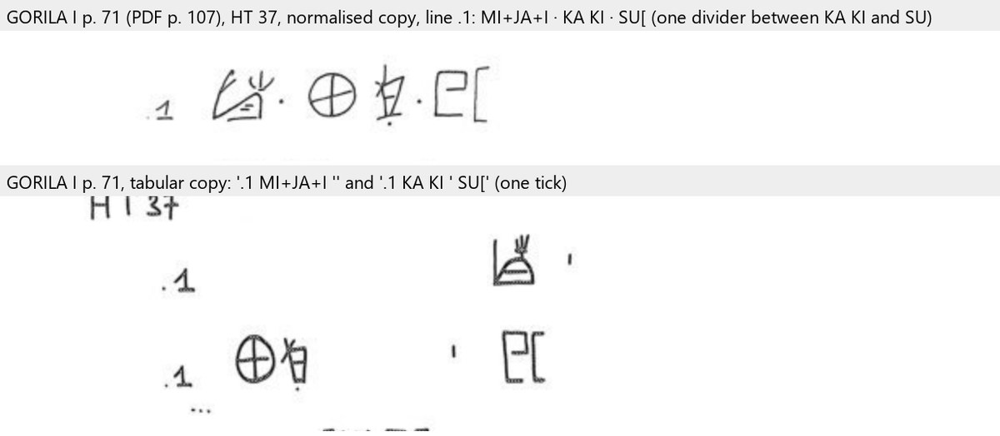

*GORILA I p. 71 (PDF p. 107), HT 37 line .1: normalised copy 'MI+JA+I · KA KI · SU[' and tabular copy '.1 KA KI ' SU[', one divider each.* (GORILA I (L. Godart and J.-P. Olivier 1976), © École française d'Athènes)

### IOZa2 — TU written twice in the transcription

On master the transcription of IOZa2 writes JA-DI-KI-TU with two TU (`𐘱𐘆𐘸𐘹𐘹𐄁`), while its `words`, its `parsedInscription`, GORILA V pp. 18–19 (PDF pp. 71–72) and Younger (`• JA-DI-KI-TU •`) have one. This PR removes the second TU from the transcription, which then equals `parsedInscription`. No other field, map or explorer area changes.

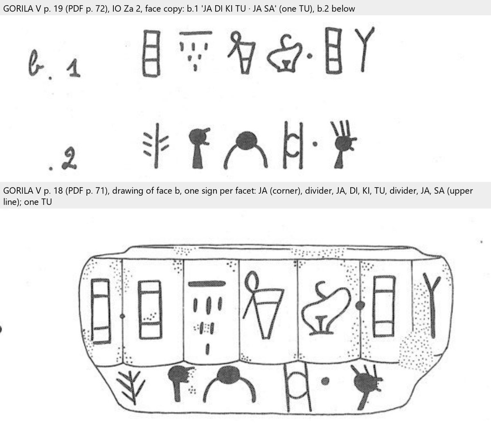

*Top: GORILA V p. 19 (PDF p. 72), IO Za 2, copy of face b: b.1 'JA DI KI TU · JA SA', one TU. Bottom: GORILA V p. 18 (PDF p. 71), drawing of face b, one sign per facet: JA, divider, JA DI KI TU, divider, JA SA.* (GORILA V (L. Godart and J.-P. Olivier 1985), © École française d'Athènes)

### HT23a — the wrong cup signs on line .3

On master line .3 of HT23a stores the cup with RE (A508, `QA2+[?]+RE`) and then the cup with RE and PU (A509, `QA2+[?]+RE+PU`), each followed by 10. GORILA I p. 41 (PDF p. 77) shows, in both copies, the cup with PU first and the cup with RE second; GORILA V p. XXIV (PDF p. 25) defines A 508 = 16+[?]+27, A 509 = 16+[?]+27+50 and A 510 = 16+[?]+50, and its index (V p. 173, PDF p. 226) gives HT 23a.3 A 508 and A 510, while A 509 occurs only at HT 45b.1. The corrigenda (V p. 71, PDF p. 124) change only the E of this line. Younger reads the same two cups (`QA+[?]+PU`, `QA+[?]+RE`) but numbers them `*508` and `*509`. HT23b already stores this pair as `𐚻` `QA2+[?]+PU` and `𐚹` `QA2+[?]+RE`. This PR stores A510 and A508 at the two places (`words` 23 and 26, and the same two characters of both glyph strings), labels them `QA2+[?]+PU` and `QA2+[?]+RE` in `transliteratedWords` and in both image maps (entries 17 and 19); `translatedWords` stays 'liquid?'.

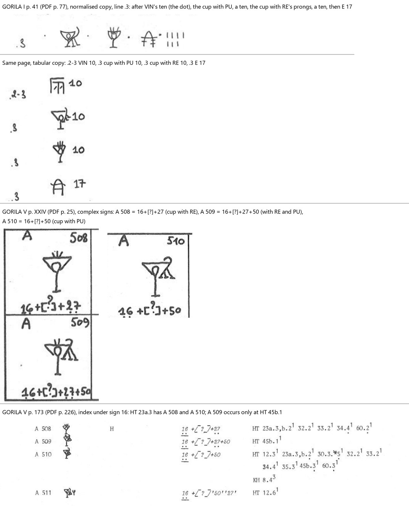

*GORILA I p. 41 (PDF p. 77), HT 23a line .3, normalised and tabular copies: the cup with PU (loop, hook and two legs) 10, then the cup with RE's prongs 10, then E 17. GORILA V p. XXIV (PDF p. 25): A 508 = 16+[?]+27 (with RE), A 509 = 16+[?]+27+50 (with RE and PU), A 510 = 16+[?]+50 (with PU). GORILA V p. 173 (PDF p. 226): HT 23a.3 has A 508 and A 510; A 509 occurs only at HT 45b.1.* (GORILA I and V (L. Godart and J.-P. Olivier 1976, 1985), © École française d'Athènes)

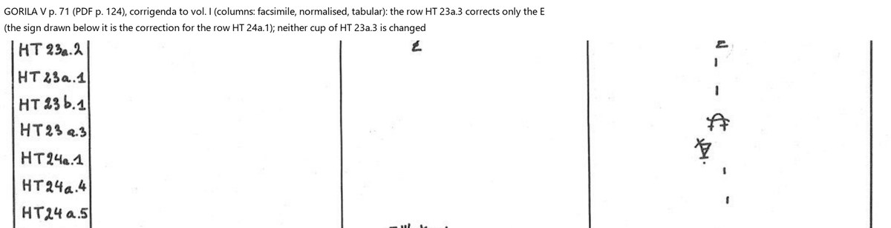

*GORILA V p. 71 (PDF p. 124), corrigenda to volume I: the row HT 23a.3 corrects only the E (the sign below it belongs to the row HT 24a.1); neither cup is changed.* (GORILA V (L. Godart and J.-P. Olivier 1985), © École française d'Athènes)

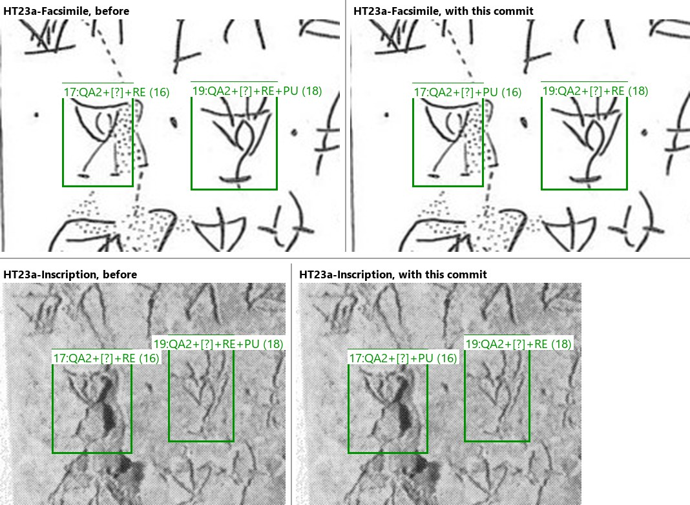

*Entries 17 and 19 of both HT23a maps, before (left) and with this commit (right): the legged cup becomes QA2+[?]+PU and the pronged cup QA2+[?]+RE. Boxes and word numbers do not change.* (lineara.xyz images `HT23a-Facsimile.jpg`, `HT23a-Inscription.jpg`, crops of GORILA plates, © École française d'Athènes; boxes from `items_image_map.js` before and with this commit)

### HT82 — the vase with 304 stored as another sign

On master line .2 of HT82 stores A628 (`*304+[ ]`, the arrow 304 over a damaged sign). GORILA I p. 129 (PDF p. 165) prints the line as `] 304 E[` in both copies, but GORILA V p. 73 (PDF p. 126), the corrigenda, corrects both copies to the vase with 304, underdotted; GORILA V p. XXVI (PDF p. 27) defines A 653 = 401VAS+304, and its index (V p. 287, PDF p. 340) lists A 653 at HT 33.1, HT 82.2 and KH 12.3, and A 628 only at KH 37. Younger has `b. *400VAS+*304 {*653} E[`. The site already writes A653 as `𐜫` `*401+*304` on HT33 and KH12. This PR stores `𐝫𐜫` at that place, with the site's break mark for the break that GORILA prints before the sign (A628's own formula `]304+[·]` held that break), labels it `*401+*304` in both text arrays and in the label of entry 2 of both image maps, and changes `𐜜` to `𐝫𐜫` in both glyph strings. GORILA underdots the reading; the tabulation keeps its 'doubtful' status. Word numbers and explorer letters do not change.

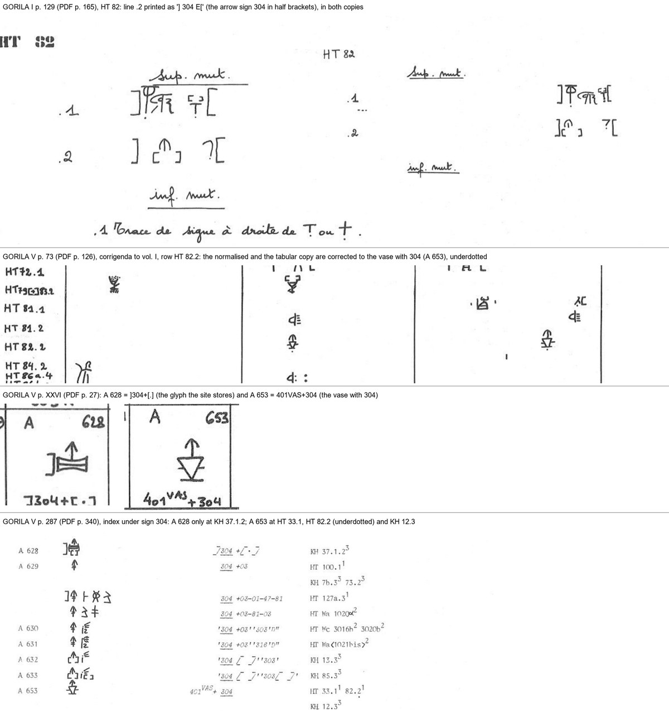

*GORILA I p. 129 (PDF p. 165): HT 82 line .2 printed as '] 304 E[' in both copies. GORILA V p. 73 (PDF p. 126), corrigenda, row HT 82.2: both copies corrected to the vase with 304, underdotted. GORILA V p. XXVI (PDF p. 27): A 628 = ]304+[·], the glyph the site stores, and A 653 = 401VAS+304. GORILA V p. 287 (PDF p. 340): A 628 only at KH 37.1.2; A 653 at HT 33.1, HT 82.2 and KH 12.3.* (GORILA I and V (L. Godart and J.-P. Olivier 1976, 1985), © École française d'Athènes)

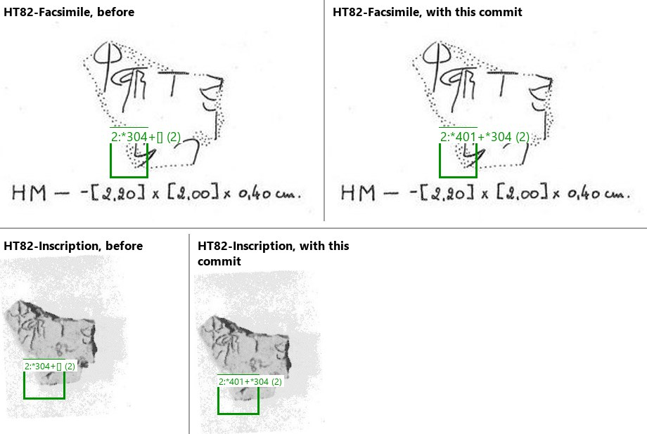

*Entry 2 of both HT82 maps, before and with this commit: '\*304+[]' → '\*401+\*304'. The box does not move.* (lineara.xyz images `HT82-Facsimile.jpg`, `HT82-Inscription.jpg`, crops of GORILA plates, © École française d'Athènes; boxes from `items_image_map.js` before and with this commit)

### KH31, KH91, MI2 — sign label `*401+RO` for 401VAS+RA

On master the vase sign A652 is labelled `*401+RO` on KH31, KH91 and MI2, and in the site's sign table (`items_analysis/syllables.txt`, `ideograms.js`, `tags.js`). GORILA V p. XXVI (PDF p. 27) defines A 652 = 401VAS+60, and sign 60 is RA in the site's own tables (RO is sign 02); GORILA V p. 241 (PDF p. 294) and p. 311 (PDF p. 364) list A 652 at KH 31.2, KH 91.4 and MI 2.3, and Younger reads `*401VAS+RA {*652}` on all three. The site labels the neighbouring A651 (401VAS+26) correctly as `*401+RU`. This PR labels the glyph `*401+RA` in both text arrays of the three records, in their image maps (KH31 entry 3, KH91 entry 15, MI2 entry 5) and in the three sign-table rows; its entry in the `ligatures` table of `LinearAInscriptions.js` names RA instead of RO, and `annotations.js` takes the new transliteration.

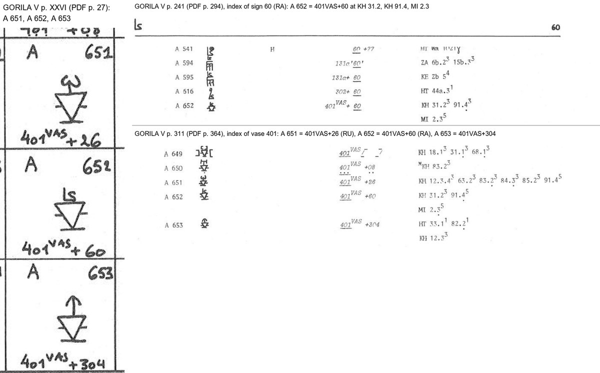

*GORILA V p. XXVI (PDF p. 27): A 651 = 401VAS+26 (RU), A 652 = 401VAS+60, A 653 = 401VAS+304. GORILA V p. 241 (PDF p. 294), index of sign 60 (the site's RA), and p. 311 (PDF p. 364), index of 401VAS: A 652 at KH 31.2, KH 91.4 and MI 2.3.* (GORILA V (L. Godart and J.-P. Olivier 1985), © École française d'Athènes)

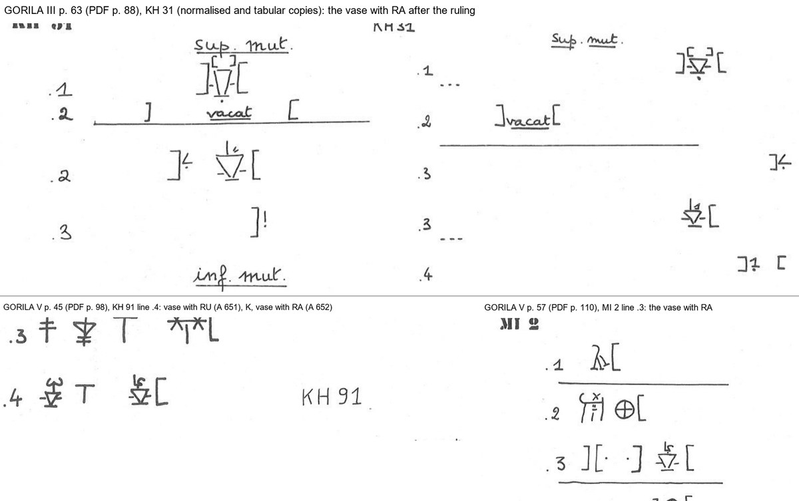

*The vase with RA in its three records: GORILA III p. 63 (PDF p. 88), KH 31, both copies; GORILA V p. 45 (PDF p. 98), KH 91 line .4, after the vase with RU (A 651) and K; GORILA V p. 57 (PDF p. 110), MI 2 line .3.* (GORILA III and V (L. Godart and J.-P. Olivier 1976, 1985), © École française d'Athènes)

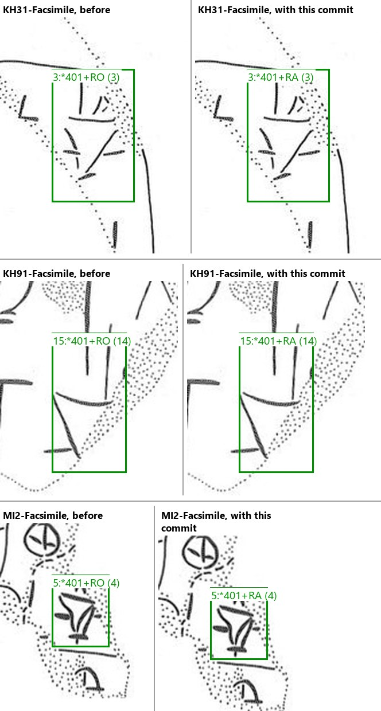

*The A652 box of each drawing, before and with this commit: '\*401+RO' → '\*401+RA' (KH31 entry 3, KH91 entry 15, MI2 entry 5; the photo maps change the same way). Boxes and word numbers do not change.* (lineara.xyz images `KH31-Facsimile.jpg`, `KH91-Facsimile.jpg`, `MI2-Facsimile.jpg`, crops of GORILA plates, © École française d'Athènes; boxes from `items_image_map.js` before and with this commit)

### MA10b, HT39, PH8a — vase labels that name the wrong vessel

On master three vase signs carry labels that name another vessel, in the records and in the site's sign table: A654 on MA10b is `*402+A`, A657 on HT39 `*414+A` and A663 on PH8a `*416+L2`. GORILA V p. XXIII (PDF p. 24) draws 402VAS as a plain beaker and 404VAS as a cup with a handle, 414VAS as a jug and 407VAS as a basin with two ring handles, 416VAS as a lidded jar and 417VAS as a hatched basket; GORILA V pp. XXVI–XXVII (PDF pp. 27–28) define A 654 = 404VAS+08, A 657 = 407VAS+08 and A 663 = 417VAS'L2', and the copies show the handled cup with A (MA 10b.2, V p. 52, PDF p. 105), the ring-handled basin with A (HT 39.5, I p. 75, PDF p. 111) and the hatched basket with L2 (PH 8a.1, I p. 297, PDF p. 333); 416VAS occurs only at HT 31.3 (V p. 315, PDF p. 368). Younger reads `*404VAS+A`, `*407VAS+A` and `*417VAS+L2`. This PR labels the glyphs `*404+A`, `*407+A` and `*417+L2` (the site's own notation, as its correct rows `*401+RU` and `*418+L2`) in both text arrays, the image maps (MA10b entry 10, HT39 entry 17, PH8a entry 0) and the three sign-table rows of each glyph, and their entries in the `ligatures` table name the vases 404VAS, 407VAS and 417VAS instead of 402VAS, 414VAS and 416VAS.

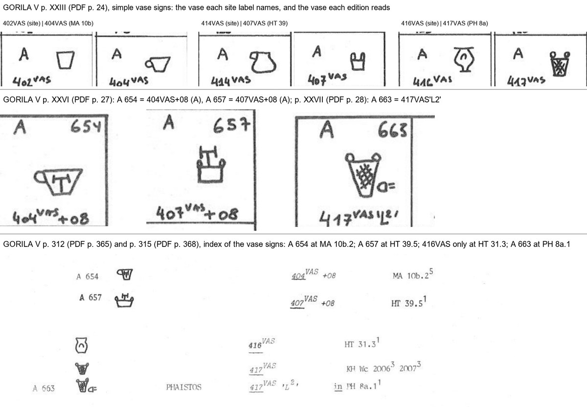

*GORILA V p. XXIII (PDF p. 24): the plain vases each wrong label names next to the vase each edition reads (402VAS | 404VAS, 414VAS | 407VAS, 416VAS | 417VAS). GORILA V pp. XXVI–XXVII (PDF pp. 27–28): A 654 = 404VAS+08 (A), A 657 = 407VAS+08, A 663 = 417VAS'L2'. GORILA V pp. 312 and 315 (PDF pp. 365, 368): A 654 at MA 10b.2, A 657 at HT 39.5, A 663 at PH 8a.1; 416VAS only at HT 31.3.* (GORILA V (L. Godart and J.-P. Olivier 1985), © École française d'Athènes)

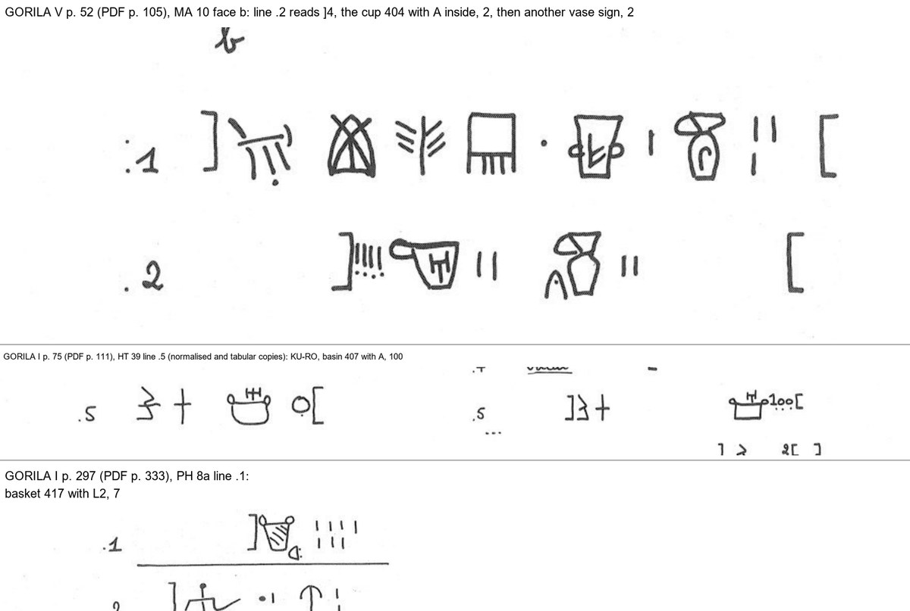

*GORILA V p. 52 (PDF p. 105), MA 10 face b line .2: the handled cup 404 with A inside, 2. GORILA I p. 75 (PDF p. 111), HT 39 line .5: KU-RO, the basin 407 with A, 100. GORILA I p. 297 (PDF p. 333), PH 8a line .1: the hatched basket 417 with L2, 7.* (GORILA I and V (L. Godart and J.-P. Olivier 1976, 1985), © École française d'Athènes)

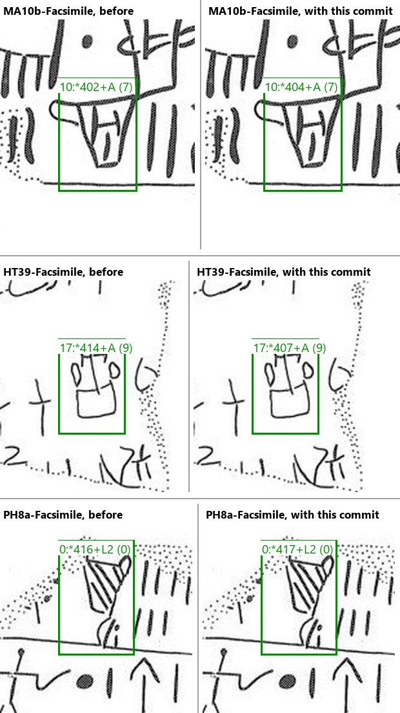

*The vase boxes of the three drawings, before and with this commit: MA10b entry 10 '\*402+A' → '\*404+A', HT39 entry 17 '\*414+A' → '\*407+A', PH8a entry 0 '\*416+L2' → '\*417+L2' (the photo maps change the same way). Boxes and word numbers do not change.* (lineara.xyz images `MA10b-Facsimile.jpg`, `HT39-Facsimile.jpg`, `PH8a-Facsimile.jpg`, crops of GORILA plates, © École française d'Athènes; boxes from `items_image_map.js` before and with this commit)

### HT85a, HT97a — sign label `*307+*387` for 307+307

On master the doubled sign A638 is labelled `*307+*387` on HT85a and HT97a (and in HT36's fused token, next item) and in the site's sign table. There is no sign 387: GORILA's 300-series of simple signs ends at A 371, and its table then goes on with the vases 400VAS–418VAS (V p. XXIII, PDF p. 24). GORILA V p. XXVI (PDF p. 27) defines A 638 = 307+307, two signs 307 side by side as the copies of HT 85a.1 (I p. 131, PDF p. 167) and HT 97a.1 (I p. 159, PDF p. 195) show, and its index (V p. 290, PDF p. 343) lists A 638 at HT 36.1, 85a.1 and 97a.1. Younger reads `*307+*307 {*638}`. This PR labels the glyph `*307+*307` in both text arrays, both image maps (entry 3) and the three sign-table rows, and its entry in the `ligatures` table, which joined 307 to '\*387', now joins 307 to 307.

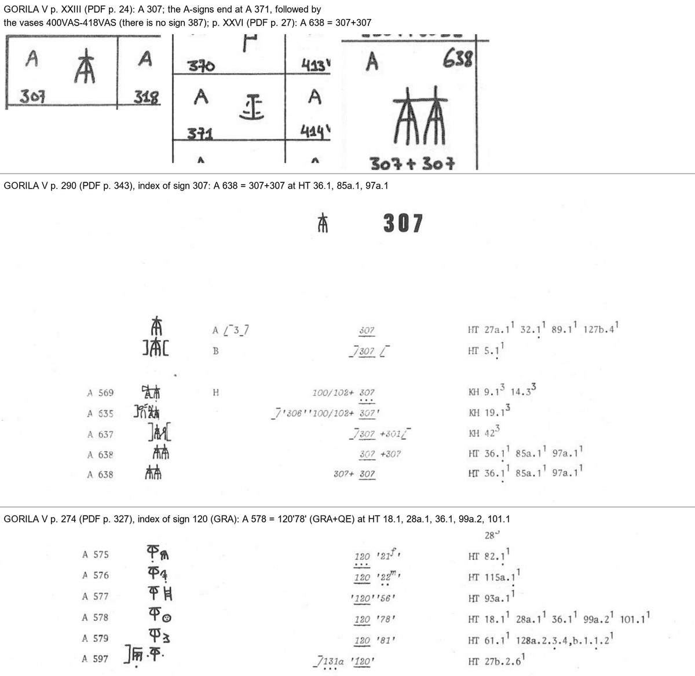

*GORILA V p. XXIII (PDF p. 24): A 307; the 300-series of simple signs ends at A 371, and the table goes on with the vases 400VAS–418VAS, so there is no sign 387. GORILA V p. XXVI (PDF p. 27): A 638 = 307+307. GORILA V p. 290 (PDF p. 343): A 638 at HT 36.1, 85a.1 and 97a.1. GORILA V p. 274 (PDF p. 327): A 578 = 120'78' (GRA+QE) at HT 18.1, 28a.1, 36.1, 99a.2 and 101.1.* (GORILA V (L. Godart and J.-P. Olivier 1985), © École française d'Athènes)

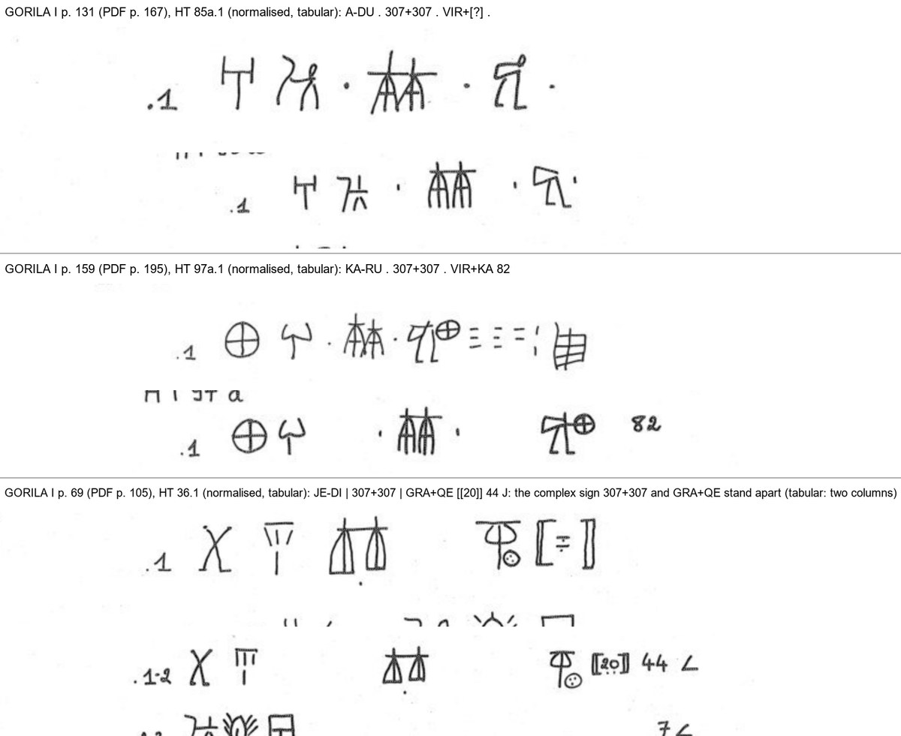

*GORILA I p. 131 (PDF p. 167), HT 85a.1, normalised and tabular copies: A-DU · 307+307 · VIR+[?] ·. GORILA I p. 159 (PDF p. 195), HT 97a.1: KA-RU · 307+307 · VIR+KA 82. GORILA I p. 69 (PDF p. 105), HT 36.1: JE-DI, 307+307 (the second 307 underdotted), GRA+QE [[20]] 44 J; in the tabular copy 307+307 and GRA+QE stand in two columns.* (GORILA I (L. Godart and J.-P. Olivier 1976), © École française d'Athènes)

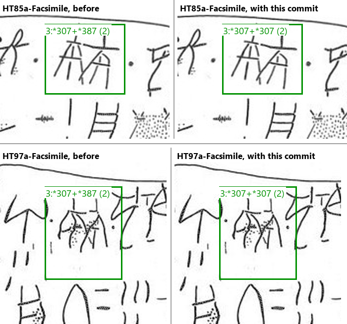

*Entry 3 of the HT85a and HT97a drawings, before and with this commit: '\*307+\*387' → '\*307+\*307' (the photo maps change the same way). Boxes and word numbers do not change.* (lineara.xyz images `HT85a-Facsimile.jpg`, `HT97a-Facsimile.jpg`, crops of GORILA plates, © École française d'Athènes; boxes from `items_image_map.js` before and with this commit)

### HT36 — two signs fused into one word

On master token 1 of HT36 fuses the complex sign 307+307 (A638) and the grain sign GRA+QE (A578) into one word, `𐜠𐛱` `*307+*387-GRA+QE`, which `annotations.js` tags as a unique word and a place name. GORILA I p. 69 (PDF p. 105) reads `JE DI 307+307 GRA+QE [[20]]` and sets 307+307 and GRA+QE in two columns of its tabular copy; GORILA V numbers them apart (A 638, V p. 290; A 578, V p. 274), and Younger reads `*307+*307 {*638} GRA+QE {*578} [[20]] 44 J`, two signs with two numbers. Elsewhere the site writes A638 alone (HT85a, HT97a) and GRA+QE alone, glossed 'grain' (HT18, HT28a, HT99a, HT101). This PR splits the token into `𐜠` `*307+*307` and `𐛱` `GRA+QE` ('grain'), 13 → 14 tokens, in the direction of 9c81beb's splits of \*304+PA; both image maps relabel entry 2 and renumber the later entries, and no box moves. HT36 is issue #4; bcfb77a corrected its erasures.

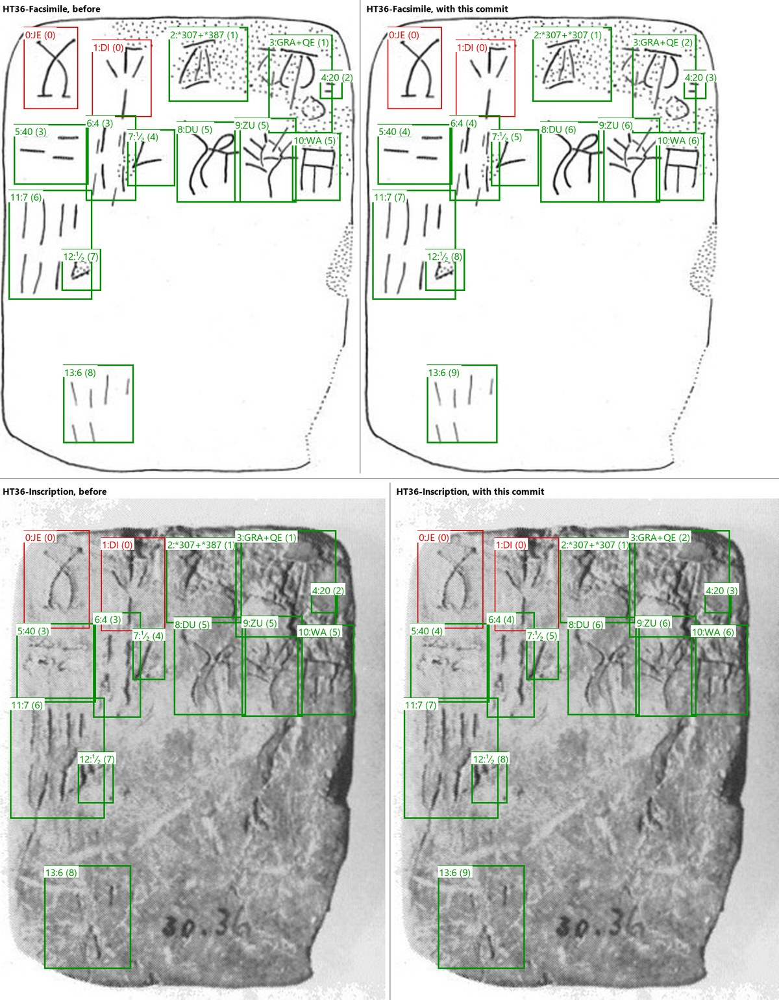

*Both HT36 maps, before and with this commit: entry 2 is relabelled '\*307+\*307', and GRA+QE (entry 3) and every later entry move up one word (green). No box moves.* (lineara.xyz images `HT36-Facsimile.jpg`, `HT36-Inscription.jpg`, crops of GORILA plates, © École française d'Athènes; boxes from `items_image_map.js` before and with this commit)

### HT120, HT86a, HT86b — sign label `GRA+K+L` for A584

On master the grain ligature A584 is labelled `GRA+K+L` on HT120, HT86a and the erased face HT86b (there `[[GRA+K+L]]`), and in the site's sign table. GORILA V p. XXV (PDF p. 26) gives A 584 = 120'KL²', GRA with K and an L-mark with two strokes, and its index (V p. 275, PDF p. 328) lists it at HT 86a.2, 86b ⟦.2⟧ and 120.2; the copies of GORILA I p. 205 (PDF p. 241) and p. 135 (PDF p. 171) draw the two strokes, and Younger reads `GRA+K+L2 {*584}`. The site writes the two-stroke mark L2 in its label of A585, `GRA+L2`. This PR labels the glyph `GRA+K+L2` in `transliteratedWords` of the three records (HT86b keeps the erasure brackets), in their image maps (HT120 entry 6, HT86a and HT86b entry 7) and in the three sign-table rows, and its entry in the `ligatures` table takes L2 instead of L; `translatedWords` stays 'grain'.

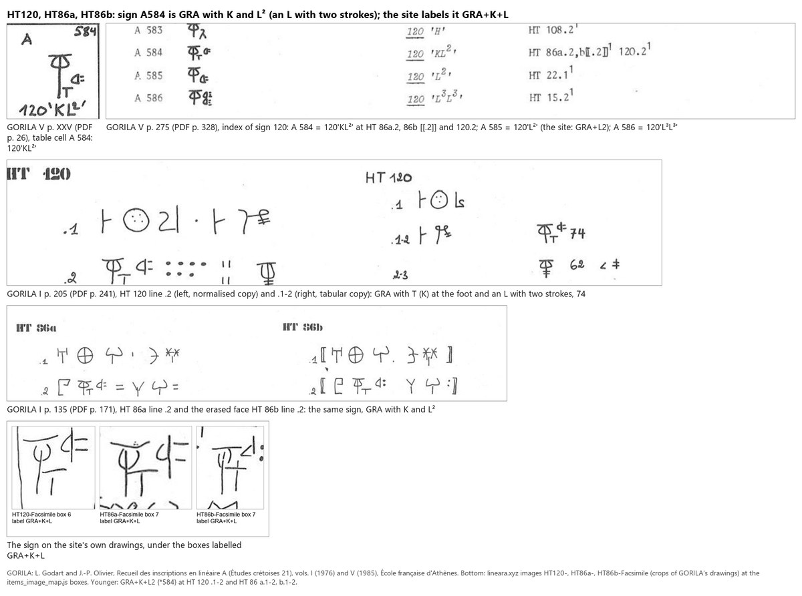

*GORILA V p. XXV (PDF p. 26), table cell A 584 = 120'KL²', and p. 275 (PDF p. 328), index of sign 120: A 584 at HT 86a.2, 86b ⟦.2⟧ and 120.2 (and A 585 = 120'L²', which the site labels GRA+L2). GORILA I p. 205 (PDF p. 241), HT 120 .2 and .1-2, and GORILA I p. 135 (PDF p. 171), HT 86a .2 and the erased HT 86b .2: GRA with K at the foot and an L-mark with two strokes. Bottom: the sign under the boxes labelled GRA+K+L on the site's drawings.* (GORILA I (L. Godart and J.-P. Olivier 1976) and GORILA V (L. Godart and J.-P. Olivier 1985), © École française d'Athènes; lineara.xyz images `HT120-Facsimile.jpg`, `HT86a-Facsimile.jpg`, `HT86b-Facsimile.jpg`, crops of GORILA's drawings)

### HT15 — sign label `GRA+L4+L4` for A586

On master the grain ligature A586 on HT15 is labelled `GRA+L4+L4`, two marks of four strokes. GORILA V p. XXV (PDF p. 26) gives A 586 = 120'L³L³', and its index (V p. 275, PDF p. 328) lists it at HT 15.2; GORILA I p. 31 (PDF p. 67) draws three strokes on each mark in its normalised copy, and Younger reads `GRA+L3L3 {*586}`. The site's drawing is too faint to count the strokes. This PR labels the glyph `GRA+L3+L3` in both text arrays, in both image maps (entry 10) and in the three sign-table rows, and its entry in the `ligatures` table takes L3 L3 instead of L4 L4.

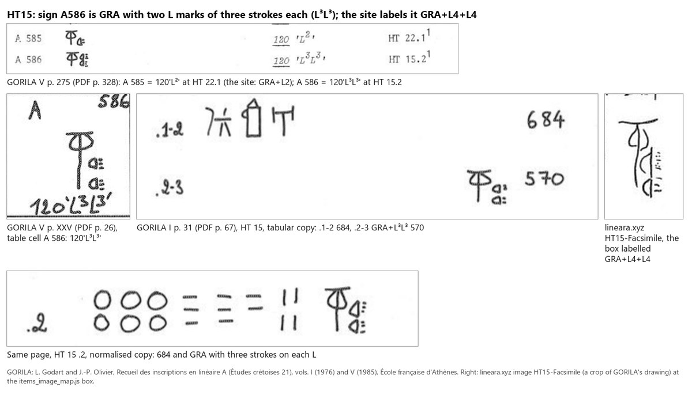

*GORILA V p. 275 (PDF p. 328): A 586 = 120'L³L³' at HT 15.2; GORILA V p. XXV (PDF p. 26), table cell A 586 with three strokes on each L-mark; GORILA I p. 31 (PDF p. 67), HT 15, tabular copy '.2-3 GRA+L³L³ 570' and normalised copy of line .2. Right: the box labelled GRA+L4+L4 on the site's drawing, whose strokes are too faint to count.* (GORILA I (L. Godart and J.-P. Olivier 1976) and GORILA V (L. Godart and J.-P. Olivier 1985), © École française d'Athènes; lineara.xyz image `HT15-Facsimile.jpg`, a crop of GORILA's drawing)

### HT115a — sign label `GRA+BOSm` for A576

On master the grain ligature A576 on HT115a is labelled `GRA+BOSm`, grain with a bull. GORILA V p. XXV (PDF p. 26) gives A 576 = 120'22ᵐ', grain with the male-goat sign 22ᵐ (the 22 underdotted), and files it under 22ᵐ next to A 513 = 22ᵐ'81', which the site labels `CAPm+KU` (V pp. 178, 274, PDF pp. 231, 327); GORILA I p. 189 (PDF p. 225) draws a hooked top with two crossbars, not an ox head, and Younger reads `GRA+*22m {*576}`. GORILA's underdot leaves the 22 uncertain, but neither edition reads a bull. This PR labels the glyph `GRA+CAPm`, the site's own name for 22ᵐ, in `transliteratedWords` (the erasure brackets that the first commit puts on other words of the record stay), in both image maps (entry 7) and in the three sign-table rows, and its entry in the `ligatures` table takes CAPm instead of BOSm.

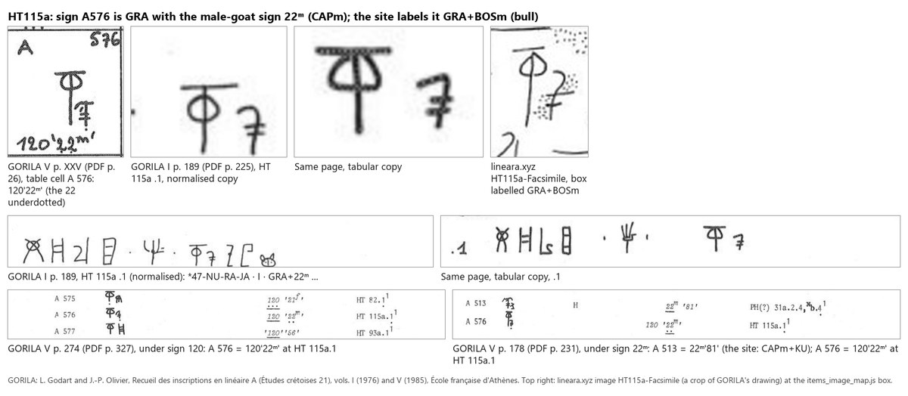

*GORILA V p. XXV (PDF p. 26), table cell A 576 = 120'22ᵐ' (the 22 underdotted); GORILA I p. 189 (PDF p. 225), HT 115a .1, normalised and tabular copies: GRA with 22ᵐ, a hooked top with two crossbars, not an ox head; GORILA V p. 274 (PDF p. 327), under sign 120, and p. 178 (PDF p. 231), under sign 22ᵐ: A 576 at HT 115a.1, next to A 513 = 22ᵐ'81' (the site's CAPm+KU). Top right: the box labelled GRA+BOSm on the site's drawing.* (GORILA I (L. Godart and J.-P. Olivier 1976) and GORILA V (L. Godart and J.-P. Olivier 1985), © École française d'Athènes; lineara.xyz image `HT115a-Facsimile.jpg`, a crop of GORILA's drawing)

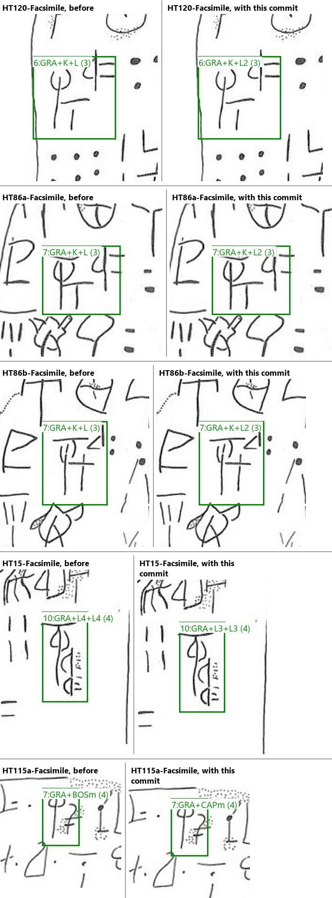

*The relabelled box of each drawing, before and with this commit: HT120 entry 6, HT86a and HT86b entry 7 'GRA+K+L' → 'GRA+K+L2'; HT15 entry 10 'GRA+L4+L4' → 'GRA+L3+L3'; HT115a entry 7 'GRA+BOSm' → 'GRA+CAPm' (the photo maps change the same way). Boxes and word numbers do not change.* (lineara.xyz images `HT120-Facsimile.jpg`, `HT86a-Facsimile.jpg`, `HT86b-Facsimile.jpg`, `HT15-Facsimile.jpg`, `HT115a-Facsimile.jpg`, crops of GORILA plates, © École française d'Athènes; boxes from `items_image_map.js` before and with this commit)

### HT24b — two complex signs joined to \*118

On master HT24b joins two complex signs to the logogram \*118 that follows each: token 4 `SI+ME-KI-*118` and token 8 `*539-*118`. GORILA V p. XX (PDF p. 21) defines the complex signs A 501–A 664 as signs that do not form sign groups worth words. GORILA I p. 43 (PDF p. 79) sets SI+ME KI and JA+KA in a column of their own and each \*118 with its number in the next, and GORILA V indexes A 531 (SI+ME KI) and A 539 (JA+KA) as complex signs and all three \*118 of the tablet as isolated logograms (V pp. 210, 259, 273). Younger writes each pair in one table cell separated by a space, not a hyphen: `SI+ME KI {*531} *118` and `JA+KA {*539} *118`. This PR splits both tokens, keeping the site's labels `SI+ME-KI` and `*539` and glossing the new \*118 tokens 'talent', as the site's other \*118; both image maps renumber the entries after each split, and no box moves.

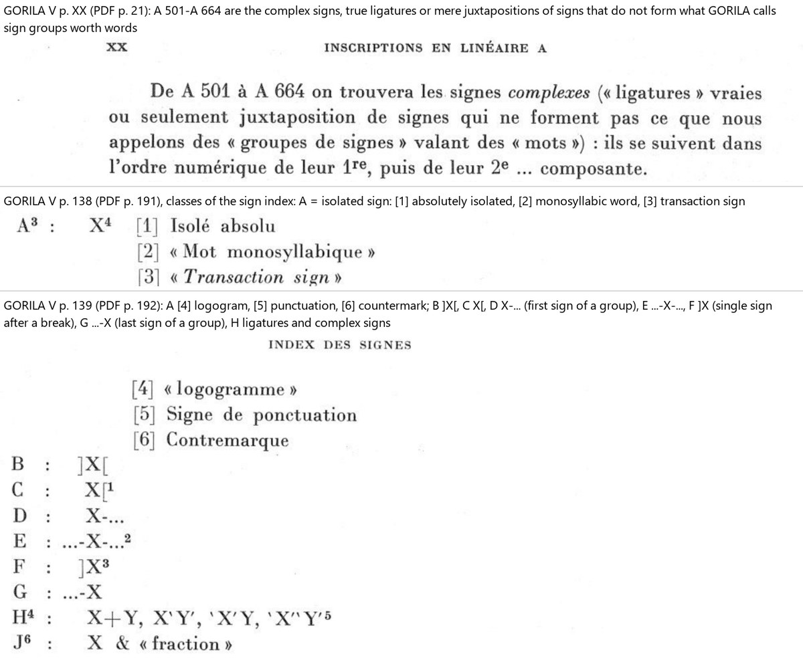

*GORILA V p. XX (PDF p. 21): A 501–A 664 are complex signs, true ligatures or juxtapositions of signs that do not form what GORILA calls 'groupes de signes' worth 'mots'. GORILA V pp. 138–139 (PDF pp. 191–192), the classes of the sign index: A isolated sign ([3] transaction sign, [4] logogram), D first sign of a group, F ]X, G last sign of a group, H complex signs.* (GORILA V (L. Godart and J.-P. Olivier 1985), © École française d'Athènes)

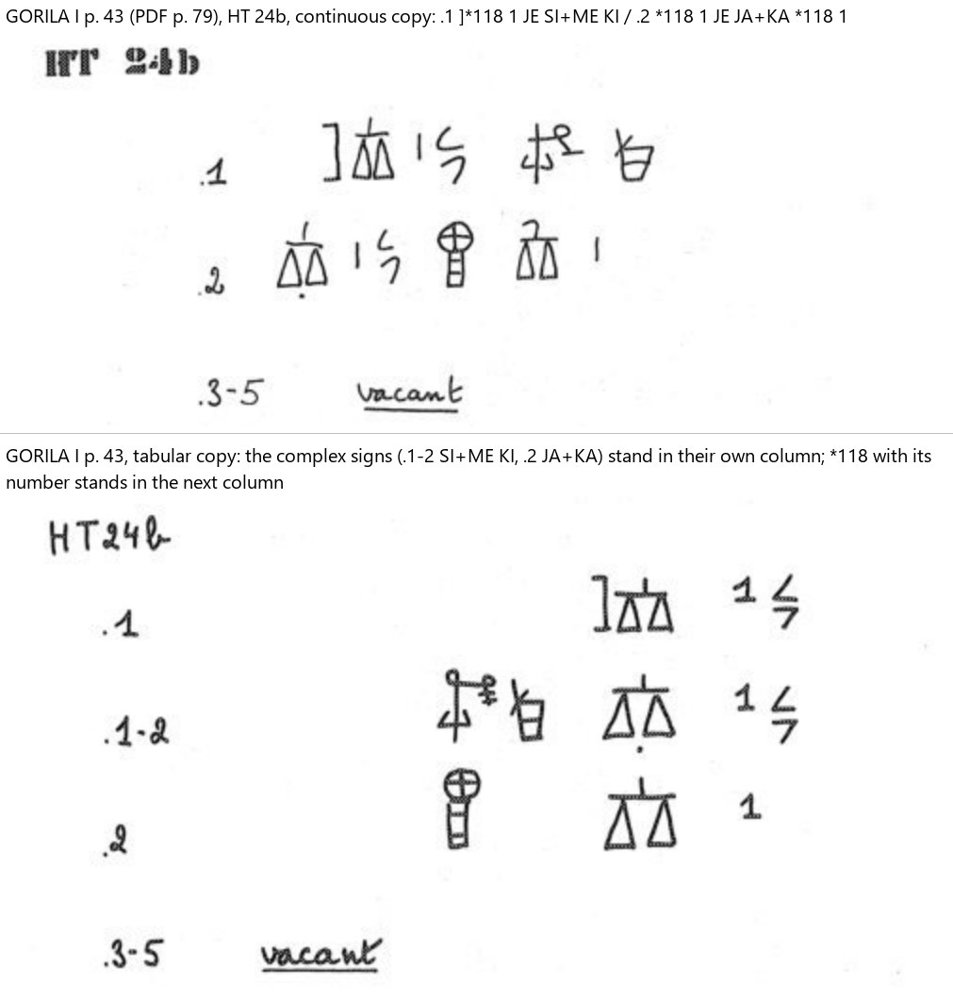

*GORILA I p. 43 (PDF p. 79), HT 24b: continuous copy (.1 ]\*118 1 JE SI+ME KI, .2 \*118 1 JE JA+KA \*118 1) and tabular copy, where the complex signs stand in their own column and each \*118 with its number in the next.* (GORILA I (L. Godart and J.-P. Olivier 1976), © École française d'Athènes)

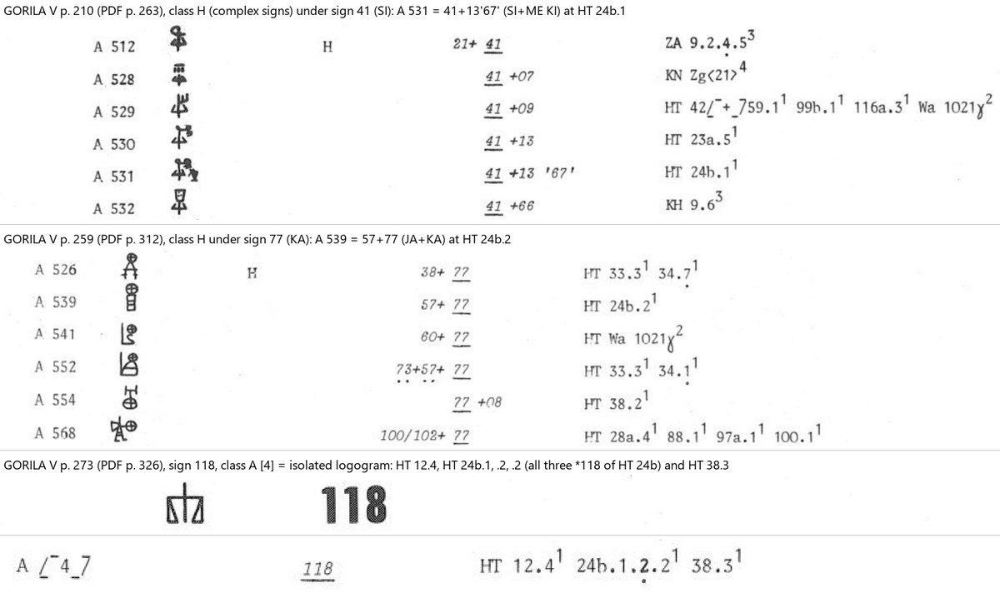

*GORILA V p. 210 (PDF p. 263): A 531 = 41+13'67' (SI+ME KI) at HT 24b.1; p. 259 (PDF p. 312): A 539 = 57+77 (JA+KA) at HT 24b.2, both class H; p. 273 (PDF p. 326): sign 118 in class A [4], isolated logogram, at HT 24b.1, .2, .2, all three \*118 of the tablet.* (GORILA V (L. Godart and J.-P. Olivier 1985), © École française d'Athènes)

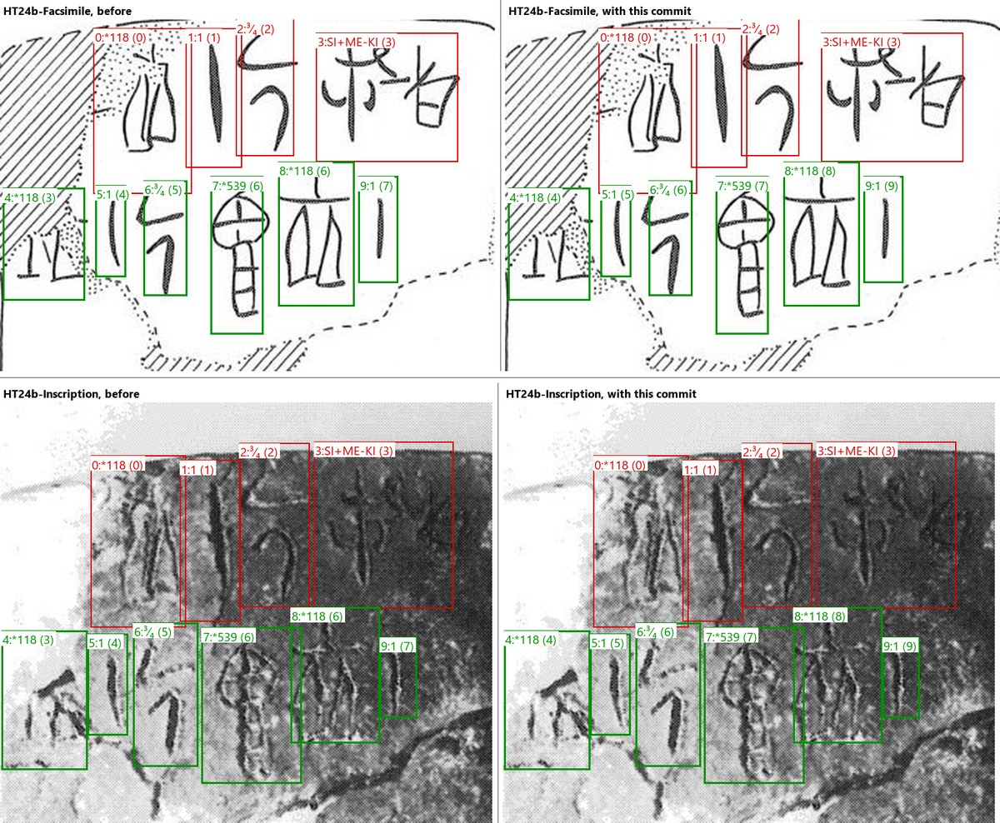

*Both HT24b maps, before and with this commit (the photo map includes commit 3's boxes): the entries after each split move up (green). No box moves.* (lineara.xyz images `HT24b-Facsimile.jpg`, `HT24b-Inscription.jpg`, crops of GORILA plates, © École française d'Athènes; boxes from `items_image_map.js` before and with this commit)

### HT38 — complex sign KA+A joined to \*118

On master token 14 of HT38 joins the complex sign KA+A (A554) at the end of line .2 to the \*118 at the start of line .3, `*554-*118`. GORILA I p. 73 (PDF p. 109) sets KA+A in its own column and \*118 3 in the logogram column, GORILA V indexes A 554 as a complex sign (V p. 259) and this \*118 as an isolated logogram (V p. 273), and Younger writes `KA+A {*554} *118` in one cell, separated by a space. The record's transcription already breaks the line between the two. This PR splits the token, glossing \*118 'talent'; the later image-map entries move up by one.

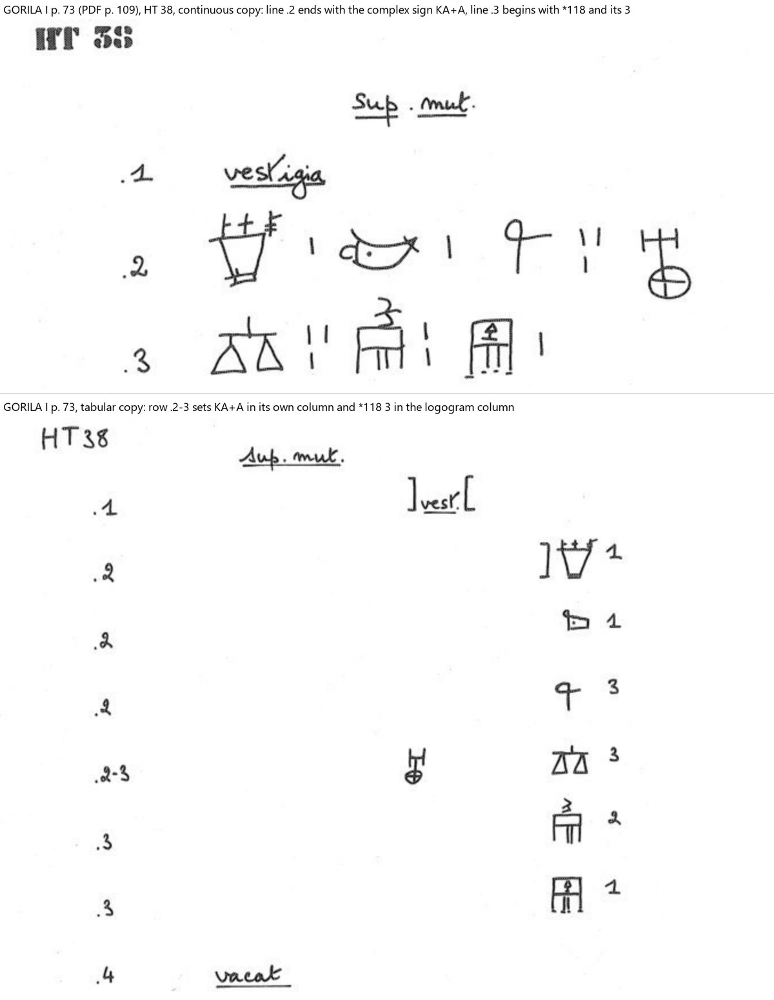

*GORILA I p. 73 (PDF p. 109), HT 38: the continuous copy ends line .2 with KA+A and begins line .3 with \*118 and its 3; the tabular copy's row .2-3 sets KA+A in its own column and \*118 3 in the logogram column.* (GORILA I (L. Godart and J.-P. Olivier 1976), © École française d'Athènes)

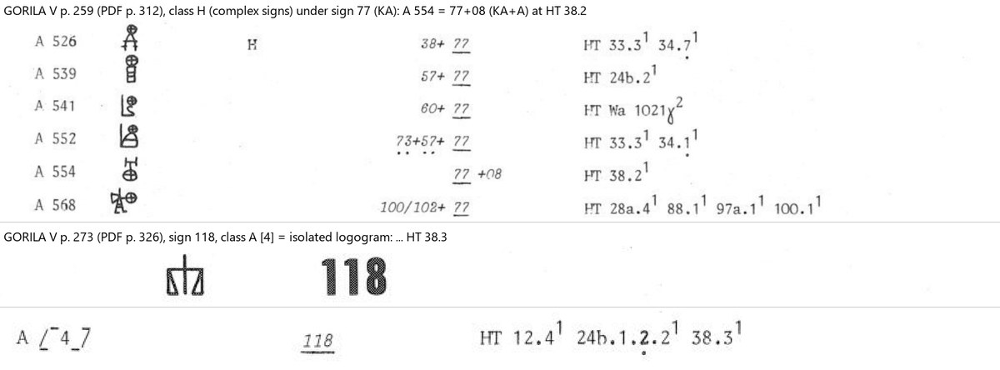

*GORILA V p. 259 (PDF p. 312): A 554 = 77+08 (KA+A) at HT 38.2, class H; p. 273 (PDF p. 326): \*118 in class A [4] at HT 38.3.* (GORILA V (L. Godart and J.-P. Olivier 1985), © École française d'Athènes)

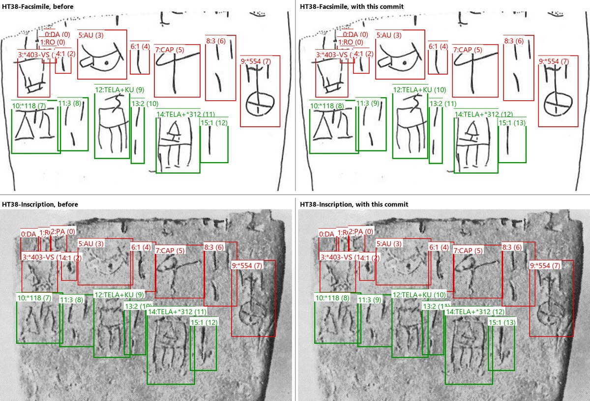

*Both HT38 maps, before and with this commit: \*118 becomes word 8 and every later entry moves up one (green). No box moves.* (lineara.xyz images `HT38-Facsimile.jpg`, `HT38-Inscription.jpg`, crops of GORILA plates, © École française d'Athènes; boxes from `items_image_map.js` before and with this commit)

### KH9 — complex sign SI+TA2 joined to \*304

On master token 28 of KH9 joins the complex sign SI+TA2 to the logogram \*304, `SI+TA2-*304`. GORILA III p. 35 (PDF p. 60) reads line .6 `]X SI+TA2 *304 1[` with spaces and sets the three in separate columns of its tabular copy; GORILA V indexes A 532 (SI+TA2) as a complex sign (V p. 210) and this \*304 as an isolated logogram (V p. 287), and Younger writes `SI+TA 2 {*532} *304`. This PR splits the token, glossing \*304 'olive oil' as at its other 25 occurrences; the last two image-map entries move up by one.

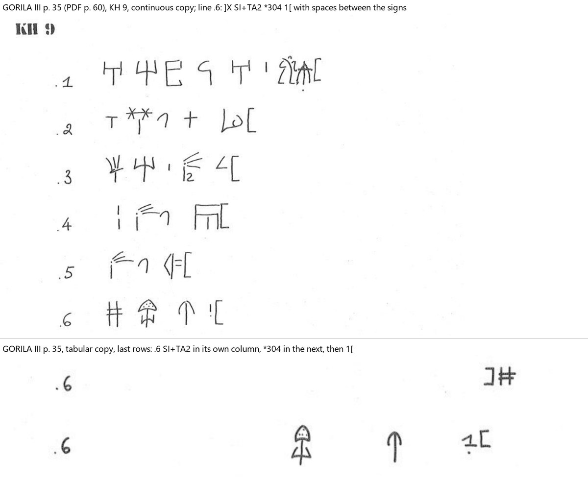

*GORILA III p. 35 (PDF p. 60), KH 9: the continuous copy reads line .6 ]X SI+TA2 \*304 1[ with spaces between the signs; the tabular copy's row .6 sets SI+TA2, \*304 and 1[ in three columns.* (GORILA III (L. Godart and J.-P. Olivier 1976), © École française d'Athènes)

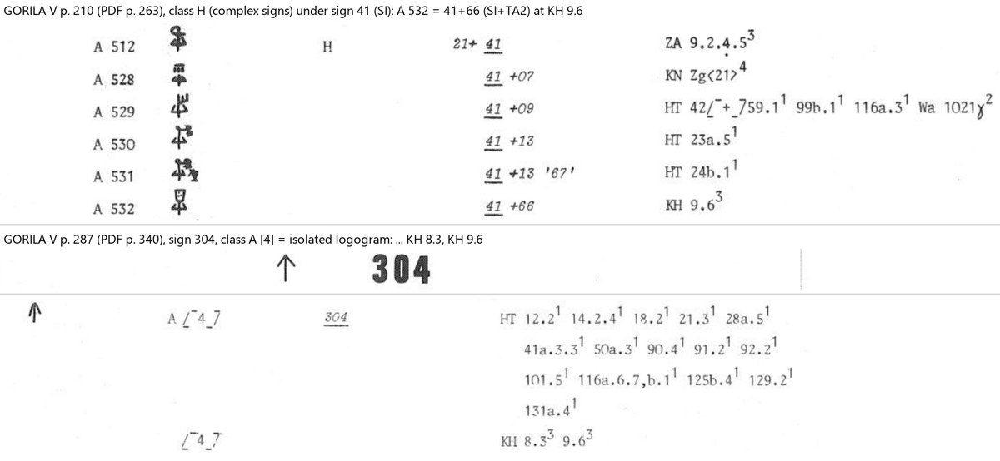

*GORILA V p. 210 (PDF p. 263): A 532 = 41+66 (SI+TA2) at KH 9.6, class H; p. 287 (PDF p. 340): sign 304 in class A [4] at KH 8.3 and 9.6.* (GORILA V (L. Godart and J.-P. Olivier 1985), © École française d'Athènes)

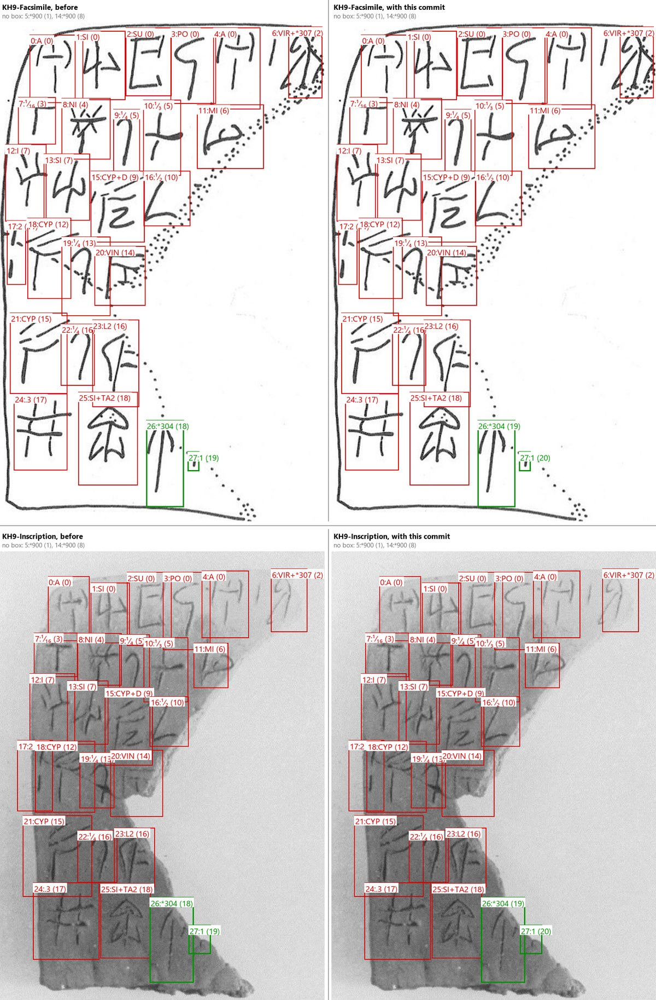

*Both KH9 maps, before and with this commit (the drawing's map includes commit 3's boxes): \*304 and the 1 after it move up one word (green). No box moves.* (lineara.xyz images `KH9-Facsimile.jpg`, `KH9-Inscription.jpg`, crops of GORILA plates, © École française d'Athènes; boxes from `items_image_map.js` before and with this commit)

### HT99b — complex sign SI+SE joined to the fig sign

On master token 0 of HT99b joins the complex sign SI+SE to the fig logogram (the site's NI), `SI+SE-NI`. GORILA I p. 163 (PDF p. 199) reads `SI+SE FIC 6` and sets SI+SE and FIC in separate columns; GORILA V indexes A 529 (SI+SE) as a complex sign and this fig sign as an isolated logogram (V pp. 210, 194), and Younger writes `SI+SE {*529} FIC | 6`. On HT116a the site already writes SI+SE apart. This PR splits the token, glossing NI 'figs' as at 74 of its 75 other occurrences; every later image-map entry moves up by one.

*GORILA I p. 163 (PDF p. 199), HT 99b: continuous copy .1 SI+SE FIC 6 DA-SI-\*118 2; in the tabular copy SI+SE stands in its own column and the fig sign (the site's NI) with 6 in the logogram column.* (GORILA I (L. Godart and J.-P. Olivier 1976), © École française d'Athènes)

*GORILA V p. 210 (PDF p. 263): A 529 = 41+09 (SI+SE) at HT 99b.1 (and at HT 116a.3, where the site writes SI+SE apart from GRA); p. 194 (PDF p. 247): sign 30 (FIC, the site's NI) in class A [4] at HT 99a.2 and b.1.* (GORILA V (L. Godart and J.-P. Olivier 1985), © École française d'Athènes)

*Both HT99b maps, before and with this commit: NI becomes word 1 and every later entry moves up one (green). No box moves.* (lineara.xyz images `HT99b-Facsimile.jpg`, `HT99b-Inscription.jpg`, crops of GORILA plates, © École française d'Athènes; boxes from `items_image_map.js` before and with this commit)

### HT28a — complex sign VIR+KA joined to VIN

On master token 30 of HT28a joins the complex sign VIR+KA to the second wine sign of line .4, `VIR+KA-VIN`. GORILA I p. 53 (PDF p. 89) reads `VIN 3 VIR+KA VIN 6` and sets VIR+KA in its own column, GORILA V indexes A 568 (VIR+KA) as a complex sign and both wine signs of the line as isolated logograms (V pp. 259, 277), and Younger writes `VIR+KA {*568} VINa | 6` in one cell, separated by a space. On HT88, HT97a and HT100 the site writes VIR+KA as a word of its own. This PR splits the token, glossing VIN 'wine'; every later image-map entry moves up by one.

*GORILA I p. 53 (PDF p. 89), HT 28a: continuous copy, line .4 VIN 3 VIR+KA VIN 6; the tabular copy's second row .4 sets VIR+KA in its own column and VIN 6 in the logogram column.* (GORILA I (L. Godart and J.-P. Olivier 1976), © École française d'Athènes)

*GORILA V p. 259 (PDF p. 312): A 568 = 100/102+77 (VIR+KA) at HT 28a.4 (and at HT 88.1, 97a.1, 100.1, where the site writes VIR+KA as a word of its own); p. 277 (PDF p. 330): sign 131a (VIN) in class A [4] at HT 28a.4.4, both wine signs of the line.* (GORILA V (L. Godart and J.-P. Olivier 1985), © École française d'Athènes)

*Both HT28a maps, before and with this commit: the second VIN and every later entry move up one word (green). No box moves.* (lineara.xyz images `HT28a-Facsimile.jpg`, `HT28a-Inscription.jpg`, crops of GORILA plates, © École française d'Athènes; boxes from `items_image_map.js` before and with this commit)

### HT44b — transaction sign TE joined to GRA+F

On master token 2 of HT44b joins the transaction sign TE and the grain ligature GRA+F, `TE-GRA+F`. GORILA I p. 85 (PDF p. 121) reads `]JA · TE GRA+F` with a gap and sets TE and GRA+F in separate columns; GORILA V lists this TE as an isolated transaction sign (V p. 149) and A 582 = GRA+F alone (V p. 275), and Younger's number `{*582}` in `• TE GRA+F {*582} [` covers GRA+F alone. The site writes the same cell of HT133, `• TE GRA+DA {*573}`, as TE | GRA+DA, and TE as a token of its own at 18 of the 21 places where GORILA V lists it as an isolated sign. This PR splits the token into `TE` and `GRA+F` ('grain', as on HT125b, KH1 and KH28), keeping the break mark with GRA+F; every later image-map entry moves up by one.

*GORILA I p. 85 (PDF p. 121), HT 44b .1: normalised copy ]JA · TE GRA+F, and the tabular copy with TE in its own column and GRA+F[ in the logogram column. GORILA V p. 149 (PDF p. 202): sign 04 (TE) as an isolated sign, class A [3] (transaction sign), at HT 44b.1; p. 275 (PDF p. 328): A 582 = 120'F', GRA+F alone, at HT 44b.1.* (GORILA I and V (L. Godart and J.-P. Olivier 1976, 1985), © École française d'Athènes)

*Both HT44b maps, before and with this commit: GRA+F becomes word 3 and every later entry moves up one (green). No box moves.* (lineara.xyz images `HT44b-Facsimile.jpg`, `HT44b-Inscription.jpg`, crops of GORILA plates, © École française d'Athènes; boxes from `items_image_map.js` before and with this commit)

### HTWa1021 — two complex signs written as one word

On master token 5 of HTWa1021 joins two complex signs into one word, `SI+SE-RA+KA`. GORILA II p. 7 (PDF p. 69) draws and copies SI+SE and RA+KA apart on face γ, GORILA V numbers them A 529 and A 541 (V pp. 210, 259), and Younger has `g: SI+SE {*529} RA+KA {*541}`, two numbers. The maintainer's 9c81beb split the matching token of HTWa1021bis. This PR splits the token into `SI+SE` and `RA+KA`; entry 5 (RA+KA) of both image maps becomes word 4.

*GORILA II p. 7 (PDF p. 69), HT Wa 1021 face γ (HM 1347): photograph, drawing and normalised signs, SI+SE and RA+KA apart. GORILA V p. 210 (PDF p. 263): A 529 = 41+09 (SI+SE), and p. 259 (PDF p. 312): A 541 = 60+77 (RA+KA), each at HT Wa 1021γ.* (GORILA II and V (L. Godart and J.-P. Olivier 1979, 1985), © École française d'Athènes)

*Both HTWa1021 maps, before and with this commit: RA+KA (entry 5) becomes word 4. No box moves.* (lineara.xyz images `HTWa1021-Facsimile.jpg`, `HTWa1021-Inscription.jpg`, crops of GORILA plates, © École française d'Athènes; boxes from `items_image_map.js` before and with this commit)

### KNZa10 — JA-SA-SA-RA-MA-NA cut at the corner

On master KNZa10 cuts JA-SA-SA-RA-MA-NA at the corner between faces a and b into `JA-SA-SA-RA-MA` and a one-sign word `NA` that the stone does not have. GORILA IV p. 9 (PDF p. 52) has no divider after MA on face a and continues `JA SA SA RA MA NA · DA …` in its continuous copy; GORILA V p. 156 (PDF p. 209) indexes NA as the last sign of JA-SA-SA-RA-MA-NA at KN Za 10a-b, and Younger writes `JA-SA-SA-RA-MA- .b: -NA •` and `JA-SA-SA-RA-MA-NA •`. This PR joins the word, as the site writes the words round the corners of KO Za 1: one token, on the line of the face that holds most of its signs, with the line break moved after it in the word arrays and in `parsedInscription`; the transcription keeps the physical break, and the gloss 'this dedication' stays. The later image-map entries move down by one.

*GORILA IV p. 9 (PDF p. 52), KN Za 10: face a ends ]-TA NU MU TI · JA SA SA RA MA with no divider after MA, face b begins NA ·; the continuous copy runs JA SA SA RA MA NA · DA … GORILA V p. 156 (PDF p. 209): NA as the last sign (class G) of 57-31-31-60-80-06, JA-SA-SA-RA-MA-NA, at KN Za 10a-b.* (GORILA IV and V (L. Godart and J.-P. Olivier 1982, 1985), © École française d'Athènes)

*Both KNZa10 maps, before (upper of each pair) and with this commit: NA joins word 2 and every later entry moves down one (green). No box moves.* (lineara.xyz images `KNZa10-Facsimile.jpg`, `KNZa10-Inscription.jpg`, crops of GORILA plates, © École française d'Athènes; boxes from `items_image_map.js` before and with this commit)

### PKZa11 — A-SA-SA-RA-ME cut at the corner

On master PKZa11 cuts A-SA-SA-RA-ME at the corner between faces b and c into a one-sign word `A` and `SA-SA-RA-ME`. GORILA IV p. 34 (PDF p. 77) ends face b with `· A` and begins face c with `SA SA RA ME ·`, and its continuous copy begins a line with `A SA SA RA ME ·`; GORILA V p. 161 (PDF p. 214) indexes A as the first sign of A-SA-SA-RA-ME at PK Za 11b-c, and Younger writes `• A-` and `c: SA-SA-RA-ME •`. This PR joins the word on face c's line, where four of its five signs are (unglossed, as on IOZb10); the later image-map entries move down by one. The corner between faces a and b is not touched.

*GORILA IV p. 34 (PDF p. 77), PK Za 11: face b ends · A (A underdotted), face c begins SA SA RA ME ·; the continuous copy begins its line with A SA SA RA ME ·. GORILA V p. 161 (PDF p. 214): A as the first sign (class D) of 08-31-31-60-13, A-SA-SA-RA-ME, at PK Za 11b-c.* (GORILA IV and V (L. Godart and J.-P. Olivier 1982, 1985), © École française d'Athènes)

*Both PKZa11 maps, before and with this commit (the photo map includes commit 3's boxes): A at the end of face b and SA SA RA ME on face c become one word 11, and every later entry moves down one (green). No box moves.* (lineara.xyz images `PKZa11-Facsimile.jpg`, `PKZa11-Inscription.jpg`, crops of GORILA plates, © École française d'Athènes; boxes from `items_image_map.js` before and with this commit)

### PKZa14 — TU-ME-I cut at the corner

On master PKZa14 cuts ]TU-ME-I at the corner into `TU-ME` and a one-sign word `I`. GORILA IV p. 40 (PDF p. 83) reads `]TU ME I · JA SA SA[` with no divider between ME and I, GORILA V p. 249 (PDF p. 302) indexes TU-ME-I at PK Za 8a and 14a-b, and Younger writes `a: ]-TU-ME- b: -I •` and `]TU-ME-I`. This PR joins the word (unglossed, as on PK Za 8); the later image-map entries move down by one.

*GORILA IV p. 40 (PDF p. 83), PK Za 14: face a ]TU ME, face b I · JA SA SA[; the continuous copy ]TU ME I · JA SA SA[ has no divider between ME and I. GORILA V p. 249 (PDF p. 302): TU as the first sign (class D) of 69-13-28, TU-ME-I, at PK Za 8a and 14a-b.* (GORILA IV and V (L. Godart and J.-P. Olivier 1982, 1985), © École française d'Athènes)

*Both PKZa14 maps, before and with this commit: I joins word 0 (TU-ME-I) and every later entry moves down one (green). No box moves.* (lineara.xyz images `PKZa14-Facsimile.jpg`, `PKZa14-Inscription.jpg`, crops of GORILA plates, © École française d'Athènes; boxes from `items_image_map.js` before and with this commit)

### PKZa16 — PU₂-RE-JA cut at the corner

On master PKZa16 cuts ]PU₂-RE-JA[ at the corner into a one-sign word `PU₂` and `RE-JA`. Both copies of GORILA IV p. 42 (PDF p. 85) read `]TO SA · PU2 RE JA[` with no divider between PU₂ and RE, GORILA V p. 193 (PDF p. 246) indexes PU₂-RE-JA at PK Za 16 (and ]PU₂-RE-JA at ZA Zb 34), and Younger writes `.a: ]-TO-SA • PU2- .b: -RE-JA [` and notes that the two lines probably run together as PU₂-RE-JA. This PR joins the word on the second line, where two of its three signs are (unglossed, as on ZA Zb 34); its two later image-map entries move down by one.

*GORILA IV p. 42 (PDF p. 85, printed sideways and turned here), PK Za 16, both copies: ]TO SA · PU2 RE JA[ ]vest.[ (PU2 and JA underdotted), with no divider between PU2 and RE and no face letters. GORILA V p. 193 (PDF p. 246): PU2 as the first sign (class D) of 29-27-57[, PU2-RE-JA, at PK Za 16 (and ]29-27-57 at ZA Zb 34).* (GORILA IV and V (L. Godart and J.-P. Olivier 1982, 1985), © École française d'Athènes)

*Both PKZa16 maps, before and with this commit: PU₂ and RE-JA become one word 2 (green). No box moves.* (lineara.xyz images `PKZa16-Facsimile.jpg`, `PKZa16-Inscription.jpg`, crops of GORILA plates, © École française d'Athènes; boxes from `items_image_map.js` before and with this commit)

### IOZa16 — JA-SA-SA-RA-ME cut at the corner

On master IOZa16 cuts JA-SA-SA-RA-ME at the corner into `JA-SA-SA-RA` and a one-sign word `ME`. The vessel is not in GORILA, and its first edition (Karetsou, Godart and Olivier 2002–2003, 443–44) was not consulted; Younger, the site's source, writes `.a: ] *123 • JA-SA-SA-RA- .b: -ME • U-NA-RU-KA[-NA-SI` and `.a-.b: ] AROM • JA-SA-SA-RA-ME • …`, and the record's own pictures have JA SA SA RA on one face and ME · U NA RU KA on the next. This PR joins the word and glosses it 'this dedication', the site's gloss of JA-SA-SA-RA-ME in its seven other records, where the cut word had the hand gloss '"to" A-SA-SA-RA'; the later image-map entries move down by one. The explorer's 10 areas for 12 letters (the restored NA and SI have no boxes) are as before.

*Both IOZa16 maps, before and with this commit: JA SA SA RA on one face and ME on the next become one word 2, and every later entry moves down one (green), including the box-less entries of the restored NA and SI. No box moves.* (lineara.xyz images `IOZa16-Facsimile.jpg`, `IOZa16-Inscription.jpg`; boxes from `items_image_map.js` before and with this commit)

### IOZa12 — JA-SA-SA-RA-ME cut at the corner

On master IOZa12 writes JA-SA-SA-RA-ME, divided between two faces, as `JA-SA` and `SA-RA-ME`. The vessel is not in GORILA, and its first edition (Karetsou, Godart and Olivier 1985, 143) was not consulted; Younger writes `.a: ][• •] • JA-SA- .b: -SA-RA-ME • I-TI-[` and notes that 'the two sides break up the word JA-SA- | -SA-RA-ME', and the record's drawing has JA SA on face a and SA RA ME · I TI on face b. This PR joins the word on face b's line, glossed 'this dedication' as elsewhere; the later entries of the drawing's image map move down by one.

*`IOZa12-Facsimile`, before (upper) and with this commit (lower): JA SA on face a and SA RA ME on face b become one word 2, and the later entries move down one (green). No box moves.* (lineara.xyz images `IOZa12-Facsimile.jpg`; boxes from `items_image_map.js` before and with this commit)

## Optional readings

The tenth commit holds ten readings that are editorial choices rather than errata; it can be left out as a whole, and each record can be taken or left on its own. The thirteenth commit is written on it, so leaving it out means taking that commit in its version written without it. In six records it follows GORILA V's reading of a complex sign: KH Wa 1001 and 1002, TY 3a, KH 74, MA 4a and HT 130. In four records the sources disagree about a divider or a break. In MA 1a and HT 127a GORILA and Younger disagree: GORILA has a divider after \*47 (MA 1a) and a break after the numeral of line .3 (HT 127a), and the site's word arrays, like Younger, do not. In HT 123+124b and HT Zd 157+156 GORILA's own copies disagree: Younger has the divider, while the site's transcription of HT 123+124b b.3 and its text of HT Zd 157 follow the GORILA copies that lack it. In each case the site's present reading can be defended. MA4a's split is written on the 63 of commit 8; without commit 8 the same split applies to 53. The derived files follow as for the ninth commit (HT127a's copy in `items_analysis/inscriptions.json`, which predates 9c81beb, stays as it was; the notebook drops the break mark it gains), and seven item pages are regenerated. "Before" figures show the state after the ninth commit.

### KHWa1001, KHWa1002 — A640 read as 317+KI

On master the first sign of KHWa1001 and KHWa1002, A640, is labelled `*316+KI`, in both text arrays and in the site's sign table. GORILA V contradicts itself here: its table prints the formula 316'67' but draws the boxed sign 317 (p. XXVI, PDF p. 27), and its index lists A 640 = 317'67' under 317 and under KI (pp. 296, 248, PDF pp. 349, 301); Younger reads `*317+KI`, while GORILA III p. 104 (PDF p. 129) reads the signs as A-KI-DA-RO. This optional change labels the glyph `*317+KI` in both records, in the three sign-table rows and in its entry in the `ligatures` table of `LinearAInscriptions.js` (317 with KI, not 316 with KI); the records have no image-map entries for it.

*GORILA V p. XXVI (PDF p. 27): table cell A 640 with the formula 316'67', but drawn with the boxed sign 317, as A 641 '317''67''334' below it. GORILA III p. 104 (PDF p. 129), KH Wa 1001 faces α and γ, and the normalised copy A-KI-DA-RO. GORILA V p. 296 (PDF p. 349): the rubric of sign 316 lists only A 639 and A 631, and A 640 = 317'67' at KH Wa 1001α and 1002α stands under 317; p. 248 (PDF p. 301), under sign 67: A 640 = 317'67'.* (GORILA III and V (L. Godart and J.-P. Olivier 1976, 1985), © École française d'Athènes)

### TY3a — KI with a lost element

On master TY3a has a plain KI in `NE-KI` (line .1-2) and `KI` (line .7). GORILA I p. 327 (PDF p. 363) draws both as KI with a lost element at the upper right (`KI+[ ]`), GORILA V catalogues them as the complex signs A 514 and A 544 (V pp. XXIV, 248), and Younger reads `NE KI+[ ] 5` and `]KI+[ ] 5`. Neither complex sign is in Unicode, so the glyph stays KI. This optional change writes `NE-KI+[?]` and `KI+[?]` in both text arrays, the site's own notation for an unknown component (as in `VIR+[?]`); glyphs, token positions and map labels do not change. Whether NE belongs to the compound (GORILA V) or stands apart (GORILA I's tabular copy) is left as the site has it.

*GORILA I p. 327 (PDF p. 363), TY 3a, tabular copy: .1-2 NE, then KI with a lost element [ ] at its upper right, 5; .7 ]KI+[ ] 5. GORILA V p. XXIV (PDF p. 25): A 514 = '24''[ ]67' and A 544 = ]67+[ ]; p. 248 (PDF p. 301): A 514 at TY 3a.1-2, A 544 at TY 3a.7.* (GORILA I and V (L. Godart and J.-P. Olivier 1976, 1985), © École française d'Athènes)

### KH74 — SI set apart from the complex sign \*805-MI

On master KH74 writes `SI-*805-MI` as one word on line .2, as Younger's table does (`] SI -*301-MI {*605}`). GORILA III p. 93 (PDF p. 118) sets ]SI apart from 301 and MI written together, GORILA V indexes this SI as a single sign after a break and A 605 = '301''73' as a complex sign at KH 74.2 and on the roundels KH Wc 2054 and 2055 (V pp. 209, 283), and Younger's note says that \*605 'is probably an independent signgroup also here: ]SI \*605'. This optional change splits the token into `SI` and `*805-MI` (the site's label of A605, as on KH Wc 2054 and 2055); the last two image-map entries move up by one.

*GORILA III p. 93 (PDF p. 118), KH 74, both copies: line .2 ]SI (underdotted), then 301 and MI written together, GORILA V's complex sign A 605; in the left copy a clear space separates ]SI from it.* (GORILA III (L. Godart and J.-P. Olivier 1976), © École française d'Athènes)

*GORILA V p. 209 (PDF p. 262): SI in class F (]X, a single sign after a break) at KH 74.2; p. 283 (PDF p. 336): A 605 = '301''73' at KH 74.2 and on the roundels KH Wc 2054 and 2055.* (GORILA V (L. Godart and J.-P. Olivier 1985), © École française d'Athènes)

*Both KH74 maps, before and with this commit: \*805 and MI (entries 6 and 7) become word 4, apart from SI (word 3). No box moves.* (lineara.xyz images `KH74-Facsimile.jpg`, `KH74-Inscription.jpg`, crops of GORILA plates, © École française d'Athènes; boxes from `items_image_map.js` before and with this commit)

### MA4a — TA set apart from HIDE+B

On master MA4a begins with one word `TA-HIDE+B`. GORILA I p. 273 (PDF p. 309) sets TA in its own column before HIDE+B 15, and GORILA V indexes TA as an isolated sign at MA 4a and A 602 = 180'B' as a complex sign at MA 4a and 6a, c (V pp. 235, 280); no complex sign joins 59 (TA) with 180 (A 599–A 603 have no 59). Younger writes `TA *180B` in one logogram cell without a hyphen or a complex-sign number, so he leaves the question open. This optional change splits the token into `TA` and `HIDE+B`; every later image-map entry moves up by one. The split is written on commit 8's 63; without commit 8 the same split applies to 53.

*GORILA I p. 273 (PDF p. 309), MA 4a: normalised copy and tabular copy, TA in its own column, then HIDE+B 15. GORILA V p. 235 (PDF p. 288): sign 59 (TA) as an isolated sign (class A [2]) at MA 4a; p. 280 (PDF p. 333): A 602 = 180'B' at MA 4a and 6a, c.1.* (GORILA I and V (L. Godart and J.-P. Olivier 1976, 1985), © École française d'Athènes)

*Both MA4a maps, before and with this commit (after commit 8's 63): HIDE+B becomes word 1 and every later entry moves up one (green). No box moves.* (lineara.xyz images `MA4a-Facsimile.jpg`, `MA4a-Inscription.jpg`, crops of GORILA plates, © École française d'Athènes; boxes from `items_image_map.js` before and with this commit)

### HT130 — SI set apart from CYP

On master HT130 writes `SI-CYP` as one word on line .5. GORILA I p. 225 (PDF p. 261) sets SI in its own column before CYP 8, and GORILA V indexes this SI and this CYP as isolated signs, recording the complex sign A 533 (SI with CYP) only at KH 11.6 (V pp. 207, 286). Younger writes `SI *303` without a number here and at KH 11.6 alike, so his notation cannot tell the two apart. This optional change splits the token into `SI` and `CYP` ('cyperus'); every later image-map entry moves up by one.

*GORILA I p. 225 (PDF p. 261), HT 130 .5: normalised copy SI CYP 8 FIC, and the tabular copy with SI in its own column, then CYP 8. GORILA V p. 207 (PDF p. 260): SI as an isolated sign (class A [2]) at HT 130.5; p. 286 (PDF p. 339): CYP isolated at HT 130.2 and .5, and the complex sign A 533 = '41''303' (SI CYP) only at KH 11.6.* (GORILA I and V (L. Godart and J.-P. Olivier 1976, 1985), © École française d'Athènes)

*Both HT130 maps, before and with this commit: CYP (entry 10) becomes word 8 and every later entry moves up one (green). No box moves.* (lineara.xyz images `HT130-Facsimile.jpg`, `HT130-Inscription.jpg`, crops of GORILA plates, © École française d'Athènes; boxes from `items_image_map.js` before and with this commit)

### HT123+124b — divider after \*188-DU in the transcription

On master line b.3 of HT123+124b disagrees with itself: the word arrays and `parsedInscription` have \*188-DU, a divider and 10 (`𐙓𐘬𐄁𐄐`), the transcription has no divider (`𐙓𐘬𐄐`). Younger, in both of his arrangements, and GORILA V p. 74 (PDF p. 127), the corrigenda, have the divider. But GORILA I's drawing and normalised copy (pp. 212–213, PDF pp. 248–249) show a single mark between DU and TU, a small circle drawn like the two that write 20 on line .6, and the site's map of the drawing boxes that mark as the 10. This optional change follows the word arrays, Younger and GORILA's corrigenda and adds the divider to the transcription; the other way would be to remove the divider from the word arrays.

*GORILA I p. 213 (PDF p. 249), HT 123b, normalised copy, lines .1–.6: on line .3, 1 \*188 DU, one small circle, TU PA DI DA; on line .6 KU RO is followed by two such circles, which the tabular copy reads as 20. Below: GORILA I p. 212 (PDF p. 248), the drawing of line .3, enlarged: one round mark between DU and TU.* (GORILA I (L. Godart and J.-P. Olivier 1976), © École française d'Athènes)

*`HT123+124b-Facsimile`, line .3, with its boxes (not changed by commit 10): the box of the 10 (entry for word 13) is on the one mark between DU and TU; the divider entry (word 12) has no box.* (lineara.xyz image `HT123+124b-Facsimile.jpg`, a crop of the GORILA I p. 212 drawing, © École française d'Athènes; boxes from `items_image_map.js`)

### MA1a — divider after \*47

After the ninth commit, MA1a's word arrays still run \*47 into QE-DE-MI-NU. GORILA has a divider there: a thick stroke on the crack between \*47 and QE in the drawing (I p. 268, PDF p. 304), and `*47 ·` in both copies (I p. 269, PDF p. 305); the record's own transcription has it too (`…𐘨𐄁𐘿…`). Younger, whom the word arrays follow, has none (`a.1 X I-DU-WI • *47`, `a.1 QE-DE-MI-NU •`). This optional change adds the divider after \*47 in the three word arrays and in `parsedInscription`, which then equals the transcription; both image maps get a box-less `*900` entry. MA1b has the same pattern; its divider after \*47 is an optional change in the thirteenth commit ([MA1b — divider after \*47](#ma1b--divider-after-47)). Figures: [MA1a — divider after X I-DU-WI missing](#ma1a--divider-after-x-i-du-wi-missing).

### HT127a — break mark after the numeral of line .3

On master HT127a marks the break at the start of line .3 (`𐝫` before \*304+PA) but none at its right end, although it writes line .2's `1[` as `𐄇𐝫`. GORILA I p. 219 (PDF p. 255) reads `.3 *304+PA DA *47 KU 1 [`, the break after the numeral, past a space, and its drawing (I p. 218, PDF p. 254) shows a stroke, a short clear stretch and then the lost surface. Younger puts the break after KU, before the numeral (`a.3 ]*304+PA-DA-*47-KU[` with 1 in his number column). This optional change follows GORILA and writes the numeral as `𐄇𐝫`, adding `𐝫` to both glyph strings; the transliteration stays `1`, as for line .2, and no map entry changes.

*GORILA I p. 218 (PDF p. 254), drawing of HT 127a: line .3 \*304+PA DA \*47 KU, a stroke, a short clear stretch, then lost (stippled) surface.* (GORILA I (L. Godart and J.-P. Olivier 1976), © École française d'Athènes)

*GORILA I p. 219 (PDF p. 255), HT 127a: normalised copy '.2 DU NE MI 1[' and '.3 \*304+PA DA \*47 KU 1 [' (both numerals underdotted; on .3 the break comes after the numeral, past a space), and the tabular copy with '1[' and '1 [' in the number column.* (GORILA I (L. Godart and J.-P. Olivier 1976), © École française d'Athènes)

### HTZd157+156 — divider before WI-JA-SU-MA-TI-TI

On master the text of HT Zd 157 begins with WI-JA-SU-MA-TI-TI. GORILA IV p. 135 (PDF p. 178) is divided: its normalised copy begins with a full-height stroke and a dot before WI, but its facsimile and its tabular copy draw the stroke and no dot, on undamaged surface, and so does the site's `HTZd157+156-Facsimile.jpg`. Younger begins `• WI-JA-SU-MA-TI-TI-*319 [ ] NE 1 …`. This optional change adds the divider at the start of the word arrays and of `parsedInscription` (the transcription holds only HT Zd 156's text), and gives both image maps a box-less `*900` entry as word 0. The stroke stays unread, as in the record and in Younger.

*GORILA IV p. 135 (PDF p. 178, printed sideways and turned here), HT Zd 157: the normalised copy (top) begins with a full-height stroke, then a dot, then WI JA SU MA TI TI and the I-shaped sign; the tabular copy (bottom) has the stroke but no dot.* (GORILA IV (L. Godart and J.-P. Olivier 1982), © École française d'Athènes)

*Same page, the facsimile: the stroke before WI, and no dot (`HTZd157+156-Facsimile.jpg` is a crop of this drawing).* (GORILA IV (L. Godart and J.-P. Olivier 1982), © École française d'Athènes)

## Readings, logograms, glyph strings and word divisions

Fifty-one records and the sign-table rows of four complex signs make up the eleventh commit. The changes are of six kinds: readings, numerals and erasures; line breaks of the word arrays; RA and TE written with other Unicode signs (A802, A800); sheep and goat signs that name the wrong animal (sixteen records); `transcription` and `parsedInscription` fields that disagree with the record's own words (fifteen records); and signs that the word arrays join although the editions write them apart. Two image maps and the rows of A 562, A 607, A 632 and A 633 are corrected too. Each was checked in GORILA and in Younger's transliteration, the site's own source, or in the record's own source where GORILA does not cover it; they agree unless noted. Every error is already on master (9c81beb), and none of these changes touches a line of the tenth commit or a line next to one, so this commit applies with or without it. The derived files follow as for the ninth commit: the tabulations of `items_analysis/supplement.json` are rebuilt from the new words, the notebook's copy `items_analysis/inscriptions.json` takes the new fields, `annotations.js` gets tag entries for split, joined and moved words, `wordsInCorpus` is updated, the changed sign-table rows and their entries in the `ligatures` table of `LinearAInscriptions.js` follow, and 29 item pages are regenerated with the committed notebook. "Before" figures show the state before this commit, which is master with the first ten commits of this PR (some figures label it "PR head (c0f074c)" or "now (PR #14 build)"); red boxes are image-map entries, blue boxes the explorer's areas, green the entries that change.

### HT17 — a private-use character in RA-\*164-TI, and 37 for 38

On master the middle sign of HT17's first word is the private-use character U+FD1EB in `words`, `transliteratedWords`, `translatedWords` and `parsedInscription` (it shows as an empty box), while the transcription has `𐙐` (AB164); the number of line .1 is 37 in every field. GORILA I p. 35 (PDF p. 71) reads RA \*164 TI · TE · VIN in both copies, with 38 in the tabular copy and three tens and two rows of four units in the normalised copy and in the drawing (p. 34); GORILA V p. 239 lists 60-164a-37 at HT 17.1 and 19.1, and Younger has `.1 RA-*164a-TI • TE • VIN 38`. The units box of both site pictures holds eight strokes. This PR writes `𐘴𐙐𐘠` / RA-\*164-TI, as the site writes the same word on HT19, and `𐄒𐄎` / 38 in all five fields; the map labels `*` and `7` become `*164` and `8`. GORILA V and Younger number the sign 164a; the site's sign table labels U+10650 `*164`, which is kept.

*GORILA I p. 35 (PDF p. 71), HT 17, normalised copy (left) and tabular copy (right): RA \*164 TI · TE · VIN, then three ten-dashes and 4 + 4 units in the normalised copy, 38 in the tabular copy.* (GORILA I (L. Godart and J.-P. Olivier 1976), © École française d'Athènes)

*GORILA I p. 34 (PDF p. 70), HT 17, photograph and drawing: the number at the start of line .2 has three tens and two rows of four units.* (GORILA I (L. Godart and J.-P. Olivier 1976), © École française d'Athènes)

*GORILA V p. 239 (PDF p. 292), index of sign 60 (RA): 60-164a-37 (RA-\*164-TI) at HT 17.1 and HT 19.1; 60-37-09 (RA-TI-SE) at HT 6b.2.* (GORILA V (L. Godart and J.-P. Olivier 1985), © École française d'Athènes)

*`HT17-Facsimile`: entries 1 and 8 (green) are labelled `*` and `7` before, `*164` and `8` after; box 8 holds eight unit strokes. No box or word number changes.* (lineara.xyz image, a crop of the GORILA I plate, © École française d'Athènes; boxes from `items_image_map.js` and `imagemaps.js` before and with this commit)

*`HT17-Inscription`: the same two labels on the photo.* (lineara.xyz image, a crop of the GORILA I plate, © École française d'Athènes; boxes from `items_image_map.js` and `imagemaps.js` before and with this commit)

### HT10a — 10 and an erased 4 stored as 14

On master HT10a's line .3 ends with one token `𐄐𐄊𐝫` / 14. GORILA I p. 21 (PDF p. 57) prints `10 [[4[ ]]` in the tabular copy, a ten and then a 4 inside erasure brackets with the break inside them, and the normalised copy draws the same; Younger has `a.3 U-*325-ZA 10 [[4 [ ]]`. Younger's note on a.3 cites Schoep 2002, p. 78, for the erased entries of lines .2a–.3 having been moved as "the total 14" on line .3; both editions nevertheless print the 4 of line .3 inside the erasure brackets, which is what this change records. As bcfb77a does for HT34 (`30`, `[[7]]`) and HT46b, this PR splits the token into `10` and `[[4]]` in the transliterations (glyphs unchanged; 32 → 33 tokens); in both image maps the 4's box becomes word 16 and the later word numbers move up by one. Younger also marks lines .2a–.3 as erased, where GORILA prints them live; that is not changed.

*GORILA I p. 21 (PDF p. 57), HT 10a line .3: normalised copy (top; a ten-dash, then units between erasure brackets), tabular copy (middle; 10 [[4[ ]]) and the apparatus (bottom).* (GORILA I (L. Godart and J.-P. Olivier 1976), © École française d'Athènes)

*`HT10a-Facsimile`, lines .3–.4: the boxes of the 10 and the 4 (green, entries 24–25) are one word (15) before; after, the 4 is word 16 and the later word numbers move up by one. No box moves.* (lineara.xyz image, a crop of the GORILA I plate, © École française d'Athènes; boxes from `items_image_map.js` and `imagemaps.js` before and with this commit)

*`HT10a-Inscription`: the same on the photo.* (lineara.xyz image, a crop of the GORILA I plate, © École française d'Athènes; boxes from `items_image_map.js` and `imagemaps.js` before and with this commit)

### HT111b — NA before ]NI 1 on line b.3

On master HT111b's tokens 11–13 run NA, NI, 1, and so does `parsedInscription`, while the transcription has NI 1 before NA. GORILA I p. 181 (PDF p. 217) prints `]FIC 1[ ] NA-[` in the normalised copy and the same order in the tabular copy (NA- on a row of its own), and Younger has `b.3 ]FIC 1 [ ]` and then `NA-[`. This PR puts the three tokens in that order and `parsedInscription` follows; the boxes stay, their word numbers become NI 5, 1 6, NA 7, and the explorer's areas 7–9 are reordered to pair with the letters NI, 1, NA.

*GORILA I p. 181 (PDF p. 217), HT 111b line .3: normalised copy ]FIC 1[ ] NA-[ (the fig sign NI, a unit, a lacuna, then NA-); tabular copy ]FIC 1[ ] with NA-[ on the next row.* (GORILA I (L. Godart and J.-P. Olivier 1976), © École française d'Athènes)

*`HT111b-Facsimile`, line .3 (green): before, NA is word 5 and NI, 1 are words 6 and 7; after, NI 5, 1 6, NA 7. Boxes unchanged; the explorer areas (blue) follow the new letter order.* (lineara.xyz image, a crop of the GORILA I plate, © École française d'Athènes; boxes from `items_image_map.js` and `imagemaps.js` before and with this commit)

*`HT111b-Inscription`: the same on the photo.* (lineara.xyz image, a crop of the GORILA I plate, © École française d'Athènes; boxes from `items_image_map.js` and `imagemaps.js` before and with this commit)

### PSZa2 — Younger's count of lost signs stored as the numeral 6

On master PSZa2's token 4 is `𐝫𐄌𐝫𐘱𐘠` / `𐄌-JA-TI`: the numeral 6 inside a word, even in the transliteration, and `PSZa2-Facsimile` boxes a trace in the break as `6`. GORILA IV p. 54 (PDF p. 97) prints `TI · [ ]JA TI · JA SA SA RA ME ·` in both copies, with the note 'Trace d'un signe dans la cassure à droite', and the drawing (p. 53) shows that trace at the edge of the break; Younger's `[ 6? ]-JA-TI` estimates the number of lost signs, as his `24??` does on line .1. This PR writes `𐝫𐘱𐘠` / JA-TI, drops the 6 from both glyph strings, and removes the `6` entry and, on both pictures, the explorer area paired with the 6 (16 → 15). The transcription's `𐝢` (A802) in JA-SA-SA-RA-ME becomes RA `𐘴`, as in every other field, GORILA (V p. 240: 57-31-31-60-13 at PS Za 2.2) and Younger; see also [the section on A802 and A800](#prza1-ht6b-ht103-za9-za10a-za10b--ra-and-te-written-with-other-unicode-signs).

*GORILA IV p. 54 (PDF p. 97), PS Za 2, normalised (top) and tabular (bottom) copies, turned: .2 [ TA NA I \*301 TI · [ ]JA TI · JA SA SA RA ME ·, with the note 'Trace d'un signe dans la cassure à droite'. No numeral.* (GORILA IV (L. Godart and J.-P. Olivier 1982), © École française d'Athènes)

*GORILA IV p. 53 (PDF p. 96), drawing of PS Za 2, line .2 (turned): TI ·, the trace of a sign at the edge of the break, then ]JA TI · JA SA SA RA ME ·.* (GORILA IV (L. Godart and J.-P. Olivier 1982), © École française d'Athènes)

*`PSZa2-Facsimile`: before, entry 9 `6` (green) sits on the trace in the break after TI; after, the entry and its explorer area are gone.* (lineara.xyz image, a crop of the GORILA IV plate, © École française d'Athènes; boxes from `items_image_map.js` and `imagemaps.js` before and with this commit)

*`PSZa2-Inscription` (photo; explorer areas only, labelled with the letters they pair with): the area paired with the 6 (e8, orange) goes, and the later areas pair with JA, TI, JA, SA, SA, RA, ME as before.* (lineara.xyz image, a crop of the GORILA IV plate, © École française d'Athènes; areas from `imagemaps.js` before and with this commit)

### TLZa1 — U-NA-KA-NA without its SI

On master TLZa1's token lists end face b with a line break and `𐘉𐘅𐘾𐘅𐝫` / U-NA-KA-NA, while `parsedInscription` and the transcription have `𐘉𐘅𐘾𐘅𐘤𐝫` and break the line after it, and both maps box the SI at the tip of the ladle. GORILA IV p. 59 (PDF p. 102) reads `U NA KA NA SI[` in both copies (NA and SI underdotted), GORILA V p. 167 lists 10-06-77-06-41 at TL Za 1b, and Younger restores `U-NA-KA-NA-[SI`. This PR writes `𐘉𐘅𐘾𐘅𐘤𐝫` / U-NA-KA-NA-SI ('requesting', the site's gloss for this word on IO Za 2, IO Za 9, KO Za 1, SY Za 2 and PK Za 27) before the line break. In both maps the SI at the tip becomes word 6 and SI-RU-TE's SI word 8; each explorer gets a zero-size area for the restored I, so that 27 areas pair with 27 letters and the drawing's tip box pairs with SI (on the photo the new area follows the third commit's placeholders, the drawing's point moved by (52, 44)). Face c's restored I-PI and TE glyphs in the token lists (Younger's `I-PI]-NA-MA SI-RU-[TE`) predate this change and are left as they are. The tabulation in `supplement.json` now follows the token lists, as for every record whose token lists this PR changes, so it includes them too: the regenerated item page lists face c as I-PI-NA-MA SI-RU-TE, as the site's transliteration does, where master's page had the old tabulation's SI-NA-MA-SI RU (face b's SI at the head of face c's word, and no restored signs).

*GORILA IV p. 59 (PDF p. 102), TL Za 1 faces b and c, normalised (top) and tabular (bottom) copies: b JA SA SA RA ME U NA KA NA SI[ (the last NA and SI underdotted); c ]-NA MA SI RU[.* (GORILA IV (L. Godart and J.-P. Olivier 1982), © École française d'Athènes)

*GORILA V p. 167 (PDF p. 220), index of sign 10 (U): 10-06-77-06-41 (U-NA-KA-NA-SI) at KO Za 1c, PK Za 8b, SY Za 2b and TL Za 1b.* (GORILA V (L. Godart and J.-P. Olivier 1985), © École française d'Athènes)

*`TLZa1-Facsimile`, the tip of the ladle; blue = explorer areas with the letter each pairs with. Before, the SI at the tip (entry 22) and SI-RU-TE's SI (entry 25, both green) are word 7, and the tip box e19 pairs with I. After, entry 22 is word 6 and entry 25 word 8; a zero-size area e20 (×) takes the restored I, so e19 pairs with SI and e21, on the trace before NA, with PI.* (lineara.xyz image, a crop of the GORILA IV plate, © École française d'Athènes; boxes from `items_image_map.js` and `imagemaps.js` before and with this commit)

*`TLZa1-Inscription`: the same word numbers; the signs at the tip have zero-size explorer areas (×), and one more (e20, the restored I) is added.* (lineara.xyz image, a crop of the GORILA IV plate, © École française d'Athènes; boxes from `items_image_map.js` and `imagemaps.js` before and with this commit)

### KH79 — glyphs in the transliteration

On master KH79's only word has the glyphs `𐝫𐘂𐘀𐝫` in `transliteratedWords` and `translatedWords` instead of a transliteration. GORILA III p. 95 (PDF p. 120) reads `]-PA DA[` in both copies. This PR writes PA-DA in both arrays. KH 79 joins KH 89 as KH 79+89 (GORILA V pp. 38–39), which the site also holds; see the notes in the pull request.

*GORILA III p. 95 (PDF p. 120), KH 79, normalised and tabular copies: ]-PA DA[ (PA underdotted); the apparatus says ]-(three-bar sign)-DA[ is not impossible.* (GORILA III (L. Godart and J.-P. Olivier 1976), © École française d'Athènes)

### KHWc2123 — erased text shown as one live word

On master KHWc2123 has one live token `𐝭𐘢𐘾` / \*810-PI-KA. The first edition (Andreadaki-Vlasaki and Hallager 2007, the site's `papers/KH97.pdf`, p. 13 and fig. 5) describes an 'Attempt to erase signs before impressions', calls the first sign isolated, perhaps an ideogram (A 373), and reads `[[A 373 , AB 39-77 (PI-KA)]]`; Younger has `[[ bird {*373} PI-KA ]]`. This PR writes `[[*810]]` and `[[PI-KA]]` as two tokens, the form bcfb77a uses for erased text (glyphs unchanged); in both maps PI and KA become word 1. The bird sign's label `*810` (the site's label for the unassigned code point U+1076D), against the first edition's A 373, is left as it is.

*Andreadaki-Vlasaki and Hallager 2007, p. 13 (PDF p. 9 of the site's `papers/KH97.pdf`): 'Attempt to erase signs before impressions'; the two last erased signs are PI-KA, the first, isolated sign perhaps an ideogram (A 373); reading [[A 373 , AB 39-77 (PI-KA)]].* (M. Andreadaki-Vlasaki and E. Hallager, 'New and unpublished Linear A and Linear B inscriptions from Khania', Proceedings of the Danish Institute at Athens V, Athens 2007; lineara.xyz `papers/KH97.pdf`)

*Same article, fig. 5 (p. 14, PDF p. 10): photograph and drawing of KH Wc 2123, with the reading [[A 373 PI-KA]].* (M. Andreadaki-Vlasaki and E. Hallager, Proceedings of the Danish Institute at Athens V, Athens 2007; lineara.xyz `papers/KH97.pdf`)

*`KHWc2123-Facsimile`: the three boxes are one word (0) before; after, the bird sign is word 0 and PI-KA word 1 (green).* (lineara.xyz image, from Andreadaki-Vlasaki and Hallager 2007, fig. 5 (the record credits 'Hallager'); boxes from `items_image_map.js` before and with this commit)

*`KHWc2123-Inscription`: the same on the photo.* (lineara.xyz image, from Andreadaki-Vlasaki and Hallager 2007, fig. 5; boxes from `items_image_map.js` before and with this commit)

### SAMWa1 — Younger's supplement SA-RA stored as a word

On master SAMWa1 has a token `𐘞𐘴` / SA-RA after the seal's JA-SA, both glyph strings hold `𐝫𐘞𐘴𐝫`, and the explorer pairs SA and RA with a second box over the seal's SA and a small box on the seal's frame. Younger, the site's source, prints the seal text as `JA-SA <-SA-RA>` ('Hieroglyphic inscription JA-SA <-SA-RA>, CHIC #137'): the angle brackets supply SA-RA, which is not on the nodule, and the seal impression in the site's photo shows two signs. This PR removes the token (5 → 4), drops SA, RA and the two marks that render the brackets from both glyph strings, and removes the two explorer areas (7 → 5). The record names no source for its photo, so it is not reproduced here. The nodule is not in GORILA, and its first publication was not consulted; the change rests on Younger, as IOZa16 and IOZa12 do in the ninth commit. JA-SA itself transliterates the Cretan Hieroglyphic seal text; see the notes in the pull request.

### PYRWc4 — side b's sign missing from the word arrays

On master PYRWc4's token lists are TI, a divider and I-SI, while both glyph strings end with `𐝯`, the site's `*829`. Younger, the site's source, has `a.1-2: TI-[•]-I-SI` and `b: logogram unknown` ('looks like a double Linear B \*141/AURUM'). This PR adds `𐝯` / \*829 as a fourth token, on the same line, as `parsedInscription` has it. The pictures show side a only, so both maps get an entry without a box and both explorers a zero-size area. The roundel is not in GORILA, its first edition (Hallager 1996) was not consulted, and the record names no source for its pictures. The divider for Younger's illegible sign in TI-[•] belongs to the follow-up on lost and illegible signs.

### MI2, PH28b — line breaks of the word arrays

On master MI2's token lists have three consecutive line breaks after the divider of line .3 and none after `*401+RA` (A652, as the ninth commit labels it), the ruling or KA. GORILA V p. 57 (PDF p. 110) prints `.3 ][· ·] *401VAS+RA[`, a ruling and `.4 ]KA[` in both copies, Younger has the same lines, and so does the record's `parsedInscription`. This PR moves the three line breaks to those places; the token lines then equal `parsedInscription`'s seven lines. The divider that stands for line .3's lost signs is left for the follow-up on lost signs.

On master all five line breaks of PH28b's token lists stand before the first number. GORILA I p. 315 (PDF p. 351) has the rows `]· 102[`, `]2`, `*304 6[`, `]6` and the graffito, Younger the same, and the record's `parsedInscription` has these lines (with the opening trace on a line of its own, as the site writes 'sup. mut.'). This PR moves the line breaks there. Both editions print the graffito (\*811) between double brackets, which `[[*811]]` would follow; that is not changed.

No token is added or removed in either record, so no word number or explorer area changes.

*GORILA V p. 57 (PDF p. 110), MI 2, normalised (top) and tabular (bottom) copies: .1 PU[, a ruling, .2 ]DU KA[, .3 ][· ·] \*401VAS+RA[, a ruling, .4 ]KA[.* (GORILA V (L. Godart and J.-P. Olivier 1985), © École française d'Athènes)

*GORILA I p. 315 (PDF p. 351), PH 28b, normalised copy with its apparatus (top) and tabular copy (bottom): rows ]· 102[, ]2, \*304 6[, ]6 and the graffito between double brackets.* (GORILA I (L. Godart and J.-P. Olivier 1976), © École française d'Athènes)

### PRZa1, HT6b, HT103, ZA9, ZA10a, ZA10b — RA and TE written with other Unicode signs

U+10762 and U+10760 are Unicode's Linear A signs A802 and A800, not RA (U+10634) and TE (U+10603). In these records they stand where both editions, GORILA V's index and every other field of the record read RA or TE. U+10762's glyph is a mirrored RA, the shape in which GORILA's normalised hand draws every RA, and U+10760's is a TE with a forked foot, which GORILA's normalised copy draws at ZA 10a .2 and 10b .3; GORILA's tabular copies and index count them as RA (60) and TE (04).

- **PRZa1** writes the fourth sign of A-SA-SA-RA-ME (face c) with A802 in all five fields (`𐘇𐘞𐘞𐝢𐘋` / A-SA-SA-\*802-ME), and both maps label it `*802`. GORILA IV p. 48 (PDF p. 91) reads A SA SA RA ME in both copies and draws face c the same way on p. 47; GORILA V p. 240 lists 08-31-31-60-13 under sign 60 (RA) at PR Za 1c, and Younger has `c: A-SA-SA-RA-ME`. This PR writes RA `𐘴` in all five fields (`A-SA-SA-RA-ME`, as the site's translatedWords repeat this word elsewhere) and labels both boxes `RA`.
- **HT6b** (RA-TI-SE, line .2) and **HT103** (KI-RA, line .5) write A802 for RA in the transcription only (GORILA I pp. 13, 171; V pp. 239, 241; Younger RA-TI-SE, KI-RA). The transcription of **ZA9** writes A802 for its three RA, at .2, .3 and .6 (GORILA III p. 167; V pp. 239–241; Younger), and that of **PSZa2** for the RA of JA-SA-SA-RA-ME (above).
- **ZA10a** (A-TA-NA-TE, line .2) and **ZA10b** (MA-KI-DE-TE, line .3) write A800 for TE in the transcription only (GORILA III pp. 169, 171; V p. 151; Younger); ZA10a's transcription writes TE in line .1's TA-NA-TE.

This PR writes RA or TE in these places; nothing else changes. After it no record uses U+10762; its sign-table rows stay, like the other unused rows. The older explorer mismatches of HT6b-Inscription (33 areas for 34 letters) and ZA10a-Inscription (36 for 37) are left as they are.

*GORILA IV p. 48 (PDF p. 91), PR Za 1 face c, normalised copy (top) and tabular copy (bottom): A SA SA RA ME.* (GORILA IV (L. Godart and J.-P. Olivier 1982), © École française d'Athènes)

*GORILA IV p. 47 (PDF p. 90), drawing of face c: A, SA, SA, RA, ME.* (GORILA IV (L. Godart and J.-P. Olivier 1982), © École française d'Athènes)

*GORILA V p. 240 (PDF p. 293), index of sign 60 (RA): 08-31-31-60-13 (A-SA-SA-RA-ME) at PK Za 11b-c and PR Za 1c; 57-31-31-60-13 (JA-SA-SA-RA-ME) at IO Za 6, PL Zf 1, PS Za 2.2 and TL Za 1b.* (GORILA V (L. Godart and J.-P. Olivier 1985), © École française d'Athènes)

*`PRZa1-Facsimile`, face c: entry 12 (green) is labelled `*802` before, `RA` after; the boxes do not change.* (lineara.xyz image, a crop of the GORILA IV plate, © École française d'Athènes; boxes from `items_image_map.js` and `imagemaps.js` before and with this commit)

*`PRZa1-Inscription`: the same label on the photo.* (lineara.xyz image, a crop of the GORILA IV plate, © École française d'Athènes; boxes from `items_image_map.js` and `imagemaps.js` before and with this commit)

*GORILA I p. 13 (PDF p. 49), HT 6b line .2, normalised copy (top) and tabular copy (bottom): RA TI SE 1. GORILA V p. 239 (shown above, with HT 17) lists 60-37-09 at HT 6b.2.* (GORILA I (L. Godart and J.-P. Olivier 1976), © École française d'Athènes)

*GORILA I p. 171 (PDF p. 207), HT 103 line .5, normalised copy (left) and tabular copy (right): KI RA 5 J.* (GORILA I (L. Godart and J.-P. Olivier 1976), © École française d'Athènes)

*GORILA V p. 241 (PDF p. 294), index of sign 60 (RA): 67-60 (KI-RA) at HT 103.5 and ZA 8.1.* (GORILA V (L. Godart and J.-P. Olivier 1985), © École française d'Athènes)

*GORILA III p. 169 (PDF p. 194), ZA 10a lines .1–.2, normalised copy (top; the TE of line .2 drawn with a forked foot) and tabular copy (bottom): TA NA TE 2 and A TA NA TE 1, the same TE.* (GORILA III (L. Godart and J.-P. Olivier 1976), © École française d'Athènes)

*GORILA III p. 171 (PDF p. 196), ZA 10b line .3, normalised copy (top; TE drawn with a forked foot) and tabular copy (bottom): MA KI DE TE 5.* (GORILA III (L. Godart and J.-P. Olivier 1976), © École française d'Athènes)

*GORILA V p. 151 (PDF p. 204), index of sign 04 (TE): 59-06-04 (TA-NA-TE) at ZA 10a.1, 08-59-06-04 (A-TA-NA-TE) at ZA 10a.2, 80-67-45-04 (MA-KI-DE-TE) at ZA 10b.3.* (GORILA V (L. Godart and J.-P. Olivier 1985), © École française d'Athènes)

### The ewe stored as the she-goat or the goat

Sixteen records store a sheep or goat sign that names the other animal or the other sex. GORILA V indexes the signs 21 (OVIS, sheep), 21f (ewe), 21m (ram), 22 (CAP, goat), 22f (she-goat) and 22m (he-goat) at every occurrence (pp. 176–178), and each record's GORILA page and Younger agree with the index (THEtab.4, which is not in GORILA, follows its publication; Younger has OVIS there without a sex mark); in eight of these records the transcription or the glyph strings already have the right sign. Each glyph takes the site's own label and gloss: `𐘐` \*21F 'ewe', `𐘑` \*21M 'ram', `𐘔` \*22M 'he-goat' and `𐘏` QI 'sheep' for sign 21 alone. This section has the ewes; [the ram](#the-ram-stored-as-the-he-goat), [the he-goat](#the-he-goat-stored-as-the-ram) and [the sheep](#the-sheep-stored-as-the-goat) follow. Boxes and word numbers do not change, only labels.

*GORILA V pp. 176–178 (PDF pp. 229–231), the index of the sheep and goat signs: 21 (OVIS) at HT 38.2, KH Wc 2063, 2102, PH Wc 44; 21f (OVISf) at HT 132.2, 136a.2, PH(?) 31a.2.4, b.1, ZA 9.5.6, 22.1.3.5, 26a.2, b.1 and ]21f at KN 28a.2; 21m (OVISm) at PH(?) 31a.2.4, b.3.4.5, ZA 22.2; 22 (CAP) only at HT Wc 3014b; 22f (CAPf) only at PH(?) 31b.1.3; 22m (CAPm) at HT 6b, 20.3, 64.4, KH 6.5, KN Wc 29, PH(?) 31b.2.3. A dot under a line number marks an uncertain reading.* (GORILA V (L. Godart and J.-P. Olivier 1985), © École française d'Athènes)

#### HT132 — the ewe stored as the she-goat

On master HT132's word arrays and `parsedInscription` have the she-goat `𐘓` \*22F after QA-RE-TO (.1–2; token 7, word 6, map entry 9), while its transcription already has the ewe `𐘐`. GORILA I p. 229 (PDF p. 265) shows 21f with 27 in both copies, GORILA V p. 176 lists 21f at HT 132.2, and Younger has `.1-2 QA-RE-TO • | OVIS f | 27`. This PR writes `𐘐` \*21F 'ewe' in the word arrays and `parsedInscription` and labels entry 9 `*21F` in both maps.

*GORILA I p. 229 (PDF p. 265), HT 132, normalised and tabular copies: .1-2 QA RE TO, a divider, the ewe sign 21f (OVISf), 27.* (GORILA I (L. Godart and J.-P. Olivier 1976), © École française d'Athènes)

*HT132's image maps: entry 9 (word 6) labelled `*22F` before, `*21F` with this commit; boxes and word numbers unchanged.* (lineara.xyz images `HT132-Inscription.jpg`, `HT132-Facsimile.jpg`, crops of GORILA plates, © École française d'Athènes; boxes from `items_image_map.js` before and with this commit)

#### KN28a — the ewe stored as the she-goat

On master every field of KN28a has `𐘓` \*22F on line a.2 (token 4, map entry 0). GORILA I p. 263 (PDF p. 299) reads ]21f 1[ in both copies, GORILA V p. 177 lists ]21f at KN 28a.2, and Younger has `a.2 ]OVISf 1[`; both editions mark the damaged sign as uncertain, and neither reads a goat. This PR writes `𐘐` \*21F 'ewe' in all five fields and labels entry 0 `*21F` in both maps.

*GORILA I p. 263 (PDF p. 299), KN 28a, normalised and tabular copies: line .2 ]21f 1[ (OVISf; the reading marked uncertain).* (GORILA I (L. Godart and J.-P. Olivier 1976), © École française d'Athènes)

*KN28a's image maps: entry 0 `*22F` → `*21F`; box unchanged.* (lineara.xyz images `KN28a-Inscription.jpg`, `KN28a-Facsimile.jpg`, crops of GORILA plates, © École française d'Athènes; boxes from `items_image_map.js` before and with this commit)

#### ZA26a, ZA26b — the ewe stored as the she-goat

On master the word arrays and `parsedInscription` of ZA26a (a.2, token 4, map entry 5) and ZA26b (b.1, token 0, map entry 0) have `𐘓` \*22F; both transcriptions have `𐘐`. GORILA III p. 203 (PDF p. 228) reads a.2 ]21f 13 and b.1 ]21f 7 in both copies, GORILA V p. 176 lists 21f at ZA 26a.2 and b.1, and Younger has `a.2 ]OVISf 13` and `b.1 ]OVISf 7`. This PR writes `𐘐` \*21F 'ewe' and relabels the two entries.

*GORILA III p. 203 (PDF p. 228), ZA 26a and 26b, normalised and tabular copies: a.2 ]21f 13; b.1 ]21f 7.* (GORILA III (L. Godart and J.-P. Olivier 1976), © École française d'Athènes)

*ZA26a's image maps: entry 5 (word 3) `*22F` → `*21F`.* (lineara.xyz images `ZA26a-Inscription.jpg`, `ZA26a-Facsimile.jpg`, crops of GORILA plates, © École française d'Athènes; boxes from `items_image_map.js` before and with this commit)

*ZA26b's image maps: entry 0 `*22F` → `*21F`.* (lineara.xyz images `ZA26b-Inscription.jpg`, `ZA26b-Facsimile.jpg`, crops of GORILA plates, © École française d'Athènes; boxes from `items_image_map.js` before and with this commit)

#### PH(?)31a — the ewe stored as the she-goat

On master the word arrays and `parsedInscription` of PH(?)31a have `𐘓` \*22F at the end of line a.2 (token 12, map entry 8); the transcription has `𐘐`. GORILA I p. 319 (PDF p. 355) reads 21f[ there, underdotted in the tabular copy, GORILA V p. 176 lists 21f at PH(?) 31a.2 (underdotted), and Younger has `a.2 | OVISf [`, underlined. This PR writes `𐘐` \*21F 'ewe' and relabels entry 8. Only the logogram changes: the divider glyph that stands for a lost sign before NE is left for the follow-up on lost signs.

*GORILA I p. 319 (PDF p. 355), PH(?) 31a and 31b, normalised and tabular copies: 31a .2 ends with the ewe sign 21f (underdotted) and a break; 31b .5 ]A MI DA O, the ram sign 21m (a loop on a stem with cross-bars, as at .3 and .4), 1[; the he-goat sign 22m (an arrow with cross-bars) at .2 and .3.* (GORILA I (L. Godart and J.-P. Olivier 1976), © École française d'Athènes)

*PH(?)31a's image maps: entry 8 (word 7) `*22F` → `*21F`.* (lineara.xyz images `PH(?)31a-Inscription.jpg`, `PH(?)31a-Facsimile.jpg`, crops of GORILA plates, © École française d'Athènes; boxes from `items_image_map.js` before and with this commit)

#### HT136a — the ewe stored as the she-goat; line .2 missing from the transcription

On master HT136a's word arrays and `parsedInscription` have `𐘓` \*22F on line a.2 (token 0, map entry 0), and its transcription starts at line .3: the missing line, `𐘐𐄒𐝫` (\*21F 30), stands at the end of HT135b's transcription. GORILA I p. 233 (PDF p. 269) reads a.2 ]21f 30[ and a.3 ]23[ in both copies, GORILA V p. 176 lists 21f at HT 136a.2, and Younger has `a.2 ]OVISf 30[`; GORILA I p. 231 (PDF p. 267) and Younger have no such line on HT 135b. This PR writes `𐘐` \*21F 'ewe', relabels entry 0, and moves the line verbatim back to HT136a's transcription, together with [HT135b's change](#ht135b--ht-136as-line-2-in-ht-135bs-transcription).

*GORILA I p. 233 (PDF p. 269), HT 136a and 136b, both copies: a.2 ]21f 30[, a.3 ]23[. GORILA I p. 231 (PDF p. 267), HT 135a and 135b: 135b has no line with OVISf 30.* (GORILA I (L. Godart and J.-P. Olivier 1976), © École française d'Athènes)

*HT136a's image maps: entry 0 `*22F` → `*21F`.* (lineara.xyz images `HT136a-Inscription.jpg`, `HT136a-Facsimile.jpg`, crops of GORILA plates, © École française d'Athènes; boxes from `items_image_map.js` before and with this commit)

#### ZA9 — the ewe stored as the she-goat; A802 for RA in the transcription

On master ZA9's word arrays and `parsedInscription` have `𐘓` \*22F at the end of lines .5 and .6 (tokens 23 and 27, map entries 21 and 28); the transcription has `𐘐` twice, but writes A802 (U+10762) for its three RA, which every other field has as RA. GORILA III p. 167 (PDF p. 192) reads .5 [·]-MA JU 21f 2 and .6 WI RA RE MI TE 21f 1 in both copies, with RA at .2, .3 and .6; GORILA V p. 176 lists 21f at ZA 9.5.6 and pp. 239–241 list sign 60 at ZA 9.2, 9.3 and 9.6; Younger agrees. This PR writes `𐘐` \*21F 'ewe' in the word arrays and `parsedInscription`, relabels the two entries, and writes RA `𐘴` in the transcription. The lost sign of A-TA-NA-[•] (.4–.5), which the site writes as a divider between damage marks, is left for the follow-up on lost signs.

*GORILA III p. 167 (PDF p. 192), ZA 9, both copies: .5 [·]-MA JU 21f 2, .6 WI RA RE MI TE 21f 1. GORILA V pp. 239–241 (PDF pp. 292–294), index of sign 60 (RA): ZA 9.6, 9.2, 9.3.* (GORILA III and V (L. Godart and J.-P. Olivier 1976, 1985), © École française d'Athènes)

*ZA9's image maps: entries 21 and 28 `*22F` → `*21F`.* (lineara.xyz images `ZA9-Inscription.jpg`, `ZA9-Facsimile.jpg`, crops of GORILA plates, © École française d'Athènes; boxes from `items_image_map.js` before and with this commit)

#### ZA22 — ewes and a ram stored as goats

On master ZA22's word arrays and `parsedInscription` have the she-goat `𐘓` \*22F at .1, .3 and .5 and the he-goat `𐘔` \*22M at .2 (tokens 2, 12, 19 and 4); the transcription already has `𐘐` and `𐘑`. GORILA III p. 199 (PDF p. 224) reads .1 ]21f[, .2 ]21m 1[, .3 RA-[·] 21f 1[ and .5 ]21f 100[ in both copies, GORILA V pp. 176–177 list 21f at ZA 22.1.3.5 and 21m at ZA 22.2, and Younger reads OVISf, OVISm, OVISf, OVISf. This PR writes `𐘐` \*21F 'ewe' at .1, .3, .5 and `𐘑` \*21M 'ram' at .2, in the word arrays and `parsedInscription`, and relabels entries 0, 6, 11 (`*21F`) and 1 (`*21M`) in both maps. Line .4's numeral, 6 in every field, which GORILA V p. 79's corrigendum and Younger read as 7, changes in the thirteenth commit ([ZA22 — the 6 of line .4 is 7](#za22--the-6-of-line-4-is-7)); the lost sign at RA-[•] (.3) is left for the follow-up on lost signs.

*GORILA III p. 199 (PDF p. 224), ZA 22, both copies: .1 ]21f[, .2 ]21m 1[, .3 RA-[·] 21f 1[, .4 ]6 DU JU[, .5 ]21f 100[. GORILA V p. 79 (PDF p. 132), corrigenda to volume III, rows ZA 22.4: a seventh, underdotted unit; tabular ]7.* (GORILA III and V (L. Godart and J.-P. Olivier 1976, 1985), © École française d'Athènes)

*ZA22's image maps before the eleventh commit and after the thirteenth: entries 0, 6, 11 `*22F` → `*21F` and entry 1 `*22M` → `*21M` (this commit); entry 8 `6` → `7` (the thirteenth commit). Boxes kept; the box of entry 8 covers the six strokes the pictures show.* (lineara.xyz images `ZA22-Inscription.jpg`, `ZA22-Facsimile.jpg`, crops of GORILA plates, © École française d'Athènes; boxes from `items_image_map.js`)

#### THEtab.4 — the ewe of line a.4 stored as the goat

THEtab.4 is THE 7 in its publication, Boulotis 2008, which the site serves as `papers/THE7.pdf`; the tablet was found in 1993 and is not in GORILA. On master every field writes both of its logograms as `CAP` 'goat'. Boulotis reads the lower one (a.4, token 3) as the ewe, OVIS AB 21f, followed by 46 (p. 78, PDF p. 13; the summary on p. 94 says the same), and withdraws the earlier reading A 306 (p. 77 and n. 26); Younger reads `a.4 ]OVIS 46[`, a sheep without a sex mark. This PR writes `𐘐` \*21F 'ewe' in all five fields, following the record's own source; Younger's unmarked OVIS would be QI. The upper logogram (a.3), which Boulotis reads as very probably a ram, is an optional change in the thirteenth commit ([THEtab.4 — logogram of line a.3 read as the ram](#thetab4--logogram-of-line-a3-read-as-the-ram)). The record has no image-map entries.

*Boulotis 2008, the record's source (THE 7 = the site's THE tab.4): p. 77 and n. 26 (the ewe ideogram OVIS: AB 21f on THE 7; the earlier A 306 withdrawn), p. 78 (the lowest line: OVIS AB 21f and 46; the line before: 7 with an incomplete ideogram, very probably OVIS AB 21m, possibly CAPRA) and p. 94 (English summary).* (Ch. Boulotis 2008, in Ch. Doumas (ed.), Ακρωτήρι Θήρας. Τριάντα χρόνια έρευνας 1967–1997, Athens: Archaeological Society at Athens; lineara.xyz `papers/THE7.pdf`)

### The ram stored as the he-goat

Besides ZA22's ram at .2 (above), PH(?)31b stores its ram of line b.5 as the he-goat in the word arrays.

#### PH(?)31b — the ram of b.5 stored as the he-goat

On master PH(?)31b's three word arrays have the he-goat `𐘔` \*22M after A-MI-DA-O on line b.5, while its `parsedInscription`, its transcription and both image maps (entry 30) already have the ram, `*21M`. GORILA I p. 319 (PDF p. 355) reads b.5 ]A MI DA O 21m 1[, the sign drawn like the 21m of .3 and .4, not like the 22m of .2 and .3 (figure above, with PH(?)31a); GORILA V p. 177 lists 21m at PH(?) 31b.3.4.5, and Younger has `b.5 A-MI-DA-O | OVISm | 1 [`. This PR writes `𐘑` \*21M 'ram' in the three word arrays (token 32, after [the split of NE from the goat sign of b.3](#ph31b--ne-joined-to-the-goat-sign)); no glyph string or map changes.

*PH(?)31b's image maps (unchanged here): entry 30 (word 19 before the split of b.3) is labelled `*21M` on both pictures, as the record's glyph strings have it; only the word arrays say `*22M`.* (lineara.xyz images `PH(?)31b-Inscription.jpg`, `PH(?)31b-Facsimile.jpg`, crops of GORILA plates, © École française d'Athènes; boxes from `items_image_map.js`)

### The he-goat stored as the ram

#### HT20, HT64, KNWc29, KH6 — the he-goat stored as the ram

On master these records have the ram `𐘑` \*21M where both editions read the he-goat (CAPm, 22m): in all five fields of HT20 (the sign before F; token 11, map entry 14), HT64 (.4; token 11, map entry 8) and KNWc29 (the roundel's sign; map entry 0), and in the word arrays and `parsedInscription` of KH6 (.5; token 19, map entry 19), whose transcription already has `𐘔`.

- **HT20**: GORILA I p. 37 (PDF p. 73) first printed the line as RE · DI J and two marks read as F; GORILA V p. 71 (PDF p. 124), the corrigenda to volume I, reads the he-goat 22m (underdotted) followed by F, and GORILA V p. 178 lists 22m at HT 20.3 (underdotted). Younger has `.4 | CAPm | F`.
- **HT64**: GORILA I p. 119 (PDF p. 155), line .4: ]3, the sign, 6, which GORILA V p. 73's corrigendum redraws as the he-goat 22m (underdotted); GORILA V p. 178 lists 22m at HT 64.4, and Younger has `.4 | CAPm | 6`.
- **KNWc29**: GORILA II p. 85 (PDF p. 145) gives the photograph, the drawing and the normalised sign 22m; GORILA V p. 178 lists 22m at KN Wc 29, doubly underdotted (uncertain), and Younger reads CAPm.
- **KH6**: GORILA III p. 27 (PDF p. 52) reads .5 ]22m 1 in both copies, GORILA V p. 178 lists 22m at KH 6.5 (underdotted), and Younger has `.5 ] CAPm 1`. KH6's transcription also lacks the fraction J after line .7's CYP+D, which its other four fields and Younger have; GORILA III prints ]CYP+D J there, and GORILA V p. 78's corrigendum reads the numeral 1 instead. This PR adds the record's own J to the transcription, so that the record agrees with itself; J against 1 is not decided here.

No source reads a ram in these places. This PR writes `𐘔` \*22M 'he-goat' and relabels the entries in both maps.

*Top: GORILA I p. 37 (PDF p. 73), HT 20, normalised copy as first printed (line .3: two marks read as F, 'perhaps over an erasure'). Bottom: GORILA V p. 71 (PDF p. 124), corrigenda to volume I (columns as on p. 70: Fac-similé, Normalisée, Tabulaire), rows HT 20.2-3 to .5: .3 is the he-goat sign 22m (underdotted) followed by F.* (GORILA I and V (L. Godart and J.-P. Olivier 1976, 1985), © École française d'Athènes)

*HT20's image maps: entry 14 (word 8) `*21M` → `*22M`.* (lineara.xyz images `HT20-Inscription.jpg`, `HT20-Facsimile.jpg`, crops of GORILA plates, © École française d'Athènes; boxes from `items_image_map.js` before and with this commit)

*GORILA I p. 119 (PDF p. 155), HT 64, both copies: line .4 ]3, the sign, 6; GORILA V p. 73 (PDF p. 126), corrigenda, row HT 64.4: the sign redrawn as the he-goat 22m (underdotted) with 6[.* (GORILA I and V (L. Godart and J.-P. Olivier 1976, 1985), © École française d'Athènes)

*HT64's image maps: entry 8 (word 5) `*21M` → `*22M`.* (lineara.xyz images `HT64-Inscription.jpg`, `HT64-Facsimile.jpg`, crops of GORILA plates, © École française d'Athènes; boxes from `items_image_map.js` before and with this commit)

*GORILA II p. 85 (PDF p. 145), KN Wc 29: photograph, drawing and the sign in normalised form, the he-goat sign 22m.* (GORILA II (L. Godart and J.-P. Olivier 1979), © École française d'Athènes)

*KNWc29's image maps: entry 0 `*21M` → `*22M`.* (lineara.xyz images `KNWc29-Inscription.jpg`, `KNWc29-Facsimile.jpg`, crops of GORILA plates, © École française d'Athènes; boxes from `items_image_map.js` before and with this commit)

*GORILA III p. 27 (PDF p. 52), KH 6, normalised copy and tabular rows .4–.7: .5 ]22m 1; .7 ]CYP+D J. GORILA V p. 78 (PDF p. 131), corrigenda to volume III: KH 6.5 (the line's last group read PA[) and KH 6.7, tabular ]CYP+D 1.* (GORILA III and V (L. Godart and J.-P. Olivier 1976, 1985), © École française d'Athènes)

*KH6's image maps: entry 19 (word 12) `*21M` → `*22M`.* (lineara.xyz images `KH6-Inscription.jpg`, `KH6-Facsimile.jpg`, crops of GORILA plates, © École française d'Athènes; boxes from `items_image_map.js` before and with this commit)

### The sheep stored as the goat

#### HT38, KHWc2063 — the sheep stored as the goat

On master every field of HT38 (line .2; token 11, map entry 7) and of KHWc2063 (the roundel's sign; map entry 0) has the goat `𐘒` CAP. GORILA reads the sheep sign 21 with no sex mark in both: GORILA I p. 73 (PDF p. 109) has 21 with 3 on HT 38 .2 in both copies, GORILA III p. 138 (PDF p. 163) draws a loop on a long stem on KH Wc 2063, and GORILA V p. 176 lists 21 at HT 38.2 and at KH Wc 2063. Younger has `.2 | OVIS | 3` ('OVIS (no sex indicated)') and `OVIS | 9 [`. This PR writes `𐘏` QI 'sheep', the label and gloss the site gives AB021 standing alone (KHWc2102, PHWc44, and the row of `syllables.txt`), in all five fields and relabels the entries. HT38's split of \*554 from \*118 in the ninth commit is not touched.

*GORILA I p. 73 (PDF p. 109), HT 38, normalised and tabular copies: line .2 \*403VAS 1, SUS 1, the sheep sign 21 with 3.* (GORILA I (L. Godart and J.-P. Olivier 1976), © École française d'Athènes)

*HT38's image maps: entry 7 (word 5) `CAP` → `QI`.* (lineara.xyz images `HT38-Inscription.jpg`, `HT38-Facsimile.jpg`, crops of GORILA plates, © École française d'Athènes; boxes from `items_image_map.js` before and with this commit)

*GORILA III p. 138 (PDF p. 163), KH Wc 2063: photograph and drawing of the sheep sign 21.* (GORILA III (L. Godart and J.-P. Olivier 1976), © École française d'Athènes)

*KHWc2063's image maps: entry 0 `CAP` → `QI`.* (lineara.xyz images `KHWc2063-Inscription.jpg`, `KHWc2063-Facsimile.jpg`, crops of GORILA plates, © École française d'Athènes; boxes from `items_image_map.js` before and with this commit)

### Transcription lines filed under the wrong record

#### HT61, HT62+73 — a line of HT 62+73 in HT 61's transcription

On master HT61's transcription has a second line, `𐝫𐄁𐝫𐘅𐙉𐄐𐄋𐝃𐘾𐙂𐄊𐝫` ([·]-NA GRA 15 E KA-KU 4 in the site's notation for the illegible first sign), which no other field of HT61 has. GORILA I p. 114 (PDF p. 150) shows one line of signs along the top of HT 61 and the rest of the face blank, and both copies on p. 115 (PDF p. 151) read `.1 ]MI TI · GRA+KU 6` and `.2-4 ]vacant`, as Younger does. The line is HT 62+73's line .2, sign for sign (GORILA I p. 117, PDF p. 153; Younger), which HT62+73's words and `parsedInscription` have and its transcription lacks. HT62+73's transcription also lacks the divider at the start of line .2 of the small fragment HT 73, which GORILA I p. 117 prints in both copies (a dot in the normalised copy, a tick in the tabular copy), as Younger and the record's other fields do. This PR removes the line from HT61's transcription, which then equals `parsedInscription`, inserts it unchanged between lines .1 and .3 of HT62+73's transcription, and adds the divider there. The site's search also looks in the transcription, so HT61 no longer turns up for signs that are not on it. The 1 after HT 73 .2's divider (token 43) is Younger's reading; GORILA prints no number on that line. It is left as the site has it.

*GORILA I p. 114 (PDF p. 150), HT 61 (HM 44), photograph and drawing: one line of signs along the top edge; the rest of the face is blank.* (GORILA I (L. Godart and J.-P. Olivier 1976), © École française d'Athènes)

*GORILA I p. 115 (PDF p. 151), HT 61: normalised copy (top), its apparatus (middle) and tabular copy (bottom): '.1 ]MI TI · GRA+KU 6', then '.2-4 ]vacant'. HT 61 has one line of text.* (GORILA I (L. Godart and J.-P. Olivier 1976), © École française d'Athènes)

*GORILA I p. 117 (PDF p. 153), HT 62[+]73, lines .1–.3 of the normalised copy (top) and of the tabular copy (bottom). Line .2 begins [·]-NA GRA 15 and goes on with KA KU. The record's words and `parsedInscription` hold this line; its transcription leaves it out, and HT 61's transcription has it instead.* (GORILA I (L. Godart and J.-P. Olivier 1976), © École française d'Athènes)

*Same page, the small fragment HT 73[+]62: normalised copy with apparatus (top), '.2 ]· PA I KI[', and tabular copy (bottom), '.2 ]'' then '.2 PA I KI['. Line .2 starts with a word divider. Younger also has it ('] •'), as do the record's words and `parsedInscription`; the transcription does not. Neither GORILA copy has a numeral on this line (Younger reads ']1[', which the site keeps).* (GORILA I (L. Godart and J.-P. Olivier 1976), © École française d'Athènes)

#### HT135b — HT 136a's line .2 in HT 135b's transcription

On master HT135b's transcription ends with a line `𐘐𐄒𐝫` (\*21F 30). GORILA I p. 231 (PDF p. 267) reads HT 135b as `.1 [· ·]-TA NE[`, `.2 2` and `.3-4 vacant` in both copies, and Younger has the same; neither has a line with OVISf 30 on HT 135b. It is HT 136a's line .2 (GORILA I p. 233, PDF p. 269), which HT 136a's transcription lacks. This PR removes it from HT135b's transcription; [HT136a's change](#ht136a--the-ewe-stored-as-the-she-goat-line-2-missing-from-the-transcription) puts it back there, in the same commit.

*GORILA I p. 231 (PDF p. 267), HT 135b: normalised copy with apparatus (top) and tabular copy (bottom): '.1 [· ·]-TA NE[', '.2 2', '.3-4 vacant'. There is no line with OVISf 30.* (GORILA I (L. Godart and J.-P. Olivier 1976), © École française d'Athènes)

*GORILA I p. 233 (PDF p. 269), HT 136a: normalised copy (top) and tabular copy (bottom), '.2 ]OVISf 30['. This is the line that the site's HT 135b transcription ends with; HT 136a's own transcription starts at line .3.* (GORILA I (L. Godart and J.-P. Olivier 1976), © École française d'Athènes)

### Signs missing, wrong or doubled in a transcription or parsedInscription

In these records `transcription` or `parsedInscription` disagrees with the record's own words and with GORILA and Younger. Each string now has the words' signs (KH7a keeps its J E, which the words write as the ligature JE: the same signs). No word, map entry or explorer area changes.

#### HT28b, HT27b, KH13, KH85 — dividers and signs missing from the transcription

- **HT28b**: the transcription puts the divider after U-MI, at the end of line .1, inside the word U-MI-NA-SI, and none after the word. GORILA I p. 53 (PDF p. 89) reads `.1 A SI JA KA · U MI`, `.2 NA SI · SA RA2` in the normalised copy and `.1-2 … U MI NA SI '` in the tabular copy, Younger has `b.1-2 A-SI-JA-KA • U-MI-NA-SI •`, and so do the record's words and `parsedInscription`. This PR moves the divider after SI; the line break stays after MI.
- **HT27b**: the transcription of line .2 has only the divider after GRA. GORILA I p. 51 (PDF p. 87) reads `.2 ]VIN · GRA · SA 1 RE 14 VIN · SI ·` in both copies, Younger has `]VINa • GRA • SA 1`, `RE 14`, `VINa •SI•[`, and the record's other fields have the four dividers. This PR adds the three missing ones (after both VIN and after SI).
- **KH13** and **KH85**: the transcription leaves out CYP after \*304 on line .3. GORILA III p. 43 (PDF p. 68) reads KH 13 `.3 ]E L2 [*304] CYP B` and GORILA III p. 99 (PDF p. 124) KH 85 `.3 ]*304[ ]CYP D[` in both copies; GORILA V p. 286 lists the complex signs A 632 (304[ ] with 303, CYP) at KH 13.3 and A 633 at KH 85.3, and Younger has \*304[ ] \*303 on both. This PR inserts CYP with the damage marks the words have.

*GORILA I p. 53 (PDF p. 89), HT 28b: normalised copy (top), '.1 A SI JA KA · U MI', '.2 NA SI · SA RA2 …'; tabular copy (bottom), '.1-2 A SI JA KA · U MI NA SI ''. The divider follows NA-SI; the word U-MI-NA-SI runs over the line end.* (GORILA I (L. Godart and J.-P. Olivier 1976), © École française d'Athènes)

*GORILA I p. 51 (PDF p. 87), HT 27b, lines .1–.2 of the normalised copy (top) and the tabular rows .1–.2 (bottom): '.2 ]VIN · GRA · SA 1 RE 14 VIN · SI ·', with dividers after both VIN, after GRA and after SI.* (GORILA I (L. Godart and J.-P. Olivier 1976), © École française d'Athènes)

*GORILA III p. 43 (PDF p. 68), KH 13: normalised copy and apparatus (top), the tabular rows of line .3 (bottom): ]E L2 [\*304] CYP B[. CYP (sign 303) follows \*304.* (GORILA III (L. Godart and J.-P. Olivier 1976), © École française d'Athènes)

*GORILA III p. 99 (PDF p. 124), KH 85: normalised copy with apparatus (top) and tabular copy (bottom): '.3 ]\*304[ ]CYP D['.* (GORILA III (L. Godart and J.-P. Olivier 1976), © École française d'Athènes)

*GORILA V p. 286 (PDF p. 339), index of sign 303 (CYP): the complex signs A 632, 304[ ] with 303, at KH 13.3, and A 633, 304[ ] with 303[ ], at KH 85.3.* (GORILA V (L. Godart and J.-P. Olivier 1985), © École française d'Athènes)

#### PKZa12, KH83, HT42+59, KH24, KH7a — a wrong or extra sign in the transcription

- **PKZa12**: the transcription writes RU (`𐘘`) for the SI of face b and drops the second PA of A-PA-DU-PA on face d. GORILA IV p. 38 (PDF p. 81) reads face b `]SI-[ ]RA ME[`, its apparatus giving RU only for traces to the right of SI ('traces à droite compatibles avec RU'), and face d `A PA DU PA-[ ]JA[ ]JA PA QA`; Younger has `b: ]SI-[` (with ']SI-RU[ possible') and `d1: A-PA-DU-PA-[`, and the record's words, `parsedInscription` and facsimile map read SI and A-PA-DU-PA. Both editions mark the second PA as uncertain (GORILA's underdot, Younger's underline) but print it. This PR writes SI and restores the PA. The ninth commit changed PKZa12's words and `parsedInscription`, not its transcription.
- **KH83**: after 15 the transcription writes the vase with A (`𐚡𐘇`, the site's two-glyph \*401+A), where the record's words, GORILA III p. 99 (PDF p. 124; both copies `.2 ]-15 *401VAS+RU[`), GORILA V p. 311 (A 651 at KH 83.2) and Younger have the vase with RU, A651. This PR writes `𐜩`. Younger also reads a vase with A before the 15, as GORILA's apparatus allows; that is left out. After this change no record uses the two-glyph \*401+A rows of the sign tables; they stay.
- **HT42+59**: the transcription writes ]RE-TE for ]RE-TU on line .6; GORILA I p. 81 (PDF p. 117), GORILA V p. 250 (]-27-69 at HT 42[+]59.6), Younger and every other field read TU, and the map label was corrected in 6214ffb. This PR writes TU.
- **KH24**: the transcription writes L L2 on line .2; GORILA III p. 57 (PDF p. 82; `.2 ]L2`, underdotted, with traces of two signs before it), Younger and every other field read L2 alone. This PR removes the L.
- **KH7a**: the transcription writes plain VIR on line .4; GORILA III p. 29 (PDF p. 54) draws the same man-sign with the element 313b on lines .3, .4 and .5 in both copies, Younger reads `VIR+*313b {*571}` at all three, and so do the record's words and the transcription itself on lines .3 and .5. This PR writes VIR+\*313b (A571).

*GORILA IV p. 38 (PDF p. 81), PK Za 12, copies of faces a–d and the apparatus. Face b: ]SI-[ ]RA ME[; RU appears only in the apparatus ('traces à droite compatibles avec RU', traces to the right of SI). Face d: A PA DU PA-[ ]JA[ ]JA PA QA, with the second PA.* (GORILA IV (L. Godart and J.-P. Olivier 1982), © École française d'Athènes)

*GORILA III p. 99 (PDF p. 124), KH 83: normalised copy with apparatus (top) and tabular copy (bottom): '.2 ]-15 \*401VAS+RU['. The apparatus reads the traces before 15 as probably another vase 'preceded by something else'; after 15 both copies have the vase with RU.* (GORILA III (L. Godart and J.-P. Olivier 1976), © École française d'Athènes)

*GORILA V p. 311 (PDF p. 364), index of 401VAS: A 651 (401VAS+26, the vase with RU) at KH 83.2; A 650 (401VAS+08, the vase with A) only asterisked at KH 83.2.* (GORILA V (L. Godart and J.-P. Olivier 1985), © École française d'Athènes)

*GORILA I p. 81 (PDF p. 117), HT 42[+]59: normalised copy (top) and the tabular row .6 (bottom): '.6 ]-RE TU OLE+KI'.* (GORILA I (L. Godart and J.-P. Olivier 1976), © École française d'Athènes)

*GORILA V p. 250 (PDF p. 303), index of sign 69 (TU): ']-27-69' (]-RE-TU) at HT 42[+]59.6.* (GORILA V (L. Godart and J.-P. Olivier 1985), © École française d'Athènes)

*GORILA III p. 57 (PDF p. 82), KH 24: normalised copy (top), apparatus (middle) and tabular copy (bottom): '.2 ]L2', underdotted. The apparatus hesitates between three L-shapes and notes traces of two signs before it; no copy has an L followed by L2.* (GORILA III (L. Godart and J.-P. Olivier 1976), © École française d'Athènes)

*GORILA III p. 29 (PDF p. 54), KH 7a: normalised copy (top) and the tabular rows of lines .3–.4 (bottom). Line .4, QA TI KI VIR+\*313b 4, has the same man-sign as lines .3 and .5.* (GORILA III (L. Godart and J.-P. Olivier 1976), © École française d'Athènes)

#### KYZg1, HTWc3024, KHZc106 — a sign written twice in parsedInscription, or none

- **KYZg1**: `parsedInscription` writes GRA+E (`𐛴`) twice. GORILA IV p. 166 (PDF p. 209) shows one GRA with E on the loom weight in its photograph, its drawing and both copies, GORILA V p. 275 lists A 581 at KY Zg 1, and Younger has `GRA+E {*581}`; the words and the transcription have it once.
- **HTWc3024**: `parsedInscription` writes side b's logogram twice; Younger (`a: A-RA-TU-ME | b: OVISf | 6`), the record's words, its transcription and both maps have one. The roundel is not in GORILA. Which animal the sign is stays as the site has it.
- **KHZc106**: `parsedInscription` is empty, while the words and the transcription hold SA-SA-RA-ME; it is the only record with words and an empty `parsedInscription`. No edition was located (the record's link opens the catalogue page of GORILA I), so the reading itself is not checked.

This PR removes the doubled glyphs and fills KHZc106's `parsedInscription` with its words' glyphs.

*GORILA IV p. 166 (PDF p. 209), KY Zg 1, a clay loom weight: the photograph, the drawing and both copies show one GRA sign with the fraction E, once.* (GORILA IV (L. Godart and J.-P. Olivier 1982), © École française d'Athènes)

*GORILA V p. 275 (PDF p. 328), index of sign 120 (GRA): the complex sign A 581, GRA with E, at KY Zg 1.* (GORILA V (L. Godart and J.-P. Olivier 1985), © École française d'Athènes)

### HT96a — logograms and TE joined into words

On master three tokens of HT96a join signs that both editions write apart: `*323-*317` (a.3) and `*323-*344` (a.4), two logograms each, and `TE-NI` (a.5), the transaction sign TE and the fig sign NI. GORILA I p. 157 (PDF p. 193) sets \*323 and \*317, and \*323 and \*344, apart in both copies, and TE apart from NI 20 (in the tabular copy TE stands in the logogram column); GORILA V indexes each sign on its own at these lines: TE as a transaction sign (class A[3]) at HT 96a.5, in the same list as HT 44b.1, which the ninth commit split (p. 149), NI as a logogram at HT 96a.5.6 (p. 194), and 317, 323 and 344 (pp. 296, 298, 304). Younger writes `*323 *317`, `*323 *344` and `• TE FIC 20`. This PR splits the three tokens (38 → 41 tokens; NI is glossed 'figs', as the site glosses the fig sign in 75 tokens), the glyph strings stay, and both maps are renumbered; the explorer still pairs 40 areas with 40 letters. The dividers of a.3 and a.5, where GORILA and Younger differ, are not changed.

On the drawing, the box of a.5's 20 (entry 42) and its explorer area (e36) sit on the small trace at the left of line .6 (GORILA's apparatus: '.6 Trace à gauche'). In GORILA's drawing and copies the 20 is the pair of ten-strokes written above NI at the end of .5, where the photo map already boxes it. This PR moves the drawing's box and area onto the two strokes.

*GORILA I p. 157 (PDF p. 193), HT 96a, normalised and tabular copies: \*323 and \*317 (.3) and \*323 and \*344 (.4) written apart; at .5 TE apart from NI 20 (in the tabular copy TE stands in the logogram column).* (GORILA I (L. Godart and J.-P. Olivier 1976), © École française d'Athènes)

*GORILA V's index: TE (04) as a transaction sign, A[3], at HT 96a.5 (p. 149, with HT 44b.1); NI (30) as a logogram at HT 96a.5.6 (p. 194); 317 (p. 296), 323 (p. 298) and 344 (p. 304) each alone at HT 96a.3–.4; the classes on pp. 138–139.* (GORILA V (L. Godart and J.-P. Olivier 1985), pp. 138–139, 149, 194, 296, 298, 304, © École française d'Athènes)

*HT96a's image maps before and with the split: the boxes stay; the word numbers after the three split tokens move up (green). The drawing's box of the 20 (entry 42) moves in the same commit (next figure).* (lineara.xyz images `HT96a-Facsimile.jpg`, `HT96a-Inscription.jpg`, crops of GORILA plates, © École française d'Athènes; boxes from `items_image_map.js` before and with this commit)

*`HT96a-Facsimile`, lines .5–.6: the box of .5's 20 (entry 42, explorer area e36) moves from the trace at the left of .6 onto the two ten-strokes above NI, where GORILA I pp. 156–157 have the numeral and the photo map boxes it.* (lineara.xyz images `HT96a-Facsimile.jpg` and `HT96a-Inscription.jpg`, crops of GORILA plates; GORILA I (L. Godart and J.-P. Olivier 1976) pp. 156–157; © École française d'Athènes)

### KNZc6 — two words joined and the line break misplaced

On master KNZc6's first token joins \*34-TI-RI and A-DI-DA-KI-TI-PA-KU into one word, and the token lists break the line before NI-JA-NU, where no source has a break. GORILA IV p. 121 (PDF p. 164) reads `.1 *34 TI RI` and `.2 A DI DA KI TI PA KU · NI JA NU '` on the cup's rings, GORILA V lists 34-37-53 at KN Zc 6.1 (p. 199) and 08-07-01-67-37-03-81 at KN Zc 6.2 (p. 158), and Younger writes two words; the record's transcription breaks the line after RI. This PR splits the token at a line break, removes the stray break (8 → 9 tokens), and moves `parsedInscription`'s break so that it equals the transcription; in both maps A-DI-DA-KI-TI-PA-KU becomes word 1 and the later words move up by one. Younger's lost sign before I-ZU is left for the follow-up on lost signs.

*GORILA IV p. 121 (PDF p. 164), KN Zc 6: .1 \*34 TI RI; .2 A DI DA KI TI PA KU · NI JA NU. GORILA V indexes 34-37-53 at KN Zc 6.1 (p. 199) and 08-07-01-67-37-03-81 at KN Zc 6.2 (p. 158).* (GORILA IV (L. Godart and J.-P. Olivier 1982) p. 121; GORILA V (1985) pp. 158, 199; © École française d'Athènes)

*KNZc6's image maps: A DI DA KI TI PA KU move from word 0 to word 1, the later words up by one; boxes unchanged.* (lineara.xyz images `KNZc6-Facsimile.jpg`, `KNZc6-Inscription.jpg`, crops of GORILA plates, © École française d'Athènes; boxes from `items_image_map.js` before and with this commit)

### KH97a — RE joined to A-JA

On master KH97a stores line a.1 as one word, RE-A-JA. Its source, the first edition (Andreadaki-Vlasaki and Hallager 2007, the site's `papers/KH97.pdf`, pp. 8–9), reads `.1 ]RE , A-JA[` and says that 'on side a there seems to be part of two sign groups'; Younger has `.a1 ]RE A-JA [`. The fragment, excavated in 1989, is not in GORILA. This PR splits the token into ]RE and A-JA[ (5 → 6 tokens); in both maps A and JA become word 1 and NA word 2. The edition's comma between the two words, which Younger does not print, is not added.

*Andreadaki-Vlasaki and Hallager 2007 (the site's `papers/KH97.pdf`, the record's source), pp. 8–9: '.1 ]RE , A-JA[', and 'On side a there seems to be part of two sign groups'.* (M. Andreadaki-Vlasaki and E. Hallager, Proceedings of the Danish Institute at Athens V, Athens 2007; lineara.xyz `papers/KH97.pdf`)

*KH97a's image maps: A and JA move to word 1, NA to word 2; boxes unchanged.* (lineara.xyz images `KH97a-Facsimile.jpg`, `KH97a-Inscription.jpg`, from Andreadaki-Vlasaki and Hallager 2007; boxes from `items_image_map.js` before and with this commit)

### PH(?)31b — NE joined to the goat sign

On master PH(?)31b stores line b.3's ]NE and the he-goat logogram as one word, NE-\*22M. GORILA I p. 319 (PDF p. 355) sets ]NE in its own column and the he-goat 22m with 1 in the logogram column, GORILA V lists ]NE at PH(?) 31b.3 (p. 180, a single sign after a break) and 22m as a logogram at PH(?) 31b.2.3 (p. 178), and Younger has `b.3 ] NE | CAPm | 1`. This PR splits the token (33 → 34 tokens); in both maps the word numbers from entry 10 on move up by one, and the explorer is unchanged. [The ram of b.5](#ph31b--the-ram-of-b5-stored-as-the-he-goat) is corrected on the split record.

On the drawing, four boxes near the end are one sign off: entry 24 (SI) sits on strokes at the left end of b.5, entry 25 (RE) on A, and entries 26 (A) and 27 (MI) on the two halves of MI. GORILA I p. 318's drawing (PDF p. 354) and p. 319's copies show SI written above the pig sign at the end of b.4, and b.5 beginning A MI DA O, as the photo map has them. This PR moves the SI, A and MI boxes and their explorer areas onto those signs (SI {320, 212, 30×27}; A on old box 25; MI {112, 278, 35×47}). The record's AU-SI-RE also has an RE, but neither edition sees one on this side of the tablet: GORILA restores it in the break at the end of b.4 (V p. 187: SI-RE at PH(?) 31a.3, b[.4]), and Younger reads `b.4 SUS+SI[`. So RE keeps no box, and its explorer area becomes a zero-size placeholder at the end of b.4, as the third commit did for TLZa1. The photo map still boxes RE on the unread strokes at the left end of b.5; that, and the site's AU-SI-RE, where the editions disagree (GORILA reads the pig sign SUS with SI-RE above it, Younger the ligature SUS+SI+RE), are left as they are.

*GORILA I p. 319, PH(?) 31b: at b.3 ]NE in its own column and the he-goat sign 22m with 1 in the logogram column; GORILA V indexes ]NE at PH(?) 31b.3 (p. 180) and 22m as a logogram at PH(?) 31b.2.3 (p. 178).* (GORILA I (L. Godart and J.-P. Olivier 1976) p. 319; GORILA V (1985) pp. 178, 180; © École française d'Athènes)

*PH(?)31b's image maps before and after the split: from entry 10 (the goat sign of b.3) on, the word numbers move up by one. The boxes 24–27 of the drawing move in the same commit (next figure).* (lineara.xyz images `PH(?)31b-Facsimile.jpg`, `PH(?)31b-Inscription.jpg`, crops of GORILA plates, © École française d'Athènes; boxes from `items_image_map.js` before and with this commit)

*`PH(?)31b-Facsimile`, lines b.4–b.5, before and with this commit (word numbers after the split). Before: 24 SI on the strokes at the left end of b.5, 25 RE on A, 26 A and 27 MI on the two halves of MI. After: SI above the pig sign at the end of b.4, A and MI on their signs; RE (entry 25) has no box and its explorer area e25 is a zero-size point at the end of b.4.* (lineara.xyz image `PH(?)31b-Facsimile.jpg`, a crop of the GORILA I p. 318 drawing, © École française d'Athènes; boxes from `items_image_map.js` and `imagemaps.js` before and with this commit)

### THEZb13 — a second 120 the edition does not have

On master THEZb13 has the numeral 120 twice, after VIN+TE and again after KA-A-SI-TE, and joins QI and VIN+TE into one word. Its source, the first edition (Karnava and Nikolakopoulou 2005, the site's `papers/THEZb13.pdf`, pp. 219–221), reads 'six visible signs and a numerical entry', `'21' '588' 120 77-08-41-[[•-•-04]]`, and says that AB 21 stands somewhat apart from the rest of the signs; on the site's drawing the boxes of the second 120 (entries 8–9) sit on blank space between SI and TE. This PR removes the second 120 from all five fields, from both maps and from the explorer areas (drawing e8–e9, photo e8, which also ends the photo's mismatch of 9 areas for 10 letters), and splits QI 'sheep' from VIN+TE 'wine' (the site's glosses for both). The photo map's TE box (entry 7) sits at the left edge of the distorted stretch, where the edition's drawing has TE to the right of it; the photo is too unclear to place it, so it is left. The edition's two lost signs before TE and its double brackets around them are left for the follow-up on lost signs.

*Karnava and Nikolakopoulou 2005 (the site's `papers/THEZb13.pdf`, the record's source), pp. 219–221: 'six visible signs and a numerical entry', read '21' '588' 120 77-08-41-[[•-•-04]]; Fig. 4; AB 21 stands apart.* (A. Karnava and I. Nikolakopoulou, 'A pithos fragment with a Linear A inscription from Akrotiri, Thera', 2005, pp. 219–221; lineara.xyz `papers/THEZb13.pdf`)

*THEZb13's image maps and explorer areas: the second 120 (entries 8–9; areas e8–e9 on the drawing, e8 on the photo) goes; VIN+TE becomes word 1.* (lineara.xyz images `THEZb13-Facsimile.jpg`, `THEZb13-Inscription.jpg`, from Karnava and Nikolakopoulou 2005; boxes from `items_image_map.js` and `imagemaps.js` before and with this commit)

### Sign tables — A 562, A 607, A 632 and A 633

The site names a complex sign's components in four tables: `items_analysis/syllables.txt` (the labels on the item pages), `ideograms.js` (the reading editor), `tags.js` (the explorer's autocomplete) and the `ligatures` table of `LinearAInscriptions.js` (the explorer's word tooltip 'Ligature: X = A + B'). Four rows do not name their glyphs:

- **A 562**: the row's key is MA, RU, RE (U+10641 U+10618 U+10619), but its label and its ligature components say MA+RU+RU. GORILA V p. XXV (PDF p. 26) reads A 562 = ]80+26'27' (MA and RU joined, with RE beside them), p. 266 places it at KH 43.1, and Younger has `MA+RU-RE {*562}`. This PR writes `MA+RU+RE` and the components MA, RU, RE.
- **A 607**: the label `*351+*351` and the components A351, A351 name sign 351 twice. GORILA V p. XXV reads A 607 = '301''351' (p. 283: at KH Wc 2065), and Younger has `*301+*351 {*607}`. This PR writes `*301+*351` and the components A301, A351, as the neighbouring row A 605 writes `*301+MI` for its key A805 + MI. `*805+*351` would follow KHWc2065's own transliteration instead; the record is not changed.
- **A 632** and **A 633**: both rows are keyed A304 + A316 (U+10658 U+10668), although their labels and ligature components, like GORILA V p. XXVI (A 632 = '304[ ]''303', A 633 = '304[ ]''303[ ]'; p. 286: at KH 13.3 and KH 85.3), have CYP, A303 (U+10657). This PR keys both rows A304 + A303 in the ten lines of the four tables, so that the explorer finds KH13's token \*304-CYP and shows its tooltip. The two rows keep sharing one key, as before; where the explorer looks the key up it uses the later row, so in the `ligatures` table the two rows swap their component lists and A 632's (KH 13, the only record whose token matches the key) come second. KH85 writes \*304 and CYP as two tokens, so A 633's row matches no word.

No record changes with these rows, and no item page changes (the notebook labels single signs).

*GORILA V pp. XXV–XXVI: A 562 = ]80+26'27'; A 605 = '301''73', A 607 = '301''351'; A 632 = '304[ ]''303', A 633 = '304[ ]''303[ ]'; A 639 = '316+02''131a'; A 641 = '317'67''334'.* (GORILA V (L. Godart and J.-P. Olivier 1985), © École française d'Athènes)

*GORILA V's index rows: A 562 at KH 43.1 (p. 266); A 605 and A 607 (p. 283); A 632 at KH 13.3, A 633 at KH 85.3 (p. 286); A 639 at PYR 1.2, A 640 and A 641 (p. 296).* (GORILA V (L. Godart and J.-P. Olivier 1985) pp. 266, 283, 286, 296, © École française d'Athènes)

## Misfiled pictures

The twelfth commit corrects the pictures of 37 records whose photo or drawing showed another object, sat in the other picture's place, or had its boxes outside the picture. Every file of these records except KN49's (the nodule is not in GORILA) was located on its GORILA page (the site's `papers/GORILA-Vol2.pdf`, `-Vol3.pdf` and `-Vol5.pdf`) by a rotation-searched template match on the native 150-dpi scans, and every figure below was checked by eye. Files that show the right object under the wrong name are re-filed: copied byte for byte from the files as they are on master (9c81beb), so that no file is read after another re-filing has replaced it. Missing pictures are 1:1 crops of the records' own entries from the same scans, saved as the fifth commit saved its crops (8-bit greyscale baseline JPEG, quality 92, 150 dpi), the format of every file they replace. The image-map boxes and explorer areas move with their files or are redrawn on the new pictures; boxes on GORILA's halftone photos are placed by matching the drawing's strokes onto the photo and may need a few pixels of adjustment where the incision is faint (noted below). Records with a new GORILA crop credit the École française d'Athènes in `imageRights`, as the seventh commit does, and HTWeWc3020 gets its link to GORILA II p. 78; the eleven item pages whose credit or link changes are regenerated. No reading changes, and no record, map or explorer line of the eleventh or thirteenth commit is touched: the thirteenth commit applies with or without this one, and only HTWa1538-Facsimile's line in `imagemaps.js` stands next to a line of the eleventh commit (TLZa1-Facsimile's), so taking this commit without the eleventh needs a one-line rebase. In the figures, red frames show where master's files sit on the GORILA page and green frames the areas cut for the new files.

### KHWc2034, KHWc2109, KHWc2097 — photo and drawing of another roundel

On master both pictures of these three Khania roundels show the next roundel on the GORILA page, and their boxes frame that roundel's sign:

- **KHWc2034**: `KHWc2034-Inscription.jpg` and `-Facsimile.jpg` are KH Wc 2035's photo and drawing from another scan, turned by 6 and 5 degrees, the same images as KHWc2035's own files. GORILA III p. 127 (PDF p. 152) prints KH Wc 2034, a stroke over a rectangle with a hook inside, above KH Wc 2035. Younger reads O on KH Wc 2034, which stays.
- **KHWc2109**: both files are the whole roundel KH Wc 2110, which reads O, while KH Wc 2109 is a fragment ([2.40] × [1.90] cm) with part of \*86+\*188 (GORILA III p. 145, PDF p. 170; Younger `*86+*188 {*566}`).
- **KHWc2097**: both files are KH Wc 2098 (sign \*322), from another scan turned by 6 degrees; KH Wc 2097 is a rim fragment whose drawing keeps one arc of its sign beside the break (GORILA III p. 141, PDF p. 166; Younger `*86+*188 {*565} 6 [`). On the photo the arc cannot be told from the edge of the break, so the photo's box is placed where the drawing puts it.

This PR replaces the six files with 1:1 crops of the records' own photos and drawings, redraws each box and explorer area on the sign, and credits the École française d'Athènes.

*Row 1: master's `KHWc2034-Inscription.jpg` and `-Facsimile.jpg`: KH Wc 2035's roundel (three prongs over a box with a zigzag). Row 2: GORILA III p. 127 (PDF p. 152), KH Wc 2034 (upper entry, a stroke over a rectangle with a hook inside) and KH Wc 2035 (lower entry); red: where master's files sit, green: the areas cut for the new files. Row 3: this PR's files, 1:1 crops of KH Wc 2034's photo and drawing.* (GORILA III (L. Godart and J.-P. Olivier 1976), © École française d'Athènes; page scan from lineara.xyz `papers/GORILA-Vol3.pdf`; lineara.xyz pictures)

*Each row: master's file with its `items_image_map.js` box (red, 'index:label (word)') and `imagemaps.js` area (blue), then this PR's file with the redrawn box. The O box moves from KH Wc 2035's sign onto KH Wc 2034's: drawing 87,41,70,154, photo 129,32,83,156.* (GORILA III (L. Godart and J.-P. Olivier 1976), © École française d'Athènes; lineara.xyz pictures and the new crops; boxes drawn for this document)

*Row 1: master's `KHWc2109-Inscription.jpg` and `-Facsimile.jpg`, which show the whole roundel KH Wc 2110 (sign O). Row 2: GORILA III p. 145 (PDF p. 170): KH Wc 2109, a small fragment with part of \*86+\*188 (upper entry), and KH Wc 2110 (middle entry), the roundel on master's files. Row 3: this PR's crops of the fragment KH Wc 2109.* (GORILA III (L. Godart and J.-P. Olivier 1976), © École française d'Athènes; page scan from lineara.xyz `papers/GORILA-Vol3.pdf`; lineara.xyz pictures)

*Master: the \*86+\*188 box frames KH Wc 2110's O. This PR: the box frames the incised strokes of the fragment, drawing 14,6,78,113 and photo 63,55,89,127.* (GORILA III (L. Godart and J.-P. Olivier 1976), © École française d'Athènes; lineara.xyz pictures and the new crops; boxes drawn for this document)

*Row 1: master's `KHWc2097-Inscription.jpg` and `-Facsimile.jpg` show KH Wc 2098 (sign \*322), from another scan turned by 6 degrees. Row 2: GORILA III p. 141 (PDF p. 166): KH Wc 2097 (middle entry), a rim fragment whose drawing keeps one arc of the sign beside the break, and KH Wc 2098 (lower entry). Row 3: this PR's crops of KH Wc 2097.* (GORILA III (L. Godart and J.-P. Olivier 1976), © École française d'Athènes; page scan from lineara.xyz `papers/GORILA-Vol3.pdf`; lineara.xyz pictures)

*Master: the box frames KH Wc 2098's \*322. This PR: the box frames the arc beside the break on the drawing (132,91,36,160); on the photo (170,118,42,166) the arc cannot be told from the edge of the break, and the box is placed where the drawing puts it.* (GORILA III (L. Godart and J.-P. Olivier 1976), © École française d'Athènes; lineara.xyz pictures and the new crops; boxes drawn for this document)

### KHWa1007, KHWc2061 — the photo of the next object

On master `KHWa1007-Inscription.jpg` is KH Wa 1008's photo (another scan turned by 6 degrees), the photo that KHWa1008 also shows (GORILA III p. 106, PDF p. 131), and `KHWc2061-Inscription.jpg` is KH Wc 2062's photo (GORILA III p. 137, PDF p. 162); both drawings are right. This PR replaces the two photos with 1:1 crops of KH Wa 1007's and of the fragment KH Wc 2061's own photos, moves the ZE and \*86+\*188 boxes onto them, and credits the École française d'Athènes. GORILA's halftone shows KH Wa 1007's incision faintly, so its ZE box comes from the drawing's sign mapped onto the nodule.

*Row 1: master's `KHWa1007-Inscription.jpg` (the photo of KH Wa 1008, another scan turned by 6 degrees), `KHWa1007-Facsimile.jpg` (KH Wa 1007's drawing, right) and `KHWa1008-Inscription.jpg` (the same photo as KHWa1007's). Row 2: GORILA III p. 106 (PDF p. 131), KH Wa 1007 and 1008. Row 3: this PR's photo, KH Wa 1007's.* (GORILA III (L. Godart and J.-P. Olivier 1976), © École française d'Athènes; page scan from lineara.xyz `papers/GORILA-Vol3.pdf`; lineara.xyz pictures)

*Master: the ZE box on KH Wa 1008's photo. This PR: ZE 100,92,56,102 on KH Wa 1007's photo, where the drawing's leaf-shaped sign maps onto the nodule.* (GORILA III (L. Godart and J.-P. Olivier 1976), © École française d'Athènes; lineara.xyz pictures and the new crops; boxes drawn for this document)

*Row 1: master's `KHWc2061-Inscription.jpg` (KH Wc 2062's photo), `KHWc2061-Facsimile.jpg` (KH Wc 2061's drawing, right) and `KHWc2062-Inscription.jpg`. Row 2: GORILA III p. 137 (PDF p. 162), KH Wc 2061 and 2062. Row 3: this PR's photo of the fragment KH Wc 2061.* (GORILA III (L. Godart and J.-P. Olivier 1976), © École française d'Athènes; page scan from lineara.xyz `papers/GORILA-Vol3.pdf`; lineara.xyz pictures)

*The \*86+\*188 box moves from KH Wc 2062's sign to KH Wc 2061's, 115,77,93,143 (the drawing's strokes matched on the photo's incisions).* (GORILA III (L. Godart and J.-P. Olivier 1976), © École française d'Athènes; lineara.xyz pictures and the new crops; boxes drawn for this document)

### KHWc2030, KHWc2041, KHWc2045, KH52 — a drawing cut from another drawing

On master each of these drawings is a piece of the drawing next to it on the GORILA page, and its boxes frame the other object's strokes: `KHWc2030-Facsimile.jpg` is the middle of KH Wc 2029's drawing (both read VIR+KA, but the drawings differ; GORILA III p. 125, PDF p. 150), `KHWc2041-Facsimile.jpg` (85×115) the middle of KH Wc 2040's, with its \*164 box outside the picture (p. 129, PDF p. 154), `KHWc2045-Facsimile.jpg` (67×117) a crop of KH Wc 2043's (p. 130, PDF p. 155), and `KH52-Facsimile.jpg` a strip of KH 50's (p. 74, PDF p. 99). The photos are right. This PR replaces the four drawings with 1:1 crops of the records' own drawings and redraws the boxes (KH52's TA and U in the order of its photo map, as Younger reads `]TA-U-[`); the three roundels get the École française d'Athènes credit, which KH52 already has.

*Row 1: master's `KHWc2030-Inscription.jpg` (right), `KHWc2030-Facsimile.jpg` (the middle of KH Wc 2029's drawing, another scan turned by 2 degrees) and `KHWc2029-Facsimile.jpg`. Row 2: GORILA III p. 125 (PDF p. 150), KH Wc 2029 and 2030. Row 3: this PR's drawing of KH Wc 2030.* (GORILA III (L. Godart and J.-P. Olivier 1976), © École française d'Athènes; page scan from lineara.xyz `papers/GORILA-Vol3.pdf`; lineara.xyz pictures)

*The VIR+KA box: master's frames KH Wc 2029's sign; this PR's frames KH Wc 2030's, 78,39,161,213.* (GORILA III (L. Godart and J.-P. Olivier 1976), © École française d'Athènes; lineara.xyz pictures and the new crops; boxes drawn for this document)

*Row 1: master's `KHWc2041-Inscription.jpg` (right), `KHWc2041-Facsimile.jpg` (85×115, the middle of KH Wc 2040's drawing) and `KHWc2040-Facsimile.jpg`. Row 2: GORILA III p. 129 (PDF p. 154), KH Wc 2040 and 2041. Row 3: this PR's drawing of KH Wc 2041.* (GORILA III (L. Godart and J.-P. Olivier 1976), © École française d'Athènes; page scan from lineara.xyz `papers/GORILA-Vol3.pdf`; lineara.xyz pictures)

*Master's \*164 box (82,16,96,124) lies outside the 85×115 picture and is not drawn; this PR's frames KH Wc 2041's sign, 36,20,96,129.* (GORILA III (L. Godart and J.-P. Olivier 1976), © École française d'Athènes; lineara.xyz pictures and the new crops; boxes drawn for this document)

*Row 1: master's `KHWc2045-Inscription.jpg` (right), `KHWc2045-Facsimile.jpg` (67×117, a crop of the middle of KH Wc 2043's drawing) and `KHWc2043-Facsimile.jpg`. Row 2: GORILA III p. 130 (PDF p. 155), KH Wc 2043 (top) and 2045 (bottom). Row 3: this PR's drawing of KH Wc 2045.* (GORILA III (L. Godart and J.-P. Olivier 1976), © École française d'Athènes; page scan from lineara.xyz `papers/GORILA-Vol3.pdf`; lineara.xyz pictures)

*The \*164 box: master's frames KH Wc 2043's sign; this PR's frames KH Wc 2045's, 40,22,103,100.* (GORILA III (L. Godart and J.-P. Olivier 1976), © École française d'Athènes; lineara.xyz pictures and the new crops; boxes drawn for this document)

*Row 1: master's `KH52-Inscription.jpg` (right), `KH52-Facsimile.jpg` (a strip cut from the right edge of KH 50's drawing, another scan turned by 1 degree) and `KH50-Facsimile.jpg`. Row 2: GORILA III p. 74 (PDF p. 99), KH 50 (top) and KH 52 (bottom). Row 3: this PR's drawing of KH 52, ]TA-U-[ (Younger).* (GORILA III (L. Godart and J.-P. Olivier 1976), © École française d'Athènes; page scan from lineara.xyz `papers/GORILA-Vol3.pdf`; lineara.xyz pictures)

*Master: the TA and U boxes frame strokes of KH 50. This PR: TA 6,35,42,70 and U 57,33,42,69 on KH 52's two signs, in the order of the photo's map.* (GORILA III (L. Godart and J.-P. Olivier 1976), © École française d'Athènes; lineara.xyz pictures and the new crops; boxes drawn for this document)

### KHWc2011, KHWc2012, KHWc2013 — pictures filed under the wrong roundel

On master the pictures of three roundels with the same sign (\*411-VS; Younger \*411VASb) are shuffled (GORILA III p. 118, PDF p. 143): `KHWc2011-Inscription.jpg` and `-Facsimile.jpg` are KH Wc 2012's photo and drawing, `KHWc2012-Inscription.jpg` is KH Wc 2011's photo, and `KHWc2013-Inscription.jpg`, in the photo field, is KH Wc 2011's drawing from another scan; KH Wc 2013's photo is on no picture of the site. This PR re-files master's own files under the right names (KHWc2011-Inscription ← master's KHWc2012-Inscription, KHWc2011-Facsimile ← master's KHWc2013-Inscription, KHWc2012-Inscription ← master's KHWc2011-Inscription), with their boxes and areas, and adds a 1:1 crop of KH Wc 2013's photo with its own box; KHWc2013, the only record with a new crop, gets the École française d'Athènes credit.

*Row 1: master's six KHWc2011–2013 files. Row 2: GORILA III p. 118 (PDF p. 143), KH Wc 2011, 2012 and 2013, with the places of master's files (red) and the new crop (green); KH Wc 2013's photo is on no lineara.xyz picture. Row 3: this PR's files: master's own files re-filed under the right names, and a new crop of KH Wc 2013's photo.* (GORILA III (L. Godart and J.-P. Olivier 1976), © École française d'Athènes; page scan from lineara.xyz `papers/GORILA-Vol3.pdf`; lineara.xyz pictures)

*The \*411-VS boxes and areas move with their files (all three records read \*411-VS); the new photo of KH Wc 2013 gets a new box, 24,65,181,123.* (GORILA III (L. Godart and J.-P. Olivier 1976), © École française d'Athènes; lineara.xyz pictures and the new crop; boxes drawn for this document)

### HTWa1177, HTWa1178, HTWa1179 — photos one entry late

On master the photos of these three nodules (all SI) run one entry late on GORILA II p. 20 (PDF p. 80): HTWa1177's is Wa 1178's, HTWa1178's Wa 1179's, and HTWa1179's Wa 1180's, the photo that HTWa1180 also shows; Wa 1177's photo (HM 443.1) is on no picture of the site, and the drawings are right. This PR re-files master's HTWa1177- and HTWa1178-Inscription.jpg as HTWa1178 and HTWa1179, with their SI boxes, and adds a 1:1 crop of Wa 1177's photo with a new SI box. The records already credit the École française d'Athènes.

*Row 1: master's `HTWa1177-`, `HTWa1178-`, `HTWa1179-` and `HTWa1180-Inscription.jpg`. Row 2: GORILA II p. 20 (PDF p. 80), Wa 1175–1180 (group f, SI). Master's photos run one entry late; Wa 1177's photo (HM 443.1) is on no lineara.xyz picture. Row 3: this PR: a new crop of Wa 1177's photo, and master's HTWa1177- and HTWa1178-Inscription.jpg re-filed as HTWa1178 and HTWa1179.* (GORILA II (L. Godart and J.-P. Olivier 1979), © École française d'Athènes; page scan from lineara.xyz `papers/GORILA-Vol2.pdf`; lineara.xyz pictures)

*The SI boxes and areas move with their files (all read SI); the new HTWa1177 photo gets SI 51,8,40,80.* (GORILA II (L. Godart and J.-P. Olivier 1979), © École française d'Athènes; lineara.xyz pictures and the new crop; boxes drawn for this document)

### HTWa1786 to HTWa1799 — drawings one nodule late

On master each drawing field of HTWa1786 to HTWa1799 (fourteen nodules, all \*301) holds the drawing of the nodule printed before it on GORILA II p. 62 (PDF p. 122; HTWa1786's is a second copy of Wa 1785's), HTWa1789, 1790, 1793, 1796 and 1798 hold that drawing in the photo field and their own photo in the drawing field, and Wa 1799's drawing (HM 474.5) is on no picture of the site. All 30 files of Wa 1785–1799 were located on the page. This PR re-files master's own files to the names of the nodules they show (18 moves, image-map entries and explorer areas with them) and adds a crop of Wa 1799's drawing with its label and a new \*301 box. Seven of the re-keyed boxes reach past the edge of their file, as they already do on master for the same file; they are left as they are. The records already credit the École française d'Athènes.

*HTWa1785–1799, two records a row: master's photo field and drawing field, then this PR's. On master each drawing field from HTWa1786 on holds the drawing of the nodule before it, and HTWa1789, 1790, 1793, 1796 and 1798 have photo and drawing in each other's field; this PR re-files master's own files (18 moves) and adds a crop of Wa 1799's drawing with its label HM 474.5. All 15 records read \*301.* (GORILA II (L. Godart and J.-P. Olivier 1979), © École française d'Athènes; lineara.xyz pictures)

*GORILA II p. 62 (PDF p. 122), Wa 1785–1799 with their HM numbers. Red: where each master file of HTWa1785–1799 sits ('I' photo field, 'F' drawing field). Green: the new HTWa1799 drawing.* (GORILA II (L. Godart and J.-P. Olivier 1979), © École française d'Athènes; page scan from lineara.xyz `papers/GORILA-Vol2.pdf`; lineara.xyz pictures)

*Each pair: master | this PR. The \*301 boxes and areas move with their files; seven of them reach past the right or bottom edge of their file, as they already do on master for the same file. The new HTWa1799 drawing gets \*301 2,31,77,87.* (GORILA II (L. Godart and J.-P. Olivier 1979), © École française d'Athènes; lineara.xyz pictures and the new crop; boxes drawn for this document)

### HTWa1538, HTWa1539, HTWa1264 — photo and drawing swapped or doubled

On master HTWa1538's photo and drawing are in each other's field, and the drawing field's KU box lies outside its picture; both HTWa1539 files are one strip with Wa 1538's and Wa 1539's photos and drawings, with the KU box on Wa 1538 (GORILA II p. 45, PDF p. 105). HTWa1264's two files are byte-identical, both Wa 1264's photo, so the drawing's SI box sits on a photo; the drawing (HM Am) is on no picture of the site (GORILA II p. 26, PDF p. 86). This PR swaps HTWa1538's two files (from master's files; the photo gets a new KU box), cuts Wa 1539's own photo and drawing (HM 452.27) with new KU boxes, and adds a crop of Wa 1264's drawing with a new SI box. The records already credit the École française d'Athènes.

*Row 1: master's `HTWa1538-Inscription.jpg` (Wa 1538's drawing), `HTWa1538-Facsimile.jpg` (its photo) and `HTWa1539-Inscription.jpg` (a strip of Wa 1538's photo and drawing and Wa 1539's photo and drawing; `HTWa1539-Facsimile.jpg` is the same file). Row 2: GORILA II p. 45 (PDF p. 105), Wa 1537–1539. Row 3: this PR: HTWa1538's two files swapped, and crops of Wa 1539's photo and drawing (label HM 452.27).* (GORILA II (L. Godart and J.-P. Olivier 1979), © École française d'Athènes; page scan from lineara.xyz `papers/GORILA-Vol2.pdf`; lineara.xyz pictures)

*HTWa1538: the drawing's KU box moves with the drawing; master's photo-field box (240,17,123,89) lay outside the 178×101 picture, and the photo gets KU 63,20,86,54. HTWa1539: master's KU boxes sit on Wa 1538's photo inside the strip; this PR's are 61,24,75,68 (photo) and 68,21,76,69 (drawing).* (GORILA II (L. Godart and J.-P. Olivier 1979), © École française d'Athènes; lineara.xyz pictures and the new crops; boxes drawn for this document)

*Row 1: master's `HTWa1264-Inscription.jpg` and `-Facsimile.jpg`, byte-identical: both are Wa 1264's photo. Row 2: GORILA II p. 26 (PDF p. 86), Wa 1262–1264. Row 3: this PR's crop of Wa 1264's drawing (HM Am), which no lineara.xyz picture showed.* (GORILA II (L. Godart and J.-P. Olivier 1979), © École française d'Athènes; page scan from lineara.xyz `papers/GORILA-Vol2.pdf`; lineara.xyz pictures)

*Master's 'drawing' box frames SI on the photo; this PR's frames SI on the drawing, 18,6,47,66.* (GORILA II (L. Godart and J.-P. Olivier 1979), © École française d'Athènes; lineara.xyz pictures and the new crop; boxes drawn for this document)

### HTWc3002 — another roundel's drawing in both fields

On master `HTWc3002-Facsimile.jpg` is the face of Wc 3001's drawing (turned by 6 degrees), with PA, SE and JA boxed on Wc 3001's signs, and `HTWc3002-Inscription.jpg`, in the photo field, is Wc 3003's drawing from another scan; Wc 3002's own photo and drawing (HM 80) are on no picture of the site (GORILA II p. 72, PDF p. 132; Younger `.a: PA-SE-JA`). This PR replaces both files with 1:1 crops of Wc 3002's photo and drawing and redraws PA, SE and JA on the drawing; the photo had no map entries and gets none. The record already credits the École française d'Athènes.

*Row 1: master's `HTWc3002-Inscription.jpg` (Wc 3003's drawing from another scan, turned by 6 degrees, in the photo field) and `HTWc3002-Facsimile.jpg` (the face of Wc 3001's drawing, turned by 6 degrees). Row 2: GORILA II p. 72 (PDF p. 132), Wc 3001, 3002 (HM 80) and 3003. Row 3: this PR's crops of Wc 3002's photo and drawing (PA-SE-JA).* (GORILA II (L. Godart and J.-P. Olivier 1979), © École française d'Athènes; page scan from lineara.xyz `papers/GORILA-Vol2.pdf`; lineara.xyz pictures)

*Master: PA, SE and JA framed on Wc 3001's drawing. This PR: PA 12,41,33,55, SE 39,25,33,63, JA 69,33,27,52 on Wc 3002's drawing.* (GORILA II (L. Godart and J.-P. Olivier 1979), © École française d'Athènes; lineara.xyz pictures and the new crops; boxes drawn for this document)

### HTWeWc3020 — the faces' pictures scrambled

On master the four pictures of the two-faced roundel HT We/Wc 3020 (HM 1348) are scrambled (GORILA II p. 78, PDF p. 138): `HTWeWc3020a-Inscription.jpg` is photo b, `a-Facsimile.jpg` is Wc 3019's lateral drawing (another record's picture), `b-Inscription.jpg` is drawing b and `b-Facsimile.jpg` drawing a; photo a is on no picture of the site. Face a is \*188-DU and face b \*304+PA CYP+D, as GORILA's normalised copy, Younger and the record have them. The record has no link and no credit. This PR adds a 1:1 crop of photo a, re-files master's other three files (a-Facsimile ← master's b-Facsimile, b-Inscription ← master's a-Inscription, b-Facsimile ← master's b-Inscription), sets `imageRightsURL` to `papers/GORILA-Vol2.pdf#page=138` and credits the École française d'Athènes. The record has no image maps.

*Row 1: master's `HTWeWc3020a-Inscription.jpg` (photo b), `HTWeWc3020a-Facsimile.jpg` (Wc 3019's lateral drawing), `HTWeWc3020b-Inscription.jpg` (drawing b, \*304+PA and CYP+D) and `HTWeWc3020b-Facsimile.jpg` (drawing a, \*188-DU). Row 2: GORILA II p. 78 (PDF p. 138), Wc 3019 and Wc 3020 (HM 1348, photos a and b, drawings a and b); photo a is on no lineara.xyz picture. Row 3: this PR: a crop of photo a, and master's other files re-filed.* (GORILA II (L. Godart and J.-P. Olivier 1979), © École française d'Athènes; page scan from lineara.xyz `papers/GORILA-Vol2.pdf`; lineara.xyz pictures)

### KHWc2070, KHWc2117 — a face's drawing missing

On master both drawing files of the roundel KHWc2070 are pieces of face b's drawing (its left and right fragments), so face a's drawing, with the sign \*516, is missing, and the record's one explorer area frames a stroke of face b (GORILA III p. 140, PDF p. 165; Younger `• I+[?] {*516} •`). KHWc2117's second pair of files (`KHWc2117a-*`, the record's second face) holds a crop of face a's drawing in the photo field and face b's photo in the drawing field; face b's drawing, with \*86+\*188, is missing (GORILA V p. 47, PDF p. 100; Younger `b: *86+*188 {*565}`). This PR cuts the drawings of KH Wc 2070's two faces whole from GORILA III p. 140 and puts the explorer area on face a's \*516 (KHWc2070 gets the École française d'Athènes credit), and moves KH Wc 2117's face-b photo to the photo field (from master's file) with a crop of face b's drawing in the drawing field. Neither record has image-map entries.

*Row 1: master's `KHWc2070a-`, `KHWc2070b-Inscription.jpg` (right) and `KHWc2070a-`, `KHWc2070b-Facsimile.jpg`: both drawing files are cut from face b's drawing (its left and right fragments, another scan turned by 5.5 degrees). Row 2: GORILA III p. 140 (PDF p. 165), KH Wc 2070, faces a and b; face a's drawing, with \*516, is on no lineara.xyz picture. Row 3: this PR's crops of the drawings of face a and face b.* (GORILA III (L. Godart and J.-P. Olivier 1976), © École française d'Athènes; page scan from lineara.xyz `papers/GORILA-Vol3.pdf`; lineara.xyz pictures)

*`KHWc2070a-Facsimile` has one explorer area and no image-map entries. Master's area frames a stroke of face b; this PR's frames face a's \*516, 94,46,82,109.* (GORILA III (L. Godart and J.-P. Olivier 1976), © École française d'Athènes; lineara.xyz pictures and the new crop; boxes drawn for this document)

*Row 1: master's `KHWc2117-Inscription.jpg` and `-Facsimile.jpg` (face a, right), `KHWc2117a-Inscription.jpg` (a crop of face a's drawing, its sign area) and `KHWc2117a-Facsimile.jpg` (face b's photo). Row 2: GORILA V p. 47 (PDF p. 100), KH Wc 2117, faces a (top) and b (bottom); face b's drawing, with \*86+\*188, is on no lineara.xyz picture. Row 3: this PR's KHWc2117a files: face b's photo (master's `KHWc2117a-Facsimile.jpg`, re-filed) and a crop of face b's drawing.* (GORILA V (L. Godart and J.-P. Olivier 1985), © École française d'Athènes; page scan from lineara.xyz `papers/GORILA-Vol5.pdf`; lineara.xyz pictures)

### KN49 — boxes drawn on the larger, unused copies

On master KN49's image-map entries and explorer areas (L) are in the pixel frame of the larger copies `KNWa40-Inscription.jpg` (722×653) and `KNWa40-Facsimile.jpg` (670×653), which no record uses, so on KN49's own pictures (211×179 and 200×160) they fall outside the image. KN49's pictures are those copies scaled by 0.292 and 0.289 (template match). This PR scales the boxes and areas onto KN49's pictures, where they frame the L sign as before; pointing the record at the KNWa40 files instead would change the record, the map keys and the explorer lines. Younger's page for KN49 is titled KN Wa 40 (`a: ]• L [`); the nodule is not in GORILA.

*KN49's image-map boxes (red) and explorer areas (blue) on master are in the pixel frame of the larger copies `KNWa40-Inscription.jpg` and `-Facsimile.jpg`: there they frame the L sign (left); on KN49's own pictures they fall outside the image (middle). This PR scales them onto KN49's pictures (right): × 0.292 and 0.289, shifted by (0, −12) and (1, −13) px.* (lineara.xyz pictures, `KN49-*.jpg` and the unused `KNWa40-*.jpg`; boxes drawn for this document)

## More optional readings, and errata that depend on the tenth commit

The thirteenth commit holds two kinds of change and can be left out as a whole, which also leaves out its errata. Four changes are optional readings, where the sources disagree and you may prefer the site's present readings: in three, GORILA or the record's own source reads otherwise than Younger, the site's source (MA 1b's divider after \*47, the same reading as MA 1a's in the tenth commit; HT 33's first cup on line .2; the logogram of THE tab.4's line a.3), and in PYR 1 GORILA I's copies and Younger write 316+RO and VIN apart, where GORILA V numbers them as one complex sign. Six changes are plain errata, placed here only because they change lines that the tenth commit changed, or the lines next to them: HT Zd 157+156's text, MA 1a's X, ZA 22's numeral, HT Zb 162's word division and the sign-table rows of A 639 and A 641. In the eleventh commit they would keep the tenth from being left out without a rebase. This commit is written on the tenth: without it, HT Zd 157+156 and MA 1a lack the tenth commit's dividers, so their changes apply to arrays one token and one map entry shorter; the other changes stay as they are, and the word counts are recounted (a version for that case is ready). The derived files follow as for the ninth commit, and eight item pages are regenerated. "Before" figures show the state before this commit (labelled "before (c0f074c)" or "PR head (c0f074c)" in some; the records shown are the same there).

### MA1b — divider after \*47

MA1b's word arrays and `parsedInscription` run \*47 into QE-DE-MI-NU, while the record's own transcription has a divider there (`𐘇𐙁𐄁𐘨𐄁𐘿𐘦𐘻𐘯`). GORILA prints it: the drawing of side b (I p. 268, PDF p. 304) has a short stroke between \*47 and QE, and both copies (I p. 269, PDF p. 305) read `A MA · *47 · QE DE MI NU` and `.1 A MA … *47 '`; GORILA V's corrigenda for MA 1b.1 (p. 75, PDF p. 128) only add the tabular copy's missing divider after A MA. The site's `MA1b-Facsimile.jpg`, a crop of that drawing, shows the stroke at the right edge of \*47's box. Younger, whom the word arrays follow, has no divider after \*47 on either face (`b.1 A-MA • *47`, `b.1 QE-DE-MI-NU`). This optional change adds the divider after \*47 in the three word arrays and in `parsedInscription`, which then equals the transcription; both image maps get a box-less `*900` entry and QE-DE-MI-NU becomes word 4. It is the same reading as MA1a's divider after \*47 in the tenth commit ([MA1a — divider after \*47](#ma1a--divider-after-47)), so the two are best taken or left together. On side a the stroke after \*47 lies on a crack line in GORILA's drawing; on side b no crack is drawn through it.

*GORILA I p. 268 (PDF p. 304), MA 1 side b, photograph and drawing: A MA, a dot, \*47, a short stroke, then QE DE MI NU.* (GORILA I (L. Godart and J.-P. Olivier 1976), © École française d'Athènes)

*GORILA I p. 269 (PDF p. 305), MA 1b: normalised copy (top) 'A MA · \*47 · QE DE MI NU' and tabular copy (bottom) '.1 A MA … \*47 '' / '.1 QE DE MI NU'.* (GORILA I (L. Godart and J.-P. Olivier 1976), © École française d'Athènes)

*GORILA V p. 75 (PDF p. 128), corrigenda to volume I (columns Fac-similé, Normalisée, Tabulaire), row 'MA 1b.1': one tick in the Tabulaire column, the divider after A MA that the tabular copy lacked; the divider after \*47 stands as printed.* (GORILA V (L. Godart and J.-P. Olivier 1985), © École française d'Athènes)

*`MA1b-Facsimile.jpg` and `MA1b-Inscription.jpg` between \*47 (entry 3) and QE (entry 4), enlarged four times, with the boxes before this commit: on the drawing a short stroke stands at the right edge of the \*47 box, unboxed; on the photo it is hard to make out.* (lineara.xyz images `MA1b-Facsimile.jpg`, `MA1b-Inscription.jpg`, crops of the GORILA I p. 268 plate, © École française d'Athènes; boxes from `items_image_map.js`)

*Both MA1b maps, before and with this commit: a box-less `*900` entry (entry 4, word 3) follows \*47, and QE DE MI NU become word 4 (green). No box moves.* (lineara.xyz images `MA1b-Facsimile.jpg`, `MA1b-Inscription.jpg`, crops of GORILA plates, © École française d'Athènes; boxes from `items_image_map.js` before and with this commit)

### HT33 — first cup of line .2 read as A510

HT33 stores line .2's first cup as A509 (`𐚺`, `QA2+[?]+RE+PU`), a cup with RE's prongs and PU, as Younger reads it (`]QA+[?]+RE+PU {*509}`, with RE underlined as uncertain). GORILA draws it without the prongs and with PU on its right, in the drawing (I p. 62, PDF p. 98) and in both copies (I p. 63, PDF p. 99), while the second cup of the line has the prongs (A508). GORILA V's index of sign 16 (p. 173, PDF p. 226) lists HT 33.2 under A 508 and A 510 and gives A 509 only at HT 45b.1; its table (p. XXIV, PDF p. 25) draws A 510 as the cup with PU alone. This optional change writes A510 (`𐚻`, `QA2+[?]+PU`, the site's own label of that sign) in `words`, `transliteratedWords`, `parsedInscription` and `transcription` and relabels entry 5 of both maps; the gloss 'liquid?' and the boxes stay. GORILA's photograph is not clear enough at this spot to decide between the two readings. HT45b .3's cup is not changed: GORILA V lists it under A510 as well, but GORILA I p. 87 draws it like the A509 of line .1. The ninth commit's change to HT33's line .1 is not touched.

*GORILA I p. 62 (PDF p. 98), drawing of HT 33, lines .1–.2: on line .2 the first cup has a loop and legs on its right (PU) and no prongs on its rim; the second cup, after 1 and the fraction, has RE's three prongs.* (GORILA I (L. Godart and J.-P. Olivier 1976), © École française d'Athènes)

*GORILA I p. 63 (PDF p. 99), HT 33, lines .1–.2: normalised copy (top) and tabular copy (bottom). In both, the first cup of .2 has PU on its right and no prongs; the second cup has the prongs.* (GORILA I (L. Godart and J.-P. Olivier 1976), © École française d'Athènes)

*GORILA V p. 173 (PDF p. 226), index of sign 16: A 508 = 16+[?]+27 at HT 33.2 (with HT 23a, 32, 34, 60), A 509 = 16+[?]+27+50 only at HT 45b.1, and A 510 = 16+[?]+50 at HT 33.2 (with HT 12, 23a, 30, 32, 34, 35, 45b, 60 and KH 8). Below, GORILA V p. XXIV (PDF p. 25): the table cells of A 508 (RE's prongs), A 509 (prongs and PU), A 510 (PU only) and A 511.* (GORILA V (L. Godart and J.-P. Olivier 1985), © École française d'Athènes)

*Both HT33 maps, lines .1–.2, before and with this commit: entry 5 (word 4) is relabelled 'QA2+[?]+RE+PU' → 'QA2+[?]+PU'. No box moves; the other boxes are only numbered.* (lineara.xyz images `HT33-Facsimile.jpg`, `HT33-Inscription.jpg`, crops of GORILA plates, © École française d'Athènes; boxes from `items_image_map.js` before and with this commit)

### PYR1 — \*806 and VIN as two words

PYR1 stores line .2's logograms as one word, `*806-VIN` (`𐝦𐙍`; the site writes GORILA's 316+RO with the glyph A806). GORILA I p. 322 (PDF p. 358) sets them apart in both copies, `.2 316+RO VIN 90` and `.1-2 TI MA RU WI TE  316+RO  VIN 90`, and Younger has `*316+RO {*639} VINa 90`, with VINa after the number of the complex sign. GORILA V, however, numbers the pair as one complex sign, A 639 = '316+02''131a' (p. XXVI, PDF p. 27; p. 296, PDF p. 349, at PYR 1.2), which the single token matches. This optional change splits the token into `*806` and `VIN` (glossed 'wine', as at the site's other VIN), as 9c81beb split \*304+PA from the words after it; the glyph strings, boxes and explorer areas stay, and VIN and 90 become words 2 and 3 in both maps. Whether A806 is the right glyph for 316+RO (Unicode has no A639), and the site's unused A639 row, are left to you; the label of that row is corrected [below](#sign-tables--a-639-and-a-641).

*GORILA I p. 322 (PDF p. 358), PYR 1, photograph and drawing: .1 TI MA RU WI TE; .2 the branch sign 316 with RO, VIN, and 90.* (GORILA I (L. Godart and J.-P. Olivier 1976), © École française d'Athènes)

*GORILA I p. 322 (PDF p. 358), PYR 1: normalised copy '.1 TI MA RU WI TE' / '.2 316+RO VIN 90' and tabular copy '.1-2 TI MA RU WI TE 316+RO VIN 90'; in both, 316+RO and VIN stand apart.* (GORILA I (L. Godart and J.-P. Olivier 1976), © École française d'Athènes)

*GORILA V p. 296 (PDF p. 349), the rubric of sign 316: A 639 = '316+02''131a' (316 with RO, juxtaposed with VINa) at PYR 1.2. Below, GORILA V p. XXVI (PDF p. 27): the table cell of A 639.* (GORILA V (L. Godart and J.-P. Olivier 1985), © École française d'Athènes)

*Both PYR1 maps, before and with this commit: VIN (entry 6) becomes word 2 and 90 (entry 7) word 3 (green); \*806 stays word 1. No box moves.* (lineara.xyz images `PYR1-Facsimile.jpg`, `PYR1-Inscription.jpg`, crops of GORILA plates, © École française d'Athènes; boxes from `items_image_map.js` before and with this commit)

### THEtab.4 — logogram of line a.3 read as the ram

THEtab.4 (THE 7 in its publication, Boulotis 2008, the site's `papers/THE7.pdf`) has two logograms, each before a numeral, and every field writes both as `CAP` 'goat'. Boulotis reads the lower one (a.4) as the ewe, OVIS f, with 46 (the eleventh commit corrects it: [THEtab.4 — the ewe of line a.4 stored as the goat](#thetab4--the-ewe-of-line-a4-stored-as-the-goat), with the figure of pp. 77–78), and says of the one above it (p. 78, PDF p. 13) that the 7 qualifies an incomplete ideogram which, judging from its traces, 'very probably' rendered rams (OVIS: AB 21m), recorded apart from the ewes, or 'possibly' caprids (CAPRA: AB 22f, AB 22m). Younger reads both as OVIS, the upper one underlined as uncertain. The tablet was found in 1993 and is not in GORILA, and the site's photo does not show the sign clearly. This optional change writes the ram, `𐘑` `*21M` 'ram', in token 0 and both glyph strings, following the reading the publication prefers; keeping `CAP` follows its alternative. The record has no image-map entries.

### HTZd157+156 — HT Zd 156's first NE missing, its second stored as \*319

Before this commit HTZd157+156's tokens are the tenth commit's divider, WI-JA-SU-MA-TI-TI, `*319` and 1, then four lines `*319 1 ½`, `*319 2 ¼`, `*319 3 ⅜` and TA-JA ⅟₁₆, and both maps label the second sign of HT Zd 156 `*319`. GORILA IV p. 133 (PDF p. 176) reads HT Zd 156 as `]NE 1 NE 1 J I 2 E I 3 E F TA JA K[` in both copies, on one line, with both NE underdotted; its facsimile on the same page shows the top of the first NE at the break. GORILA V p. 180 lists NE at HT Zd 156 as an isolated sign and after a break, and V p. 297 lists the I sign (319) twice at HT Zd 156 and the group WI-JA-SU-MA-TI-TI-319 at HT Zd 157 (IV p. 135). Younger has `• WI-JA-SU-MA-TI-TI-*319 [ ] NE 1 NE 1 J *319 2 E *319 3 EF TA-JA K [`, and the record's own transcription already reads NE twice on one line; the four line breaks follow a tabulation that Younger quotes under HT Zd 155, not either edition's text. This PR joins `*319` to the word (as the site writes NA-MA-MA-TI-TI-\*319 on HT Zd 155), adds `]NE`, writes NE for the second `*319` and removes the four line breaks (19 → 15 tokens). In both maps the `*319` box joins word 1, a new `NE` entry (word 2) is boxed on the drawing's trace (no box on the photo, which does not show it), and the second NE's box is relabelled; each explorer gets one area for the new letter. GORILA V p. 80 notes that some of these signs may be punctuation; its index keeps the readings. The record's transcription holds only HT Zd 156 and is not changed. This is a plain erratum; it is in this commit because every one of its changes touches lines that the tenth commit changed (its divider is token 0, `parsedInscription` is one line).

*GORILA IV p. 133 (PDF p. 176), HT Zd 156, normalised (top) and tabular (bottom) copies, turned: ]NE 1 NE 1 J I 2 E I 3 E F TA JA K[, both NE underdotted.* (GORILA IV (L. Godart and J.-P. Olivier 1982), © École française d'Athènes)

*GORILA IV p. 133 (PDF p. 176), facsimile of HT Zd 156, turned: the top of the first NE above the stippled break, 1, the second NE (with its crossbar), 1, J, I, 2, E, I, 3, E F, TA, JA, K.* (GORILA IV (L. Godart and J.-P. Olivier 1982), © École française d'Athènes)

*GORILA IV p. 135 (PDF p. 178), HT Zd 157, facsimile, normalised and tabular copies (turned): the stroke, then WI JA SU MA TI TI I.* (GORILA IV (L. Godart and J.-P. Olivier 1982), © École française d'Athènes)

*GORILA V p. 180 (PDF p. 233), index of sign 24 (NE): HT Zd 156 in class A (isolated) and in class F (after a break), both underdotted.* (GORILA V (L. Godart and J.-P. Olivier 1985), © École française d'Athènes)

*GORILA V p. 80 (PDF p. 133), corrigenda to volume IV: HT Zd 155 and 157, 'apparat: I peut-être (signe de) ponctuation'; HT Zd 156, two signs 'peut-être signes de ponctuation (cf. NE et I)'.* (GORILA V (L. Godart and J.-P. Olivier 1985), © École française d'Athènes)

*`HTZd157+156-Facsimile`; blue = explorer areas with their letters. Before, entry 7 `*319` is word 2 and the second NE (entry 9) is labelled `*319`; after, `*319` belongs to word 1, a new `NE` entry (word 2) and explorer area e7 are boxed on the first NE's top, and the second NE (now entry 10) is labelled `NE`. Changed entries in green.* (lineara.xyz image, a crop of the GORILA IV plate, © École française d'Athènes; boxes from `items_image_map.js` and `imagemaps.js` before and with this commit)

*`HTZd157+156-Inscription`. Top: the end of HT Zd 157, the `*319` box (green) passes from word 2 to word 1. Below: the start of HT Zd 156; the photo does not show the first NE, so its entry has no box and its explorer area e7 is zero-size (×); entry 10 is relabelled `NE`.* (lineara.xyz image, a crop of the GORILA IV plate, © École française d'Athènes; boxes from `items_image_map.js` and `imagemaps.js` before and with this commit)

### MA1a — X joined to I-DU-WI

MA1a's first token joins the opening X (`*903`) to the word I-DU-WI. GORILA I p. 269 (PDF p. 305) sets X apart in the normalised copy, `X  I DU WI · *47 · QE DE MI NU ·`, and writes `.1 X I DU WI '` in the tabular copy; GORILA V p. 206 (PDF p. 259) lists the sign group 28-51-40 (I-DU-WI) at MA 1a, without X, and Younger has `a.1 X I-DU-WI •` and notes that side a begins with X. This PR splits the token into `*903` and `I-DU-WI` (7 → 8 tokens); in both maps I, DU and WI become word 1 and the later words move up by one; the explorer is unchanged. In `annotations.js` X is tagged as a word, as the site tags its single unknown signs, and becomes the record's head word. This is a plain erratum; it is in this commit because its map word numbers build on the tenth commit's divider after \*47 (without the tenth commit the same split applies to maps one entry shorter).

*GORILA I pp. 268–269, MA 1a: X set off before I DU WI; GORILA V p. 206 indexes the sign group 28-51-40 (I-DU-WI) at MA 1a, without X.* (GORILA I (L. Godart and J.-P. Olivier 1976) pp. 268–269; GORILA V (1985) p. 206; © École française d'Athènes)

*MA1a's image maps (on the tenth commit): I, DU, WI move to word 1, the later words up by one; boxes unchanged.* (lineara.xyz images `MA1a-Facsimile.jpg`, `MA1a-Inscription.jpg`, crops of GORILA plates, © École française d'Athènes; boxes from `items_image_map.js` before and with this commit)

### ZA22 — the 6 of line .4 is 7

ZA22's line .4 ends with the numeral 6 in every field (`𐝫𐄌`), as GORILA III p. 199 (PDF p. 224) first printed it. GORILA V p. 79 (PDF p. 132), the corrigenda to volume III, adds a seventh, underdotted unit to the normalised copy and reads ]7 (underdotted) in the tabular copy, and Younger reads `DU-JU[ 7[` with the 7 underlined; both mark the seventh unit as uncertain, and the site's pictures, GORILA III's photograph and drawing, show six strokes, the seventh at the break. This PR writes 7 (`𐝫𐄍`) in the five text fields and relabels entry 8 `7` in both maps; the box keeps the six strokes. This is a plain erratum by the sources (GORILA's own corrigendum); it is in this commit because its line in `wordsInCorpus` is next to a line that the tenth commit changes. Figures: [ZA22 — ewes and a ram stored as goats](#za22--ewes-and-a-ram-stored-as-goats).

### HTZb162 — the numeral 3 inside a word

On master HTZb162 has a single token whose transliteration is `DI-𐄉-TI-DU`, with the numeral glyph for 3 inside a hyphenated word. Younger, the site's source, reads `DI 3 TI-DU` (after La Rosa and Carratelli 1987, which was not consulted). GORILA V p. 87 (PDF p. 140) lists HT 162–1000 as 'vacantes', so the sherd is not in GORILA. This PR stores the three items DI, 3 and TI-DU; the glyph strings do not change, the record has no map entries, and the explorer still pairs 4 areas with 4 letters. The change rests on Younger, as IOZa16 and IOZa12 do in the ninth commit. This is a plain erratum; it is in this commit because its line in `wordsInCorpus`, the count of the numeral 3, is next to a line that the tenth commit changes.

*GORILA V p. 87 (PDF p. 140): HT 162–1000 'vacantes', so HT Zb 162 is not in GORILA; the record follows Younger, 'DI 3 TI-DU'.* (GORILA V (L. Godart and J.-P. Olivier 1985) p. 87, © École française d'Athènes)

### Sign tables — A 639 and A 641

Two more sign-table rows do not name their glyphs (see [the eleventh commit's rows](#sign-tables--a-562-a-607-a-632-and-a-633) for the four tables):

- **A 639**: the row's key is A316, RO, VIN (U+10668 U+10601 U+1064D), but its label is `*316+TO+VINa` and its ligature components give TO (U+10604). GORILA V p. XXVI reads A 639 = '316+02''131a' (02 = RO; p. 296: at PYR 1.2), and Younger has `*316+RO {*639} VINa`. This PR writes `*316+RO+VINa` (in `tags.js`, `*316+RO+VINA`) and the component RO.
- **A 641**: the row's key is A317, KI, A334 (U+10669 U+10638 U+1067A), but its label is `*317+KU+*334` and its ligature components give KU (U+10642). GORILA V p. XXVI reads A 641 = '317'67''334' (67 = KI; p. 296: at KH 7a.1). This PR writes `*317+KI+*334` and the component KI.

These are plain errata; they are in this commit because both rows stand directly next to A 640's row, which the tenth commit relabels, in all four tables. The figures are those of [the eleventh commit's rows](#sign-tables--a-562-a-607-a-632-and-a-633).

## Two readings from GORILA V's corrigenda, and a transliteration

The fourteenth commit corrects three records. Two are rows of GORILA V's corrigenda (pp. 70–80, PDF pp. 123–133), which correct the copies of volumes I–IV: Younger reads as the corrigenda do, and every field of the record has the reading of the first copy. They are MA6a's numeral and an entry missing from HT128a. The third writes out MYZf2's transliteration, which held a glyph, as the eleventh commit does for KH79. The commit is written on the thirteenth: its count of the numeral 1 in `wordsInCorpus` is the line after the count of the divider, which the tenth and thirteenth commits change, so without either of them that one line needs a rebase. No other line it changes is one that the sixth, eighth, tenth, twelfth or thirteenth commit changes, or a line next to one. The derived files follow as for the eleventh commit: `wordsInCorpus` (MA6a's numeral, HT128a's two new words), `annotations.js`, the notebook's inputs `items_analysis/supplement.json` and `items_analysis/inscriptions.json`, and the item pages of MA6a and HT128a (MYZf2's page shows the sign table's label `*` and does not change). In the figures, "before (PR head, b91dffd)" is the pull request with its first thirteen commits.

### MA6a — the 45 of line .1 stored as 35

On the PR head MA6a's HIDE+B (`𐜅`, `words` 3) is followed by `𐄒𐄋` / 35 in every field, as GORILA I p. 275 (PDF p. 311) prints the line (tabular copy `.1 *180+B 35`; the normalised copy has three ten-dots and five units). GORILA V p. 75 (PDF p. 128), the corrigenda to volume I, corrects the row: its facsimile draws four ten-dots, the lower ones on a stippled (worn) patch, its normalised copy has four ten-dots and five units, and its tabular copy reads 45. Younger has `a.1 *180+B {*602} 45`. This PR writes `𐄓𐄋` / 45 in the five text fields and labels the tens box (entry 5, word 3) `40` in both maps. The box keeps its place around the dots that the site's drawing, GORILA I's (p. 274), shows; no word number or explorer area changes.

*Top: GORILA I p. 275 (PDF p. 311), MA 6a, normalised copy and tabular copy (`.1 *180+B 35`). Bottom: GORILA V p. 75 (PDF p. 128), corrigenda to volume I (columns Fac-similé, Normalisée, Tabulaire; the headings are those of p. 70): the first MA 6a row draws four ten-dots (the lower ones among stippling), writes four ten-dots and five units, and reads 45. The second MA 6a row concerns another sign and is not part of this change.* (GORILA I and V (L. Godart and J.-P. Olivier 1976, 1985), © École française d'Athènes)

*`MA6a-Facsimile`: entry 5 (green), the tens box of word 3, is labelled `30` before and `40` after; no box or word number changes.* (lineara.xyz image, a crop of the GORILA I plate, © École française d'Athènes; boxes from `items_image_map.js` and `imagemaps.js` before and with this commit)

*`MA6a-Inscription`: the same label on the photo.* (lineara.xyz image, a crop of the GORILA I plate, © École française d'Athènes; boxes from `items_image_map.js` and `imagemaps.js` before and with this commit)

### HT128a — the entry ]GRA 1 of line .4 missing

On the PR head HT128a's line .4 begins with GRA+KU 4 (`words` 23–24; the transcription's line 4 is `𐝫𐛲𐄊𐙁𐘭`), as GORILA I p. 221 (PDF p. 257) prints it in both copies (`.4 ]GRA+KU 4`, then `.4 MA RI[`). GORILA V p. 74 (PDF p. 127), the corrigenda to volume I, adds a first row HT 128a.4, `]GRA 1` in both copies (the normalised copy draws the unit as `!`), with GRA between half brackets and GRA and the unit underdotted as uncertain; its second row is `MA RI[`. Younger has `a.4 GRA [+ • ] 1`, GRA and 1 underlined as uncertain, before `a.4 GRA+KU {*579} 4`. GORILA V's index (p. 274, PDF p. 327) lists the damaged GRA (`]120[`) at HT 128a.2 and .4, and GRA+KU (A 579) at HT 128a.2, .3 and .4, so ]GRA 1 is a new entry, not a reading of GRA+KU 4.

This PR adds the entry before GRA+KU 4, on a line of its own, as each of the record's entries is: `𐝫𐙉𐝫` / GRA / 'grain' and `𐄇` / 1 / 1, then a line break (29 → 32 tokens), and the same in both glyph strings (`parsedInscription` gains the line `𐝫𐙉𐝫𐄇`; the transcription's line 4 becomes `𐝫𐙉𐝫𐄇𐛲𐄊𐙁𐘭`). GRA carries the damage mark on both sides, for the break before it and for the damage both editions mark, as the record writes its damaged GRA on line .2 (`𐙉𐝫`); the label is GORILA V's simple GRA, as on line .2, where Younger also writes `GRA[+ • ]`. Neither of the site's pictures shows a sign that can be boxed at the left of line 4: the photo shows worn surface, and the drawing (GORILA I p. 220) only one short stroke, level with the top of GRA+KU, which GORILA I does not transliterate; it may be what is left of the damaged GRA, but it is too little to box. So both image maps get box-less entries for the new words 16 and 17, like the `*900` divider entries, and words 16–18 become 18–20. The explorer, which pairs its areas with the letters in order, gets two zero-size areas (24 and 25) for GRA and 1, left of GRA+KU on line 4, as TLZa1 has for its restored signs. In `annotations.js` the new GRA takes the tags of the record's other GRA plus 'lacuna at start', both GRA take 'logogram repeated in Inscription', and the 1 takes 'number'.

*Top: GORILA I p. 221 (PDF p. 257), HT 128a, normalised copy (left) and tabular copy (right): line .4 begins with ]GRA+KU 4. Bottom: GORILA V p. 74 (PDF p. 127), corrigenda to volume I (columns as on p. 70): the first HT 128a.4 row writes ]GRA ! (normalised) and ]GRA 1 (tabular), in both with GRA between half brackets and GRA and the unit underdotted; the second reads MA RI[.* (GORILA I and V (L. Godart and J.-P. Olivier 1976, 1985), © École française d'Athènes)

*GORILA V p. 274 (PDF p. 327), index of sign 120 (GRA): the damaged GRA (class B, ]120[) at HT 128a.2 and .4; GRA+KU (A 579, 120 '81') at HT 128a.2, .3 and .4.* (GORILA V (L. Godart and J.-P. Olivier 1985), © École française d'Athènes)

*`HT128a-Facsimile`, lines .3–.4: entries 26–29 (green; GRA+KU, 4, MA, RI) are words 16–18 before and, as entries 28–31, words 18–20 after; the new entries 26 and 27 (words 16 and 17, GRA and 1) have no box. The explorer's new areas 24 and 25 have zero size (blue crosses), and its areas for GRA+KU, 4, MA and RI become 26–29. No box moves.* (lineara.xyz image, a crop of the GORILA I plate, © École française d'Athènes; boxes from `items_image_map.js` and `imagemaps.js` before and with this commit)

*`HT128a-Inscription`: the same on the photo.* (lineara.xyz image, a crop of the GORILA I plate, © École française d'Athènes; boxes from `items_image_map.js` and `imagemaps.js` before and with this commit)

### MYZf2 — a glyph in the transliteration

On the PR head MYZf2's only word holds the glyph `𐁁` (U+10041, Linear B's sign 43, for which Unicode's Linear A block has no character) in `words`, `transliteratedWords` and `translatedWords`. Younger reads the sign on the cauldron (MY Zf 2, NMA 576) as AI, "the only appearance of AB 43", and Palaima 2003, which discusses it (`papers/MYZf1.pdf`, p. 194, PDF p. 8), writes that "the closest parallel, I believe, is Linear B sign \*43 = ai"; G. Owens identified it as A 529 (Palaima's n. 18). The glyph field follows Palaima and Younger. This PR writes AI in `transliteratedWords` and `translatedWords` and keeps the glyph. The image map keeps its label `*`, which the notebook takes from `syllables.txt`, where U+10041 has no row. MYZf1 holds the same object; see the notes in the pull request.
