# Evidence for the second set of lineara.xyz data fixes

This document accompanies a pull request to [mwenge/lineara.xyz](https://github.com/mwenge/lineara.xyz) from the branch `fix/second-errata` of [senegrom/lineara.xyz](https://github.com/senegrom/lineara.xyz). For each change it shows what the site shows now, what the source shows, and what the pull request changes. This branch (`pr2-evidence`) holds only this document and its images; none of it is part of the pull request.

**Conventions**

- "master (9c81beb)" is the state of the site before the pull request.
- Word numbers are those of the item pages and of `items_image_map.js`: line breaks and trace-only tokens are not counted.
- Image-map overlays: red boxes are the `items_image_map.js` entries, labelled "index:label (word)"; blue boxes are the explorer areas of `imagemaps.js`, numbered from 0; green marks the entries a change is about.
- GORILA = L. Godart and J.-P. Olivier, *Recueil des inscriptions en linéaire A* (Études crétoises 21, 1976–1985), cited by volume and printed page, with the page of the PDF in the site's `papers/` folder. Younger = J. G. Younger's Linear A texts, as quoted in the commentary on the item pages.

**Image credits.** GORILA crops are © École française d'Athènes. Most of the site's own pictures are crops of GORILA plates (© École française d'Athènes) and appear here with boxes drawn for this document. Renders, height fields and depth profiles marked INSCRIBE are made from the 3D models of the INSCRIBE project (ERC, University of Bologna; <https://www.inscribercproject.com/Linear_A.php>), named in each caption with, for renders, the light direction. All images are reproduced here only to document the corrections; none of them goes into the repository.

**Contents**

1. [Erased text shown as live text](#erased-text-shown-as-live-text)
2. [Readings, sign labels and data entries](#readings-sign-labels-and-data-entries)
3. [Image maps: boxes on the wrong signs](#image-maps-boxes-on-the-wrong-signs)
4. [Image maps and item pages: further corrections](#image-maps-and-item-pages-further-corrections)
5. [Ruling lines, pictures, MA4a, and a note on PA1](#ruling-lines-pictures-ma4a-and-a-note-on-pa1)
6. [GORILA page links](#gorila-page-links)

## Erased text shown as live text

GORILA prints erased signs between double square brackets, ⟦ ⟧. Its normalised copies follow the editorial rules used for Linear B (the Wingspread Convention; GORILA I p. XXXIV, PDF p. 34), and its drawings render erased strokes much finer than those of the later text (GORILA I p. XXXIII, PDF p. 33). Younger's commentary, the site's text source, writes the brackets as `[[ ]]`. Since bcfb77a (#13) the site marks an erased sign by wrapping its token in `[[ ]]` in `transliteratedWords` and `translatedWords`, one token at a time, and keeps the glyphs in `words`, `parsedInscription` and `transcription`; master (9c81beb) does this in HT34, HT36, HT46b, HT127b, KH8 and PKZg22. In the seven records below, both editions bracket signs that the site still shows as live text. The first commit of this PR marks them in the same way.

The derived files follow the text. `items_analysis/inscriptions.json` (the notebook's copy of the records) and `annotations.js` change for all seven records. For MA4b and ZAWc2, whose glyph words change too, so do `items_analysis/supplement.json` and `wordsInCorpus`, and their item pages are regenerated with the committed notebook, which reproduces all seven committed pages byte for byte from the master inputs. The other five item pages do not change, because the notebook builds them from the glyphs. "Before" figures show master (9c81beb).

### HT115a — erased signs shown as live text

The site shows `*301-U-RA` (line .2), `RI-SU-MA` (.6) and `SU 2 ¹⁄₅` (.7) of HT115a as live text. GORILA I p. 189 (PDF p. 225) notes '.1-9 Palimpseste' and, in both its normalised and its tabular copy, prints \*301-U-RA, RI-SU-MA and SU 2 D between erasure brackets, together with the traces on .6–.9; its drawing on p. 188 (PDF p. 224) has these signs in the fine stroke used for erased text. Younger's commentary has the same brackets and the note 'lines a.1-9: palimpsest'. The site's readings and glyphs already match GORILA, so this PR only wraps the five tokens in `[[ ]]` in `transliteratedWords` and `translatedWords`; glyphs, boxes and word numbers do not change.

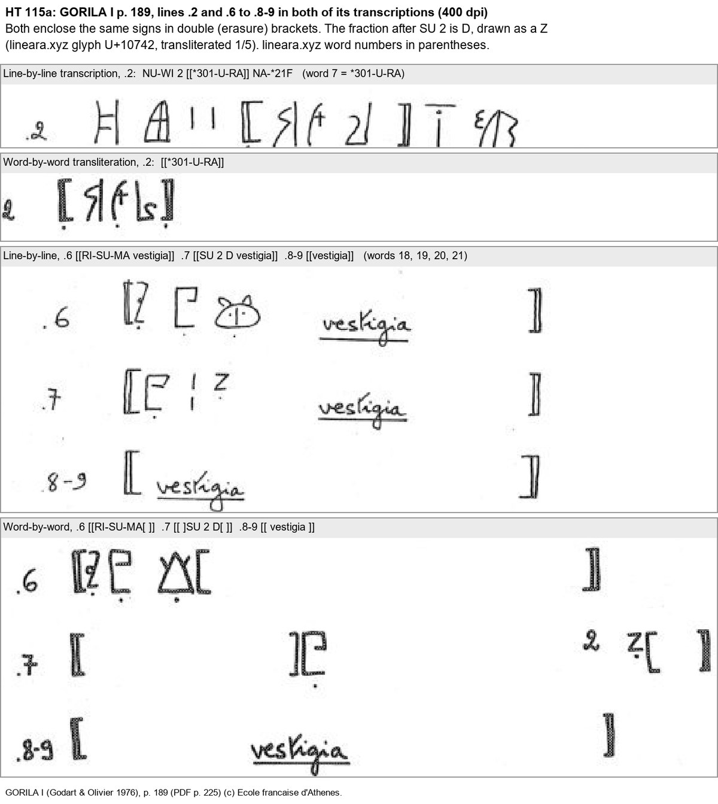

*GORILA I p. 189 (PDF p. 225), HT 115a lines .2 and .6–.9 in both copies: the signs stand between double (erasure) brackets.* (GORILA I, © École française d'Athènes)

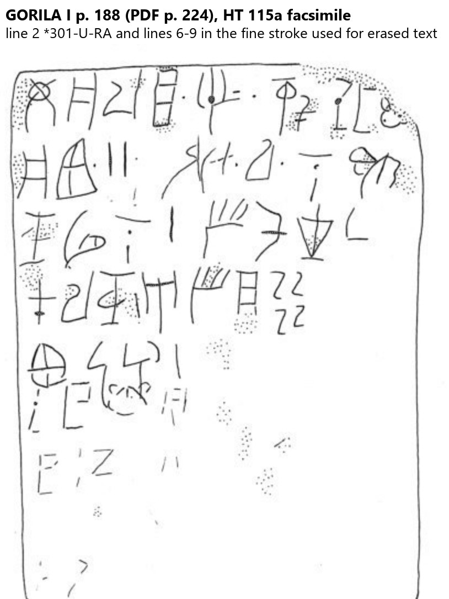

*GORILA I p. 188 (PDF p. 224), HT 115a drawing: \*301-U-RA (line .2) and lines .6–.9 are drawn in the fine stroke GORILA uses for erased signs.* (GORILA I, © École française d'Athènes)

### ARKH1b — erased NA 8 shown as live text

The site shows line .4 of ARKH1b, `NA 8`, as live text. GORILA III p. 5 (PDF p. 30) prints the line as `]⟦NA 8⟧` in both copies (normalised and tabular), and Younger has `][[NA 8]]`; GORILA V's corrigenda for ARKH 1b (p. 78, PDF p. 131) say only that its first two notes belong to ARKH 1a. This PR changes the two tokens to `[[NA]]` and `[[8]]` in `transliteratedWords` and `translatedWords`. No token is split, so the glyph fields, word numbers and boxes stay as they are.

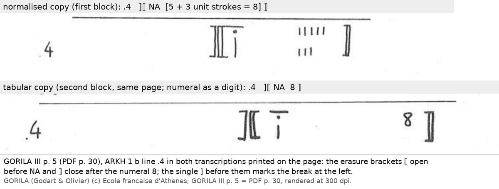

*GORILA III p. 5 (PDF p. 30), ARKH 1b line .4 in the normalised and the tabular copy: ]⟦NA 8⟧ in both.* (GORILA III, © École française d'Athènes)

### ARKH3a — erased first \*317 2 shown as live text

ARKH3a lists \*317 2 twice, and the site shows both pairs as live text. GORILA III p. 9 (PDF p. 34) prints the first pair (line .3) between erasure brackets in both copies, with the apparatus 'Autre signe effacé après \*317 2', and leaves the second (line .5) live; Younger's a.3 has the same brackets (`[[*317 2]]`). This PR changes the first pair to `[[*317]]` `[[2]]` in `transliteratedWords` and `translatedWords`. On the drawing, box 11 of `ARKH3a-Facsimile` ('2', word 10) framed the erased vestige after the numeral; in `items_image_map.js` and in the matching `imagemaps.js` area it now sits on the numeral stroke after \*317.

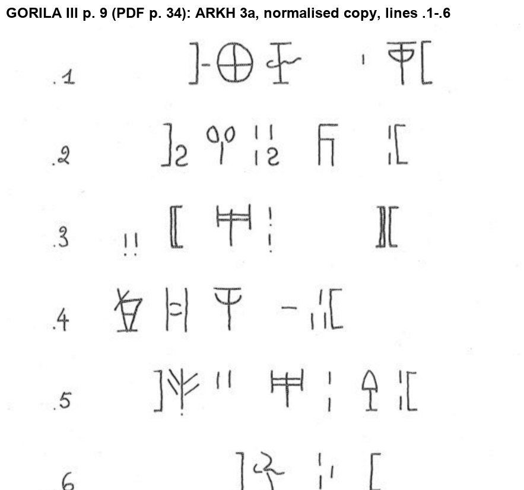

*GORILA III p. 9 (PDF p. 34), ARKH 3a normalised copy: the first \*317 2 (line .3) stands between erasure brackets; the second (line .5) is live.* (GORILA III, © École française d'Athènes)

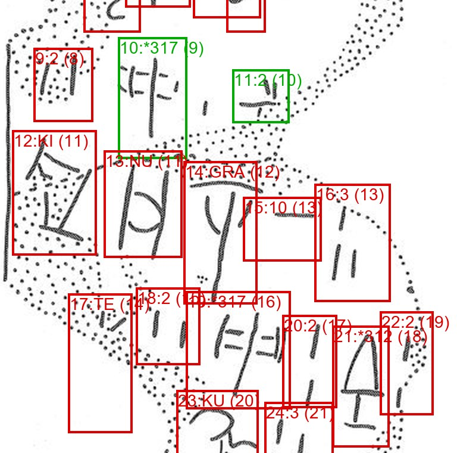

*Master (9c81beb): `ARKH3a-Facsimile` box 11 ('2') frames the erased vestige after the numeral; the erased pair \*317 2 (boxes 10 and 11) is in green.* (lineara.xyz image, a crop of the GORILA III plate; boxes drawn from `items_image_map.js`; © École française d'Athènes)

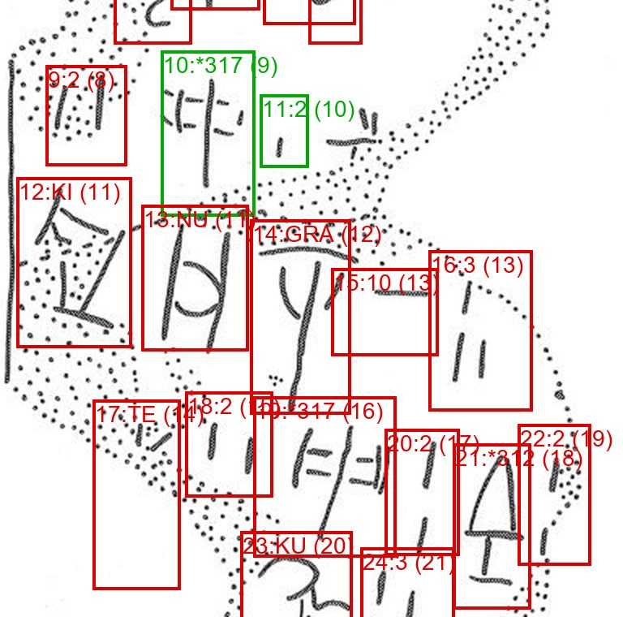

*This PR: box 11 on the stroke of the 2 after \*317; explorer area 11 moves with it.* (lineara.xyz image, a crop of the GORILA III plate; boxes drawn from the new `items_image_map.js` entries; © École française d'Athènes)

### ZA21b — erased ME shown as live text

The site shows the last sign of ZA21b, `ME` on line .7, as live text. GORILA III p. 197 (PDF p. 222) prints the line as `⟦ME⟧` in both copies (copie normalisée and copie tabulaire), with a dot under the sign, and Younger's ZA 21 table has the same reading in row b.7 (`[[ ME ]]`, ME underlined). This PR changes the token to `[[ME]]` in `transliteratedWords` and `translatedWords`; the glyph, the boxes and the explorer areas stay as they are.

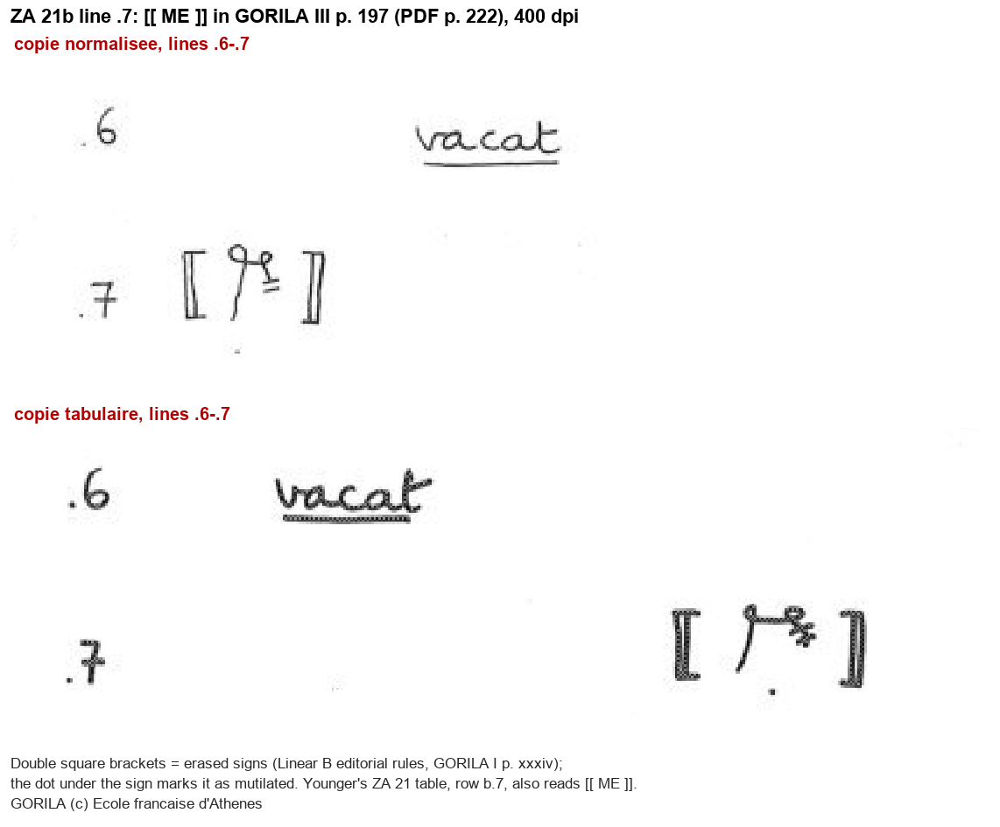

*GORILA III p. 197 (PDF p. 222), ZA 21b line .7 in both copies: ⟦ME⟧, with a dot under the sign.* (GORILA III, © École française d'Athènes)

### HT86b — whole face erased, shown as live text

The site shows HT86b as ordinary text: `A-KA-RU 𐄁 / KU-NI-SU GRA+K+L 20 / SA-RU 20 / DI-DE`. GORILA I p. 135 (PDF p. 171) prints every line of side b between erasure brackets in both copies (.1–.3, then .4-6 ⟦vacant⟧), with the note 'Texte actuel sur premier palimpseste' under its normalised copy of HT 86b; Younger brackets b.1–b.3 the same way and calls the tablet a double palimpsest (after Schoep 2002, 79). Side b repeats the opening of HT86a and breaks off at DI-DE, where side a goes on with DI-DE-RU, and in the photograph on p. 134 (PDF p. 170) its strokes are much fainter than those of side a. This PR wraps every HT86b token in `[[ ]]` in `transliteratedWords` and `translatedWords`; glyphs, word numbers and boxes do not change. The divider becomes `[[𐄁]]` because both editions put it inside the brackets; bcfb77a has no example of an erased divider, so leaving it bare would be an equally valid choice.

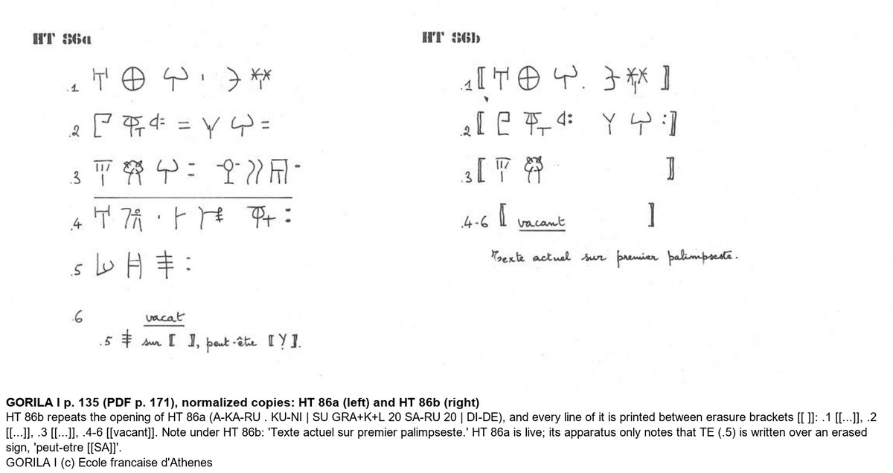

*GORILA I p. 135 (PDF p. 171), normalised copies: HT 86a (live) beside HT 86b, where every line stands between erasure brackets; under HT 86b, the note 'Texte actuel sur premier palimpseste'.* (GORILA I, © École française d'Athènes)

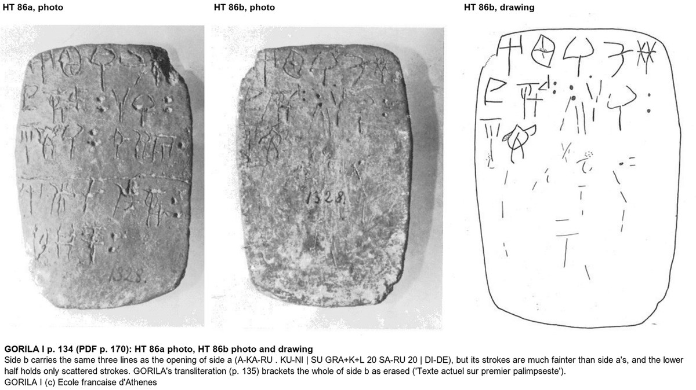

*GORILA I p. 134 (PDF p. 170): photographs of HT 86a and HT 86b and the drawing of HT 86b; side b repeats the opening of side a in much fainter strokes.* (GORILA I, © École française d'Athènes)

### ZAWc2 — text stored twice; erased MI shown as live

ZAWc2 stores its one seven-sign text twice (A-TI-KA-A-DU-KO-MI, a line break, then the same again) and shows MI as live. GORILA II p. 98 (PDF p. 158) prints the inscription once, as `A-TI-KA A-DU-KO-⟦MI⟧`, and Younger gives the same text and word division; Anastasiadou (in Salgarella and Petrakis 2026, pp. 37–41) reads the last sign as the numeral 2, so on either reading it is not a live MI. This PR keeps one copy in `words`, `transliteratedWords`, `translatedWords` and `parsedInscription`, divided as GORILA divides it: A-TI-KA, A-DU-KO and `[[MI]]` as a token of its own. Both image maps lose the seven entries of the duplicate, none of which has a box, and the seven boxed entries become words 0–2; `transcription` and the explorer areas need no change. `supplement.json`, `wordsInCorpus` and `annotations.js` (one tag entry per word) follow, and `items/ZAWc2.html` is regenerated.

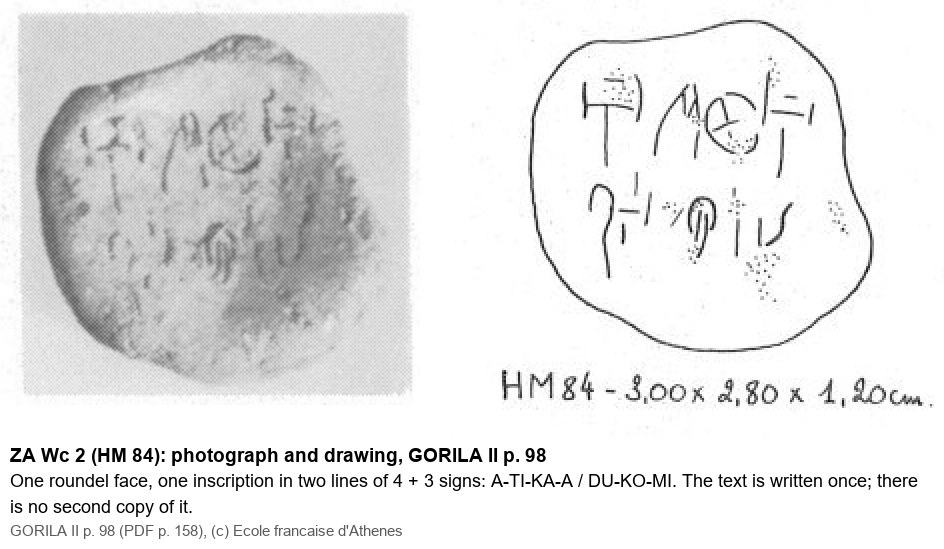

*GORILA II p. 98 (PDF p. 158): ZA Wc 2 (HM 84), one inscription of 4 + 3 signs, written once.* (GORILA II, © École française d'Athènes)

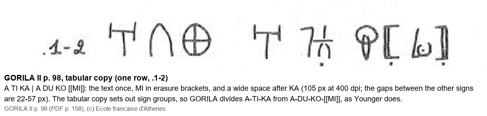

*GORILA II p. 98 (PDF p. 158), tabular copy: A-TI-KA A-DU-KO-⟦MI⟧, printed once.* (GORILA II, © École française d'Athènes)

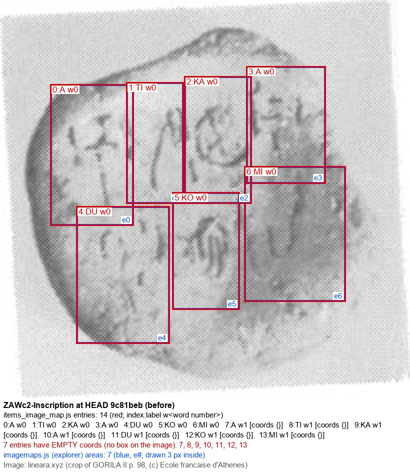

*Master (9c81beb): `ZAWc2-Inscription` has seven boxes, all word 0, and seven entries without boxes for the duplicated text.* (lineara.xyz image, a crop of the GORILA II plate; boxes drawn from `items_image_map.js` and `imagemaps.js`; © École française d'Athènes)

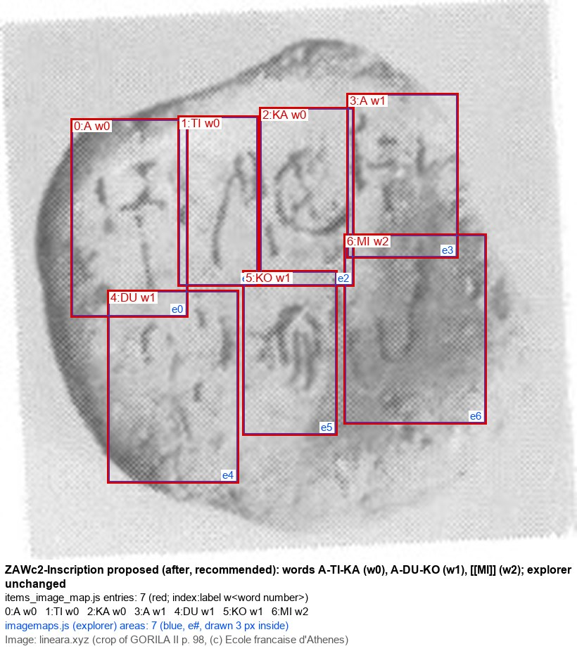

*This PR: seven entries, A-TI-KA (word 0), A-DU-KO (word 1) and MI (word 2, `[[MI]]` in the text); boxes and explorer areas are unchanged.* (lineara.xyz image, a crop of the GORILA II plate; boxes drawn from the new entries; © École française d'Athènes)

### MA4b — whole face erased; first number 137, not 123

The site shows side b of MA 4 as a live entry, `A-JA HIDE+[?] 123 / 160`. GORILA I p. 273 (PDF p. 309), MA 4b .1, prints the whole face between erasure brackets, `⟦A-[· · ·]-JA *180 137⟧` with `⟦160⟧` beneath it, and Younger agrees (b.1 `[[A-[...]-JA *180 137]]`, the 7 underlined; b.1 `[[160]]`). The drawing on GORILA I p. 272 (PDF p. 308), from which `MA4b-Facsimile.jpg` is cropped, has three tens dots (30, not 20) and at least five unit strokes, two above and three below, which GORILA's copy draws as `I[II]I` over `III`, i.e. 7 with two strokes restored; the INSCRIBE 3D model `Clay_tablet_MA_4` (side b, lights az 90° and az 270°, el 35°) shows the three dots clearly, while the units lie on the spalled join and cannot be counted on it. This PR changes the number to `𐄙𐄒𐄍` (100 30 7) in `words`, `parsedInscription` and `transcription`, wraps each token in `[[ ]]` in `transliteratedWords` and `translatedWords` (`[[A-JA]] [[HIDE+[?]]] [[137]] [[160]]`), and in both image maps relabels entries 4 and 5 `30` and `7`, whose boxes and explorer areas now cover all three dots and both rows of strokes; on the drawing the `100` and `60` boxes are refitted too, and the photo's `7` box is approximate, because the strokes cannot be made out on the photo. `supplement.json` and `wordsInCorpus` follow, `items/MA4b.html` is regenerated, and the site-wide label `HIDE+[?]` and the spelling of A-JA without its gap mark are left as they are.

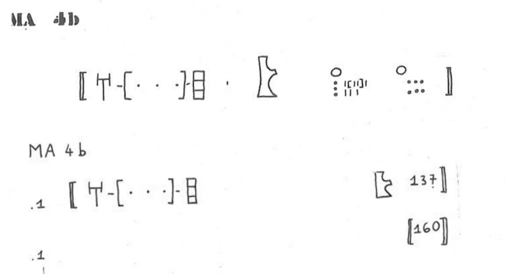

*GORILA I p. 273 (PDF p. 309), MA 4b: the normalised copy, whole face inside erasure brackets, and the tabular copy, .1 ⟦A-[· · ·]-JA \*180 137⟧ with ⟦160⟧ beneath it.* (GORILA I (L. Godart and J.-P. Olivier 1976), © École française d'Athènes)

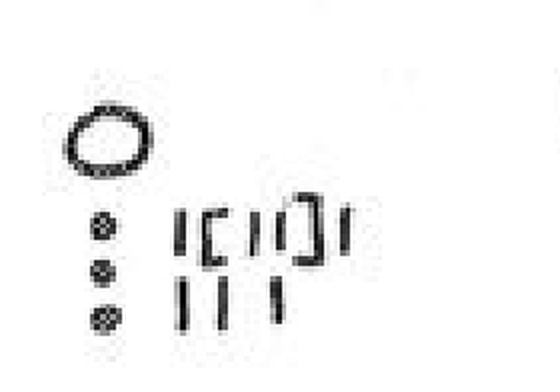

*GORILA I p. 273, the first number in the normalised copy, enlarged 2×: circle (100), a column of three dots (30), and unit strokes drawn I[II]I over III, i.e. 7 with two strokes restored.* (GORILA I (L. Godart and J.-P. Olivier 1976), © École française d'Athènes)

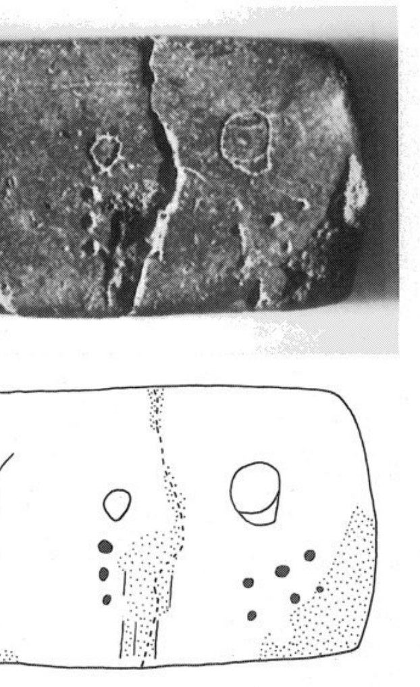

*GORILA I p. 272 (PDF p. 308), MA 4b photograph (top) and drawing (bottom), numeral half; the site's `MA4b-Inscription.jpg` and `MA4b-Facsimile.jpg` are crops of these. Under the small circle, three dots in a column (30, not 20); in the stippled, damaged units area, two upper and three lower strokes (at least 5, so not 3); under the large circle, six dots (60).* (GORILA I (L. Godart and J.-P. Olivier 1976), © École française d'Athènes)

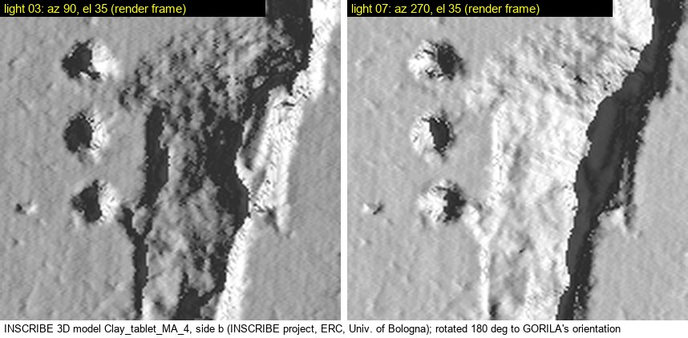

*INSCRIBE 3D model, MA 4 side b, ready-made renders under light 03 (az 90°, el 35°) and light 07 (az 270°, el 35°), turned 180° to GORILA's orientation: three round dot impressions in the tens column under both lights. The unit strokes lie on the spalled join to the right and cannot be counted on the model.* (INSCRIBE 3D model Clay_tablet_MA_4 (INSCRIBE project, ERC, University of Bologna; https://www.inscribercproject.com/Linear_A.php); © École française d'Athènes)

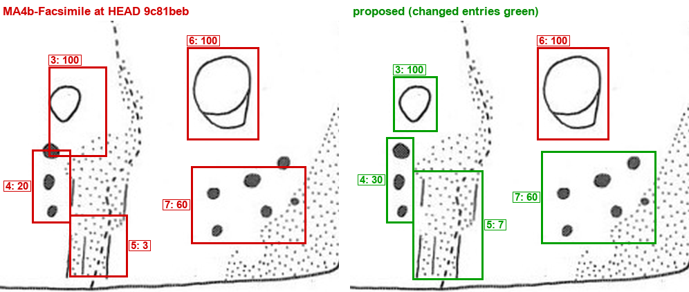

*`MA4b-Facsimile`, numeral half. Left, master (9c81beb): box 4 '20' cuts through the top tens dot, box 3 '100' also takes in that dot, box 5 '3' covers only the lower row of unit strokes, and box 7 '60' leaves the top-right dot outside. Right, this PR (green): 3 '100' tight on the circle, 4 '30' on all three dots, 5 '7' on both rows of strokes, 7 '60' on all six dots. The explorer areas equal these boxes, before and after.* (lineara.xyz image `MA4b-Facsimile.jpg`, a crop of GORILA I p. 272, © École française d'Athènes; boxes from `items_image_map.js` at 9c81beb and from the new entries)

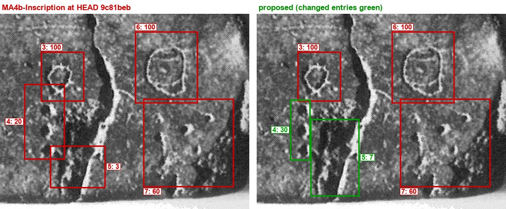

*`MA4b-Inscription` (photo), numeral half. Left, master (9c81beb): box 4 '20' takes in the column of three holes and part of the crack, and box 5 '3' only the lower part of the units area. Right, this PR (green): 4 '30' tight on the three holes, 5 '7' over the units area beside and on the crack. The strokes cannot be made out on the photo, so this box was placed by carrying the drawing's strokes over to the photo (same scale, shifted by about 15 px in x and 20 px in y).* (lineara.xyz image `MA4b-Inscription.jpg`, a crop of GORILA I p. 272, © École française d'Athènes; boxes from `items_image_map.js` at 9c81beb and from the new entries)

## Readings, sign labels and data entries

Ten corrections to readings, sign labels and record entries; they make up the second commit of this PR. The derived files follow the records wherever the data they hold changes: `items_analysis/inscriptions.json` (the notebook's copy of the records), `items_analysis/supplement.json`, `annotations.js` and `wordsInCorpus`. In `annotations.js`, words that are split, merged or moved get tag entries of their own. Twelve item pages change and are regenerated with the committed notebook, which reproduces the committed pages byte for byte from the master inputs: HT24a, HT132, HTZd155, HTZd157+156, KNZg57a, KNZg57b, KNZg58, PE1, SYZa2, SKOZc1, ZA6a and GOWc3. Entry and area numbers count from 0, as in the files, and boxes are given as (x, y, width, height) in the image's own pixels. "Before" figures show master (9c81beb).

### HT24a — MA+RU monogram split into MA and RU

On master (9c81beb) the word arrays write the MA+RU monogram as one glyph, U+106E2, only in line .5. In .1–.4 they split it into MA + RU, which creates the words KI-MA-RU and MA-RU-ME (three times), and both image maps and the explorer give each of these monograms two boxes, RU on the horns and MA on the dome. GORILA I p. 43 (PDF p. 79) and its drawing on p. 42 (PDF p. 78), which `HT24a-Facsimile.jpg` reproduces, show the monogram as one sign in all five lines; GORILA V p. 266 (PDF p. 319, shown under the next item) numbers the groups A 546 (KI on MA+RU, .1), A 561 (MA+RU with ME, .2–.4) and A 560 (.5), and Younger has `KI MA+RU[ {*546}`, `MA+RU ME {*561}` three times and `MA+RU {*560}[`. This PR writes U+106E2 in `words`, `parsedInscription` and `transcription`, labels the groups `*546` and `*561` in `transliteratedWords` and `translatedWords` (.5 keeps `*560`), and merges each MA/RU box pair into one box labelled `*546` or `*561` (29 → 25 entries and explorer areas per image; the KI and ME boxes keep their labels). It also puts the .4 group back on the PA-SA-RI-JA line, as in GORILA, Younger and the record's `parsedInscription`, adds the .4 ME to `transcription` and its damage mark to `parsedInscription`, moves the drawing's .4 ME box, a copy of the RU box, onto the ME remains, and regenerates `items/HT24a.html`, which still labels the monogram `*560` (see the next item). HT117a's MA-RU, two separate signs, is not touched.

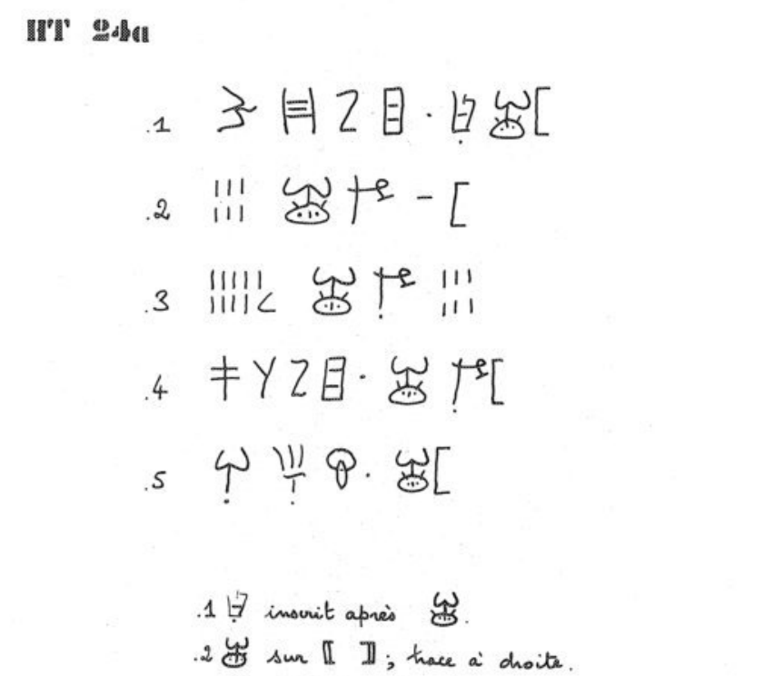

*GORILA I p. 43 (PDF p. 79), HT 24a .1–.5, normalised copy and apparatus. The monogram (RU's horns set on MA's dotted dome) is one sign in every line: .1 KU-PA₃-RI-JA · KI MA+RU[, .2 6 MA+RU ME 10[, .3 9 J MA+RU ME 6, .4 PA-SA-RI-JA · MA+RU ME[, .5 RU-I-KO · MA+RU[. Apparatus: '.1 KI inscrit après MA+RU', '.2 MA+RU sur ⟦ ⟧; trace à droite'.* (GORILA I (L. Godart and J.-P. Olivier 1976), © École française d'Athènes)

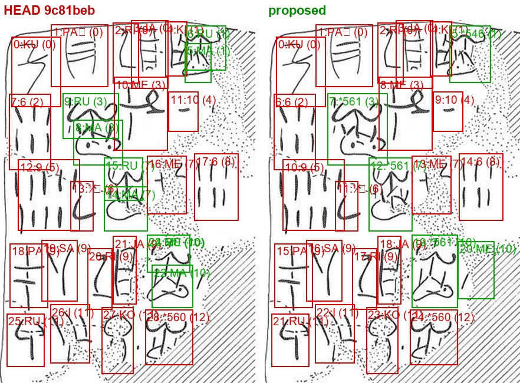

*The drawing `HT24a-Facsimile` (GORILA I p. 42) with its image-map boxes; the explorer areas are the same boxes. Left, master (9c81beb): in .1–.4 each monogram has two boxes, RU on the horns and MA on the dome, and the .4 ME box is a copy of the RU box. Right, this PR: one box per monogram, labelled `*546` (.1) and `*561` (.2–.4), and the .4 ME box on the ME remains at the break. Changed boxes are green.* (lineara.xyz image, a crop of the GORILA I p. 42 plate, © École française d'Athènes; boxes from `items_image_map.js` at 9c81beb and from the new entries)

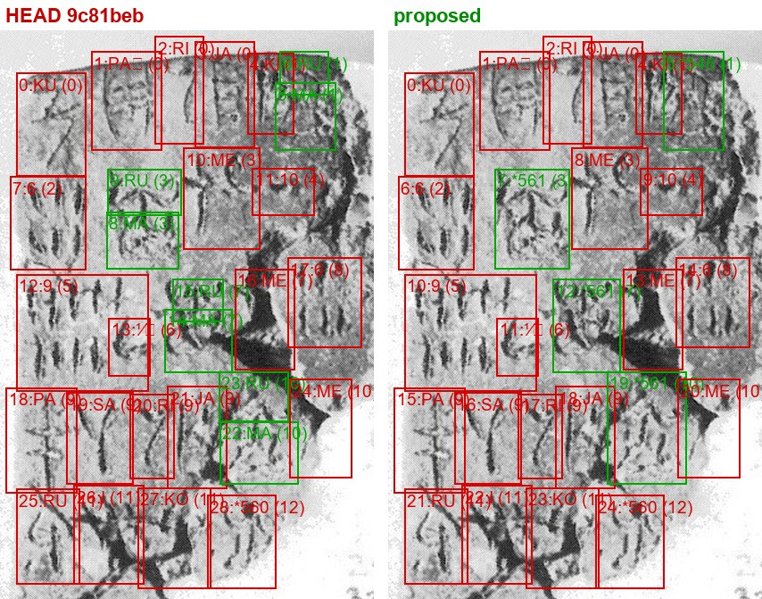

*The photo `HT24a-Inscription` (GORILA I p. 42) with its image-map boxes. Left, master (9c81beb): paired RU and MA boxes on each monogram in .1–.4. Right, this PR: one box per monogram, labelled `*546` and `*561`; all other boxes are unchanged. Changed boxes are green.* (lineara.xyz image, a crop of the GORILA I p. 42 plate, © École française d'Athènes; boxes from `items_image_map.js` at 9c81beb and from the new entries)

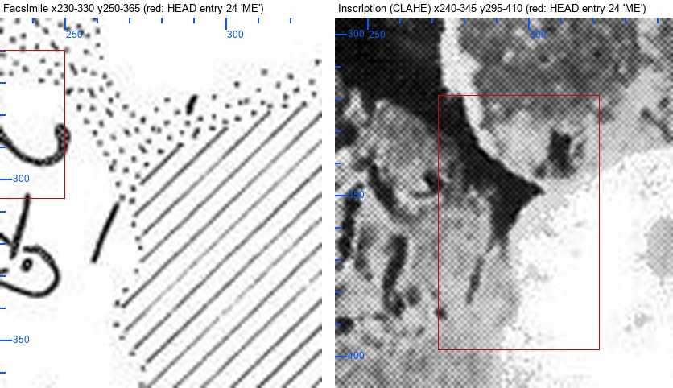

*Line .4 right of the monogram, enlarged. Left, the drawing (`HT24a-Facsimile` x 230–330, y 250–365): master's ME box (entry 24, red) sits on the monogram's horns; the ME remains are the slanted stroke at x 259–266, y 308–325 and a short dash at x 288–290, y 274–279, at the edge of the break. Right, the photo with its ME box (entry 24 on master), which is kept.* (lineara.xyz images, crops of the GORILA I p. 42 plate, © École française d'Athènes; photo contrast-enhanced)

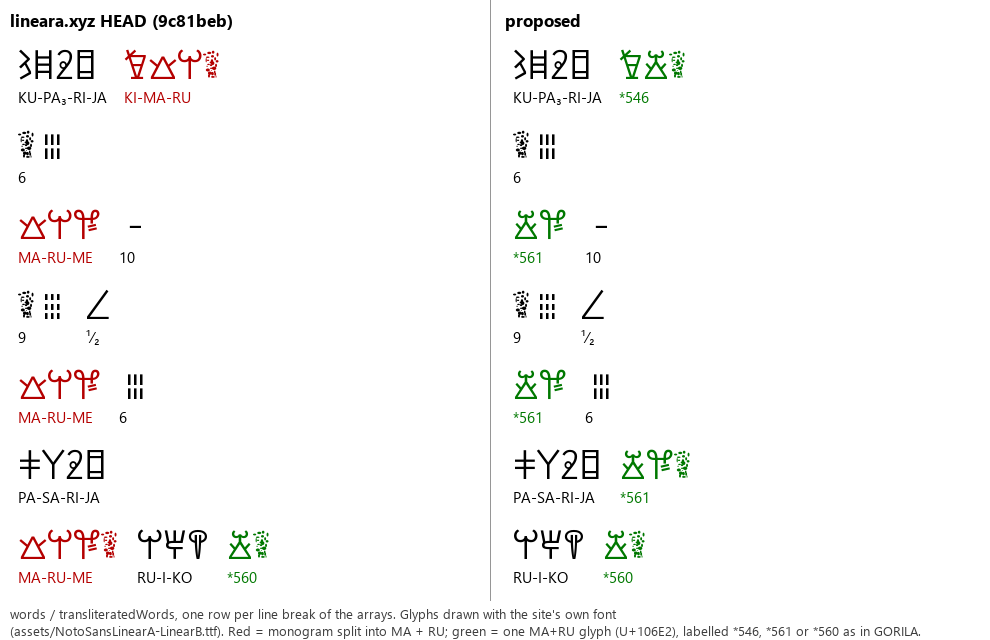

*HT24a `words` and `transliteratedWords` on master (9c81beb) and with this PR, one row per line break of the arrays, drawn in the site's own font. Red: the monogram split into MA + RU; green: the single glyph U+106E2, labelled `*546` (.1), `*561` (.2–.4) and, as before, `*560` (.5). The .4 group moves back to the PA-SA-RI-JA row.* (Rendered with lineara.xyz `assets/NotoSansLinearA-LinearB.ttf`, Noto fonts, SIL Open Font License 1.1)

### HT12, PH3a, KH43, HT132, HTZd155, HTZd157+156 — sign labels `*560` and `*904`

On master (9c81beb) the MA+RU monogram (U+106E2) is labelled `*560` on HT12, PH3a and KH43 (there `*560-RE`), and the capital-I sign (U+1066B) is labelled `*904` at all six of its occurrences. GORILA V p. 266 (PDF p. 319) gives each MA+RU occurrence its own number, A 558 = PH 3(a).3, A 559 = HT 12.4 and A 562 (MA+RU with RE) = KH 43.1, and Younger prints the same numbers at these lines (`]MA+RU {*558}`, `MA+RU {*559}`, `]MA+RU-RE {*562}`); the I-shaped sign is 319 in GORILA V p. 297 (PDF p. 350), Younger writes `*319`, and neither has a sign 904. This PR changes these labels in `transliteratedWords`, `translatedWords` and the matching boxes of both image maps (HT12 `*559`, PH3a `*558`, KH43 `*562` with its RE box still `RE`, and `*319` on HT132, HTZd155 and HTZd157+156), writes U+106E2 in KH43's `transcription`, which spelt the monogram as MA RU, and removes the duplicate `*904` row of U+1066B from `items_analysis/syllables.txt`, `ideograms.js` and `tags.js`. The item pages of HT132, HTZd155 and HTZd157+156 are regenerated and show `*319`, but those of HT12, PH3a, KH43 and HT24a still show `*560`: the notebook takes one label per glyph from `syllables.txt` (for U+106E2 the last row, `*560`), and re-running its image-map cell would set these map labels back to `*560`. On HTZd157+156 line 2 the stored glyph follows the all-319 reading that Younger quotes from Valério, while GORILA IV p. 133 (PDF p. 176) reads NE (dotted), so there the new label only follows the stored glyph.

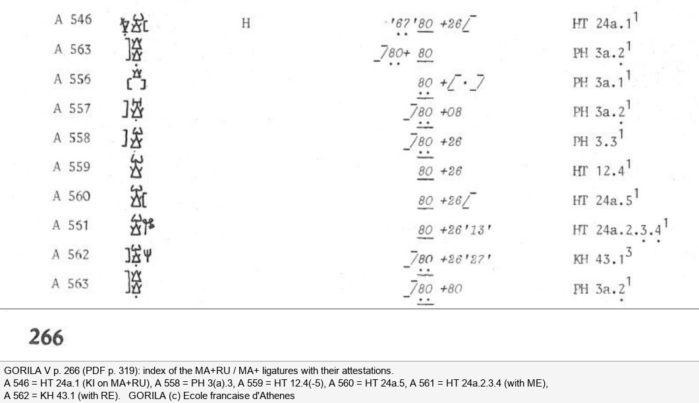

*GORILA V p. 266 (PDF p. 319), index of the MA+ ligatures with their attestations: A 546 '67'80+26 (KI on MA+RU) = HT 24a.1, A 558 ]80+26 = PH 3(a).3, A 559 80+26 = HT 12.4, A 560 80+26[ = HT 24a.5, A 561 80+26'13' (MA+RU with ME) = HT 24a.2.3.4, A 562 ]80+26'27' (MA+RU with RE) = KH 43.1. Each occurrence of MA+RU has its own number.* (GORILA V (L. Godart and J.-P. Olivier 1985), © École française d'Athènes)

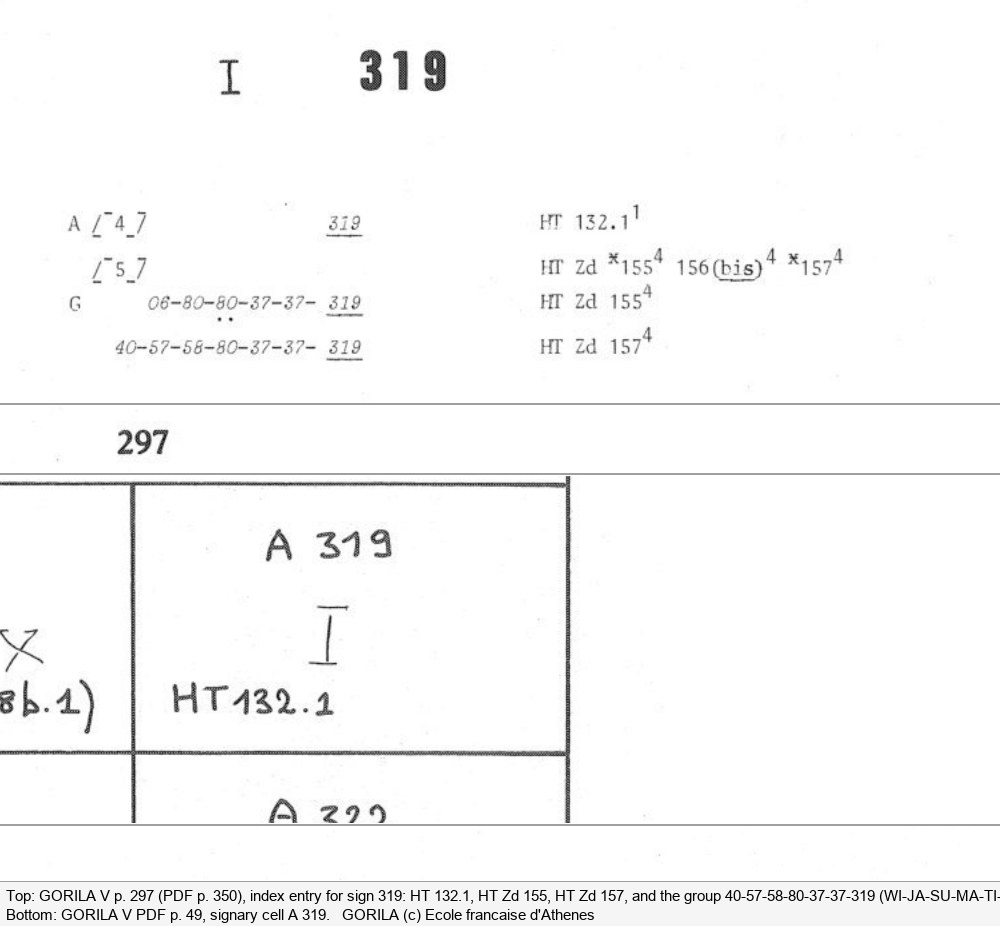

*GORILA V p. 297 (PDF p. 350): sign 319 (capital I) at HT 132.1 and HT Zd 155, 156 (bis), 157, and in the groups 06-80-80-37-37-319 (NA-MA-MA-TI-TI-319, HT Zd 155) and 40-57-58-80-37-37-319 (WI-JA-SU-MA-TI-TI-319, HT Zd 157). Below: GORILA V's signary, cell A 319 (PDF p. 49), with the example HT 132.1.* (GORILA V (L. Godart and J.-P. Olivier 1985), © École française d'Athènes)

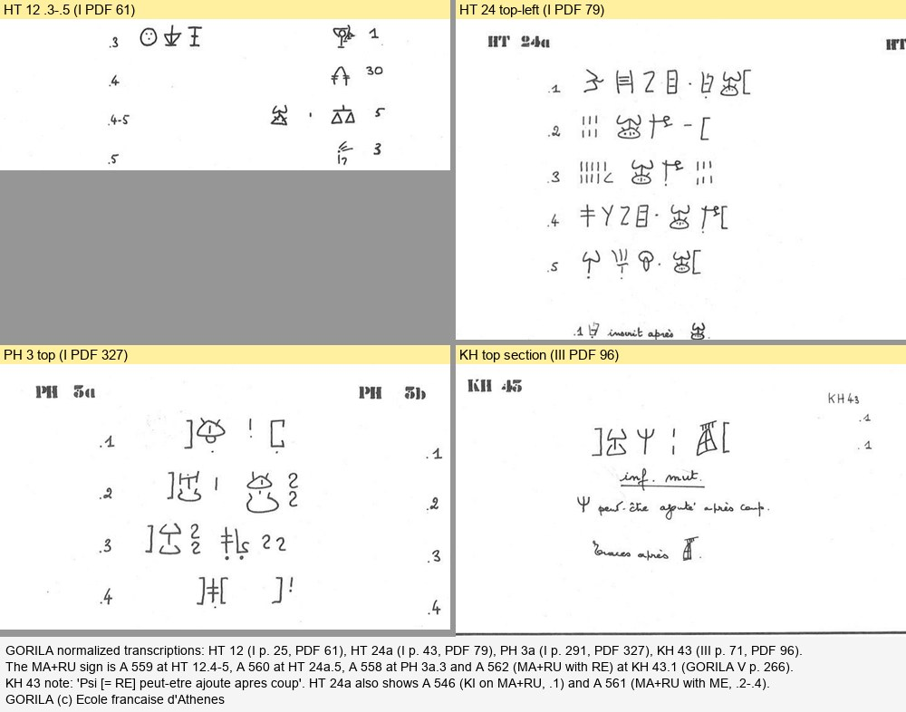

*GORILA's copies of the four MA+RU tablets: HT 12 .3–.5 (A 559; I p. 25, PDF p. 61, tabular copy), HT 24a .1–.5 (A 546, A 561, A 560; I p. 43, PDF p. 79), PH 3a .1–.4 (A 558 in .3; I p. 291, PDF p. 327) and KH 43 (A 562; III p. 71, PDF p. 96, with the note 'Ψ [= RE] peut-être ajouté après coup').* (GORILA I and III (L. Godart and J.-P. Olivier 1976, 1979), © École française d'Athènes)

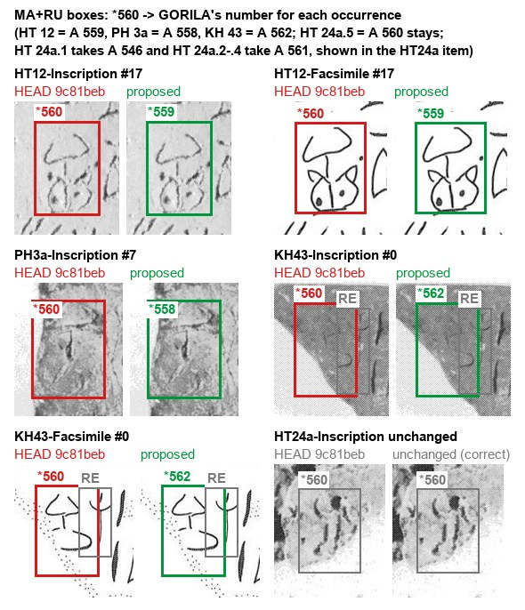

*Image-map boxes on the MA+RU sign, master (9c81beb) in red and this PR in green: HT12 #17 `*560` → `*559` (photo and drawing), PH3a #7 `*560` → `*558` (photo), KH43 #0 `*560` → `*562` (photo and drawing; the grey RE box is unchanged). Boxes and word numbers do not change. For HT24a, see the previous item. `PH3a-Facsimile` #7 is not shown: on master that drawing is cut through the sign (see [PH3a](#ph3a--the-drawing-is-cropped-through-a-sign)).* (lineara.xyz images, crops of GORILA plates, © École française d'Athènes; boxes from `items_image_map.js`)

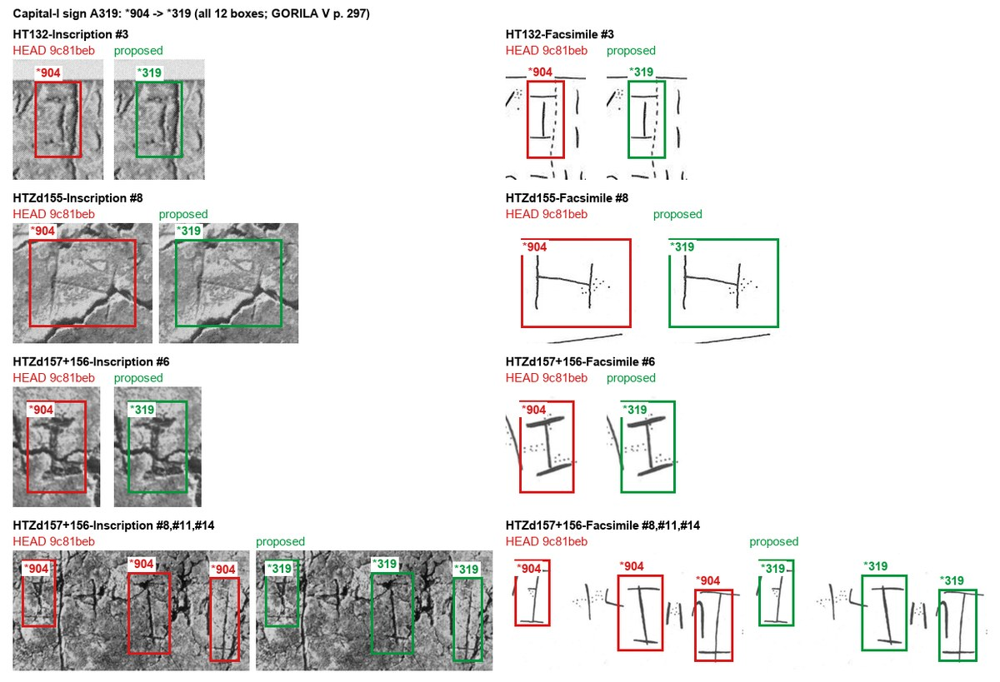

*All 12 image-map boxes labelled `*904` sit on the capital-I sign A319: HT132 #3, HTZd155 #8 (written sideways), HTZd157+156 #6, #8, #11 and #14, each in both images; master (9c81beb) in red, this PR (`*319`) in green. Boxes and word numbers do not change.* (lineara.xyz images, crops of GORILA plates, © École française d'Athènes; boxes from `items_image_map.js`)

### KH101 — duplicate empty entry

`LinearAInscriptions.js` lists KH101 twice: an empty stub after KH100 and the real entry after KE6. `new Map()` keeps the second, so the site already shows the right data; the duplicate was point 2 of #12, which was closed as completed on 2026-08-24 without the stub being removed. This PR removes the stub and the matching empty entries in `items_analysis/inscriptions.json`, `items_analysis/supplement.json`, `annotations.js` and `sitemap.xml`. No record value changes, and `items/KH101.html` stays as it is.

### KNZg57b, KNZg57a, KNZg58 — Face A text in the Face B record; photo credits

On master (9c81beb) the `parsedInscription` and `transcription` of KNZg57b (Face B of the Anetaki ivory ring) are a copy of KNZg57a's Face A text, pasted in when 5facf29 added the record, while its `words` hold a different ten-token reading and `transliteratedWords` and `translatedWords` are empty. The publication of the ring (Kanta, Nakassis, Palaima & Perna, in *KO-RO-NO-WE-SA*, Ariadne Supplement Series 5, Rethymno 2024, pp. 27–43; the site's `papers/KNZg57.pdf`) puts the rhyton A 664 and the vases on Face A (pp. 37–38) and describes Face B as sign groups with "AB 81 (KU), AB 40 (WI) and AB 60 (RA)" followed by three logograms, "GRA, probably FAR and OLIV" (p. 39); the record's `words` hold these syllabograms, but as single signs (see below). This PR sets both glyph strings to the record's own `words` and fills the two arrays with the site's values for these glyphs (`I, KU, WI, RA, KA, DU, 𐝫, GRA, GRA, OLIV`; GRA "grain", OLIV "olives"); the Face B reading itself could not be checked, as the article prints no transcription, drawing or legible photograph of it, has "probably FAR" where `words` has a second GRA, and counts "six groups of signs" where `words` has six single signs. KNZg57b also gets an entry in `annotations.js`, which had none, so that the explorer's word tip failed on its words; its tags are those the file gives the same signs elsewhere, except for RA, which stands alone in no other record, and the trace, tagged only 'lacuna' (elsewhere 'lacuna', 'lacuna at start' and 'lacuna at end'). The photo credits now follow the article's figure captions: 'Ph Sapirstein' (was 'Ph Saperstein') for KNZg57a and KNZg58, whose photo is Fig. 7, "Photo Ph. Sapirstein" (p. 35), and "Excavator's archive" for KNZg57b, whose photo is a crop of Fig. 6B (p. 33); 'Kanta', the excavator, would be a shorter form. The three item pages are regenerated with the new credits.

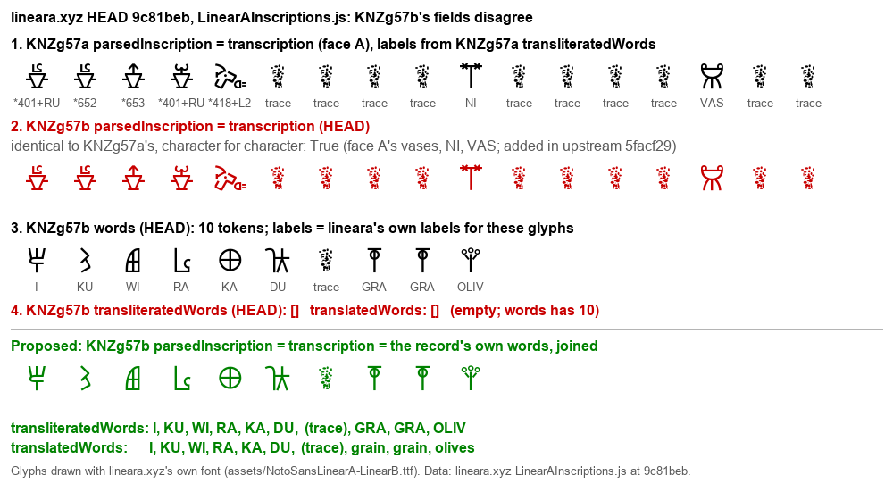

*KNZg57b on master (9c81beb): `parsedInscription` and `transcription` repeat KNZg57a's Face A string character for character (vases A652/A653/A651, rhyton A664, NI, VAS); `words` holds a different ten-token reading (I KU WI RA KA DU, trace, GRA GRA OLIV); `transliteratedWords` and `translatedWords` are empty. Below, in green: the new fields, built from the record's own `words` with the site's own labels.* (lineara.xyz data, `LinearAInscriptions.js` at 9c81beb; glyphs drawn in lineara.xyz's font, `assets/NotoSansLinearA-LinearB.ttf`)

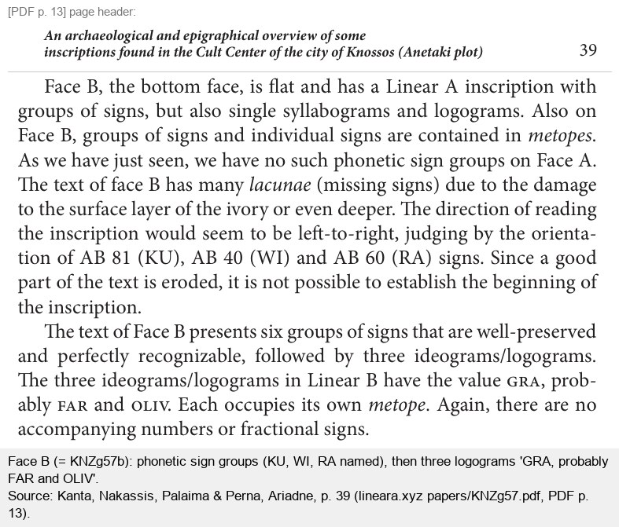

*P. 39 (PDF p. 13), Face B (= KNZg57b): phonetic sign groups, with AB 81 (KU), AB 40 (WI) and AB 60 (RA) named, then three logograms, 'GRA, probably FAR and OLIV'; 'we have no such phonetic sign groups on Face A'.* (Kanta, Nakassis, Palaima & Perna, 'An archaeological and epigraphical overview of some inscriptions found in the Cult Center of the city of Knossos (Anetaki plot)', KO-RO-NO-WE-SA (Ariadne Supplement Series 5), Rethymno 2024, pp. 27–43; lineara.xyz `papers/KNZg57.pdf`)

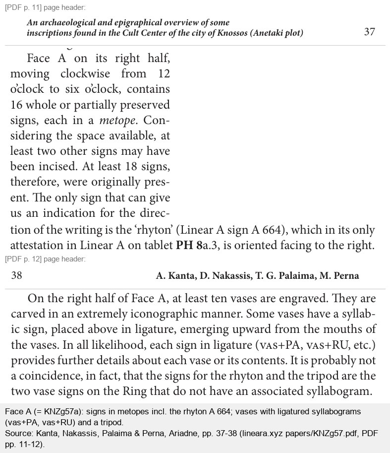

*Pp. 37–38 (PDF pp. 11–12), Face A (= KNZg57a): signs in metopes, among them the 'rhyton' (Linear A sign A 664), at least ten vases, some with a ligatured syllabogram (VAS+PA, VAS+RU), and a tripod. These are the signs copied into KNZg57b's `parsedInscription` and `transcription`.* (Kanta, Nakassis, Palaima & Perna, KO-RO-NO-WE-SA (Ariadne Supplement Series 5), Rethymno 2024; lineara.xyz `papers/KNZg57.pdf`)

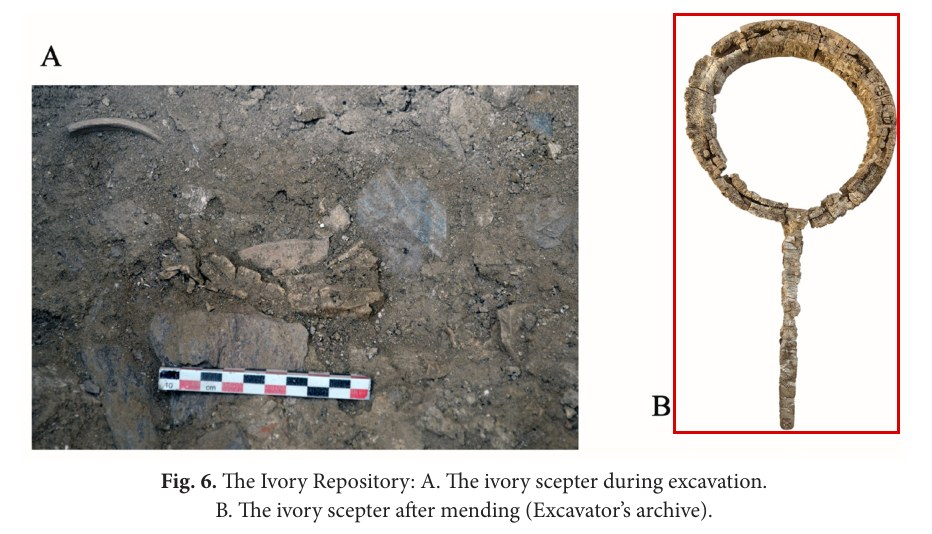

*Fig. 6, p. 33 (PDF p. 7). The red box marks the crop the site uses as `images/KNZg57b-Inscription.jpg` (normalised cross-correlation 0.996 at offset 983,7 in the embedded 1334×678 figure): panel B, 'The ivory scepter after mending (Excavator's archive)'. It is a view of the whole object in which no sign of Face B can be read, and not a Sapirstein photograph, as master's `imageRights` has it.* (Kanta, Nakassis, Palaima & Perna, KO-RO-NO-WE-SA (Ariadne Supplement Series 5), Rethymno 2024, Fig. 6 (Excavator's archive); red box added)

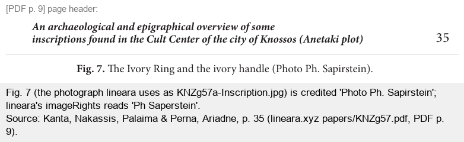

*Fig. 7 caption, p. 35 (PDF p. 9): 'Photo Ph. Sapirstein'. Fig. 7 is the photograph the site uses as `KNZg57a-Inscription.jpg` (and the byte-identical `KNZg58-Inscription.jpg`); master's `imageRights` reads 'Ph Saperstein'.* (Kanta, Nakassis, Palaima & Perna, KO-RO-NO-WE-SA (Ariadne Supplement Series 5), Rethymno 2024; lineara.xyz `papers/KNZg57.pdf`)

### PE1 — U-KA-RE-A-SE-SI-NA is two words

On master (9c81beb) the first word of PE1 is one seven-sign token, `U-KA-RE-A-SE-SI-NA` in `transliteratedWords` and `translatedWords`, and all seven signs are word 0 in both image maps; the word occurs nowhere else in the corpus. Issue #5 asks for `U-KA-RE A-SE-SI-NA`, Younger reads the same two words (`.1-2 U-KA-RE A-SE-SI-NA`), SigLA divides u-ka-re | a-se-si-na, and the site's own facsimile (line .1, about x 179–182, y 50–62) shows a short free-standing stroke between RE and A, with an incision at the same place in the photo. PE 1 was published after GORILA, so there is no GORILA page, and the editio princeps (Tsipopoulou & Hallager 1996: 25–30) was not available for checking. This PR splits the token in `words`, `transliteratedWords` and `translatedWords` (16 → 17 tokens) and renumbers the image-map words of `PE1-Inscription` and `PE1-Facsimile` (A-SE-SI-NA becomes word 1 and every later entry moves up by one); the glyph strings, boxes, labels and explorer areas do not change, and `items/PE1.html` is regenerated. No divider tokens are added: Younger writes dividers as `•` elsewhere (e.g. HT 1, `QE-RA2-U • KI-RO`, which the site has as `𐄁`) but marks none on PE 1. In `annotations.js` the numeral 72 of PE1 is now tagged `number` instead of `word`, like other numerals; HT127b and PK3, the two other records with 72, follow in the third commit.

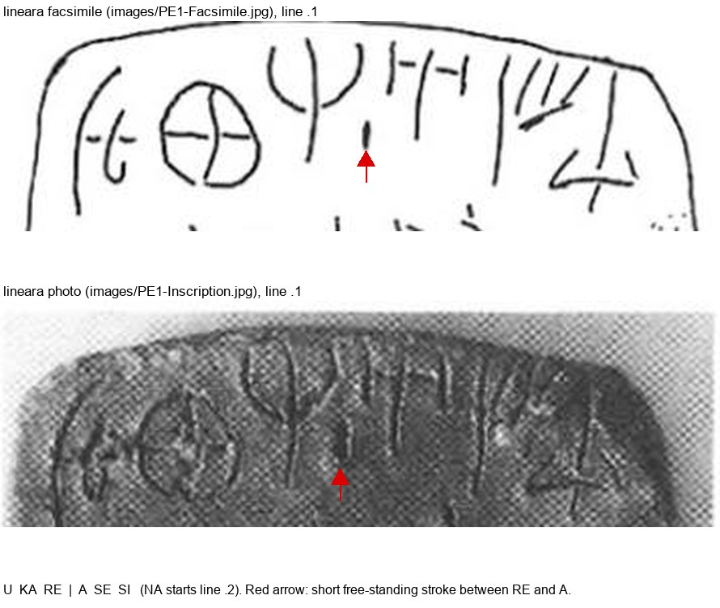

*PE 1 line .1 in the site's own facsimile (top) and photo (bottom), enlarged 2.5×: U KA RE | A SE SI. The red arrow points at a short free-standing stroke between RE and A, separate from both signs, at the word boundary that issue #5 asks for.* (lineara.xyz images, `images/PE1-Facsimile.jpg` and `images/PE1-Inscription.jpg`)

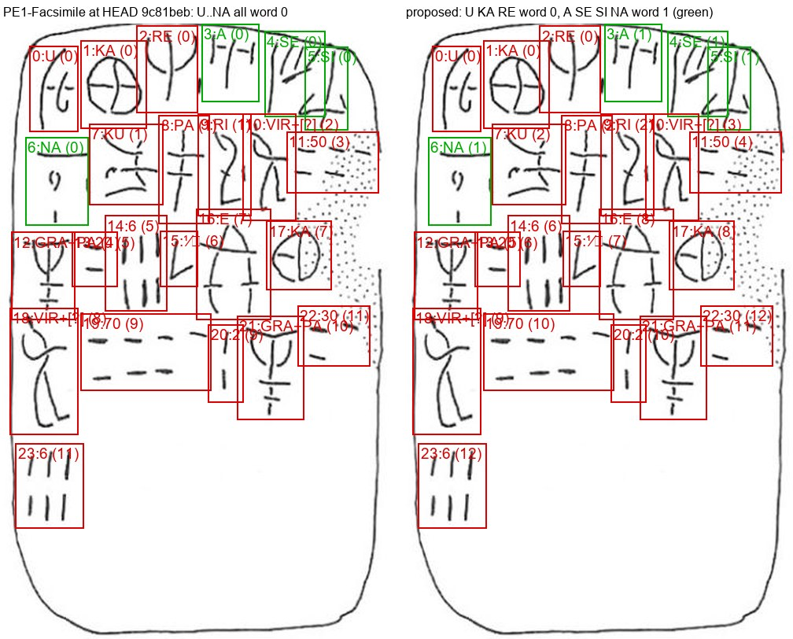

*Image map of `PE1-Facsimile`, master (9c81beb) left and this PR right; labels read 'index:label (word)'. On master all seven signs U..NA are word 0. With this PR U KA RE are word 0 and A SE SI NA word 1 (green), and every later entry moves up by one (KU-PA-RI 2 … 30/6 word 12). Boxes and labels are unchanged.* (lineara.xyz image `images/PE1-Facsimile.jpg`; boxes drawn from `items_image_map.js`)

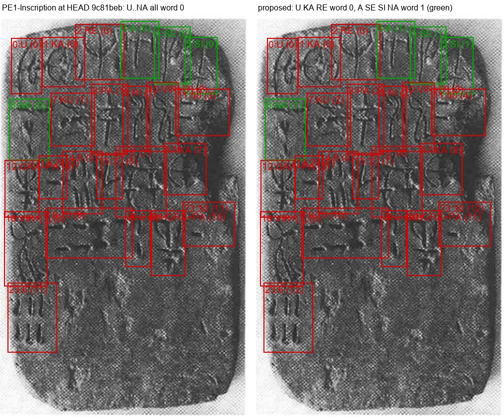

*Image map of `PE1-Inscription` (photo), master (9c81beb) left and this PR right. The renumbering is the same as on the facsimile; boxes are unchanged.* (lineara.xyz image `images/PE1-Inscription.jpg`; boxes drawn from `items_image_map.js`)

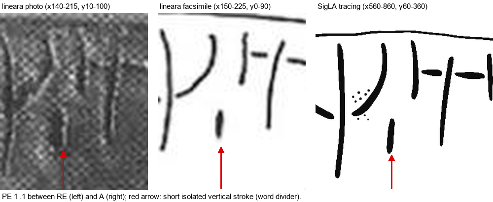

*Close-up between RE and A in the site's photo, the site's facsimile and SigLA's independent tracing: the same isolated stroke appears in all three.* (lineara.xyz images; SigLA drawing © Ester Salgarella & Simon Castellan, sigla.phis.me, CC BY-NC-SA 4.0)

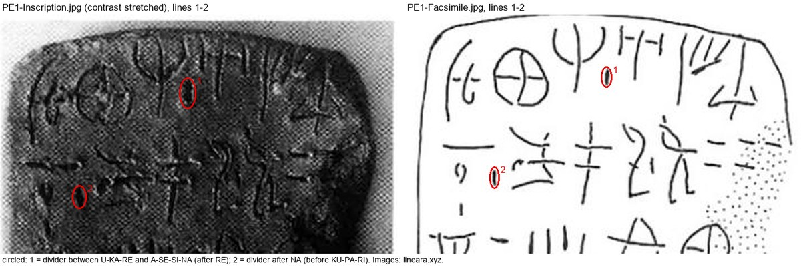

*Lines .1–.2 in the site's photo (contrast stretched) and facsimile. 1: the stroke between U-KA-RE and A-SE-SI-NA. 2: a similar stroke after NA, before KU-PA-RI, at an existing word boundary. This matters only if divider tokens are wanted; this PR adds none.* (lineara.xyz images, `images/PE1-Inscription.jpg` and `images/PE1-Facsimile.jpg`)

### SYZa2 — logograms fused into words, divider read as 1, wrong GORILA page

On master (9c81beb) the site reads side a of the Syme libation table (HM 3429) as `A-TA-I-*301-WA-JA 𐄁 JA-SU-MA-TU-OLIV 1` and side b as `U-NA-KA-NA-SI-OLE`. GORILA V p. 65 (PDF p. 118) sets OLIV and OLE apart from the words, in the logogram column of its tabular copy (its apparatus notes that OLE is "curieusement rattaché à" SI), and Younger has `JA-SU-MA-TU OLIV •` and `U-NA-KA-NA-SI OLE`. The "1" is a word divider: in GORILA's drawing (V p. 64, PDF p. 117) the mark after OLIV is the same filled round dot as the divider after WA-JA, on p. 65 it is a short mark at mid-height, far shorter than a unit stroke, and image-map entry 12 and explorer area 11 sit on it. This PR splits OLIV and OLE off in the three word arrays (glossed "olives", "olive oil" and, for U-NA-KA-NA-SI, "requesting", as at their other occurrences on the site), turns the 1 into `𐄁` in all five text fields, makes entry 12 a box-less `*900` entry with the later word numbers following, and drops the explorer area on the dot (19 areas for 19 letters). It also points `imageRightsURL` to `papers/GORILA-Vol5.pdf#page=117` (p. 64, SY Za 2) instead of `#page=115`, which opens SY Za 1 (p. 62), and `items/SYZa2.html` is regenerated with the new words and link.

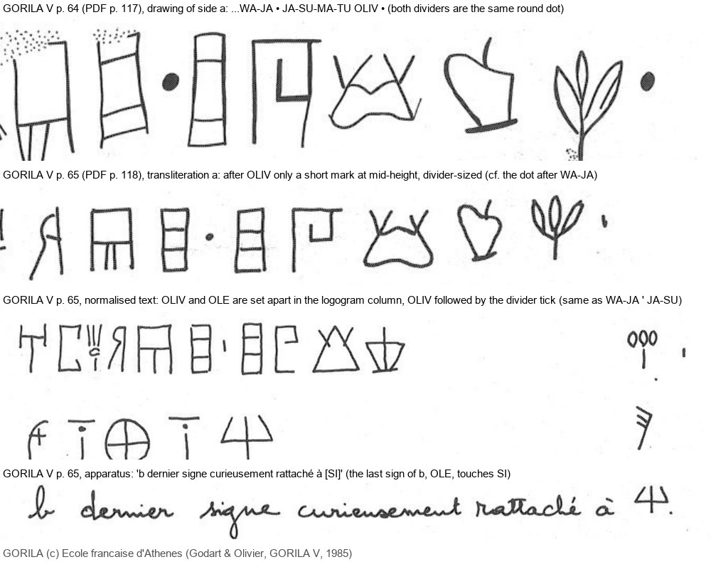

*GORILA V, four crops. (1) p. 64 (PDF p. 117), drawing of side a: …WA-JA • JA-SU-MA-TU OLIV •; the mark after the olive sign is the same filled round dot as the divider before JA-SU-MA-TU. (2) p. 65 (PDF p. 118), normalised copy of side a: after OLIV only a short, divider-sized mark at mid-height. (3) p. 65, tabular copy: OLIV (line a) and OLE (line b) stand apart in the right-hand logogram column, and OLIV is followed by the same short tick as the divider between the two JA; a unit stroke would be about sign height. (4) p. 65, apparatus: 'b dernier signe curieusement rattaché à [SI]'.* (GORILA V (L. Godart and J.-P. Olivier 1985), © École française d'Athènes; rendered from the copy lineara.xyz serves, `papers/GORILA-Vol5.pdf`)

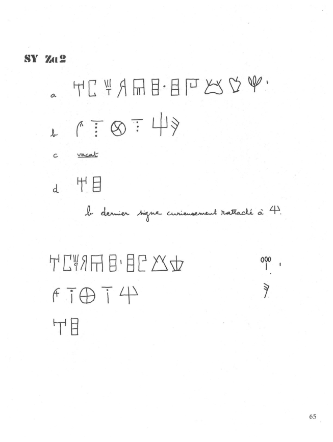

*GORILA V p. 65 (PDF p. 118), the whole SY Za 2 page: the normalised copy of sides a–d, the apparatus note on b's last sign, and the tabular copy with OLIV and OLE in the right-hand logogram column.* (GORILA V (L. Godart and J.-P. Olivier 1985), © École française d'Athènes; rendered from the copy lineara.xyz serves, `papers/GORILA-Vol5.pdf`)

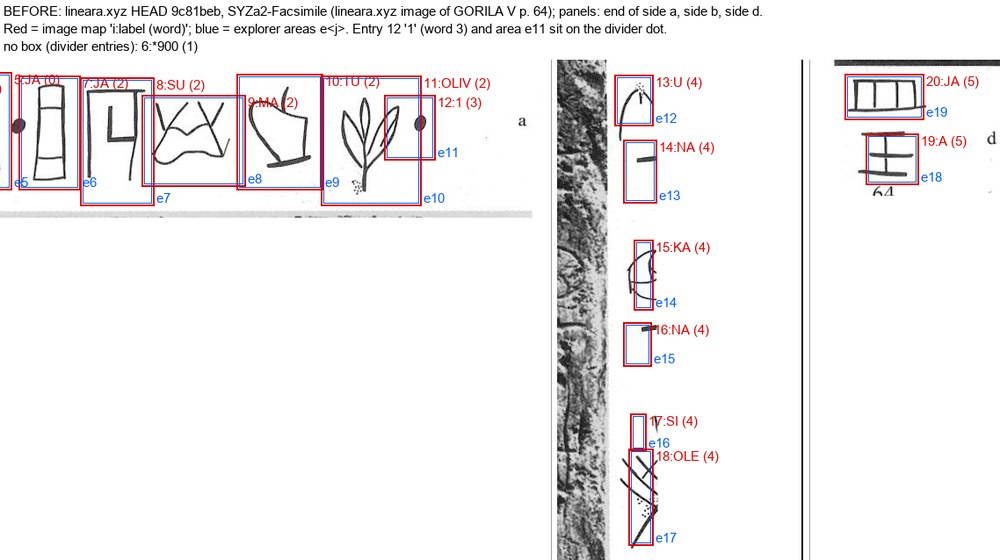

*Master (9c81beb): image map (red, 'index:label (word)') and explorer areas (blue) on `SYZa2-Facsimile.jpg`, in panels for the end of side a, side b and side d. Entry 12 '1' (word 3) and explorer area 11 sit on the divider dot after OLIV.* (lineara.xyz image `SYZa2-Facsimile.jpg`, a crop of GORILA V p. 64, © École française d'Athènes; boxes from `items_image_map.js` and `imagemaps.js`)

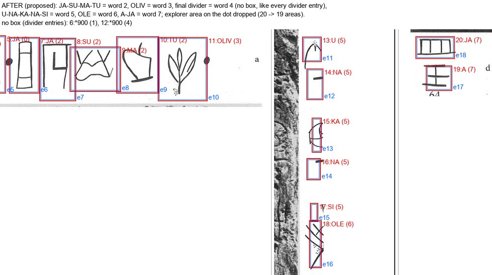

*This PR: JA-SU-MA-TU word 2, OLIV word 3, the final divider word 4 (a box-less `*900` entry, like every divider), U-NA-KA-NA-SI word 5, OLE word 6, A-JA word 7. The explorer area on the dot is dropped (20 → 19 areas, 19 letters). No coordinates change.* (lineara.xyz image `SYZa2-Facsimile.jpg`, a crop of GORILA V p. 64, © École française d'Athènes; boxes from the new `items_image_map.js` and `imagemaps.js` entries)

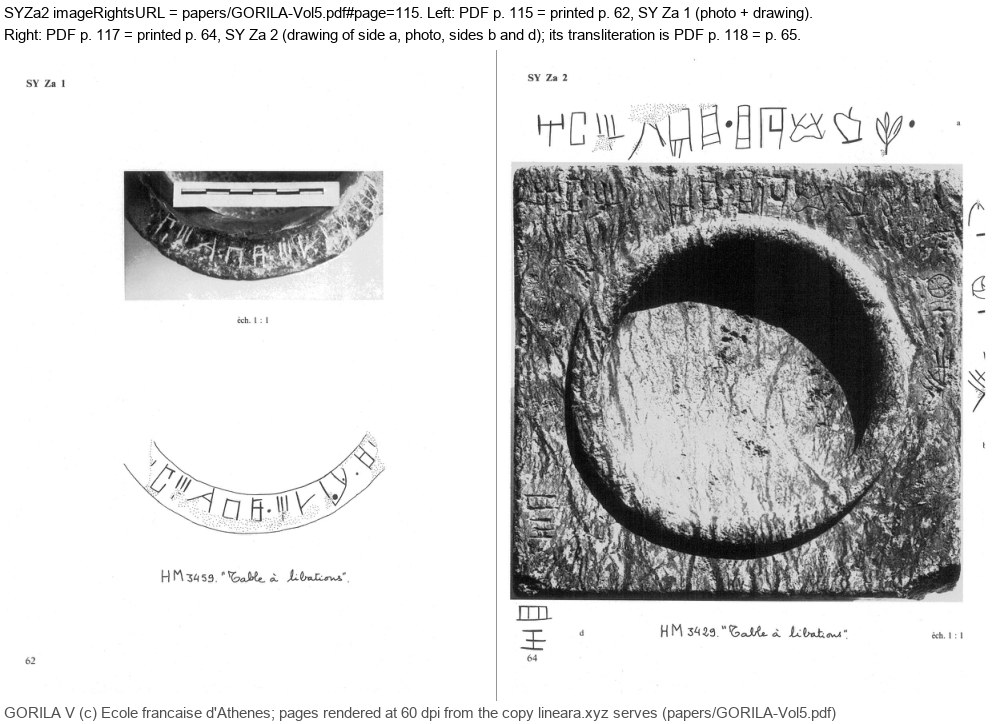

*Master's `imageRightsURL`, `papers/GORILA-Vol5.pdf#page=115`, opens SY Za 1 (left: PDF p. 115 = p. 62, HM 3459). SY Za 2 (right: HM 3429) is on PDF p. 117 = p. 64, the page `SYZa2-Facsimile.jpg` is cropped from.* (GORILA V (L. Godart and J.-P. Olivier 1985), © École française d'Athènes; rendered from the copy lineara.xyz serves, `papers/GORILA-Vol5.pdf`)

### SKOZc1 — fragment B reads ZU, not TI

On master (9c81beb) fragment B of SKO Zc 1 reads QA-KI-TI. The record's linked source and only edition, M. Perna, A. Kanta, L. Tyree, "An Unpublished Inscription in Linear A from the Skoteino Cave, Crete (SKO Zc 1)", in M. Perna (ed.), *Studi in onore di Enrica Fiandra*, Paris 2005, 321–333 (`papers/SKOZc1.pdf`), reads `]AB 16-AB 67-AB 79[`, i.e. QA-KI-ZU, with all three signs underdotted as uncertain (p. 327; the dotting is explained on p. 328). The third sign "is compatible with AB 79, particularly in its variant that appears in the painted clay inscription KN Zc 6.3 (fig. 11a)" and "presents a dot rather than a line within the oval" (p. 327); in fig. 10a–b (p. 330) and in the site's own crops (box 7) it is a pointed arch with a dot inside, whereas the site's TI boxes elsewhere (e.g. HT 8a, HT 7a, HT 10b) show the arch without a central dot, and the site itself reads the KN Zc 6.3 sign as ZU. This PR changes TI (U+10620) to ZU (U+10640) in the five text fields and in the label of entry 7 in both image maps, and `items/SKOZc1.html` is regenerated; boxes, word numbers and explorer areas stay. The site has no way to show the editors' underdot and already shows QA and KI plain, so ZU is shown plain as well.

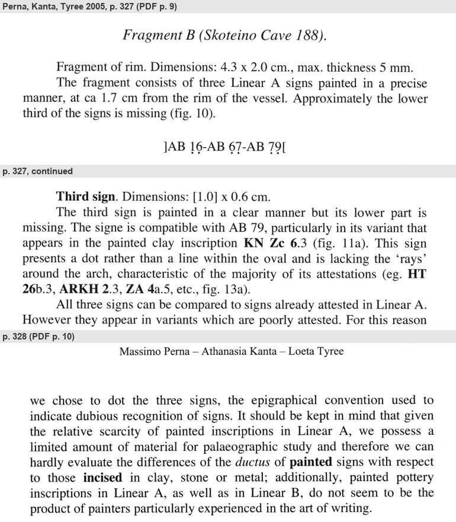

*Edition of SKO Zc 1, p. 327: fragment B is read ]AB 16-AB 67-AB 79[ (QA-KI-ZU), each sign underdotted. The third sign is 'compatible with AB 79, particularly in its variant that appears in the painted clay inscription KN Zc 6.3', with 'a dot rather than a line within the oval'. P. 328: the dots mark doubtful recognition. TI (AB 37) is not mentioned.* (M. Perna, A. Kanta, L. Tyree, 'An Unpublished Inscription in Linear A from the Skoteino Cave, Crete (SKO Zc 1)', in M. Perna (ed.), Studi in onore di Enrica Fiandra (Paris 2005) 321–333, pp. 327–328; lineara.xyz `papers/SKOZc1.pdf`, PDF pp. 9–10)

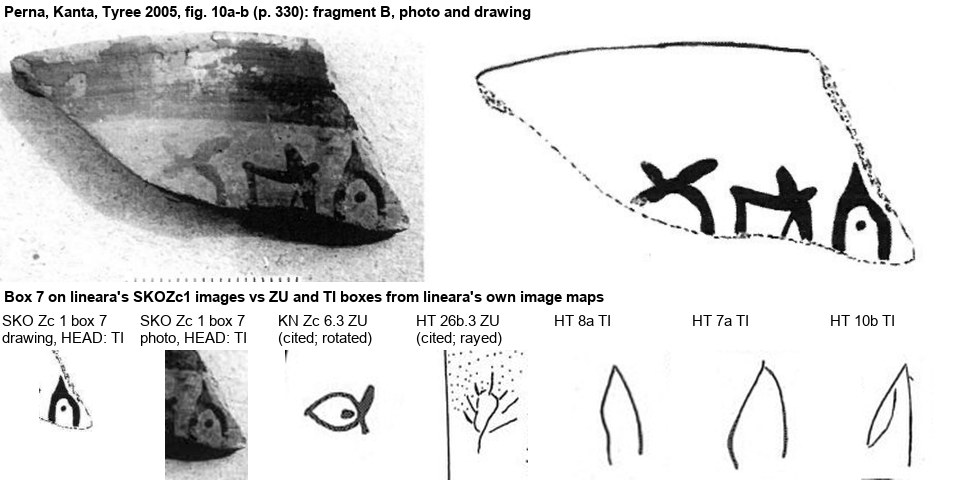

*Top: fragment B in the edition's photo and drawing; the third sign is a pointed arch with a dot inside, broken off below. Bottom: box 7 on the site's two SKOZc1 images (labelled TI on master) beside ZU and TI boxes from the site's own image maps: KN Zc 6.3 ZU (the variant the editors cite, rotated on the cup), HT 26b.3 ZU (the usual rayed form), and TI on HT 8a, HT 7a and HT 10b (arches without a central dot).* (Top: Perna, Kanta, Tyree 2005, fig. 10a–b, p. 330, photo and drawing M. Perna; lineara.xyz `papers/SKOZc1.pdf`, PDF p. 12. Bottom: crops of lineara.xyz images at the `items_image_map.js` boxes of 9c81beb; the SKOZc1 images are cropped from the same figure, KNZc6, HT26b, HT8a, HT7a and HT10b from GORILA IV and I; © École française d'Athènes)

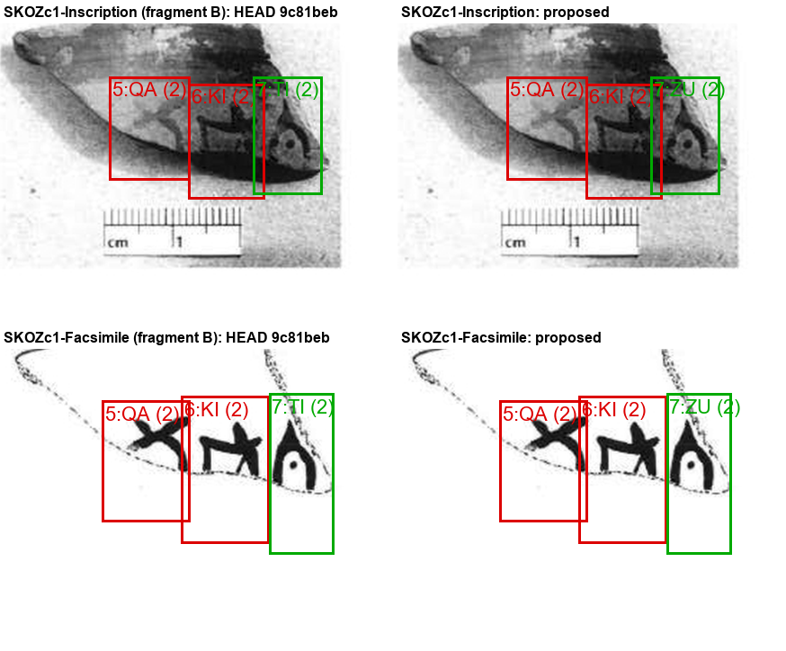

*Image maps on fragment B of `SKOZc1-Inscription` and `SKOZc1-Facsimile`: master (9c81beb) left, entry 7 'TI'; this PR right, entry 7 'ZU' (green). Boxes and word numbers are unchanged.* (lineara.xyz images `SKOZc1-Inscription.jpg` and `SKOZc1-Facsimile.jpg`, crops of Perna, Kanta, Tyree 2005, fig. 10; boxes from `items_image_map.js`)

### ZA6a — false divider and bunched line breaks on face a

On master (9c81beb) the word arrays of ZA6a end face a with five line breaks in a row, then `𐄁`, then `]OLIV[ ]25 *304[ ]20 I-SE-` on one row; the tabulation in `supplement.json` and both image maps give the '5' of 25 word 17 (entry 27) and SE of I-SE word 20 (entry 31), the number of the divider, so `items/ZA6a.html` groups `5 *304` as one word and splits I-SE into `I` and `SE 𐄁`. The record's own `parsedInscription`, Younger's rows a.7 to a.9-10 and GORILA's tabular copy (GORILA III p. 157, PDF p. 182) give each of these five entries its own line. The `𐄁` comes from Younger's `•` (one illegible sign) in `a.9-10 I-SE-[•`; GORILA reads `.9-10 I-SE-[` with only a trace `[·][` on line .10, and the site's drawing shows a sign fragment there, not a divider. This PR drops the divider from all five text fields, puts a line break before each of the five entries, gives OLIV its leading damage mark (`]OLIV[`, as in `parsedInscription` and both editions), renumbers entries 27 (17 → 16) and 31 (20 → 19) and removes entry 32 in both image maps; the explorer areas do not change (32 letters, 32 areas). `items/ZA6a.html` is regenerated and now shows 25 and I-SE as single words.

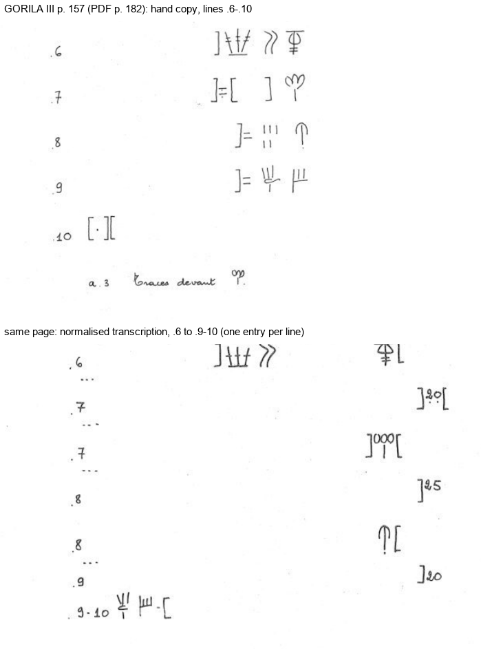

*GORILA III p. 157 (PDF p. 182). Top, the normalised copy of face a, lines .6–.10: .7 ]20[ ]OLIV, .8 ]25 \*304, .9 ]20 I-SE, and on .10 a single trace [·][. Bottom, the tabular copy on the same page gives each entry its own line (.7 ]20[ / .7 ]OLIV[ / .8 ]25 / .8 \*304[ / .9 ]20 / .9-10 I-SE-[). The word I-SE- runs on into the broken line .10, and there is no word divider.* (L. Godart and J.-P. Olivier, GORILA III (Études crétoises 21.3, 1979), p. 157, © École française d'Athènes; page as served at lineara.xyz/papers/GORILA-Vol3.pdf)

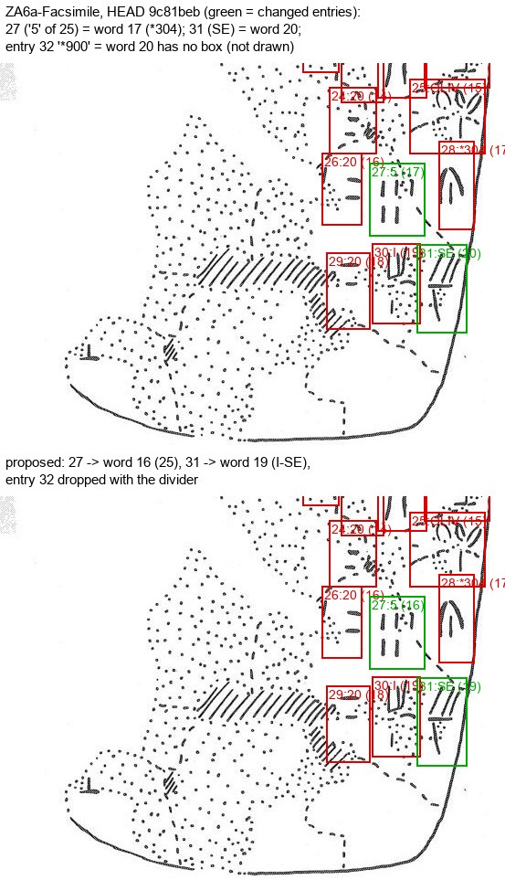

*The drawing `images/ZA6a-Facsimile.jpg`, bottom of face a, with its image-map boxes; the changed entries are green. Top, master (9c81beb): entry 27 (the '5' of 25) carries word 17, which is \*304's number, and entry 31 (SE) carries word 20; entry 32 `*900` (the divider, no box, not drawn) is also word 20. Bottom, this PR: 27 → 16 and 31 → 19, so the '20' and '5' boxes form the word 25 and the I and SE boxes the word I-SE; entry 32 goes with the divider. Box positions are unchanged.* (Drawing from GORILA III, © École française d'Athènes, as cropped by lineara.xyz; boxes drawn from `items_image_map.js` at 9c81beb and from the new entries)

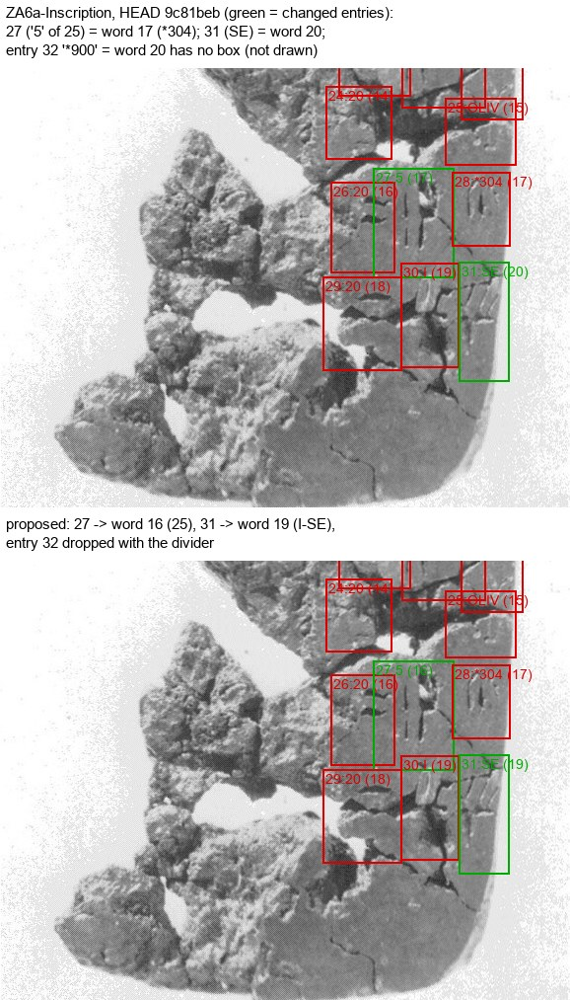

*The photograph `images/ZA6a-Inscription.jpg`, bottom of face a, with the same two changes as on the drawing: entry 27 ('5' of 25) goes from word 17 to 16, entry 31 (SE) from word 20 to 19, and the box-less divider entry 32 is removed. Box positions are unchanged.* (Photograph from GORILA III, © École française d'Athènes, as cropped by lineara.xyz; boxes drawn from `items_image_map.js`)

*The drawing `images/ZA6a-Facsimile.jpg`, lower left corner (x 20–220, y 790–910, enlarged 3×). At line .10 it shows only a sign fragment at the broken left edge, an L-shaped pair of strokes, where GORILA's normalised copy has the trace [·][. There is no divider here.* (Drawing from GORILA III, © École française d'Athènes, as cropped by lineara.xyz)

*Schematic of the end of face a as the explorer builds its rows from the word arrays (`populateText` starts a new row at every line-break token). On master (9c81beb) there are four empty rows, then the divider and five entries crowded into one row. With this PR there is one entry per row, as in the record's own `parsedInscription`, Younger's rows and GORILA's tabular copy. Rendered from the arrays, not a browser screenshot; U+1076B shows as a box.* (Rendered from lineara.xyz `LinearAInscriptions.js` at 9c81beb, before, and the new arrays, after; © École française d'Athènes)

### GOWc3 — 20 and 2 stored as one token with a comma

On master (9c81beb) GOWc3 stores its number as one token, `𐄑,𐄈` (20, comma, 2), in `words`, `transliteratedWords` and `translatedWords`, the only comma in any glyph field of the corpus; the transliteration shows glyphs, `items/GOWc3.html` shows the comma as an unknown sign `*`, and `annotations.js` and `wordsInCorpus` count the pair as a word. Younger (`commentary/GOWc3.html`) reads '20 , 2': 'two horizontal strokes (20) are followed by two lightly incised vertical strokes (2)', 'the two sets of numbers'; the comma only separates them. The image maps give the comma an entry of its own: on the photo a box on bare clay (108, 209, 18, 25), on the drawing the box on the two short strokes (161, 84, 43, 81), which leaves the 2 there without a box and the drawing's explorer with 3 areas for 4 letters. This PR splits the token into 20 and 2, drops the comma from `parsedInscription` and `transcription` and its entries from both image maps and the photo's explorer, gives the 2 (now word 2) a box and explorer area on the drawing's two short strokes, (172, 100, 26, 37), keeps the 20's box on the long strokes, and regenerates `items/GOWc3.html`. In the drawing the long strokes stand vertical and the short ones horizontal, so Younger describes the roundel turned by 90 degrees; the assignment of 20 and 2 follows his order and the existing boxes, and swapping the two box labels would reverse it (the publication, Watrous et al. 2015, Hesperia 84, 446–448, was not available).

*Image map of `GOWc3-Facsimile`, master (9c81beb) left and this PR right, 2.7×. Master: box 1 '20' holds the two long strokes beside the logogram; box 2, labelled `*` (the comma), holds the two short strokes and one long stroke; entry 3 '2' has no box. This PR: the comma's entry is gone, the 20 keeps its box, and the 2 (now its own word) gets a box on the two short strokes (172, 100, 26, 37). The explorer's third area changes the same way.* (lineara.xyz image `images/GOWc3-Facsimile.jpg`, drawing of GO Wc 3; the roundel was published by Watrous et al. 2015, Hesperia 84, 446–448; boxes drawn from `items_image_map.js` at 9c81beb and from the new entries)

*Image map of `GOWc3-Inscription`, master (9c81beb) left and this PR right, 1.6×. Master gives the comma a box of its own (entry 2, green, 108, 209, 18, 25) on bare clay below the logogram. This PR removes that entry and the explorer area under it; the 20 and 2 boxes keep their coordinates, and the 2 becomes word 2.* (lineara.xyz image `images/GOWc3-Inscription.jpg`, photo of GO Wc 3; the roundel was published by Watrous et al. 2015, Hesperia 84, 446–448; boxes drawn from `items_image_map.js` at 9c81beb and from the new entries)

*Left: `GOWc3-Inscription.jpg`, contrast-stretched, 2×. Right: the same photo with the ink of `GOWc3-Facsimile.jpg` laid over it, fitted on three landmarks of the logogram (the two dots and the side loop): rotation 49° clockwise, scale 1.69, residuals of 2.5 px or less. The drawn logogram (orange) lies on the photographed one; the two long strokes (green, the 20) fall inside the photo's 20 box, and the right short stroke (blue, part of the 2) lies on a visible slanted incision inside its 2 box. Nothing falls near master's comma box (red), which sits on bare clay.* (lineara.xyz images `images/GOWc3-Inscription.jpg` and `images/GOWc3-Facsimile.jpg`, GO Wc 3, Watrous et al. 2015, Hesperia 84, 446–448; overlay made for this PR)

### HTW231d, HTW231e, HTW231f — 'None' stored as a word

These three records have no transcription: their `parsedInscription` and `transcription` are empty. On master (9c81beb) their `words`, `transliteratedWords` and `translatedWords` nevertheless hold the string `"None"`, a Python `None` written out as text, and the explorer, which shows every entry of these arrays, displays it as a word. This PR sets the three arrays to `[]`, as the eight other records with no words already have them (e.g. KE6, ZOZa1). `wordsInCorpus` never counted "None". The derived files hold only an older combined entry, HTW231d-f; its arrays in the notebook's copy are `"None"` too and become `[]` (its item page does not change).

## Image maps: boxes on the wrong signs

In each record below, image-map boxes sit on the wrong signs, or a sign has no box. The changes are to the boxes in `items_image_map.js` (item pages) and the matching areas in `imagemaps.js` (explorer). For SYZa3, HT24b and HT123+124a they also correct the record's tabulation in `items_analysis/supplement.json` and regenerate the item page from it with the committed notebook. No text field in `LinearAInscriptions.js` changes. Entry and area numbers count from 0, as in the files, and boxes are given as (x, y, width, height) in the image's own pixels. "Before" figures show master (9c81beb).

### HT154n — 6 and SI boxes swapped on the drawing

On `HT154n-Facsimile`, entry 1 (label `6`) is boxed on the SI sign at the right of line .2, and entry 2 (label `SI`) on the six unit strokes to its left; explorer areas 1 and 2 have the same swap. GORILA I p. 250 (PDF p. 286) draws the six strokes to the left of SI, and GORILA I p. 251 (PDF p. 287) reads `.2 ]6 SI[`. The site's photo map (`HT154n-Inscription`) already has 6 on the left and SI on the right. This PR swaps the two boxes in the drawing's image map and explorer areas and moves the SI box's left edge from x 221 to x 213, so that it takes in the sign's left arm; text fields and word numbers are unchanged.

*Master (9c81beb): the box labelled 6 sits on SI, and the box labelled SI on the six strokes.* (lineara.xyz images/HT154n-Facsimile.jpg, a crop of the GORILA I p. 250 drawing; boxes drawn for this PR; © École française d'Athènes)

*Proposed: 6 on the six strokes, SI on the sign.* (lineara.xyz images/HT154n-Facsimile.jpg, a crop of the GORILA I p. 250 drawing; boxes drawn for this PR; © École française d'Athènes)

*GORILA I p. 251 (PDF p. 287), HT 154 N, hand copy: line .2 has six unit strokes (the lower three dotted), then SI.* (GORILA © École française d'Athènes)

### SYZa3 — SI-RU-TE labels rotated; WA, JA and SE boxes on other signs

On `SYZa3-Facsimile`, entries 10–12 (word 2) hold SI, RU and TE from left to right but are labelled TE, SI, RU, and entries 4–6 (WA, JA, SE) sit on the first three signs of the second fragment, which Younger reads as illegible; the real WA (right after \*301) and SE (right before KA) have no box. GORILA V p. 67 (PDF p. 120) reads `A-TA-I-*301-WA-[ -- ca. 20 -- ]SI-RU-TE`, its drawing on p. 66 (PDF p. 119) shows SI, RU, TE in that order, and Younger (`commentary/SYZa3.html`) reads `A-TA-I-*301-WA-[JA -- ca. 8 --]•-•-•SE-KA-NA-SI[•]TE[-- ca. 10 --]SI-RU-TE`, so JA is restored in the break, not on the stone. The TE, SI, RU order was also copied into the SYZa3 tabulation in `items_analysis/supplement.json`, so `items/SYZa3.html` shows word 2 as TE-SI-RU, a sequence found in no inscription, and searches for it on click. This PR relabels entries 10–12 (boxes unchanged), moves WA to (137, 9, 17, 28) and SE to (253, 4, 19, 29), gives JA `"coords": {}` and a zero-size explorer area at the break, reorders the tabulation and regenerates the item page. The second fragment (ArchEph 2008) postdates GORILA V, so the SE box follows Younger, who marks SE as doubtful, and the site's own drawing.

*Master (9c81beb): the SYZa3-Facsimile sign strip (x 70–495, 2.3x), raw (top) and with the image-map boxes (bottom; wN = word number). Entries 10–12 hold SI, RU, TE but are labelled TE, SI, RU. Entries 4–6 (WA, JA, SE) sit on the first three signs of the second fragment, while the real WA (5th sign of the first group, after \*301) and the sign before KA (SE) have no box.* (lineara.xyz images/SYZa3-Facsimile.jpg (credited on lineara.xyz to © École française d'Athènes); boxes and labels drawn for this PR)

*Proposed, same strip: 10–12 relabelled SI, RU, TE (boxes unchanged); WA boxed on the 5th sign of the first group and SE on the sign before KA; JA has no box (coords {}) and a zero-size explorer area at the break (dashed marker). Word numbers unchanged.* (lineara.xyz images/SYZa3-Facsimile.jpg (credited on lineara.xyz to © École française d'Athènes); boxes and labels drawn for this PR)

*GORILA V p. 67 (PDF p. 120), SY Za 3, the transcription line (printed rotated; shown turned 90° clockwise): A-TA-I-\*301-WA-[ -- ca. 20 -- ]SI-RU-TE, with TA, I and \*301 underdotted. The break follows WA, so JA is not on the stone; the last word runs SI, RU, TE.* (GORILA V (L. Godart & J.-P. Olivier 1985) © École française d'Athènes; rendered from papers/GORILA-Vol5.pdf as served by lineara.xyz)

*GORILA V p. 66 (PDF p. 119), drawing of HM 3757, the two ends of the inscribed rim: left, SI, RU, TE in reading order; right, A, TA, I, \*301 and WA at the break.* (GORILA V (L. Godart & J.-P. Olivier 1985) © École française d'Athènes; rendered from papers/GORILA-Vol5.pdf as served by lineara.xyz)

*Which sign is in each box: the Noto Sans Linear A glyph and the same label in five other lineara.xyz facsimile maps, next to the SYZa3-Facsimile boxes (red = box on master with its label there; green = proposed box). On master, entry 10 'TE' holds SI, 11 'SI' holds RU and 12 'RU' holds TE, and entries 4 'WA' and 5 'JA' hold signs that are neither; the proposed WA and SE boxes hold WA- and SE-like signs.* (Crops of lineara.xyz facsimile images (HT and SYZa3 facsimiles, credited on lineara.xyz to their publishers, chiefly © École française d'Athènes); glyphs Noto Sans Linear A (SIL Open Font License))

### HT24b — photo boxes one sign off; line break one sign late

On `HT24b-Inscription`, a crop of the GORILA I p. 42 (PDF p. 78) photograph, entries 2 and 3 split the single fraction sign JE (³⁄₄) of line .1 into its two strokes; from entry 3 on, each label names the sign after the one it frames (entry 5, `1`, sits on the \*118 that opens line .2), and the final 1 of line .2 has no box. The explorer has the same split, 11 areas for the record's 10 letters, so from area 3 on it highlights the next sign's word, and area 10 (the final 1) falls back to word 0. GORILA I p. 43 (PDF p. 79) reads `.1 ]*118 1 JE *531` and `.2 *118 1 JE *539 *118 1`, the same ten signs in the same order as the record's text, Younger's commentary and the correctly mapped `HT24b-Facsimile`. The HT24b tabulation in `items_analysis/supplement.json` also ends line 1 after the \*118 that opens line .2, so both "Line breaks match the inscription" blocks of `items/HT24b.html` break one sign late. This PR merges the two ³⁄₄ boxes into one, so that each later entry moves onto its own sign, adds a box for the final 1 (labels and word numbers unchanged), gives the explorer the same 10 areas, moves the tabulation's row break to after SI+ME-KI, as in GORILA and the record's `transcription`, and regenerates the page.

*HT24b-Inscription with the image-map boxes. Left, master (9c81beb): boxes 2 and 3 split the ³⁄₄ of line .1, and from box 3 on each label names the sign after the one it frames (3 'SI+ME-KI' on the lower stroke of JE, 4 '\*118' on SI+ME-KI, 5 '1' on the \*118 that opens line .2, and so on to 9 '1' on \*118); the final 1 has no box. Right, proposed: one box for the ³⁄₄, every label on its own sign, and a new box 9 on the final 1.* (lineara.xyz images/HT24b-Inscription.jpg (crop of the GORILA I p. 42 photograph); boxes from items_image_map.js at 9c81beb and from this PR; © École française d'Athènes)

*The same photo with the explorer's areas, each labelled with the word explorer.js pairs it with (area i goes with letter i). Left, master (9c81beb): 11 areas for 10 letters, so from e3 on each area highlights the next sign's word, and e10 (the final 1) runs past the last letter and falls back to word 0 (\*118). Right, proposed: 10 areas, each on its own sign.* (lineara.xyz images/HT24b-Inscription.jpg (crop of the GORILA I p. 42 photograph); areas from imagemaps.js at 9c81beb and from this PR; © École française d'Athènes)

*GORILA I p. 42 (PDF p. 78), HT 24b photograph (top) and drawing (bottom): .1 [lost sign] \*118, 1, JE (³⁄₄: a short stroke over a long hook), \*531 (SI+ME-KI); .2 \*118 (damaged, at the left edge), 1, JE, \*539, \*118, 1. lineara's HT24b-Inscription.jpg is a crop of this photograph.* (GORILA I (L. Godart and J.-P. Olivier 1976), © École française d'Athènes; copy served at lineara.xyz/papers/GORILA-Vol1.pdf#page=78)

*GORILA I p. 43 (PDF p. 79), HT 24b: hand copy .1 ]\*118 1 JE \*531 / .2 \*118 1 JE \*539 \*118 1 / .3-5 vacant; apparatus '.1 Un seul signe perdu à gauche'; normalised list .1 ]\*118 1 JE / .1-2 \*531 \*118 1 JE / .2 \*539 \*118 1. Line .1 ends with \*531 (SI+ME-KI), and line .2 opens with \*118.* (GORILA I (L. Godart and J.-P. Olivier 1976), © École française d'Athènes; copy served at lineara.xyz/papers/GORILA-Vol1.pdf#page=79)

*Reference, not changed: the HT24b-Facsimile map (the GORILA I p. 42 drawing) on master (9c81beb) has one box for each ³⁄₄ and every label on its own sign. The proposed photo map uses the same label sequence.* (lineara.xyz images/HT24b-Facsimile.jpg (crop of the GORILA I p. 42 drawing); boxes from items_image_map.js at 9c81beb; © École française d'Athènes)

### HT22 — drawing boxes one sign late from the ruling on

On `HT22-Facsimile` the ruling has no box: its entry (entry 3, word 2, labelled `10` like every ruling on the site) is drawn on \*330+DA, the \*330+DA entry on the circle (100), the `100` entry on the bar (10) and the `10` entry on the three unit strokes, while the last entry (`3`) has `"coords": {}`. The explorer has 7 areas for the record's 8 letters. GORILA I p. 38 (PDF p. 74) has the drawing (HM 45) that `HT22-Facsimile.jpg` is cropped from, and GORILA I p. 39 (PDF p. 75) reads *sup. mut.* / `.1 GRA+L2 230` / ruling / `.2 *330+DA 113`, as do the record's text and the photo map `HT22-Inscription`, which is already right. This PR gives entry 3 a thin box on the ruling, (28, 88, 157, 12), moves entries 4–7 onto the current boxes 3–6, which already frame \*330+DA, the circle, the bar and the strokes, and gives the drawing's explorer the same 8 boxes in letter order. Word numbers, labels and the text do not change here; the ruling's label `10` becomes `—` in the separate [ruling change](#38-inscriptions--rulings-stored-as-the-numeral-10).

*HT22-Facsimile on master (9c81beb), x3.5 (left: the image; right: the image-map entries and explorer areas). The ruling has no box. Entry 3 (word 2, the ruling) sits on \*330+DA, entry 4 (\*330+DA) on the circle (100), entry 5 (100) on the bar (10), entry 6 (10) on the three unit strokes, and entry 7 ('3') has empty coords, so it is listed in the footer. The explorer has 7 areas for 8 letters.* (lineara.xyz images/HT22-Facsimile.jpg (a crop of the GORILA I p. 38 drawing); boxes from items_image_map.js and imagemaps.js at 9c81beb; © École française d'Athènes)

*Proposed, same scale (changed entries in green, the 8 new explorer areas in blue). Entry 3 (the ruling) is a thin box on the ruling, (28, 88, 157, 12). Entries 4–7 (\*330+DA, 100, 10, 3) take the old boxes 3–6 unchanged, each now on its own sign. Explorer areas e0–e7 are the same boxes in letter order. The ruling's label is still '10' here; it becomes '—' with the ruling change.* (lineara.xyz images/HT22-Facsimile.jpg (a crop of the GORILA I p. 38 drawing); proposed boxes; © École française d'Athènes)

*GORILA I p. 38 (PDF p. 74): photograph and drawing of HT 22 (HM 45), the sources of lineara's HT22-Inscription and HT22-Facsimile. Line .1: GRA+L2, two circles, three bars; a ruling; line .2: \*330+DA, one circle, one bar, three unit strokes (two above, one below).* (L. Godart & J.-P. Olivier, Recueil des inscriptions en linéaire A (GORILA) I (Paris 1976), p. 38; PDF as served at lineara.xyz/papers/GORILA-Vol1.pdf; © École française d'Athènes)

*GORILA I p. 39 (PDF p. 75), HT 22: sup. mut.; .1 GRA+L2 230; ruling; .2 \*330+DA 113. This matches the record's text, so only the drawing's boxes change.* (L. Godart & J.-P. Olivier, Recueil des inscriptions en linéaire A (GORILA) I (Paris 1976), p. 39; PDF as served at lineara.xyz/papers/GORILA-Vol1.pdf; © École française d'Athènes)

*Reference, not changed: HT22-Inscription (the photo) on master (9c81beb), x3. Its ruling entry (3, word 2) is a thin box along the ruling, entries 4–7 sit on \*330+DA, 100, 10 and 3, and the explorer has 8 areas for 8 letters. It is the model for the drawing's fix.* (lineara.xyz images/HT22-Inscription.jpg (a crop of the GORILA I p. 38 photograph); boxes from items_image_map.js and imagemaps.js at 9c81beb; © École française d'Athènes)

### HT31 — three drawing boxes of word 7 rotated

Word 7 of HT31, \*815-QA-PA₃ on line .2, is a conical vessel with QA and PA₃ written above it. On `HT31-Facsimile`, entries 9–11 and explorer areas 6–8 have the right boxes in the wrong order: the box labelled `*815`, (133, 76, 26, 36), frames QA; the box labelled `QA`, (169, 78, 24, 34), frames PA₃; and the box labelled `PA₃`, (139, 105, 49, 40), frames the vessel, so the explorer's word tip shows the signs as QA, PA₃, vessel (whole-word highlighting is not affected). GORILA I p. 58 (PDF p. 94), the drawing the facsimile is cropped from, and p. 59 (PDF p. 95), the normalised transcription, show QA on the left and PA₃ on the right above the vessel, followed by 10; Younger reads `.2 *402VAS+QA-PA₃ 10`, and the photo map (`HT31-Inscription`) already has this arrangement. This PR re-pairs the three existing boxes in the drawing's image map and explorer areas, so that `*815` gets the vessel's box, `QA` the left box above it and `PA₃` the right one; labels, word numbers, box sizes and the text are unchanged.

*HT31-Facsimile on master (9c81beb), line .2, with each entry's explorer area in brackets: entry 9 '\*815' (e6) frames QA, entry 10 'QA' (e7) frames PA₃, and entry 11 'PA₃' (e8) frames the conical vessel. The next word, entries 13–15 (\*415-VS, SU, PU), is boxed correctly: vessel first, then the signs above.* (lineara.xyz images/HT31-Facsimile.jpg (a crop of the GORILA I p. 58 drawing); boxes from items_image_map.js and imagemaps.js at 9c81beb; © École française d'Athènes)

*Proposed: the three existing boxes re-paired in both files. Entry 9 '\*815' (e6) frames the vessel, 10 'QA' (e7) the left sign above it, 11 'PA₃' (e8) the right sign; labels, word numbers and box sizes are unchanged.* (lineara.xyz images/HT31-Facsimile.jpg (a crop of the GORILA I p. 58 drawing); proposed boxes; © École française d'Athènes)

*GORILA I p. 58 (PDF p. 94), the drawing of HT 31, lines .2–.3 (lineara's HT31-Facsimile is a crop of it). In line .2, the crossed sign QA (left) and the ladder sign PA₃ (right) are written above the conical vessel, which is followed by '—' (10).* (L. Godart & J.-P. Olivier, GORILA I (1976), p. 58; crop of the PDF served at lineara.xyz/papers/GORILA-Vol1.pdf; © École française d'Athènes)

*GORILA I p. 59 (PDF p. 95), the normalised transcription of HT 31, lines .1–.3. In line .2, after the numeral 5, QA (left) and PA₃ (right) stand above the conical vessel, followed by '—' (10); next come SU-PU above the jar \*415VS and another '—' (10).* (L. Godart & J.-P. Olivier, GORILA I (1976), p. 59; crop of the PDF served at lineara.xyz/papers/GORILA-Vol1.pdf; © École française d'Athènes)

*Reference, not changed: HT31-Inscription (photo), line .2, on master (9c81beb). The photo map already puts entry 9 '\*815' (e6) on the vessel, and 10 'QA' (e7) and 11 'PA₃' (e8) on the two signs above it. Top: contrast-stretched crop at 3x; bottom: the same crop with the boxes.* (lineara.xyz images/HT31-Inscription.jpg (a crop of a GORILA I plate), contrast-stretched; boxes from items_image_map.js and imagemaps.js at 9c81beb; © École française d'Athènes)

### PH2 — drawing box for the numeral 1 misses its stroke

On `PH2-Facsimile`, the box of the numeral `1` after A-SE-TU-\*21F, entry 4 and explorer area 4 at (225, 35, 25, 46), covers only the tips of \*21F's arms and blank ground; the numeral, a thick slanting stroke at x 251–264, y 39–68, lies wholly inside the RA box, entry 5 at (249, 22, 63, 81). GORILA I p. 288 (PDF p. 324) draws the stroke on line .1, and its photo shows it as a wide groove; GORILA I p. 289 (PDF p. 325) copies it as a separate short stroke between \*21F and RA and reads `.1 A-SE-TU-*21F 1`, `.1-2 RA-O-DI-KI 60`, and Younger reads the same (A-SE-TU-QIf 1), with the note `.1: 1 or •`. The photo map (`PH2-Inscription`, entry 4) already puts `1` on this stroke, and the INSCRIBE 3D model Clay_tablet_PH_2 (INSCRIBE project, ERC, University of Bologna; https://www.inscribercproject.com/Linear_A.php), under raking light at azimuth 315°/elevation 20° and at 135°/20°, shows it as a deep groove outside the current box. This PR sets entry 4 and area 4 to (248, 35, 18, 37) and moves the left edge of entry 5 and area 5 off the stroke, to (263, 22, 49, 81); the text, word numbers and `PH2-Inscription` are unchanged.

*PH2-Facsimile, line 1, x3. Top, master (9c81beb): box 4 ('1', word 1) holds only the tips of \*21F's arms and blank ground, and the slanting stroke sits inside box 5 (RA). Bottom, proposed: box 4 (248, 35, 18, 37) on the stroke; box 5 (263, 22, 49, 81) starts at the stroke's top.* (Drawing from GORILA I p. 288, as cropped by lineara.xyz (images/PH2-Facsimile.jpg); boxes from items_image_map.js at 9c81beb (top) and from this PR (bottom); © École française d'Athènes)

*GORILA I p. 288 (PDF p. 324), line .1, photo (top) and drawing (bottom): A SE TU \*21F, then the thick slanting stroke whose top touches RA's arch, then RA.* (L. Godart & J.-P. Olivier, Recueil des inscriptions en linéaire A (GORILA) I (1976), p. 288; © École française d'Athènes)

*GORILA I p. 289 (PDF p. 325). Top: copy of line .1 in tablet layout, with a short separate stroke between \*21F and RA. Bottom: normalised transcription .1 A-SE-TU-\*21F 1 and .1-2 RA-O-DI-KI 60.* (L. Godart & J.-P. Olivier, Recueil des inscriptions en linéaire A (GORILA) I (1976), p. 289; © École française d'Athènes)

*INSCRIBE relief of PH 2, line 1, under raking light from azimuth 315°, elevation 20° (top) and azimuth 135°, elevation 20° (bottom). Facsimile boxes 4 and 5 are projected through the registration fit (score 0.673, about 1 mm accuracy). Left: master (9c81beb), with box 4 on blank surface. Right: proposed, with box 4 on the deep oblique groove.* (INSCRIBE 3D model Clay_tablet_PH_2 (INSCRIBE project, ERC, University of Bologna; https://www.inscribercproject.com/Linear_A.php))

*Reference, not changed: the photo map PH2-Inscription on master (9c81beb), x3. Box 4 ('1') already sits on the slanting groove left of RA's arch, overlapping box 5 by a few pixels.* (Photo from GORILA I p. 288, as cropped by lineara.xyz (images/PH2-Inscription.jpg); boxes from items_image_map.js at 9c81beb; © École française d'Athènes)

### KH88 — drawing box for the numeral 8 too narrow

On `KH88-Facsimile`, the numeral 8 on line .3 (entry 11, word 7) is two rows of four strokes at x 56–131, y 201–269; its box, (25, 186, 85, 83), which explorer area 9 repeats, ends at the third column, leaves both strokes of the fourth column (x 124–131) outside and takes in the tablet's outline on the left. GORILA V p. 40 (PDF p. 93) shows the numeral as 2 × 4 intact strokes in the photo and the drawing, and GORILA V p. 41 (PDF p. 94), line .3, gives 4 + 4 strokes, normalised `.2-3 PU-DE 8`, which is also Younger's reading. The INSCRIBE 3D model Clay_tablet_KH_88 (INSCRIBE project, ERC, University of Bologna; https://www.inscribercproject.com/Linear_A.php) shows all eight incisions intact under raking light at azimuth 90°/elevation 35° and azimuth 315°/elevation 20°, and the photo map (`KH88-Inscription`) already covers all four columns. This PR sets entry 11 and area 9 to (50, 195, 87, 80), which holds all eight strokes with a 5–6 px margin and no other ink; the text, word numbers and letter count are unchanged.

*KH88-Facsimile on master (9c81beb): the box for the numeral 8 (image-map entry 11, word 7, green; explorer area e9, blue, same box (25, 186, 85, 83)) runs over the tablet's outline on the left, stops at the third stroke column and leaves both strokes of the fourth column outside.* (lineara.xyz images/KH88-Facsimile.jpg (crop of the drawing in GORILA V p. 40); boxes from items_image_map.js and imagemaps.js at 9c81beb, enlarged x2.4; © École française d'Athènes)

*Proposed: entry 11 and explorer area e9 = (50, 195, 87, 80). The box holds all eight strokes (two rows of four) with a 5–6 px margin and no other ink, and leaves out the tablet outline and the dotted break line.* (lineara.xyz images/KH88-Facsimile.jpg (crop of the drawing in GORILA V p. 40); proposed boxes, enlarged x2.4; © École française d'Athènes)

*GORILA V p. 40 (PDF p. 93), KH 88, photo (left) and drawing (right): the numeral on line .3 is two rows of four strokes, all intact. The top stroke of the fourth column sits at the left end of a crack (the dotted break line in the drawing).* (L. Godart and J.-P. Olivier, GORILA V (1985), p. 40 (PDF p. 93), from lineara.xyz/papers/GORILA-Vol5.pdf; © École française d'Athènes)

*GORILA V p. 41 (PDF p. 94), KH 88: the hand copy's line .3 has 4 + 4 strokes; the normalised transliteration reads '.2-3 PU-DE 8'.* (L. Godart and J.-P. Olivier, GORILA V (1985), p. 41 (PDF p. 94), from lineara.xyz/papers/GORILA-Vol5.pdf; © École française d'Athènes)

*INSCRIBE relief of KH 88, numeral on line .3, under raking light from azimuth 90°, elevation 35° (left) and azimuth 315°, elevation 20° (right): eight intact incisions in four columns of two. The red dashes on the right mark the box on master (9c81beb), mapped onto the relief by an approximate registration; the fourth column falls outside it.* (INSCRIBE 3D model Clay_tablet_KH_88 (INSCRIBE project, ERC, University of Bologna; https://www.inscribercproject.com/Linear_A.php), renders enlarged x2)

### HT23b — drawing boxes 8 to 11 one sign off, no box for the 7

On `HT23b-Facsimile`, entries 8–11 each sit on the next sign: `QA2+[?]+PU` (word 7) on the QA2+[?]+RE ligature at the end of line .2 and its unit stroke, `QA2+[?]+RE` (word 8) on the vestiges that open line .3, `1` (word 9) on the syllable E and `E` (word 10) on the seven strokes of the numeral; entry 12 (`7`, word 11) has `"coords": {}`, the traces of QA2+[?]+PU in mid line .2 have no box, and the explorer has the same 12 boxes for the record's 13 letters. GORILA I p. 41 (PDF p. 77) reads line .2 as `MI+JA+RU[ ]MU[ ]QA2+?+PU[ ]QA2+?+RE 1` and line .3 as `vest.[ ]E 7[`, with the 7 written 4 over 3; the drawing on p. 40 (PDF p. 76), which the facsimile crops, Younger's edition, the record's text and the photo map `HT23b-Inscription` have the same order. This PR gives entries 8–12 new boxes on the QA2+[?]+PU traces (217, 129, 42, 47), QA2+[?]+RE (272, 92, 46, 96), the 1 (311, 140, 13, 22), E (187, 201, 51, 71) and the 7 (239, 197, 58, 74), drops the box on the line-.3 vestiges (a trace-only token, which has no word number) and gives the explorer the same 13 boxes; labels, word numbers, entries 0–7 and the text are unchanged. GORILA dots QA2+?+PU as uncertain: if only legible signs should be boxed, its image-map entry can keep `"coords": {}`, but the explorer still needs an area there, or every later area pairs with the wrong letter.

*HT23b-Facsimile on master (9c81beb), lines .2–.3 (2.5x). Entries 8–11 (green) are one sign off: 8 'QA2+[?]+PU' sits on the QA2+[?]+RE ligature and its unit stroke, 9 'QA2+[?]+RE' on the line-.3 vestiges, 10 '1' on E (cutting off E's left crossbars), 11 'E' on the 7. Entry 12 '7' has empty coords, the explorer has 12 areas for 13 letters, and the QA2+[?]+PU traces in mid line .2 have no box.* (lineara.xyz images/HT23b-Facsimile.jpg (crop of the GORILA I p. 40 drawing); boxes from items_image_map.js and imagemaps.js at 9c81beb; © École française d'Athènes)

*Proposed: entries 8–12 (green) on QA2+[?]+PU (traces, mid line .2), QA2+[?]+RE (the ligature at the line end), 1 (the unit stroke after it), E and 7 (4 over 3 strokes); the explorer's 13 areas are the same boxes in the same order. The line-.3 vestiges get no box.* (lineara.xyz images/HT23b-Facsimile.jpg (crop of the GORILA I p. 40 drawing); proposed boxes; © École française d'Athènes)

*GORILA I p. 41 (PDF p. 77), HT 23b. Line .2: MI+JA+RU[ ]MU[ then two QA2 ligatures, the first dotted and broken on both sides (lineara QA2+[?]+PU), the second followed by a single unit stroke (QA2+[?]+RE 1). Line .3: vest.[ ]E 7[, the 7 written as 4 over 3 strokes. Lines .4-5 desunt.* (L. Godart and J.-P. Olivier, GORILA I (Études crétoises 21.1, Paris 1976); PDF as served by lineara.xyz (papers/GORILA-Vol1.pdf); © École française d'Athènes)

*GORILA I p. 40 (PDF p. 76), drawing of HT 23b, lines .1–.3 (300 dpi). Line .2: MI+JA+RU, MU, a few traces in the damaged zone, then the branched ligature and one short stroke. Line .3: vestiges at the far left (a hook and a stroke), then E and 4 + 3 strokes.* (L. Godart and J.-P. Olivier, GORILA I (Études crétoises 21.1, Paris 1976); PDF as served by lineara.xyz (papers/GORILA-Vol1.pdf); © École française d'Athènes)

*GORILA I p. 40 (PDF p. 76), right half of lines .2–.3 at 300 dpi, registered to the lineara facsimile by template matching (scale 2.0); the tick labels are facsimile pixel coordinates. Traces at x 220–255, the ligature at x 276–316 with the unit stroke just to its right (x 314–320), E at x 191–234 and the 4 + 3 strokes of the 7 at x 241–292.* (L. Godart and J.-P. Olivier, GORILA I (Études crétoises 21.1, Paris 1976); PDF as served by lineara.xyz (papers/GORILA-Vol1.pdf); © École française d'Athènes)

### HT123+124a — photo boxes one sign late from line .4 on

On `HT123+124a-Inscription`, every image-map label from KI (start of line .4) to the end sits on the box of the sign before its own: `90` covers the olive sign that ends line .7, `3` the nine dots of 90, and the last sign, the 6 of KI-RO 6 (line .9), has no box. The cause is the first ³⁄₄ (word 16), which GORILA I p. 211 (PDF p. 247) writes in two parts, an underdotted E below the 8 that ends line .3 and an underdotted J that opens line .4; the map boxes both parts, (273, 197, 43, 45) and (11, 253, 21, 49), but labels the second one KI. The explorer's live list for this image (`imagemaps.js` line 3369) has the same extra box, 63 areas for 62 letters, so its last area, on the final 6, falls back to word 0 (KI-TA-I). This PR keeps one box per sign: the ³⁄₄ keeps the box below the 8, as on `HT123+124a-Facsimile` (not changed), the box at the left edge of line .4 is dropped from the map and from the live explorer list, every later label moves to the next box, and the 6 gets (202, 527, 65, 72), the box the explorer already has. No text changes; the two older `imagemaps.js` entries for these images (lines 441 and 1112) are never used and could be deleted. The tabulation in `items_analysis/supplement.json` had the same shift: from line .4 on, each of its rows (the physical lines) ended one sign late. The rows now follow GORILA I p. 211 (five cells move to the next row; signs, statuses and word numbers are unchanged), and `items/HT123+124a.html` is regenerated: 17 lines change, the row numbers of five signs in its reading list and rows .4–.9 of its two line-break blocks.

*HT123+124a-Inscription with its image map, master (9c81beb) left and proposed right; the boxes of word 16 (the first ³⁄₄) and of the final 6 are green. On master the box at the left edge of line .4 is labelled KI, every later label sits one box late, and the final 6 has no box. In the proposed map the ³⁄₄ keeps only its box below the 8, and the rows follow GORILA's lines: .4 starts with KI, .5 with \*308, .6 with DA, .7 with KI, .8 with 90, and .9 ends with 6.* (lineara.xyz image HT123+124a-Inscription.jpg (crop of the GORILA I p. 210 photo, Godart & Olivier 1976); boxes from items_image_map.js at 9c81beb and from this PR; © École française d'Athènes)

*Lines .7–.9 of the photo, enlarged. Master (top) labels the nine dots of 90 as '3', the olive sign ending line .7 as '90' and the 5 opening line .9 as '≈¹⁄₆', and the label '6' (green) sits on the box of RO. Proposed (bottom): each label sits on its own sign, and the 6 gets the box (202, 527, 65, 72) that the explorer already has.* (lineara.xyz image HT123+124a-Inscription.jpg (crop of the GORILA I p. 210 photo, Godart & Olivier 1976); boxes from items_image_map.js at 9c81beb and from this PR; © École française d'Athènes)

*GORILA I p. 211 (PDF p. 247), HT 123a. Hand copy .3–.4: a hooked mark with a dot below (an E with an underdot; it looks like '?') sits below the 8 that ends line .3, and an underdotted J opens line .4 before KI-RO. The summary of HT 123a gives entry 3-4 as PU-VIN OLIV 31 J \*308 8, then J stacked over the same underdotted mark, then KI-RO X: the ³⁄₄ (JE) is written in two parts.* (GORILA I (Godart & Olivier 1976), p. 211; scan as served by lineara.xyz, papers/GORILA-Vol1.pdf#page=247; © École française d'Athènes)

*GORILA I p. 210 (PDF p. 246), drawing of HT 123a, lines .3–.4. Below the 8 at the right end of line .3 is the 7-shaped mark on the join's dashed line; line .4 begins at the left edge with stippled traces before KI.* (GORILA I (Godart & Olivier 1976), p. 210; scan as served by lineara.xyz, papers/GORILA-Vol1.pdf#page=246; © École française d'Athènes)

*The two parts of the first ³⁄₄ on master (9c81beb), enlarged. Top, lineara's photo: box 22 below the 8 ending line .3 (incised strokes) and box 23 at the broken left edge of line .4 (red; blue is box 24, which holds KI). Bottom, lineara's facsimile: the 7-shaped mark below the 8 (the drawing map's box for this ³⁄₄) and, just left of the red KI box, an L-shaped trace (a vertical stroke and a foot), the J. The proposed photo map keeps box 22 for the ³⁄₄ and drops box 23, as the drawing map has it.* (lineara.xyz images HT123+124a-Inscription.jpg and HT123+124a-Facsimile.jpg; boxes from items_image_map.js at 9c81beb)

## Image maps and item pages: further corrections

These records came to light while this PR was being prepared. Most changes are to the boxes in `items_image_map.js` (item pages) and the matching areas in `imagemaps.js` (explorer). For the ten records split by #13 (bcfb77a) and by 9c81beb, and for HT119, they also bring the item-page generator's inputs in `items_analysis/` and the word tags in `annotations.js` up to date, and those pages and the HT42+59 page are regenerated with the committed notebook. No record in `LinearAInscriptions.js` changes; only its word counts (`wordsInCorpus`) follow the splits of bcfb77a. Entry and area numbers count from 0, as in the files, and boxes are given as (x, y, width, height) in the image's own pixels. "Before" figures show master (9c81beb).

### KH79+89 — drawing boxes miss all nine signs

On the drawing `KH79+89-Facsimile`, cropped from GORILA V p. 38 (PDF p. 91), the only boxes are entries 0–1 of `items_image_map.js` (MI, NA) and the explorer's two areas, and they lie on blank paper above and to the left of the fragment (x 72–167, y 6–81). Entries 2–9 (PA, TA, the divider, A, RA, PA, DA, NI) have empty coordinates, so none of the nine drawn signs can be highlighted. GORILA V p. 39 (PDF p. 92) gives the sign order `]MI-NA[ / ]PA-TA · A-RA-[ / ]-PA-DA-NI`, and the site's photo map (`KH79+89-Inscription`) already has one correct box per sign. This PR puts one box on each of the nine signs, in that order, and gives the explorer nine areas in letter order; the divider keeps `{}`, as elsewhere on the site, and words, labels and word numbers are unchanged.

*Master (9c81beb), 1.5x: the only two boxes (entries 0–1, MI and NA, and the explorer's 2 areas) sit on blank paper above and to the left of the fragment (x 72–167, y 6–81). Entries 2–9 have empty coords, so none of the 9 drawn signs can be highlighted.* (lineara.xyz images/KH79+89-Facsimile.jpg, a crop of the drawing in GORILA V p. 38 (© École française d'Athènes); boxes from items_image_map.js and imagemaps.js at 9c81beb)

*Proposed: one box on each sign, MI NA / PA TA A RA / PA DA NI, and 9 explorer areas e0–e8 in the explorer's letter order. The divider keeps empty coords (the site's convention), and the broken traces at the line ends stay unboxed, as in the photo's map.* (lineara.xyz images/KH79+89-Facsimile.jpg (GORILA V p. 38, © École française d'Athènes); proposed boxes)

*Reference, not changed: the photo KH79+89-Inscription with its map and explorer areas on master (9c81beb): 9 boxes in the same sign order, with the divider left empty. The drawing's fix follows them.* (lineara.xyz images/KH79+89-Inscription.jpg, a crop of the photograph in GORILA V p. 38 (© École française d'Athènes); boxes from items_image_map.js and imagemaps.js at 9c81beb)

*GORILA V p. 38 (PDF p. 91): the drawing of KH 79+89 that the lineara facsimile is cropped from. GORILA V p. 39 (PDF p. 92): the transcription .1 ]MI NA[ / .2 ]PA TA · A RA-[ / .3 ]-PA DA NI [ / .4 ] vacat [, the sign sequence the boxes follow.* (L. Godart and J.-P. Olivier, Recueil des inscriptions en linéaire A (GORILA) V, Études crétoises 21.5, Paris 1985, pp. 38–39 (© École française d'Athènes); rendered from lineara.xyz/papers/GORILA-Vol5.pdf)

### MA6a — drawing boxes only 2 of 7 signs, both misplaced

On the drawing `MA6a-Facsimile`, a crop of GORILA I p. 274 (PDF p. 310), only entries 0 (HIDE+[?]) and 1 (900) of `items_image_map.js` have coordinates, entries 2–6 (40, 1, HIDE+B, 30, 5) have none, and `imagemaps.js` has 2 areas for the record's 7 letters. Both existing boxes are misplaced: box 0 stops at y 123 and leaves out the lower part of HIDE+[?], and box 1, (42, 63, 408, 54), is a thin strip that holds only the two top-row circles of the 900 but runs on over the unit stroke and HIDE+B on the right-hand fragment. GORILA I p. 275 (PDF p. 311) reads `.1 ]HIDE+[?] 941` and `.1 HIDE+B 35`, and its typeset copy gives the layout: HIDE+[?] at the broken left edge, the circles, `[ ]1` and four dots, then HIDE+B, three dots and `||| / ||`. This PR gives each of the seven entries a box on its sign, in the order of the site's own `MA6a-Inscription` map, and gives the explorer the same seven areas; each box holds all of its sign's ink with up to 3 px of margin and none of a neighbour's, and word numbers, labels and the text are unchanged.

*MA6a-Facsimile on master (9c81beb), 1.5x: boxes for only 2 of the 7 entries, and 2 explorer areas for 7 letters. Box 0 (HIDE+[?], (8, 30, 92, 93)) stops at y 123 and misses the lower part of the sign; box 1 (900, (42, 63, 408, 54)) holds only the two top-row circles but runs on over the unit stroke and HIDE+B. Entries 2–6 (40, 1, HIDE+B, 30, 5) have empty coords.* (Drawing: GORILA I (L. Godart and J.-P. Olivier, Recueil des inscriptions en linéaire A, vol. 1, Paris 1976), p. 274, as cropped in lineara.xyz images/MA6a-Facsimile.jpg; boxes from items_image_map.js and imagemaps.js at 9c81beb; © École française d'Athènes)

*Proposed: 0 HIDE+[?], 1 900 (eight drawn circles), 2 40 (four dots), 3 1 (unit stroke), 4 HIDE+B, 5 30 (three dots), 6 5 (strokes ||| over ||), and the same 7 explorer areas. Each box holds all of its sign's ink with up to 3 px margin and none of a neighbour's.* (Drawing: GORILA I p. 274, as cropped in lineara.xyz images/MA6a-Facsimile.jpg; proposed boxes; © École française d'Athènes)

*GORILA I p. 274 (PDF p. 310), drawing of MA 6 face a, which lineara's MA6a-Facsimile crops: HIDE+[?] with two ticks at the broken left edge, eight circles in rows of 2/3/3, four dots; on the right-hand fragment a short unit stroke, HIDE+B (upright, top bar, wavy side, cross at the foot), three dots and ||| over ||.* (GORILA I (L. Godart and J.-P. Olivier, Recueil des inscriptions en linéaire A, vol. 1, Paris 1976), p. 274 (PDF p. 310); © École française d'Athènes)

*GORILA I p. 275 (PDF p. 311), MA 6a: typeset 'HIDE+[?] O O[O] [ ]1 / O O O :: / O O O HIDE+B : ||| / : ||' and transliteration '.1 ]HIDE+[?] 941', '.1 HIDE+B 35': the seven signs and their order, as in the record's words and the image map's seven entries.* (GORILA I (L. Godart and J.-P. Olivier, Recueil des inscriptions en linéaire A, vol. 1, Paris 1976), p. 275 (PDF p. 311); © École française d'Athènes)

*Reference, not changed: the site's photo map of the same face on master (9c81beb) (MA6a-Inscription, cropped, 1.4x): seven boxes in the same order and layout (HIDE+[?], 900, 40, 1, HIDE+B, 30, 5) and seven explorer areas equal to them. The proposed drawing map follows it.* (Photo: GORILA I p. 274, as cropped in lineara.xyz images/MA6a-Inscription.jpg; boxes from items_image_map.js (red) and imagemaps.js (blue) at 9c81beb; © École française d'Athènes)

### HT34, HT36 and eight more split records; HT42+59 — item pages and word tags out of date

The erasure splits of #13 (bcfb77a) and 9c81beb's split of \*304+PA changed only `LinearAInscriptions.js`, but the item pages and the word numbers in `items_image_map.js` are generated by the committed notebook from the tabulations in `items_analysis/supplement.json`, which still group the words the old way in ten records: HT34, HT36, HT46b, PKZg22, HT127a, HTWa1020, HTWa1021bis, HTWc3016, HTWc3017 and HTWeWc3020. Their pages show, for example, HT36 '20-40-4' as one number (now [[20]] and 44) and HTWa1021bis '\*304+PA-CYP+D' as one word; `annotations.js` has one tag entry fewer than words for each of these records, so the explorer's word tip fails on the last word, and `wordsInCorpus` still counts bcfb77a's split numbers as single words. This PR moves the signs of the ten tabulations into the current words (23 lines; signs and statuses unchanged), regenerates the ten pages with the notebook, renumbers the 60 affected entries in the 18 image maps of nine of these records (boxes and labels unchanged; `imagemaps.js` is not affected), gives each part of a split word its own tag entry and updates the counts. Pages and map numbers must change together, because `item.js` links each box to `<word number=N>` on the static page; one without the other drops boxes or points them one word too early. The PR also regenerates `items/HT42+59.html`, which still reads RE-TE although #13 (6214ffb) changed word 21 to RE-TU in `supplement.json` and both maps. In `annotations.js` it also adds KH103's three missing line-break entries, adds the missing word field to PORZf2's entry, stores PKZb26's word, a one-item list, as a string like every other entry, gives six entries whose transliterations predate earlier fixes the record's values (HT67, HT107, HT127b, HT131b, KH8, TY2), and tags the numeral 72 in HT127b and PK3 as `number` instead of `word`, as the second commit does for PE1.

*Word rows (parsed-reading-ascii) of the item pages of nine of the ten split records: committed at 9c81beb (red) and regenerated with the committed notebook after the supplement.json edit (green). [n] is the \<word number\> that item.js and items_image_map.js use. The committed pages still join HT 36 [[20]] 44 as '20-40-4', HT 46b 2 [[4]] as '2-4', PKZg 22 VIN [[VIN]] as 'VIN-VIN', and \*304+PA to the next word.* (Text rendered from lineara.xyz items/\*.html at 9c81beb and from the regenerated pages)

*items/HT34.html: the committed page still has word 26 '30-7' (the 30 and the erased 7 of KI-RO 30 [[7]] as one number). Regenerated: 30 and 7 are words 26 and 27, and the last four words become 28–31, as in LinearAInscriptions.js since bcfb77a.* (Text rendered from lineara.xyz items/HT34.html at 9c81beb and from the regenerated page)

*HT36-Facsimile image map on master (9c81beb) (left) and proposed (right). Entries 5–13 (green) get word numbers 3–8 instead of 2–7, following the split of '64' into [[20]] (word 2) and 44 (word 3); boxes and labels are unchanged. The new numbers work only together with the regenerated items/HT36.html.* (Drawing: GORILA I, © École française d'Athènes, crop served by lineara.xyz; boxes from items_image_map.js)

*items/HT42+59.html still reads RE-TE for word 21, although #13 (6214ffb) corrected it to RE-TU in supplement.json and both image maps. Regenerated from the current inputs, the page reads RE-TU; nothing else changes.* (Text rendered from lineara.xyz items/HT42+59.html at 9c81beb and from the regenerated page)

### HT119 — units of 68 still labelled 7; item page shows 67

PR #8 (b74138b) corrected HT119 line .1 from VIR+[?] 67 to 68 in `LinearAInscriptions.js` only. Entry 5 of both image maps (`HT119-Inscription`, `HT119-Facsimile`; word 3, the box to the right of the six ten-marks) is still labelled `7`, although it holds eight unit strokes, four over four, in the photo and in the drawing, and `items/HT119.html` still shows word 3 as 60 7 in all four reading blocks, while Younger's table on the same page says 68. GORILA I p. 203 (PDF p. 239) reads `.1 VIR+? 68`, and its apparatus calls 60 with 5 over 4 units (69) 'fort peu vraisemblable'. The map labels and the page come from the notebook's inputs, HT119's tabulation in `items_analysis/supplement.json` and the notebook's own copy of the record, `items_analysis/inscriptions.json`, which supplies the page's line breaks; both still have 67, as do HT119's entry in `annotations.js` and `wordsInCorpus`. This PR relabels entry 5 as `8` in both maps (boxes and word numbers unchanged), changes 67 to 68 (𐄍, U+1010D, to 𐄎, U+1010E, in the glyph fields) in the tabulation (`tabulatedWords` and the first `tabulation` row), in the five text fields of the notebook's copy and in the `annotations.js` entry, counts 68 instead of 67 in `wordsInCorpus`, and regenerates `items/HT119.html`, in which five lines change: one in the page's hidden list of signs and one in each of the four reading blocks.

*HT 119, photo, line 1 at the upper right, enlarged 2.5x. Top: the image without boxes. Middle: the image map on master (9c81beb); entry 5 (green, word 3) is labelled 7. Bottom: the proposed label 8. The box holds two rows of four unit strokes, to the right of the six ten-marks of entry 4 (60).* (lineara.xyz images/HT119-Inscription.jpg, from GORILA I p. 202; boxes from items_image_map.js at 9c81beb and from this PR; © École française d'Athènes)

*HT 119, drawing, line 1, enlarged 2.5x: image, map on master (9c81beb) with entry 5 labelled 7, proposed map with entry 5 labelled 8. After VIR+[?] come six ten-dashes (60) and then four unit strokes over four (8).* (lineara.xyz images/HT119-Facsimile.jpg, from GORILA I p. 202; boxes from items_image_map.js at 9c81beb and from this PR; © École française d'Athènes)

*GORILA I p. 203 (PDF p. 239), HT 119: line .1 of the transcription (\*327 34, VIR+? with six ten-marks and four over four units), the apparatus '.1 [60 and 5 over 4 units] fort peu vraisemblable' (69 is very unlikely), and the word list '.1 VIR 68'.* (L. Godart and J.-P. Olivier, Recueil des inscriptions en linéaire A (GORILA) I (Études crétoises 21, Paris 1976), p. 203; scan as served at lineara.xyz/papers/GORILA-Vol1.pdf, page 239; © École française d'Athènes)

### MA6c — no box for the 3 of 233 on the photo

On the photo `MA6c-Inscription`, the last entry of `items_image_map.js` (`3`, the units digit of 233 in line .2, word 5) has empty coordinates, while entry 4 (`7` of 87 in line .1, word 3; (509, 77, 76, 188)) reaches down to y 265, over line .2 where that 3 is written; `imagemaps.js` has 8 areas for the record's 9 letters. GORILA I p. 276 (PDF p. 312) draws the 3 (three strokes) directly below the 7, right of the three dots of 30, and GORILA I p. 277 (PDF p. 313) reads .1 `]HIDE+B 4[ ] HIDE+[?] 87̣[` and .2 `]HIDE+[?] 233̣[`; the site's own facsimile map already has separate boxes for the two digits (7: (507, 67, 75, 134); 3: (517, 195, 81, 77)). In a contrast-stretched crop of the photo, two strokes of the 3 show at x ≈ 537 and x ≈ 557, y ≈ 214–261, where GORILA's drawing puts them, and the INSCRIBE 3D model Clay_tablet_MA_6 (INSCRIBE project, ERC, University of Bologna; https://www.inscribercproject.com/Linear_A.php), face c, shows the same two grooves below the 7 under raking light at azimuth 315°/elevation 20° and 135°/20° (in the render's frame, turned 180° from the drawing). This PR shortens entry 4 to line .1 (height 188 → 125) and gives entry 8 the box (522, 204, 66, 68); the explorer's areas get the same edit plus a ninth area. The third stroke of the 3 (dotted in GORILA) is not visible on the photo, so the right edge of the new box is approximate.

*Master (9c81beb), MA6c-Inscription: entry 4 '7' (green; (509, 77, 76, 188)) runs from line .1 down over line .2; entry 8 '3' (units digit of 233, line .2) has empty coords, and the explorer has 8 areas for 9 letters.* (Photo: lineara.xyz images/MA6c-Inscription.jpg (crop of the GORILA I p. 276 photograph, © École française d'Athènes); boxes from items_image_map.js and imagemaps.js at 9c81beb)

*Proposed: entry 4 '7' shortened to line .1, now (509, 77, 76, 125); new entry 8 '3' in line .2, right of the 30, at (522, 204, 66, 68); the explorer gets the same 9 areas.* (Photo: lineara.xyz images/MA6c-Inscription.jpg (crop of the GORILA I p. 276 photograph, © École française d'Athènes); proposed boxes)

*Detail of the photo (x 488–613, y 60–300, x3.5, 1 px blur against the halftone, autocontrast). Left: clean; the strokes of the 7 (top) and two strokes of the 3 (bottom, x ≈ 537 and x ≈ 557) are visible. Right: the same with the strokes of GORILA's drawing moved +8, +6 px (fitted on the eight dots of 80) in cyan, the box of the 7 on master in red and the proposed boxes in green.* (Photo: lineara.xyz images/MA6c-Inscription.jpg (crop of the GORILA I p. 276 photograph, © École française d'Athènes); cyan strokes from lineara.xyz images/MA6c-Facsimile.jpg (crop of the GORILA I p. 276 drawing); overlay drawn for this PR)

*GORILA I p. 276 (PDF p. 312): drawing of MA 6c, right half: the 7 (four strokes over two) in line .1, and the 3 (three strokes) directly below it in line .2, right of the 200 (two circles) and the 30 (three dots). GORILA I p. 277 (PDF p. 313): .1 ]HIDE+B 4[ ] HIDE+[?] 87[ ; .2 ]HIDE+[?] 233[ (the last digit of each dotted as uncertain).* (L. Godart and J.-P. Olivier, GORILA I (1976), pp. 276–277, © École française d'Athènes; rendered from lineara.xyz/papers/GORILA-Vol1.pdf (labels added))

*INSCRIBE relief of MA 6, face c, under two raking lights (azimuth 315°, elevation 20° and azimuth 135°, elevation 20° in the render frame), turned 180° to the drawing's orientation; same area as the photo detail. The grooves of the 7 (top) and two grooves of the 3 (bottom) lie one above the other, as in the drawing.* (INSCRIBE 3D model Clay_tablet_MA_6 (INSCRIBE project, ERC, University of Bologna; https://www.inscribercproject.com/Linear_A.php); render made for this PR (labels added))

*Reference, not changed: the site's own facsimile map on master (9c81beb) (MA6c-Facsimile) has separate boxes for the 7 (507, 67, 75, 134) and the 3 (517, 195, 81, 77), one above the other, and 9 explorer areas.* (lineara.xyz images/MA6c-Facsimile.jpg (crop of the GORILA I p. 276 drawing, © École française d'Athènes); boxes from items_image_map.js and imagemaps.js at 9c81beb)

### HT9a — the 30 box of KU-RO 31 misses a ten

The total on the last line of HT9a, KU-RO 31 J/E, is written `= - |`: two stacked tens, then a third ten whose right end runs into the unit stroke. GORILA I p. 18 (PDF p. 54) draws it so, and GORILA I p. 19 (PDF p. 55) gives the transcription `.6 KU-RO = - | J/E`, the apparatus `.6 =-| : | ajouté après J/E` (the unit stroke was added after the fraction) and the normalised text `.6 KU-RO 31 J/E`. In `HT9a-Facsimile` the '30' box (entry 38, x 138–173) holds only the two stacked tens, and the third ten falls in the '1' box (entry 39, x 188–206); `HT9a-Inscription` splits the group the same way (x 225–265 and x 268–290). This PR widens '30' over the third ten (drawing x 138–197, photo x 225–281) and narrows '1' to the unit stroke (x 192–206 and x 276–290), in `items_image_map.js` and in explorer areas 34 and 35 of `imagemaps.js`, which copy these boxes. The two boxes overlap by a few pixels because the third ten touches the unit; on the photo the third ten is faint, so the photo boxes also rest on the drawing, and the text, labels and word numbers are unchanged.

*HT9a-Facsimile, last line, with the image-map boxes on master (9c81beb), 4x. The '30' box (entry 38, green, x 138–173) holds only the two stacked tens; the third ten, which runs into the unit stroke, sits in the '1' box (entry 39, x 188–206). Explorer areas 34 and 35 are the same two boxes.* (lineara.xyz images/HT9a-Facsimile.jpg, a crop of the drawing in GORILA I (Godart & Olivier 1976) p. 18; boxes from items_image_map.js at 9c81beb; © École française d'Athènes)

*Proposed: '30' (entry 38) at x 138–197 covers all three tens, and '1' (entry 39) at x 192–206 holds the unit stroke; the two boxes overlap a little because the third ten touches the unit. The y values, labels and word numbers are unchanged.* (lineara.xyz images/HT9a-Facsimile.jpg (crop of GORILA I p. 18); proposed boxes; © École française d'Athènes)

*HT9a-Inscription (photo), last line, with the boxes on master (9c81beb), 4x. The '30' box (entry 38, x 225–265) ends before the third ten; the '1' box (entry 39, x 268–290) takes in the third ten's junction with the unit stem.* (lineara.xyz images/HT9a-Inscription.jpg, a crop of the photograph in GORILA I p. 18; boxes from items_image_map.js at 9c81beb; © École française d'Athènes)

*Proposed: '30' (entry 38) at x 225–281 and '1' (entry 39) at x 276–290 on the unit stem; explorer areas 34 and 35 change in the same way.* (lineara.xyz images/HT9a-Inscription.jpg (crop of the GORILA I p. 18 photograph); proposed boxes; © École française d'Athènes)

*The total at 8x. Left, the photo (x 222–298, y 436–484, contrast stretched); right, the drawing (x 140–216, y 370–418). In the drawing the third ten runs into the unit stroke at about x 199–203. In the photo the third ten is faint, but a short stroke joins the unit stem from the left at about x 276–282, y 448–455: the Y-shaped mark that the '1' box on master encloses.* (lineara.xyz images/HT9a-Inscription.jpg and images/HT9a-Facsimile.jpg (crops of GORILA I p. 18); © École française d'Athènes)

*GORILA I p. 18 (PDF p. 54), drawing, line .6: KU-RO, two stacked tens, a third ten joined to the unit, then J/E. GORILA I p. 19 (PDF p. 55): transcription '.6 ... KU-RO = - | J/E'; apparatus '.6 =-| : | ajouté après J/E' (the unit stroke was added after the fraction); normalised text '.6 KU-RO 31 J/E'.* (L. Godart and J.-P. Olivier, Recueil des inscriptions en linéaire A (GORILA) I (Paris 1976), pp. 18–19, from the PDF that lineara.xyz serves (papers/GORILA-Vol1.pdf); © École française d'Athènes)

### HT94a — boxes take in erased strokes

GORILA I p. 151 (PDF p. 187) ends line .1 of HT94a with `*86`, an erased, underdotted ten above the `20`, and an erased `[[II]]`; the drawing on GORILA I p. 150 (PDF p. 186) puts those two erased strokes directly above the `TA 4` (two strokes over two) at the end of line .2. The site's text, like GORILA's normalised text (`.1 *86 20`, `.2 TA 4`), rightly leaves both erasures out, but in both maps the box for `4` (entry 13, word 10) reaches up into line .1 and encloses all three pairs of strokes, six strokes for a 4, and in the drawing the box for `20` (entry 6, word 4) also encloses the erased ten, three dashes for a 20. This PR lowers only the top edges, keeping x, width and bottom: `HT94a-Facsimile` entry 13 goes from y 45 to 66 (height 75 to 54) and entry 6 from y 22 to 40 (height 56 to 38), and `HT94a-Inscription` entry 13 from y 33 to 56 (height 85 to 62), with the matching explorer areas in `imagemaps.js` (6 and 13 for the drawing, 13 for the photo). The erased ten cannot be seen on the photo, so the photo's `20` box stays as it is; the text is unchanged.

*GORILA I p. 150 (PDF p. 186), drawing, top right: three dashes in the '20' column (the top one is GORILA's erased, underdotted ten) and three pairs of strokes at the right edge, the top pair level with line .1 and two pairs beside TA. GORILA I p. 151 (PDF p. 187), transcription: line .1 ends '\*86 [[10?]] over =' then '[[II]]'; line .2 ends 'TA ::' (2 over 2 = 4). Normalised text: '\*86 20', 'TA 4'.* (GORILA I (L. Godart and J.-P. Olivier, Recueil des inscriptions en linéaire A, vol. 1, 1976), pp. 150–151, from the copy served at lineara.xyz/papers/GORILA-Vol1.pdf; © École française d'Athènes)

*images/HT94a-Facsimile.jpg, end of lines .1–.2, magnified x4. Left, master (9c81beb): box 13 '4' (word 10) runs from y 45 and holds three pairs of strokes (six strokes); box 6 '20' (word 4) runs from y 22 and holds three dashes, the top one the erased ten. Right, proposed: box 13 from y 66 (the two pairs beside TA), box 6 from y 40 (the two live dashes); x, width and bottom edges unchanged.* (lineara.xyz images/HT94a-Facsimile.jpg (crop of the GORILA I p. 150 drawing); boxes from items_image_map.js at 9c81beb and from this PR; © École française d'Athènes)

*images/HT94a-Inscription.jpg, end of lines .1–.2, magnified x4. Left, master (9c81beb): box 13 '4' (word 10) runs from y 33 and includes the top pair of strokes (y about 35–52, level with the 20 of line .1). Right, proposed: box 13 from y 56, holding the two pairs beside TA (y about 59–80 and 83–103); x, width and bottom edge unchanged. Box 12 'TA' is shown in blue for orientation.* (lineara.xyz images/HT94a-Inscription.jpg (crop of the GORILA I p. 150 photograph); boxes from items_image_map.js at 9c81beb and from this PR; © École française d'Athènes)

### TY3b — OLE+NE 2 and the ruling boxed on the wrong line

On the photo `TY3b-Inscription`, entries 14 (OLE+NE, word 9) and 15 (2, word 10) of `items_image_map.js`, and the same explorer areas, sit at the right end of line .2 after OLE+MI 11, where GORILA I p. 329 (PDF p. 365) sees only unread traces ('.2 Traces à droite, non incompatibles avec [ideogram] suivi de chiffres'); entry 16, the ruling under .3 (word 11), lies between .2 and .3. The same page reads `.3 OLE+NE 2[ ] vacat` at the left edge under PI, with the second ruling below it, and Younger's text (`b.3 ]OLE+NE 2[`), the site's own transcription and the `TY3b-Facsimile` map, whose entries 14–16 sit at the start of .3, agree. This PR moves the three boxes and areas to (22, 169, 61, 98), (78, 186, 44, 56) and (27, 236, 531, 26): the drawing map's own boxes, carried onto the photo by an affine transform fitted on the other 17 boxes of the two maps (median residual 6 px), with the ruling box trimmed to the photo's thin ruling-box style. They are transferred rather than read off the photo, where line .3 is barely legible, so the maintainer may want to tighten them. Labels, word numbers and the text are unchanged here (the ruling labels of entries 5 and 16 change with the [other rulings](#38-inscriptions--rulings-stored-as-the-numeral-10)), and the explorer's 21 areas still pair with the 21 letters.

*TY3b photo with the image map on master (9c81beb) (green: entry 14 OLE+NE, 15 '2', 16 the ruling under .3). OLE+NE and 2 sit at the right end of line .2, after OLE+MI 11, and the ruling box lies between lines .2 and .3, on top of line .3.* (Photograph: GORILA I p. 328 (Godart & Olivier 1976), as cropped by lineara.xyz (images/TY3b-Inscription.jpg); boxes from items_image_map.js at 9c81beb; © École française d'Athènes)

*Proposed: OLE+NE (22, 169, 61, 98) and 2 (78, 186, 44, 56) at the start of line .3 under PI, and the ruling (27, 236, 531, 26) just below them. Only entries 14–16 and explorer areas 14–16 move; labels and word numbers stay the same (the ruling's label '10' becomes '—' with the ruling change).* (Photograph: GORILA I p. 328 (Godart & Olivier 1976), as cropped by lineara.xyz (images/TY3b-Inscription.jpg); proposed boxes; © École française d'Athènes)

*Reference, not changed: the site's drawing map on master (9c81beb) (TY3b-Facsimile). Entries 14–16 already sit at the start of line .3 under PI, with the ruling below them, and the traces at the right end of line .2 have no box. The proposed photo boxes are these drawing boxes transferred to the photo.* (Drawing: GORILA I p. 328 (Godart & Olivier 1976), as cropped by lineara.xyz (images/TY3b-Facsimile.jpg); boxes from items_image_map.js at 9c81beb; © École française d'Athènes)

*GORILA I p. 329 (PDF p. 365), TY 3b: .2 PI KU ZU OLE+KI 4 OLE+MI 11[ ; .3 OLE+NE 2[ ] vacat, with the second ruling under .3. The apparatus says '.2 Traces à droite, non incompatibles avec [ideogram] suivi de chiffres', so the traces at the right end of .2 are left unread. Below, the normalised column on the same page: .3 OLE+NE 2[ ] above the ruling.* (L. Godart & J.-P. Olivier, Recueil des inscriptions en linéaire A (GORILA) I (1976), p. 329; the copy at lineara.xyz/papers/GORILA-Vol1.pdf; © École française d'Athènes)

*Right end of line .2 at the same scale. Left: the drawing, which shows the unread traces after OLE+MI 11 and has no box on them. Right: the contrast-stretched photo, where entries 14 (OLE+NE) and 15 (2) on master (green) sit on those traces, with the ruling box 16 below them. Blue ticks give pixel coordinates in each image.* (GORILA I p. 328 (Godart & Olivier 1976) via lineara.xyz images/TY3b-Facsimile.jpg and images/TY3b-Inscription.jpg; boxes from items_image_map.js at 9c81beb; © École française d'Athènes)

### PKZa11 — I and NA boxes one sign too far left

On the photo `PKZa11-Inscription`, line 4 (GORILA's side d), entry 47 `I` of `items_image_map.js` (x 482, width 88) covers the damaged traces between SI-RU and I-NA-JA-PA-QA, entry 48 `NA` (x 554, width 90) covers the I sign (the trident), and the NA sign has no box; explorer areas 37 and 38 carry the same coordinates. GORILA IV p. 33 (PDF p. 76; PK Za 11 d, photo and drawing) shows the order SI-RU, traces, I, NA, JA, PA, QA, and the site's drawing map (`PKZa11-Facsimile`) places both signs correctly. This PR moves the two boxes onto their signs, I to (562, 1281, 64, 128) and NA to (628, 1281, 50, 128), in `items_image_map.js` and in explorer areas 37 and 38 of `imagemaps.js`. The NA sign is faint on the photo; its box rests on the visible stroke at x 645–665 and on its alignment with GORILA's photo and drawing. No text, word numbers or other boxes change, and the traces stay unboxed, like the unnumbered trace-only token they represent.

*Master (9c81beb): PKZa11-Inscription.jpg, line 4 (side d), x 300–903, y 1240–1445, scaled 1.5x. Entries 47 I and 48 NA (green) are one sign too far left: 47 I covers the damaged traces between SI-RU and I-NA-JA-PA-QA, and 48 NA covers the I sign (the trident); the NA sign is not boxed. Explorer areas 37 and 38 carry the same coordinates.* (Photograph from GORILA IV p. 33 (PK Za 11 d), as cropped by lineara.xyz (images/PKZa11-Inscription.jpg); boxes from items_image_map.js at 9c81beb; © École française d'Athènes)

*Proposed, same crop: entry 47 I = (562, 1281, 64, 128) on the trident and entry 48 NA = (628, 1281, 50, 128) on the NA sign. The traces before the word stay unboxed, as on the drawing map; explorer areas 37 and 38 get the same coordinates.* (Photograph from GORILA IV p. 33 (PK Za 11 d), as cropped by lineara.xyz (images/PKZa11-Inscription.jpg); proposed boxes; © École française d'Athènes)

*Line 4 of PK Za 11, top to bottom: the photo without boxes (x ticks in image pixels), the photo with its boxes on master (9c81beb), and the drawing PKZa11-Facsimile.jpg with its boxes on master, which are right. The drawing reads SI, RU, traces, I (trident), NA, JA, PA, QA; on the photo, the I and NA boxes start one sign early.* (Photograph and drawing from GORILA IV pp. 32–33 (PK Za 11), as cropped by lineara.xyz (images/PKZa11-Inscription.jpg, images/PKZa11-Facsimile.jpg); boxes from items_image_map.js at 9c81beb; © École française d'Athènes)

*Zoom on the photo, x 470–700, y 1275–1425, scaled 2.5x. Top: no boxes; the trident-shaped I is at x 583–611 and the faint NA stroke at x 645–665, and the strokes at x 490–550 are the damaged traces. Bottom: on master (9c81beb), 47 I (x 482–570) sits on the traces and 48 NA (x 554–644) on the I.* (Photograph from GORILA IV p. 33 (PK Za 11 d), as cropped by lineara.xyz (images/PKZa11-Inscription.jpg); boxes from items_image_map.js at 9c81beb; © École française d'Athènes)

*GORILA IV p. 33 (PDF p. 76), PK Za 11 side d, right part of the photograph and of the drawing, from the 150 dpi page scan, scaled 1.5x. Both show the order SI, RU, traces, I, NA, JA, PA, QA. This is line 4 on the site.* (L. Godart and J.-P. Olivier, Recueil des inscriptions en linéaire A (GORILA) IV, Études crétoises XXI.4, Paris 1982, p. 33 (scan served at lineara.xyz/papers/GORILA-Vol4.pdf, PDF p. 76); © École française d'Athènes)

### TY2 — KI and PU swapped, RI and JU misplaced on the photo

On the photo `TY2-Inscription`, three groups written around the vessel sign \*309 have boxes on the wrong signs. In line .2, `*309B-KI-PU`, the KI box (entry 9) is on the lower sign and the PU box (entry 10) on the upper one, while GORILA's drawing (GORILA I p. 324, PDF p. 360), the editors' hand copy (GORILA I p. 325, PDF p. 361), the site's own `TY2-Facsimile` map and the photo itself have the fan-shaped KI above the Pi-shaped PU. In lines .5, `*309-RI-WA-JU`, and .6, `*309B-RI-JU`, the box labelled RI (entries 41, 47) covers the hatched crescent, which is JU on this tablet (compare JU at entries 20, 25 and 33), and the JU boxes (43, 48) sit on the corner of WA and on damaged surface. This PR swaps the coordinates of entries 9 and 10, gives JU (43, 48) the two crescent boxes and puts RI (41, 47) on the hook above the vessel, where the drawing and the facsimile map have it (the site, with Younger, reads this hook as RI); the image's explorer areas change the same way. Labels, entry order and word numbers do not change, and the two RI boxes come from the drawing registered onto the photo (affine fit on 43 undisputed box pairs, rms 7.5 px), because the photo is barely legible at those spots.

*TY 2, the three \*309 groups (lines .2, .5, .6), 3x. Left: GORILA's drawing with the site's TY2-Facsimile boxes, which are right. Middle: the photo with the TY2-Inscription boxes on master (9c81beb), in red: in .2, KI and PU are swapped; in .5 and .6, the box labelled RI covers the hatched crescent JU, and the JU box sits on the corner of WA or on damage. Right: the proposed boxes (green): KI above PU, JU on the crescent, RI on the hook above the vessel as in the drawing.* (GORILA I p. 324 (PDF p. 360; L. Godart and J.-P. Olivier, Recueil des inscriptions en linéaire A I, 1976), as cropped by lineara.xyz (images/TY2-Facsimile.jpg, images/TY2-Inscription.jpg); boxes from items_image_map.js at 9c81beb and from this PR; © École française d'Athènes)

*GORILA's drawing warped onto the photo and shown as red ink, using an affine fit on the centres of 43 undisputed box pairs (rms 7.5 px). Line .2: the Pi-shaped PU lies on the arch at the lower right, with the fan-shaped KI above it. Lines .5 and .6: the JU ink lies on the hatched crescent, below WA and to the right of \*309B; the RI hook lies on top of the vessel, where the photo is barely legible.* (GORILA I p. 324 (PDF p. 360; L. Godart and J.-P. Olivier, Recueil des inscriptions en linéaire A I, 1976), as cropped by lineara.xyz; registration and overlay made for this PR; © École française d'Athènes)

*GORILA I p. 325 (PDF p. 361), the editors' hand copy of TY 2, lines .2–.6. Line .2: KI (fan) above PU, beside \*309b. Line .5: a hook on top of \*309, WA to its right and JU (hook plus hatched crescent) below WA. Line .6: JU to the right of \*309b.* (GORILA I p. 325 (L. Godart and J.-P. Olivier 1976), from the copy served at https://lineara.xyz/papers/GORILA-Vol1.pdf (page 361); © École française d'Athènes)

*Undisputed instances of the same signs on TY 2, each as a drawing crop with the site's facsimile box beside a photo crop: PU #2 (Pi shape), KI #21 (fan), RI #24 (hook on the vessel), JU #20, #25 and #33 (hook plus hatched crescent).* (GORILA I p. 324 (PDF p. 360; L. Godart and J.-P. Olivier, Recueil des inscriptions en linéaire A I, 1976), as cropped by lineara.xyz; boxes from items_image_map.js at 9c81beb; © École française d'Athènes)

*TY2-Inscription, lines .2–.6, with all boxes: master (9c81beb) on the left and proposed on the right. The six changed entries (9, 10, 41, 43, 47, 48) are in green.* (GORILA I p. 324 (PDF p. 360; L. Godart and J.-P. Olivier, Recueil des inscriptions en linéaire A I, 1976), as cropped by lineara.xyz (images/TY2-Inscription.jpg); boxes from items_image_map.js at 9c81beb and from this PR; © École française d'Athènes)

### HT70 — last drawing boxes one sign off

In `HT70-Facsimile`, entry 7 ('2', word 5) is a box drawn round the fraction sign, (247, 134, 33, 43), which the 2's stroke only touches at its left edge; entry 8 ('¹⁄₄', word 6) sits on the I, entry 9 ('I', word 7) on the 3, and entry 10 ('3', word 8) has no box, and `imagemaps.js` has the same shift, with 9 areas for 10 letters. GORILA I p. 123 (PDF p. 159) reads HT70 .2 `]QA *118 SA 2 E[` (2 underdotted) and .3 `]I 3[`, as do Younger and the record, so the text is unchanged. GORILA's drawing on p. 122 (PDF p. 158) shows line .2 ending with one vertical stroke (the 2) and then the 7-shaped fraction sign, and line .3 with I, then the unit strokes of the 3. This PR puts '2' on its stroke, (243, 128, 12, 48), and '¹⁄₄' on the fraction sign, (255, 127, 21, 48), and moves 'I' and '3' onto the old boxes 8 and 9; the explorer gets the same four areas, giving 10 areas for 10 letters. The photo map (`HT70-Inscription`) is already right.

*HT70-Facsimile, lines .2–.3, on master (9c81beb). Red label = the text word an items_image_map.js box highlights; blue = the letter the imagemaps.js area at the same place is paired with. Entry 7 ('2', w5) is drawn round the 7-shaped fraction sign, which the 2's single stroke only touches at its left edge; entry 8 ('1/4', w6) sits on the syllabogram I, and entry 9 ('I', w7) on the unit strokes of the 3. Entry 10 ('3', w8) has no box, and the explorer has 9 areas for 10 letters and none for the 3.* (Drawing © École française d'Athènes (GORILA I p. 122), as cropped in lineara.xyz images/HT70-Facsimile.jpg; boxes from items_image_map.js and imagemaps.js at 9c81beb)

*Proposed: '2' (w5) on its stroke (243, 128, 12, 48), '1/4' (w6) on the fraction sign (255, 127, 21, 48), 'I' (w7) and '3' (w8) on the boxes already drawn round those signs (old entries 8 and 9). imagemaps.js gets the same four areas (e6–e9), so its 10 areas pair one-to-one with the 10 letters.* (Drawing © École française d'Athènes (GORILA I p. 122), as cropped in lineara.xyz images/HT70-Facsimile.jpg; proposed boxes)

*GORILA I p. 122 (PDF p. 158), HT 70 drawing, lines .2–.3. Line .2 reads QA, \*118, SA, then one vertical stroke (the underdotted 2) and the 7-shaped fraction sign E. Line .3 has I, a dashed join line, and then the unit strokes of the 3 (two above, one below).* (GORILA I (Godart & Olivier 1976) p. 122, © École française d'Athènes; rendered at 400 dpi from lineara.xyz papers/GORILA-Vol1.pdf)

*GORILA I p. 123 (PDF p. 159), HT 70: .1 ]NI·TE 30[, .2 ]QA \*118 SA 2 (underdotted) E[, .3 ]I 3[, .4 ]vest.[. Younger's commentary has the same reading (.2 ]QA-\*118-SA 2 E[, .3 ]I 3[), and so does the lineara record, so only the boxes change.* (GORILA I (Godart & Olivier 1976) p. 123, © École française d'Athènes; rendered at 200 dpi from lineara.xyz papers/GORILA-Vol1.pdf)

### KH7a — last four drawing boxes one sign off

On the drawing `KH7a-Facsimile`, `items_image_map.js` gives the stacked J-over-E sign at the end of line .5 two boxes (45 `³⁄₄` on the J, 46 `L2` on the E), so the later boxes land one sign early: 47 `¹⁄₃` (word 35) sits on the L2 sign that ends line .5, 48 `cum𐙕` on the B cross, and the L6 sign has no box, so hovering L2 highlights word 35 instead of word 34. The explorer's areas in `imagemaps.js` repeat the split with 44 areas for 43 letters: areas 40–42 each pair with the next letter, and area 43 (on L6) runs past the last letter, where `wordIndexForLetterIndex` returns 0, so hovering L6 in the explorer highlights NE. GORILA III p. 29 (PDF p. 54) reads the end of line .5 as `1 JE L2[`, with J written over E in one sign position, and line .6 as `]B L6`; the record's words and the photo map `KH7a-Inscription` agree. This PR sets 45 to the whole J/E sign (588, 393, 40, 99), 46 to L2 (627, 394, 61, 101), 47 to B (160, 442, 54, 86) and 48 to L6 (215, 440, 83, 87), with labels and word numbers unchanged; the explorer gets the same four boxes as areas 39–42 and loses area 43, and entries 0–44 and the text are untouched.

*Master (9c81beb): the image map on KH7a-Facsimile, lines .5–.6 (green = entries 45–48). Entries 45 '³⁄₄' and 46 'L2' (both word 34) split the stacked J-over-E sign into a top and a bottom half; 47 '¹⁄₃' (word 35) sits on the L2 sign that ends line .5; 48 'cum𐙕' (word 35) sits on the B cross that opens line .6; the L6 sign beside it has no box.* (Drawing: GORILA III p. 28 (Godart & Olivier 1976, © École française d'Athènes), as served by lineara.xyz (images/KH7a-Facsimile.jpg); boxes from items_image_map.js at 9c81beb)

*Proposed: 45 '³⁄₄' on the whole J/E sign (588, 393, 40, 99), 46 'L2' on L2 (627, 394, 61, 101), 47 '¹⁄₃' on B (160, 442, 54, 86), 48 'cum𐙕' on L6 (215, 440, 83, 87). Labels and word numbers are unchanged.* (Drawing: GORILA III p. 28 (Godart & Olivier 1976, © École française d'Athènes), as served by lineara.xyz; proposed boxes)

*The explorer areas (imagemaps.js) for the same image. Master (9c81beb) has 44 areas for 43 letters, so areas 40–42 are each paired with the next sign's letter, and area 43 (on L6) runs past the last letter, where wordIndexForLetterIndex returns word 0 (NE). Proposed: 43 areas, one per letter.* (Drawing: GORILA III p. 28 (Godart & Olivier 1976, © École française d'Athènes), as served by lineara.xyz; areas from imagemaps.js at 9c81beb and from this PR)

*GORILA III p. 29 (PDF p. 54), KH 7a lines .4–.6: line .5 ends '1 JE L2[' with J written over E in one sign position; line .6 reads ']B L6'.* (L. Godart & J.-P. Olivier, Recueil des inscriptions en linéaire A (GORILA) III (1976), p. 29, © École française d'Athènes; PDF as served by lineara.xyz (papers/GORILA-Vol3.pdf))

*Reference, not changed: the photo map on master (9c81beb) (KH7a-Inscription) has one box per sign in the right order: 45 '³⁄₄' on J/E and 46 'L2' at the end of line .5, then 47 '¹⁄₃' and 48 'cum𐙕' on line .6.* (Photo: GORILA III p. 28 (Godart & Olivier 1976, © École française d'Athènes), as served by lineara.xyz (images/KH7a-Inscription.jpg); boxes from items_image_map.js at 9c81beb)

### TLZa1 — side-c boxes one sign out of step

In `TLZa1-Facsimile` the entries labelled NA, MA, SI and RU (23–26) sit on a trace, NA, MA and SI, and the RU trace has no box; in `TLZa1-Inscription` the box on the side-c NA is the entry of the side-b NA (21, word 6), the boxes on MA, SI and RU are labelled SI, NA and MA, entries 25 (SI) and 26 (RU) have no box, and the explorer has 22 areas for 26 letters. GORILA IV p. 59 (PDF p. 102) reads side b as `...U-NA-KA-NA-SI[` and side c as `]-NA-MA-SI-RU[`, and its drawing on p. 58 (PDF p. 101) shows, up the left rim from the damaged tip, a trace, NA, MA, SI and a curved trace of RU. This PR moves the four entries onto their own signs in both maps, keeping labels and word numbers (entry 25, SI, stays word 7, as on the item page, so on the item page this SI lights up with word 7, while the explorer, which pairs areas with the letters of `words`, lights it with SI-RU-TE): on the drawing, RU takes the box of explorer area e24 and the box on the trace is dropped; on the photo, the side-b NA and the SI at the tip, not clearly visible there, get no box. On the photo the end of side b, the restored I and PI at the tip and the restored TE are not visible, so the photo explorer gets zero-size placeholder areas at their places (the facsimile explorer's areas moved by (+52, +44) px), so that its 26 areas pair with the 26 letters without boxing blank clay. Left to the maintainer: word 6 reads U-NA-KA-NA, while GORILA, Younger (`[SI`) and the record's parsedInscription end it in SI; adding it would need a 27th explorer area in the lacuna.

*GORILA IV p. 59 (PDF p. 102), sides b–c: side b ends U-NA-KA-NA-SI[ with the last NA and SI underdotted; side c reads ]-NA-MA-SI-RU[ with RU underdotted.* (L. Godart and J.-P. Olivier, GORILA IV (1982), p. 59; scan as served by lineara.xyz (papers/GORILA-Vol4.pdf), rendered at 200 dpi; © École française d'Athènes)

*GORILA IV p. 58 (PDF p. 101), drawing of the lower rim at 400 dpi. Side b runs down the right rim (KA, then strokes at the edge of the damaged, stippled tip). Side c runs up the left rim: a trace, NA, MA (the cat's-head sign), SI, and a small curved trace of RU where the lacuna begins.* (L. Godart and J.-P. Olivier, GORILA IV (1982), p. 58; scan as served by lineara.xyz (papers/GORILA-Vol4.pdf); © École française d'Athènes)

*Master (9c81beb), TLZa1-Facsimile, lower rim (2.5x): box 23 'NA' sits on the trace, 24 'MA' on NA, 25 'SI' on MA and 26 'RU' on SI; the RU trace has no box.* (lineara.xyz images/TLZa1-Facsimile.jpg (crop of the GORILA IV p. 58 drawing); boxes from items_image_map.js at 9c81beb; © École française d'Athènes)

*Proposed TLZa1-Facsimile map: NA, MA, SI and RU each on their own sign. RU takes the facsimile explorer's existing area e24, and the box on the unidentified trace is dropped; boxes 21 and 22 at the tip are unchanged.* (lineara.xyz images/TLZa1-Facsimile.jpg; proposed boxes)

*Master (9c81beb), TLZa1-Inscription (photo), lower rim (2.5x); blue = explorer areas with the letter and word each one pairs with. The side-c NA carries the entry of the side-b NA (21, word 6); MA is labelled SI, SI is labelled NA and RU is labelled MA (word 7). Entries 25 (SI) and 26 (RU) have no box, and explorer e19–e21 pair MA, SI and RU with I, PI and NA.* (lineara.xyz images/TLZa1-Inscription.jpg (crop of the GORILA IV p. 58 photograph); boxes from items_image_map.js and imagemaps.js at 9c81beb; © École française d'Athènes)

*This PR, TLZa1-Inscription map and explorer: the map boxes NA, MA, SI and RU each sit on their own sign; entries 21 and 22 at the tip have no box. The explorer has 26 areas for the 26 letters: e18–e20 (end of side b; the restored I and PI at the tip) and e25 (the restored TE) are zero-size placeholders, as these signs are not visible on the photo.* (lineara.xyz picture from GORILA IV; boxes and areas drawn for this document; © École française d'Athènes)

### KH9 — no box for the final 1 on the drawing

On the drawing `KH9-Facsimile`, entry 27 of `items_image_map.js` (word 19, the numeral 1 at the end of line .6) has empty coordinates, and `imagemaps.js` has 25 areas for the drawing's 26 explorer letters, so the last sign of line .6 cannot be highlighted. GORILA III p. 34 (PDF p. 59) draws a short vertical stroke right of \*304, hanging from the dotted break line, and GORILA III p. 35 (PDF p. 60) reads line .6 as `SI+TA2 *304 1[` with the 1 underdotted; the record's words include this 1, and the photo map (`KH9-Inscription`, entry 27) already has a box at the same place. The INSCRIBE 3D model Clay_tablet_KH_9 (INSCRIBE project, ERC, University of Bologna; https://www.inscribercproject.com/Linear_A.php) shows a short vertical groove at the broken edge there: its shading reverses between lights at azimuth 90° and 270° (elevation 35°), and it almost vanishes under the light at azimuth 0° (elevation 35°), which runs along it. This PR gives entry 27 the box (240, 548, 15, 25) and appends the same box to the image's areas in `imagemaps.js` (area 25), so that the explorer has 26 areas for 26 letters. The 1 is a damaged unit at the break, so the box marks what the drawing shows, not a certain reading; the text is unchanged.

*KH9-Facsimile on master (9c81beb), line .6: \*304 is boxed (entry 26), but the short stroke to its right, the numeral 1 (entry 27, word 19), has coords {} and no box. The explorer has 25 areas for the drawing's 26 letters.* (Drawing from GORILA III p. 34 (Godart & Olivier), as served by lineara.xyz (images/KH9-Facsimile.jpg); boxes from items_image_map.js at 9c81beb; © École française d'Athènes)

*Proposed: entry 27 (word 19, '1') gets (240, 548, 15, 25) (green), on the stroke; the same box is appended to imagemaps.js as area 25, so the explorer has 26 areas for 26 letters.* (Drawing from GORILA III p. 34 (Godart & Olivier), as served by lineara.xyz (images/KH9-Facsimile.jpg); proposed boxes; © École française d'Athènes)

*Reference, not changed: KH9-Inscription (photo) on master (9c81beb). The site's photo map already has a box for the 1 (entry 27, green, (289, 581, 32, 42)) at the broken edge right of \*304, and its explorer has 26 areas for 26 letters; only the drawing lacks the box.* (Photo from GORILA III p. 34 (Godart & Olivier), as served by lineara.xyz (images/KH9-Inscription.jpg); boxes from items_image_map.js at 9c81beb; © École française d'Athènes)

*GORILA III p. 34 (PDF p. 59), drawing of KH 9, lower right (line .6): SI+TA2, \*304 and, right of \*304, a short vertical stroke hanging from the dotted break line, the stroke that the site's facsimile crop shows without a box.* (L. Godart & J.-P. Olivier, GORILA III, p. 34 (lineara.xyz papers/GORILA-Vol3.pdf, PDF p. 59), rendered at 400 dpi; © École française d'Athènes)

*GORILA III p. 35 (PDF p. 60), transcription of KH 9, line .6, normalised (top) and in layout (bottom): the line ends '\*304 1[' with a dot under the 1, a damaged but read unit numeral before the break.* (L. Godart & J.-P. Olivier, GORILA III, p. 35 (lineara.xyz papers/GORILA-Vol3.pdf, PDF p. 60), rendered at 220 dpi; © École française d'Athènes)

*INSCRIBE relief of KH 9 at the broken edge right of \*304 (end of line .6), under four lights: azimuth 90° and 270° at elevation 35° (top row), azimuth 0° at elevation 35° and azimuth 135° at elevation 20° (bottom row). A short vertical groove runs down from the break edge; its shading reverses between azimuth 90° and 270°, and it almost vanishes under the azimuth 0° light, which runs along it, as a vertical incision does. Yellow corner ticks: the proposed facsimile box mapped into the render by an affine fit to the 25 boxed facsimile signs (median residual 2.3 render px).* (INSCRIBE 3D model Clay_tablet_KH_9 (INSCRIBE project, ERC, University of Bologna; https://www.inscribercproject.com/Linear_A.php); renders made for this PR)

## Ruling lines, pictures, MA4a, and a note on PA1

This part covers one correction that touches 38 inscriptions (the ruled lines), the pictures of HTWa1005, KHWa1017, KHWa1018 and KHWa1020 and the drawings of HTWa1002–1004, which show other nodules, and the PH3a drawing, which cuts off a sign. It ends with MA4a, where this PR reads a sixth ten-dot, and with PA1, a reading that was checked against the sources and is left as it is. Entry and area numbers count from 0, as in the files, and boxes are given as (x, y, width, height) in the image's own pixels. "Before" figures show master (9c81beb).

### 38 inscriptions — rulings stored as the numeral 10

`LinearAInscriptions.js` has the 56 rulings of 38 records as `—`, but `items_analysis/supplement.json` stores all 56 as U+10110 AEGEAN NUMBER TEN (`𐄐`). As a result, the 94 ruling entries in `items_image_map.js` (in the maps of 36 of the records; PEZg6 and PK1 have no maps) are labelled `10`, the 38 item pages show `𐄐` or `10` at every ruling (on HT9b, a 10 that is not one of the amounts in KU-RO 24), and on 31 pages the Tabulation views run every line after the first ruling together (HT9b: 3 lines instead of 12). GORILA draws rulings as long lines, not as numerals (HT 56 b, GORILA I p. 108, PDF p. 144; the double ruling after KH 50 .2, GORILA III p. 75, PDF p. 100), and so does Younger's commentary (twice after KH 50 .2; after HT 56 b.1; after MI 2 .1 and .3). This PR stores the rulings as `—` in `supplement.json` (`tabulation` and `tabulatedWords`), adds a `—` row to `items_analysis/syllables.txt` and to `ideograms.js` (the item pages' reading editor maps labels through `ideograms.js` and would otherwise show the ruling as an empty number), relabels the 94 entries, draws three ruling boxes that were missing (KH50-F #8 and TY3a-I #60 had none, HT96a-F #45 a zero-size point) and moves three onto their line (HT56b-F, KH50-F #7, MI2-F), with their `imagemaps.js` areas (figures below), and regenerates the 38 pages with the committed notebook, which reproduces the current pages byte for byte from master's inputs. The Tabulation views of these 31 pages now break their lines as `parsedInscription` does; on ARKH1b, HT49a and HT130 the notebook already stops at an empty, trace-only line before the ruling, so their Tabulation line breaks stay as on master.

*Top: HT 56 b, GORILA I p. 108 (PDF p. 144), photo and drawing; the numeral 20 is two short strokes, and the ruling is one long line across the face below them. Bottom: KH 50, GORILA III p. 75 (PDF p. 100); the double ruling after line .2 is printed as two lines in both transcriptions.* (GORILA I and III, © École française d'Athènes)

*HT56b-Facsimile. Left, master (9c81beb): the ruling entry #2 (word 2, label '10') sits on the numeral 20, almost the same box as #1, and the explorer has no area for it (2 areas, 3 letters). Right, this PR: #2 '—' on the ruling line; explorer area 2 added with the same box.* (lineara.xyz picture from GORILA, © École française d'Athènes; boxes drawn for this document)

*KH50-Facsimile. Top, master: one box (#7, '10') spans both lines of the double ruling, and the second ruling (#8) has no box (7 explorer areas, 8 letters). Bottom, this PR: #7 '—' on the upper line and #8 '—' on the surviving right part of the lower line; explorer area 6 changed and area 7 added.* (lineara.xyz picture from GORILA, © École française d'Athènes; boxes drawn for this document)

*MI2-Facsimile. Left, master: the second ruling (#6, '10') is a 23×23 box on the dotted break outline left of the drawn line. Right, this PR: #6 '—' on the line under \*401+RO; explorer area 5 likewise.* (lineara.xyz picture from GORILA, © École française d'Athènes; boxes drawn for this document)

*HT96a-Facsimile. Left, master: the second ruling (#45, '10') is a 0×0 point (circled) inside the box of the 20. Right, this PR: #45 '—' on the drawn line under NI 2; explorer area 39 likewise.* (lineara.xyz picture from GORILA, © École française d'Athènes; boxes drawn for this document)

*TY3a-Inscription (photo). Top, master: the fourth ruling (#60, '10') has no box (59 explorer areas, 60 letters). Bottom, this PR: #60 '—' on the incised line under the last row of signs, at the height where TY3a-Facsimile already boxes it; explorer area 59 added.* (lineara.xyz picture from GORILA, © École française d'Athènes; boxes drawn for this document)

### HTWa1005 — the photo and drawing show another nodule (Wa 1018)

The record reads DA-KA, but `images/HTWa1005-Inscription.jpg` and `images/HTWa1005-Facsimile.jpg` show GORILA II's Wa 1018 (HM 557.1), from group c) SI-KA on p. 6 (PDF p. 68), the nodule the site already shows under HTWa1018, so the box labelled DA sits on its trident-shaped SI. GORILA II p. 4 (PDF p. 66) prints Wa 1005 = HM 445.4 under group a) DA-KA, with Wa 1001–1004, as the record's text and Younger's commentary have it ("HT Wa 1005 (HMs 445.4) (GORILA II: 4)"). The record's `imageRightsURL` also points to p. 6 (`#page=68`), while HTWa1001–1004 link `#page=66`; #13 (bcfb77a, 6214ffb) listed this record under "Not changed". This PR replaces both images with 1:1 crops of Wa 1005 from the 150-dpi scan of PDF p. 66 in `papers/GORILA-Vol2.pdf` (photo 190×130; drawing 171×125 with its printed label HM 445.4; 8-bit greyscale JPEGs like HTWa1002–1013), redraws the DA and KA boxes in `items_image_map.js` and `imagemaps.js`, and sets `imageRightsURL` to `papers/GORILA-Vol2.pdf#page=66` in `LinearAInscriptions.js` and in the notebook's copy `items_analysis/inscriptions.json`, so the regenerated `items/HTWa1005.html` links that page. The reading DA-KA, its word number and its two explorer letters do not change.

*Row 1: lineara.xyz images/HTWa1005-Inscription.jpg and images/HTWa1005-Facsimile.jpg on master (9c81beb). Row 2: GORILA II p. 6 (PDF p. 68), group c) SI-KA and Wa 1018 = HM 557.1: the same photo and drawing. Row 3: GORILA II p. 4 (PDF p. 66), group a) DA-KA and Wa 1005 = HM 445.4, the nodule the record describes.* (GORILA II, © École française d'Athènes; lineara.xyz pictures)

*Master (9c81beb): the image-map boxes (red) and explorer areas (blue) on images/HTWa1005-Inscription.jpg, 3×. The photo is Wa 1018; the box labelled DA sits on its SI.* (lineara.xyz picture from GORILA II p. 6, © École française d'Athènes; boxes drawn for this document)

*This PR: the new images/HTWa1005-Inscription.jpg (the Wa 1005 photo, a 1:1 crop of x 435–625, y 1144–1274 of GORILA II PDF p. 66) with the new DA and KA boxes (image map red, explorer blue), 3×.* (GORILA II p. 4, © École française d'Athènes; boxes drawn for this document)

*Master: the image-map boxes (red) and explorer areas (blue) on images/HTWa1005-Facsimile.jpg, 3×. The drawing is Wa 1018 (SI-KA); the DA box sits on SI.* (lineara.xyz picture from GORILA II p. 6, © École française d'Athènes; boxes drawn for this document)

*This PR: the new images/HTWa1005-Facsimile.jpg (the Wa 1005 drawing with its printed label HM 445.4, a 1:1 crop of x 689–860, y 1156–1281 of GORILA II PDF p. 66) with the new DA and KA boxes, 3×.* (GORILA II p. 4, © École française d'Athènes; boxes drawn for this document)

### HTWa1002, HTWa1003, HTWa1004 — each drawing shows the nodule printed before it

The three records read DA-KA, and their photos show the right nodules, but `images/HTWa1002-Facsimile.jpg`, `HTWa1003-Facsimile.jpg` and `HTWa1004-Facsimile.jpg` are GORILA II's drawings of Wa 1001 (HM 442.60), Wa 1002 (HM 445.1) and Wa 1003 (HM 445.2), from group a) DA-KA on p. 4 (PDF p. 66), the page the three records link. HTWa1002's drawing is the same as HTWa1001's, HTWa1003's even shows Wa 1002's label HM 445.1, and the drawing of Wa 1004 (HM 445.3) is on no lineara image; each page therefore pairs the photo of one nodule with the drawing of another, and the boxes sit up to 15 px off the signs (two KA boxes run past the image edge). This PR replaces the three files with 1:1 crops of the drawings of Wa 1002, 1003 and 1004 from the 150-dpi scan of PDF p. 66, each with its printed label (159×138, 155×138, 168×136; greyscale JPEGs like the new HTWa1005 files), and redraws the DA and KA boxes in `items_image_map.js` and `imagemaps.js`. HTWa1001's drawing is the right one, but its two boxes sit about 10 px right of the signs; they are fitted the same way. Readings, word numbers, explorer letters, page links and photos do not change.

*Row 1: the site's photos and drawings of HTWa1002–1004 on master (9c81beb); each photo shows its own nodule, each drawing the nodule printed before it. Row 2: GORILA II p. 4 (PDF p. 66), the drawings of Wa 1001, 1002 and 1003, the same drawings. Row 3: Wa 1002, 1003 and 1004 with their photos and drawings, the nodules the records describe; their drawings are the new files.* (GORILA II, © École française d'Athènes; lineara.xyz pictures)

*Master: image-map boxes (red) and explorer areas (blue) on images/HTWa1002-Facsimile.jpg, 3×. The drawing is Wa 1001's, the same as HTWa1001-Facsimile.jpg; the KA box runs 10 px past the bottom of the image.* (lineara.xyz picture from GORILA II p. 4, © École française d'Athènes; boxes drawn for this document)

*This PR: the new images/HTWa1002-Facsimile.jpg, the Wa 1002 drawing with its label HM 445.1 (1:1 crop x 1014–1173, y 497–635 of PDF p. 66), with the new DA and KA boxes, 3×.* (GORILA II p. 4, © École française d'Athènes; boxes drawn for this document)

*Master: images/HTWa1003-Facsimile.jpg is Wa 1002's drawing, label HM 445.1 included; the DA box cuts through DA's upright and the KA box leaves out about a third of KA.* (lineara.xyz picture from GORILA II p. 4, © École française d'Athènes; boxes drawn for this document)

*This PR: the Wa 1003 drawing with its label HM 445.2 (x 348–503, y 816–954), with the new boxes, 3×.* (GORILA II p. 4, © École française d'Athènes; boxes drawn for this document)

*Master: images/HTWa1004-Facsimile.jpg is Wa 1003's drawing; the DA box misses most of DA's upright and the KA box runs 15 px past the right edge.* (lineara.xyz picture from GORILA II p. 4, © École française d'Athènes; boxes drawn for this document)

*This PR: the Wa 1004 drawing with its label HM 445.3 (x 1006–1174, y 820–956), until now on no lineara image, with the new boxes, 3×.* (GORILA II p. 4, © École française d'Athènes; boxes drawn for this document)

*Master: images/HTWa1001-Facsimile.jpg is the right drawing (Wa 1001, HM 442.60), but both boxes sit about 10 px right of the signs: the KA box leaves out the left of the KA circle and the DA box takes in KA's left edge.* (lineara.xyz picture from GORILA II p. 4, © École française d'Athènes; boxes drawn for this document)

*This PR: the same image with DA (54, 32, 43, 78) and KA (97, 34, 53, 59) fitted to the signs; the explorer areas equal the boxes.* (lineara.xyz picture from GORILA II p. 4, © École française d'Athènes; boxes drawn for this document)

### KHWa1017, KHWa1018, KHWa1020 — the photos and drawings show other nodules

All six pictures come from earlier entries of GORILA III. `images/KHWa1017-Inscription.jpg` and `KHWa1017-Facsimile.jpg` show KH Wa 1015 (p. 109, PDF p. 134; the photo is its face γ, the drawing its face α), KHWa1018's pictures show both faces of KH Wa 1016 (p. 110, PDF p. 135), and KHWa1020's show KH Wa 1017 (p. 110, PDF p. 135), the nodule that KHWa1017 describes; template matching finds each file in those entries (normalised cross-correlation 0.979–1.000). So KHWa1017's `*301` boxes frame KH Wa 1015's signs and KHWa1018's `*371` boxes frame face α of KH Wa 1016. The records' own entries are KH Wa 1017 (the lower entry on p. 110, PDF p. 135) and KH Wa 1018 and 1020 (the top and bottom entries on p. 111, PDF p. 136), the pages the records' links now open (they opened the pages before; this commit changes them together with the pictures). The records also credit the École française d'Athènes, like the other GORILA crops this PR adds (their neighbours KHWa1015 and KHWa1019 credit nobody, as on master). This PR replaces the six files with 1:1 crops of the records' own photos and drawings from the 150-dpi scans in `papers/GORILA-Vol3.pdf`, in the file format of KHWa1015 and KHWa1019, whose pictures show their own nodules (KHWa1017's crops take the areas of master's KHWa1020 files, which already show KH Wa 1017; KHWa1018's and KHWa1020's take KHWa1019's margins), redraws the boxes of KHWa1017 and KHWa1018 in `items_image_map.js` and `imagemaps.js`, and removes KHWa1020-Facsimile's one explorer area: the record's text, a trace and a divider, has no letters for the explorer. The readings do not change: KHWa1018's `*371` agrees with GORILA V p. 310; GORILA prints no reading for KH Wa 1017 and 1020, so KHWa1017's `*301` and KHWa1020's trace cannot be checked against it.

*Row 1: lineara.xyz on master (9c81beb), 0.75×: images/KHWa1017-, KHWa1018- and KHWa1020-Inscription.jpg and -Facsimile.jpg. KHWa1017's photo is face γ of KH Wa 1015 (the cross) and its drawing face α of the same nodule; KHWa1018's photo and drawing each hold both faces of KH Wa 1016; KHWa1020's photo and drawing are KH Wa 1017. Row 2: the GORILA III entries these pictures come from, KH Wa 1015 (p. 109, PDF p. 134) and KH Wa 1016 and 1017 (p. 110, PDF p. 135), each under its printed heading (heading 1×, entry 0.4×); the red frames mark the areas of the site's files (template matching, normalised cross-correlation 0.979–1.000). Row 3, this PR: the records' own nodules, KH Wa 1017 (p. 110, PDF p. 135) and KH Wa 1018 and 1020 (p. 111, PDF p. 136), photo and drawing as cut for the new files (0.75×).* (GORILA III, © École française d'Athènes; page scans from lineara.xyz papers/GORILA-Vol3.pdf; row 1: lineara.xyz pictures; frames drawn for this document)

*Master (9c81beb): images/KHWa1017-Inscription.jpg, 3×, with its items_image_map.js box (red) and imagemaps.js area (blue), which coincide. The photo is face γ of KH Wa 1015 (GORILA III p. 109, PDF p. 134), and the \*301 box frames that face's RO, the incised cross.* (lineara.xyz picture from GORILA III p. 109, © École française d'Athènes; boxes drawn for this document)

*This PR: the new images/KHWa1017-Inscription.jpg, 3×: the photo of KH Wa 1017, a 1:1 crop x 352–566, y 1124–1347 of GORILA III PDF p. 135 (p. 110), the area of master's KHWa1020-Inscription.jpg. The new \*301 box (image map red, explorer blue, coinciding) sits on the incised strokes below the break.* (GORILA III p. 110, © École française d'Athènes; boxes drawn for this document)

*Master (9c81beb): images/KHWa1017-Facsimile.jpg, 3×, with its items_image_map.js box (red) and imagemaps.js area (blue), which coincide. The drawing is face α of KH Wa 1015 (GORILA III p. 109, PDF p. 134), and the \*301 box frames that face's curved strokes.* (lineara.xyz picture from GORILA III p. 109, © École française d'Athènes; boxes drawn for this document)

*This PR: the new images/KHWa1017-Facsimile.jpg, 3×: the drawing of KH Wa 1017, a 1:1 crop x 777–951, y 1187–1310 of PDF p. 135 (p. 110), the area of master's KHWa1020-Facsimile.jpg. The new \*301 box (image map red, explorer blue, coinciding) holds the three strokes under the stippled break.* (GORILA III p. 110, © École française d'Athènes; boxes drawn for this document)

*Master (9c81beb): images/KHWa1018-Inscription.jpg, 2×, with its items_image_map.js box (red) and imagemaps.js area (blue), which coincide. The picture holds both photos of KH Wa 1016 (GORILA III p. 110, PDF p. 135): face α on the left (curved strokes) and face γ on the right (a cross). The \*371 box frames face α.* (lineara.xyz picture from GORILA III p. 110, © École française d'Athènes; boxes drawn for this document)

*This PR: the new images/KHWa1018-Inscription.jpg, 2×: the photo of KH Wa 1018, a 1:1 crop x 197–543, y 145–460 of GORILA III PDF p. 136 (p. 111). The new \*371 box (image map red, explorer blue, coinciding) frames the sign, a stem with pairs of branches.* (GORILA III p. 111, © École française d'Athènes; boxes drawn for this document)

*Master (9c81beb): images/KHWa1018-Facsimile.jpg, 2×, with its items_image_map.js box (red) and imagemaps.js area (blue), which coincide. The picture holds both drawings of KH Wa 1016 (GORILA III p. 110, PDF p. 135): face α on the left and face γ on the right (a cross). The \*371 box frames face α's strokes.* (lineara.xyz picture from GORILA III p. 110, © École française d'Athènes; boxes drawn for this document)

*This PR: the new images/KHWa1018-Facsimile.jpg, 2×: the drawing of KH Wa 1018, a 1:1 crop x 715–982, y 121–381 of PDF p. 136 (p. 111), the dimension line left out as in KHWa1019. The new \*371 box (image map red, explorer blue, coinciding) holds the whole sign: bar, stem, side strokes and two pairs of branches.* (GORILA III p. 111, © École française d'Athènes; boxes drawn for this document)

*Master (9c81beb): images/KHWa1020-Inscription.jpg, 3×: the photo of KH Wa 1017 (GORILA III p. 110, PDF p. 135), the same area as the new KHWa1017-Inscription.jpg. No boxes: the image has no items_image_map.js key and no imagemaps.js line.* (lineara.xyz picture from GORILA III p. 110, © École française d'Athènes)

*This PR: the new images/KHWa1020-Inscription.jpg, 2×: the photo of KH Wa 1020, a 1:1 crop x 207–520, y 1222–1494 of GORILA III PDF p. 136 (p. 111). Still no boxes: the record reads a trace and a divider.* (GORILA III p. 111, © École française d'Athènes)

*Master (9c81beb): images/KHWa1020-Facsimile.jpg, 3×, with its one imagemaps.js area (blue). The drawing is KH Wa 1017's (GORILA III p. 110, PDF p. 135). The area frames KH Wa 1017's three strokes and part of the stippled break, although the record has no letter for the explorer (a trace and a divider). The image map's one entry, the divider '\*900', has no coordinates, so there is no red box.* (lineara.xyz picture from GORILA III p. 110, © École française d'Athènes; boxes drawn for this document)

*This PR: the new images/KHWa1020-Facsimile.jpg, 3×: the drawing of KH Wa 1020 (a stippled break and one horizontal stroke near the top), a 1:1 crop x 689–924, y 1257–1394 of PDF p. 136 (p. 111), the dimension line left out. No boxes: the explorer area is dropped (0 letters), and the '\*900' entry stays without coordinates.* (GORILA III p. 111, © École française d'Athènes)

### PH3a — the drawing is cropped through a sign

`images/PH3a-Facsimile.jpg`, a crop of the PH 3a drawing in GORILA I p. 290 (PDF p. 326), cuts through the sign that opens line .3 (word 7; `*560` on master, `*558` after this PR): about three quarters of the sign lies outside the picture, and its box (1, 203, 26, 116) frames only the right corner of its triangle. The drawing shows the whole sign (triangle, stem, bowl) inside the tablet's dotted left edge, the transliteration on p. 291 (PDF p. 327) draws it in full at the start of .3 and gives no number (GORILA V p. 266, PDF p. 319, lists it as A 558), and the INSCRIBE 3D model Clay_tablet_PH_3 shows it incised in full under raking light (az 315°/el 20° and az 135°/el 20°). This PR replaces the file with a wider crop of the same 150-dpi scan, made the same way (−1.76° rotation, scale 1, greyscale JPEG with the original's quantisation tables): 361×456 instead of 273×428 (80 px more on the left, 8 on the right, 28 at the bottom), so it also shows the tablet's outline and the traces at the left of .2 and .4. The old picture sits in the new one at exactly (+80, 0), so the other 13 boxes and explorer areas of `PH3a-Facsimile` move by x + 80, and box 7 becomes (31, 199, 77, 126) around the whole sign (`item.js` and the explorer scale boxes by the image's natural size). The re-crop changes no text, word number or photo (`PH3a-Inscription`).

*GORILA I p. 290 (PDF p. 326), the PH 3a drawing, rendered at 250 dpi. Red: the area that PH3a-Facsimile.jpg shows on master, and its box 7 (\*560). The left edge runs through the sign that opens line .3 (triangle, stem, bowl), and box 7 holds only the triangle's right corner. Green: the new crop (the whole tablet, without GORILA's caption) and the new box 7 around the whole sign, labelled \*558 as in this PR.* (GORILA I, © École française d'Athènes; outlines drawn for this document)

*GORILA I p. 291 (PDF p. 327), PH 3a transliteration: after the opening bracket, line .3 begins with the sign, drawn in full and without a number. Apparatus: '.2 Trace à gauche.', '.4 Trace à gauche.'* (GORILA I, © École française d'Athènes)

*Master (9c81beb): images/PH3a-Facsimile.jpg (273×428, shown 2×) with the image-map boxes (red; box 7, '\*560', in green) and the explorer areas (blue). Box 7 (1, 203, 26, 116) frames a sliver at the cropped left edge.* (lineara.xyz picture from GORILA I p. 290, © École française d'Athènes; boxes drawn for this document)

*This PR: the re-cropped PH3a-Facsimile.jpg (361×456, shown 2×). The boxes and explorer areas move by x + 80, and box 7 (green, \*558; 31, 199, 77, 126) encloses the whole sign. The tablet's dotted left edge, the trace at the left of .2 and the traces at the lower left (.4) are now in the picture.* (GORILA I p. 290, © École française d'Athènes, re-cropped from the scan in papers/GORILA-Vol1.pdf; boxes drawn for this document)

*PH 3a, left end of line .3: the INSCRIBE 3D model Clay_tablet_PH_3 under two low raking lights (az 315°/el 20°; az 135°/el 20°). The sign is incised in full: triangle with a flat base, stem, bowl. Red dashes: the left edge of the master crop. Green: the new box 7. Both lines are approximate, mapped through an image registration, and are not used in the fix.* (INSCRIBE project, ERC, University of Bologna, <https://www.inscribercproject.com/Linear_A.php>; renders and lines made for this document)

### MA4a — HIDE+SA+L 63, not 53: a sixth ten-dot

The site reads HIDE+SA+L 53, as GORILA I p. 273 (PDF p. 309) and Younger do; GORILA prints no apparatus note on this numeral. GORILA's drawing (I p. 272, PDF p. 308; the site's `MA4a-Facsimile.jpg`) has five ten-dots, 2+1+1+1: it leaves out a round pit at the right of the second row, which GORILA's own photo (`MA4a-Inscription.jpg`) and the INSCRIBE 3D model Clay_tablet_MA_4 (six light directions, e.g. az 315° and az 135° at el 20°) both show clearly, and it draws its lowest dot on the edge of a break below the third row. There the relief keeps a dot-sized wall, steep and 1.7 mm deep, on the intact side, while the other half and the floor run into the break, so a rounded notch in the edge of the break would leave the same relief. This PR counts both the pit the drawing omits and the dot the draftsman drew at the break: six ten-dots, so the number is 63. 63 is therefore a new reading, against GORILA's and Younger's 53; since the spot is damaged, only an examination of the tablet (HM 1377) could settle it. The 50 becomes 60 in `words`, `parsedInscription` and `transcription`, 53 becomes 63 in `transliteratedWords` and `translatedWords`, the dot box is labelled `60` instead of `50` in both image maps (it already covers every dot position), and `wordsInCorpus`, `annotations.js`, the notebook's copy `items_analysis/inscriptions.json`, `items_analysis/supplement.json` and the regenerated `items/MA4a.html` follow. The change is its own commit (the eighth), which can be left out without affecting the others (Younger's commentary on that page keeps his 53).

*GORILA I p. 272 (PDF p. 308), MA 4a, the dot group after HIDE+SA+L (word 5), enlarged 4× from the site's own crops. Left, the photo (MA4a-Inscription.jpg x 378–468, y 22–182): four dark pits in a 2×2 block and a fifth below on the left, each with a bright crescent on its right wall; the three unit strokes lie to the right of the fifth; below it is the bright broken surface. Right, the drawing (MA4a-Facsimile.jpg x 352–427, y 0–135): five dots arranged 2+1+1+1, with nothing at row 2 right and the lowest dot drawn inside the stippled damage.* (lineara.xyz pictures from GORILA I p. 272, © École française d'Athènes)

*GORILA I p. 273 (PDF p. 309), MA 4a: the normalised line copies the drawing's five dots (2, then a column of 3) and three strokes, and the transliteration reads 53. The page has no apparatus note on this numeral.* (GORILA I, © École française d'Athènes)

*The same dot group on the INSCRIBE 3D model Clay_tablet_MA_4 under six light directions (az 315° and 135° at el 20°; az 0°, 180°, 90° and 270° at el 35°), 0.1 mm/px, 2×. Five clear round pits in rows of 2+2+1. Blue dashed: the pit at row 2 right that GORILA's drawing omits. Red dashed: GORILA's lowest drawn dot (r4L), at the corner of the break; its intact side keeps a dot-like wall, but with its other half broken away it never shows as a whole round pit.* (INSCRIBE project, ERC, University of Bologna, <https://www.inscribercproject.com/Linear_A.php>; © École française d'Athènes)

*Height field of the INSCRIBE 3D model Clay_tablet_MA_4: depth below the tablet surface (contours every 0.25 mm), with GORILA's drawing ink (red) warped on through an image registration. r2R (row 2, right) is a round pit with no ink. The ink of the lowest drawn dot (r4L) sits on a rounded lobe at the top edge of the deep broken area, and the lobe's floor is continuous with the break.* (INSCRIBE project, ERC, University of Bologna, <https://www.inscribercproject.com/Linear_A.php>; red ink from lineara.xyz MA4a-Facsimile.jpg, GORILA I p. 272, © École française d'Athènes)

*Depth profiles on the INSCRIBE 3D model Clay_tablet_MA_4, from each pit centre along the three directions in which the r4L spot is still intact (up, up-right, right). Grey: the five clear pits. Red: GORILA's drawn row-4 dot, from its drawn centre; orange: the same, from the centre of a circle fitted to its preserved arc. On this side the spot's wall is as steep and as deep as the dots', but a rounded notch in the edge of a break would give the same profile. In the other directions it opens into the 1.6–2.0 mm deep break.* (INSCRIBE project, ERC, University of Bologna, <https://www.inscribercproject.com/Linear_A.php>; © École française d'Athènes)

### PA1 — the doubtful JU: checked, not changed

GORILA I p. 284 (PDF p. 320) prints a dot under the third sign of A-KU-JU-PA-\*118 in the copie tabulaire; the copie normalisée draws that sign as preserved, without a dot. GORILA I p. XXXIV (PDF p. 34) explains that such dots mark mutilated signs the editors completed ("les signes mutilés, dûment pointés, ont été complétés", following the Wingspread rules for Linear B); it says this of the copies normalisées, although here only the copie tabulaire has the dot. Younger's commentary underlines the same sign. The site's word fields have no notation for a doubtful sign (they mark doubt in no record), so the plain `A-KU-JU-PA-*118` follows the site's convention, and the doubt is already recorded in PA1's per-sign Status of Reading: `items/PA1.html` has `1 1 0 JU doubtful`, and the PA1 `tabulation` in `items_analysis/supplement.json` marks 𐘶 (AB065, JU), and only that sign, as `"doubtful"`. The image maps and explorer areas of `PA1-Inscription` and `PA1-Facsimile` are also correct, so nothing in PA1 is changed.

*GORILA I p. 284 (PDF p. 320), 400 dpi: copie normalisée of PA 1 (left, prefix stencilled) and copie tabulaire (right, prefix in cursive, '.1-2 ... 35'). Zooms: the copie tabulaire prints a dot under the third sign, JU, and under no other sign; the copie normalisée draws that sign as preserved (a V with two short strokes), without a dot.* (GORILA I, © École française d'Athènes)

*GORILA I p. XXXIV (PDF p. 34), sections C–D: in the copies normalisées 'les signes mutilés, dûment pointés, ont été complétés', under the editorial rules used for Linear B (footnote: the Wingspread Convention). PA 1 is one of four documents whose four presentations share a single left-hand page, and the copie normalisée is told apart from the copie tabulaire by its prefix and number drawn 'au normographe et non en cursive'.* (GORILA I, © École française d'Athènes)

*Master (9c81beb) already flags the sign: the Status of Reading in items/PA1.html ('1 1 0 JU doubtful') and the PA1 tabulation in items_analysis/supplement.json (U+10636, AB065 = JU, 'doubtful'; the other six 'certain'), quoted verbatim, with glyphs shown as code points.* (text from lineara.xyz items/PA1.html and items_analysis/supplement.json at master (9c81beb); card made for this document)

*Master (9c81beb): the image maps (red, 'index:label (word)'; box 2, 'JU', in green) and explorer areas (blue, e0–e6) on PA1-Inscription.jpg (left) and PA1-Facsimile.jpg (right). Every box sits on the right sign, and the 7 areas pair with the 7 letters, so no map change is needed.* (lineara.xyz pictures from GORILA I p. 284, © École française d'Athènes; boxes drawn for this document)

## GORILA page links

### 319 records — the GORILA link opens a page outside the record's entry

For 1,468 of the 1,721 records the reference link (`imageRightsURL`, the 🔗 tag in the explorer and the source link of the item page) points into one of the GORILA PDFs in `papers/`. It should open a page of the record's own entry, best the page with the record's photo and drawing, from which the site's pictures were cut. For 319 records it opens a page outside the record's entry: in GORILA III almost every link opens the page before the pictures, often the transcription page of the previous tablet (KH50's link opens printed p. 73, the transcriptions of KH 46, 47 and 49, while KH 50's photo and drawing are on p. 74, PDF p. 99). In GORILA IV, 63 of the 74 links are wrong, most of them one page early (some open a section title page). In GORILA I and V the wrong links are single slips: the b face of a tablet (for MA 6, the c and d faces) linking the page of the a face, the HT 154 fragments all linking p. 242, and PYR 2 linking the blank page after its pictures (V p. 60). Two Khania joins published only in GORILA V (KH 79+89 on p. 38, KH Wc 2044 + fr. on p. 46) linked GORILA III pages and now link GORILA V; the counts go by the volume of the old link.

These links now open the page with the record's photo and drawing, found by matching the site's own pictures on the GORILA pages (the median match is 0.99); the few low matches are composite pictures, an entry spread over several pages, or a picture not taken from GORILA (THE Zb 5), and each was checked on the page. Links that already open a page of the record's own entry are left as they are, also where the pictures are on a neighbouring page of that entry (KNZc6, KNZc7, MA10b–d, PKZa8, PKZa10, PRZa1); ARZf2's link now opens its entry (IV PDF p. 186), although the site's photos come from the plate on PDF p. 205. Five more links change with other commits: SYZa2's in the second, with its other fixes, HTWa1005's in the fifth, and those of KHWa1017, KHWa1018 and KHWa1020 in the seventh, together with their pictures, which showed KH Wa 1015–1017; so this commit can be left out on its own. The other 1,144 links are right. The full list, with the page each link opened and what is printed there, is in [GORILA-links/links.md](evidence/GORILA-links/links.md). This commit changes `imageRightsURL` in `LinearAInscriptions.js` and in the generator's copy `items_analysis/inscriptions.json`, and regenerates the 319 item pages (each changes only in its links to GORILA, usually three: the photo, the drawing and the source).

*KH50: the link #page=98 opens GORILA III p. 73 (transcriptions of KH 46, 47, 49); KH 50's photo and drawing are on p. 74 (PDF p. 99), where the site's pictures match (0.99 and 0.96); p. 75 has KH 50's transcription* (GORILA © École française d'Athènes; lineara.xyz images)

*Examples from the other volumes: KNZb4's link opens the section title '3. KNOSSOS' (IV PDF p. 117), its pictures are on IV p. 75 (PDF p. 118); PKZa9's link opens the last page of PK Za 8, its pictures are on IV p. 28 (PDF p. 71); HT27b's link opens HT 27a (I p. 48), its pictures are on I p. 50 (PDF p. 86); SYZa2's link opens SY Za 1 (V p. 62), its pictures are on V p. 64 (PDF p. 117)* (GORILA © École française d'Athènes)

*KH79+89 and KHWc2044 link GORILA III pages without these pictures; the site's pictures are of the joins published in GORILA V p. 38 (PDF p. 91) and p. 46 (PDF p. 99)* (GORILA © École française d'Athènes; lineara.xyz images)
