# Evidence for the lost-sign corrections to lineara.xyz

This document accompanies a pull request to [mwenge/lineara.xyz](https://github.com/mwenge/lineara.xyz) from the branch `fix/lost-signs` of [senegrom/lineara.xyz](https://github.com/senegrom/lineara.xyz). The pull request corrects how the site's word arrays write lost and illegible signs. For each change it shows what the record has now, what each source prints, what the pull request writes, and which side it takes where the sources differ. This branch holds only this document and its images; none of it is part of the pull request.

**It depends on #14.** Its branch starts at #14's tip, `fix/second-errata` at c8607d6, and 23 of its 81 records carry #14's changes in their text fields, so it cannot go on master (9c81beb) without #14.

In all it changes 105 places in 81 records: 119 lost signs written, 3 gaps, 74 divider tokens removed, and 4 sign readings replaced by the lost sign. In `parsedInscription` a divider between two break marks falls from 69 places to 5, and in the transcription from 74 places in 61 records to 6; those that stay are explained under [Checked, not changed](#checked-not-changed). At most of the places below the record has a divider token where Younger prints `[•]` and GORILA `[·]`: the bullet has been stored as the word divider, so that one lost sign cuts a word in two. This list is not complete: the same section says what was looked at and what was not.

**Conventions**

- "The tip" is #14's tip, c8607d6, the state before this pull request. "Master (9c81beb)" is upstream's.
- Tokens are given as in `transliteratedWords`, in code spans. `𐄁` is the divider U+10101, `𐝫` the mark U+1076B, and ⏎ a line-break token.
- Word numbers are those of the item pages and of `items_image_map.js`: line breaks and trace-only tokens are not counted.
- Image-map overlays, as in the evidence for #14: red boxes are the `items_image_map.js` entries, labelled "index:label (word)"; blue boxes are the explorer areas of `imagemaps.js`, numbered from 0; green marks the entries a change is about.
- GORILA = L. Godart and J.-P. Olivier, _Recueil des inscriptions en linéaire A_ (Études crétoises 21, 1976–1985), cited by volume and printed page, with the page of the PDF in the site's `papers/` folder. Each text has a normalised copy and a tabular copy; "both copies" means these two. GORILA underdots what it marks as uncertain. Signs in GORILA's copies are drawn: the transliterations below are mine.
- GORILA V pp. 70–80 are its corrigenda, in three columns after the reference: Fac-similé, Normalisée and Tabulaire; the headings stand on p. 70, so most crops below do not show them.
- GORILA V pp. 141–326 are its index of signs. A row of the index is cited by its sign numbers, as printed. A star before a reference (`*HT 87.5`) stands at the readings of the apparatus, at every place below; "unstarred" means the row has none. The index does not list lone illegible signs.
- Younger = J. G. Younger's Linear A texts, as they stand in the site's `commentary/` pages. Underlining marks what is uncertain; a lost sign is `[•]`, and a bare `•` stands both for a divider and for a sign left unread.
- Line numbers are GORILA's; where Younger numbers a line otherwise, the text says so.
- Records are named as the editions space them: HT 45b is the site's HT45b. "Both strings" are `parsedInscription` and `transcription`.
- "Not consulted" means that I have not seen the edition.

**Image credits.** GORILA crops are © École française d'Athènes. Most of the site's own pictures are crops of GORILA plates (© École française d'Athènes) and appear here with boxes drawn for this document. Other pictures are named in each caption, with the edition where the record gives one. Crops of the papers in `papers/` are credited to their authors. All images are reproduced here only to document the corrections; none of them goes into the repository.

**Contents**

- [How lost signs are written](#how-lost-signs-are-written)
- [Commit 1: Write apart what editions print apart; drop gap dividers](#commit-1-write-apart-what-editions-print-apart-drop-gap-dividers) (plain, 6 records)
  [AP Za 2](#ap-za-2--two-dividers-in-the-gaps-between-two-fragments) · [KN Zb 35](#kn-zb-35--ja-di-wi-is-three-fragments) · [KN Zf 31](#kn-zf-31--an-isolated-si-joined-to-the-next-word) · [PH(?) 31a .3](#ph-31a-3--a-divider-for-a-lost-element-of-ne) · [PK Za 8 b](#pk-za-8-b--two-fragments-written-as-one-word) · [KH 94](#kh-94--i-za-runs-across-two-broken-lines)
- [Commit 2: Write lost signs in words the site stores whole](#commit-2-write-lost-signs-in-words-the-site-stores-whole) (plain, 9 records)
  [HT 9b .1](#ht-9b-1--wa-ja-pi-becomes-wa-ja-pi-) · [HT 115b .4](#ht-115b-4--a-i-becomes-a-i--) · [KN Zc 6 .3](#kn-zc-6-3--the-lost-sign-before-i-zu) · [MA 4b .1](#ma-4b-1--a-ja-becomes-a----ja) · [PK Za 12 c](#pk-za-12-c--a-gap-in-a-ne) · [PK Za 12 c](#pk-za-12-c--a-gap-in-u-na-ru-ka-ja-si) · [PR Za 1](#pr-za-1--a-gap-inside-ta-na-su-te-ke) · [THE Zb 13](#the-zb-13--ka-a-si-te-becomes-ka-a-si---te) · [TY 2 .1a, .2a, .4](#ty-2-1a-2a-4--three-lost-signs-written-in-place) · [ZA 6a .9-10](#za-6a-9-10--i-se-becomes-i-se-)
- [Commit 3: Join words cut or ended by a divider for a lost sign](#commit-3-join-words-cut-or-ended-by-a-divider-for-a-lost-sign) (plain, 41 records)
  [ARKH 4a .3-4](#arkh-4a-3-4--de-su--47-te-is-one-word) · [ARKH 4a .2-3](#arkh-4a-2-3--a--ju-becomes-a---ju) · [HT 11a .1](#ht-11a-1--a-ru-ra--becomes-a-ru-ra-) · [HT 29 .4](#ht-29-4--the-divider-before-ki-ta-goes) · [HT 29 .2](#ht-29-2--a-divider-for-a-lone-lost-sign) · [HT 31 .1](#ht-31-1--the-divider-before-ti-sa-goes) · [HT 37 .6](#ht-37-6---qe-becomes--qe) · [HT 45b .3](#ht-45b-3--pa--a-is-one-word) · [HT 62+73 .2](#ht-6273-2---na-becomes--na) · [HT 62+73 .3](#ht-6273-3--28b-ti--becomes-28b-ti-) · [HT 62+73 .1](#ht-6273-1--sa-ra-becomes---sa-ra) · [HT 68 .1](#ht-68-1---ju-becomes--ju) · [HT 72 .1](#ht-72-1--the-divider-after-si-vir-goes) · [HT 79+83 .2](#ht-7983-2--tu--becomes-tu-) · [HT 87 .5](#ht-87-5--a-ra--a-tu-is-one-word-in-the-main-text) · [HT 93a .6-7](#ht-93a-6-7--o-ti--becomes-o-ti-) · [HT 94b .5](#ht-94b-5--ra--de-me-te-is-one-word) · [HT 94b .6](#ht-94b-6--21f-tu--becomes-21f-tu-) · [HT 97a .6](#ht-97a-6--de--becomes-de--and-two-line-breaks-move) · [HT 106 .3](#ht-106-3--da--becomes-da-) · [HT 108 .3](#ht-108-3---ra-ti-becomes--ra-ti) · [HT 122a .2-3](#ht-122a-2-3--pa--becomes-pa--) · [HT 126a .2](#ht-126a-2--a-na--becomes-a-na-) · [HT 128b .2](#ht-128b-2--ru-a-divider-and-a-mark-become-ru--) · [HT 135b .1](#ht-135b-1---ta-ne-becomes---ta-ne) · [HT Zb 158a](#ht-zb-158a---tu-se-su-ki-becomes--tu-se-su-ki) · [IO Za 2 .2](#io-za-2-2--the-divider-after-i-goes) · [KH 7a .1](#kh-7a-1--the-divider-between-ne-and-ki-goes) · [KH 7a .4-5](#kh-7a-4-5--ku--ko-e-is-one-word) · [KH 11 .1](#kh-11-1--a-du--za-is-one-word) · [KH 50 .2](#kh-50-2--qe--becomes-qe-) · [KH 90 .1](#kh-90-1---ja-becomes--ja) · [KN 22c .1](#kn-22c-1--a-second-divider-before-na) · [KN Za 10](#kn-za-10--da-wa--du-wa-to-is-one-word) · [KN Za 18](#kn-za-18--three-places-on-one-line) · [KN Zc 7 .2](#kn-zc-7-2--wi-pi--becomes-wi-pi-) · [PH 1b .1](#ph-1b-1---na-becomes--na) · [PH Zb 48](#ph-zb-48--qa-305--becomes-qa-305-) · [PK 1 .1](#pk-1-1--si--ne-ti-is-one-word) · [PK Za 9 .2](#pk-za-9-2--ja-u-pa-ma-i-da--di-is-one-word) · [PK Za 11 a-b](#pk-za-11-a-b--two-dividers-for-the-two-signs-at-the-corner) · [PK Za 11 d](#pk-za-11-d--si-ru-a-divider-and-a-mark-become-si-ru-) · [PL Zf 1](#pl-zf-1--a-mark-a-divider-i-and-a-divider-become--i-) · [SI Zg 1](#si-zg-1--a--da-118-is-one-word) · [TY 3a .3](#ty-3a-3--a-du-a-divider-and-a-mark-become-a-du--) · [ZA 4a .2](#za-4a-2--pi--se-is-one-word) · [ZA 4a .4](#za-4a-4---tu-me-se-becomes--tu-me-se) · [ZA 9 .4-5](#za-9-4-5--two-dividers-become-a-ta-na--and--ma-ju) · [ZA 22 .3](#za-22-3--ra-a-divider-and-a-mark-become-ra-)
- [Commit 4: Write lost signs that stand alone](#commit-4-write-lost-signs-that-stand-alone) (plain, 6 records)
  [HT 95b .2](#ht-95b-2--a-lone-illegible-sign) · [KH 91 .1](#kh-91-1--a-divider-beside-a-lone-illegible-sign) · [KN Za 19 .1](#kn-za-19-1--a-lone-lost-sign) · [MI 2 .3](#mi-2-3--a-divider-for-two-lone-signs) · [PH 1a .1](#ph-1a-1--a-divider-for-the-sign-before-l2) · [PK Za 17](#pk-za-17--a-second-divider-after-i-da)
- [Commit 5: Optional: readings where the editions differ](#commit-5-optional-readings-where-the-editions-differ) (optional, 9 records)
  [HT 29 .4](#ht-29-4--ki-ta-becomes--ki-ta-against-gorila-vs-a-340) · [HT 31 .1](#ht-31-1--ti-sa-becomes--ti-sa-against-gorila-vs-i-ti-sa) · [HT 72 .1](#ht-72-1--si-vir-and-a-mark-become-si-vir--against-gorila-v) · [IO Za 2 .2](#io-za-2-2--i-becomes-i---against-gorila-vs-i-da-) · [KH 7a .1](#kh-7a-1--ne-ki-becomes-ne--ki-against-gorila-vs-a-641) · [ARKH 4a .4-5](#arkh-4a-4-5--pi-ti-ne-a-becomes-pi-ti-ne-a-) · [MI 2 .1](#mi-2-1--pu-becomes-pu-) · [SY Za 1](#sy-za-1--ja-becomes-ja-) · [TY 2 .5a, .5b](#ty-2-5a-5b--two-signs-gorila-v-reads-and-younger-leaves-as-gaps)
- [Commit 6: Lost signs whose first editions were not consulted](#commit-6-lost-signs-whose-first-editions-were-not-consulted) (can be left out, 14 records)
  [GO 2 r.4](#go-2-r4--se-becomes--se) · [IO Za 11 .a](#io-za-11-a--na--da-da--becomes-one-word) · [IO Za 11 .b](#io-za-11-b--i-na-i-da-becomes-i-na-i-da-) · [IO Za 12 .a](#io-za-12-a--a-divider-for-two-lone-signs) · [IO Za 13](#io-za-13---ma-i-becomes--ma-i) · [KAM Zb 1](#kam-zb-1--three-unread-signs-as-two-dividers) · [KAN Za 1](#kan-za-1--a--i-is-one-word) · [KN Wc 43](#kn-wc-43--side-bs-sign-stored-as-a-divider) · [KN Ze 44](#kn-ze-44--i-wa-ja-becomes-i--wa-ja) · [PE 2 .2](#pe-2-2--a-gap-inside-ru-pi-305-mi) · [PE Zg 6](#pe-zg-6--i-na--te-is-one-word) · [PYR Wc 4 a](#pyr-wc-4-a--ti--i-si-is-one-word) · [SY Za 8](#sy-za-8--ja-ja-becomes-ja-ja---) · [SY Za 12](#sy-za-12--a-becomes-a-) · [SY Zb 7](#sy-zb-7--ra-ki-ni-se-becomes--ra-ki--ni-se)
- [Commit 7: Replace signs the records read where the sources read none](#commit-7-replace-signs-the-records-read-where-the-sources-read-none) (can be left out, 4 records)
  [HT 6b .2-3](#ht-6b-2-3--ma-ri-re-i-becomes-ma-ri--i) · [HT 49a .1](#ht-49a-1---ra-du-becomes--ra-du) · [HT 49a .3](#ht-49a-3--su-ki-becomes-su-) · [HT 49a .6](#ht-49a-6--370-becomes-) · [KN Wa 51](#kn-wa-51--mi-becomes-) · [KN Wb 51](#kn-wb-51--the-same-nodule-its-bullet-stored-as-a-divider)
- [Commit 8: Optional: item pages show the lost sign](#commit-8-optional-item-pages-show-the-lost-sign) (optional, code)
- [The notation on the explorer and the item pages](#the-notation-on-the-explorer-and-the-item-pages)
- [What changes elsewhere on the site](#what-changes-elsewhere-on-the-site)
- [Checked, not changed](#checked-not-changed)

## How lost signs are written

The README and the site's help say nothing about this, so here it is in full.

1. **`[?]` stands for a sign lost, or present and unread.** In `transliteratedWords` and `translatedWords` it stands at its place in the hyphenated word, one `[?]` per sign an edition counts: `PA-[?]-A`. A `[?]` joined by a hyphen is a whole lost sign, which is new on the site. `+[?]` stays an unknown part of a complex sign, as in 69 tokens on the tip (`VIR+[?]`). A queried estimate such as Younger's `[ 2? ]` at PK Za 12, an estimate across fragments that do not join, or a bare minimum in an apparatus is not a count.
2. **The mark.** In `words`, `parsedInscription` and `transcription` the same place holds one mark `𐝫` (U+1076B) per lost sign. A lost sign at a break takes no second mark: the one mark shows both. A mark at a word's edge that stands for a break alone stays. The divider glyph goes from all three.
3. **A lost sign with no word to join** is a trace-only token whose transliteration is `[?]`, or `[?]-[?]` with two marks for two. A bare mark keeps meaning a break of unknown size.
4. **`[ ]` is a gap that the text prints without a count,** at PR Za 1, PK Za 12's A-NE and PE 2. It keeps its stored marks, and takes no `[?]`, since `[?]` writes one sign per sign an edition counts.
5. **Erasure.** An erased group stays one token in `[[ ]]`. A sign-group only partly erased stays one token with the `[[ ]]` inside it, which no token on the tip does yet. A lost sign inside either is `[?]`: MA 4b's `[[A-[?]-[?]-[?]-JA]]`, THE Zb 13's `KA-A-SI-[[[?]-[?]-TE]]`.
6. **`wordsInCorpus`** has no entry for a word with a lost sign or gap inside it; its parts' counts still go down. "Inside" is defined on hyphen slots: take off one outer `[[ ]]`, split on `-`, and leave the token out if a part equal to `[?]` or `[ ]` lies between two parts that are neither, at any distance. `A-[?]-[?]-JU` is left out. `A-I-[?]-[?]`, with its lost signs at the end, keeps its key, and so does `[?]-[?]-TA-NE`. The tip's tokens with `[?]` or `[ ]` between the parts of a complex sign, such as `QA2+[?]+PU` and `VIR+[?]-I`, keep theirs: no such part stands alone in a hyphen slot.
7. **Where the record reads a sign and the sources read none,** the letter goes, so its map entry and its explorer area go too.
8. **A word that gets longer or loses a sign** takes its transliteration as its `translatedWords` entry, and the old gloss goes. A part that is a complete known word takes the site's gloss.
9. **A line inside a record's `parsedInscription` that would go empty** once the generator strips the marks loses its line break there, at HT 95b only. KH 91's are leading lines, which the generator strips. `words` keeps its tokens.

The hyphens beside `[?]` and `[ ]` are the notation, not the editions': GORILA prints none at, for example, PK Za 9 or at PK Za 12's second gap, and one side only at PK Za 12's A-NE and PR Za 1.

At KN Ze 44 and PE Zg 6 `[?]` means unidentified, not lost.

Why the mark: U+1076B is the one character that every letter-counting path of the site already skips, so a mark moves no box. In Chrome, against the tip, 16,224 boxes on all 1,721 records keep their letters, and the only 8 that go are commit 7's. The site's font draws each mark as a sign-sized patch, so one patch per lost sign reads right by eye. `[?]` is already the site's word for an unknown part, is no sign label, and does not make the search throw.

## Commit 1: Write apart what editions print apart; drop gap dividers

*Plain: 6 records, 11 files.*

Four tokens that join fragments are split (KN Zb 35, KN Zf 31, PK Za 8, KH 94); two dividers between fragments that do not join (AP Za 2) and one divider for a lost element of NE (PH(?) 31a) go. There is no `[?]` in this commit, so it needs none of the new notation.

At a split both glyph strings stay, as for the splits of #14. `wordsInCorpus`, `annotations.js`, the notebook's inputs `items_analysis/supplement.json` and `items_analysis/inscriptions.json`, the word numbers in `items_image_map.js` and the item pages follow. No box moves.

### AP Za 2 — two dividers in the gaps between two fragments

On the tip the record has a divider token in each of the two gaps (tokens 3 and 9). GORILA IV p. 5 (PDF p. 48) prints, in both copies, `.1 ]NA SI · I PI NA MA[ ]-KU PA3 NA TU NA TE[` and `.2 ]PI MI NA TE · I NA JA RE TA[ ]QA ·`. Nothing stands between the brackets in either gap: no divider and no dot. Its caption on p. 4 (PDF p. 47) reads 'HM 2479[+]2480', with the plus in brackets, and no index row gives a count for either gap (V p. 151, PDF p. 204; V p. 230, PDF p. 283). Younger has `.1 ]NA-SI • I-PI-NA-MA [ • • • • • • ] I-KU-PA3-NA-TU-NA-TE [` and `.2 ]PI-MI-NA-TE • I-NA-JA-RE-TA [ • • • ]-QA •`: no divider in the gaps either. Younger then sets the two fragments in the reverse order, and there the .2 gap is an empty `[  ]`.

This pull request drops both divider tokens and the divider glyph from both strings; the words stay apart. It writes no `[?]`: Younger's six and three bullets are estimates across fragments that do not join, not a count.

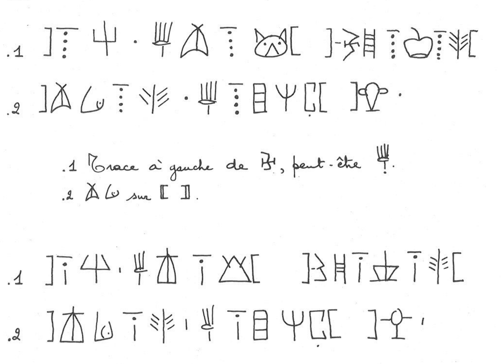

*GORILA IV p. 5 (PDF p. 48), AP Za 2, normalised copy, apparatus and tabular copy: both copies have an empty gap on each line.* (GORILA IV (L. Godart and J.-P. Olivier 1982), © École française d'Athènes)

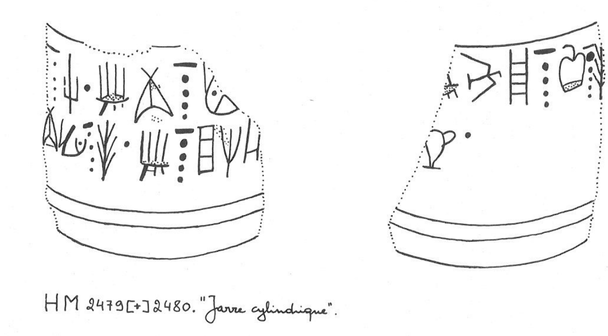

*GORILA IV p. 4 (PDF p. 47): the two sherds and the caption 'HM 2479[+]2480'.* (GORILA IV (L. Godart and J.-P. Olivier 1982), © École française d'Athènes)

### KN Zb 35 — `JA-DI-WI` is three fragments

On the tip the record has `JA-DI-WI` (token 0). GORILA IV p. 81 (PDF p. 124) prints in both copies `]JA[   ]DI-[   ]WI[   ]OLE 100` and so on, each fragment in its own brackets with a blank gap between them, no dots in the gaps; WI is underdotted in the tabular copy. Its apparatus reads 'Traces d'au moins 3 signes entre DI-[ et ]WI['. GORILA V indexes the three apart, each unstarred: `]57[` (p. 228, PDF p. 281), `]07-[` (p. 157, PDF p. 210) and `]40[` (p. 206, PDF p. 259). The corrigendum row KN Zb 35 on V p. 80 (PDF p. 133) underdots WI and redraws OLE 100, and says nothing of the gaps. Younger has `]JA[ ]DI-[ ]WI[`.

This pull request stores `JA`, `DI` and `WI` as three tokens. Both glyph strings stay, as for the splits of #14, and the later word numbers rise by two. GORILA's 'at least 3' is a bare minimum in its apparatus, not a count, so it takes no `[?]`.

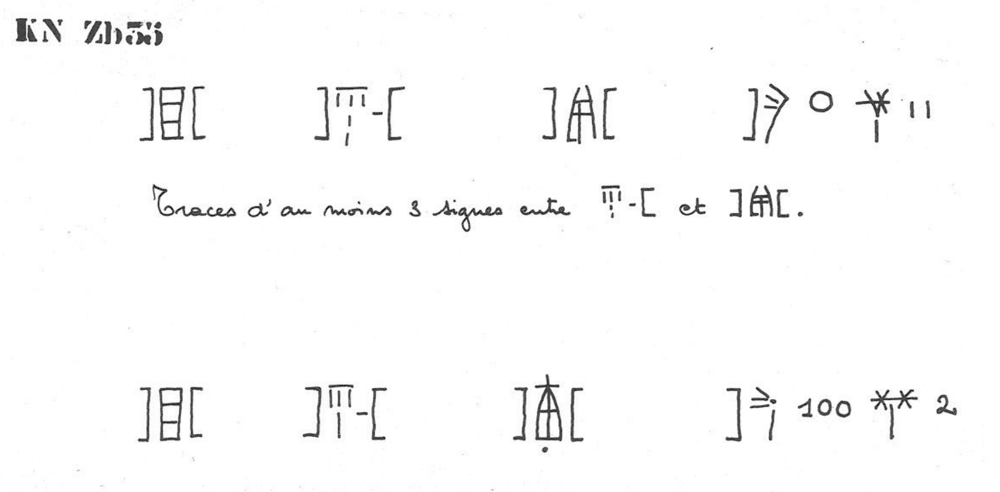

*GORILA IV p. 81 (PDF p. 124), KN Zb 35, turned upright: normalised copy, apparatus and tabular copy, the fragments each in their own brackets.* (GORILA IV (L. Godart and J.-P. Olivier 1982), © École française d'Athènes)

### KN Zf 31 — an isolated SI joined to the next word

On the tip the record has `SI-SI-ZA-NE-*310` (token 0). GORILA IV p. 155 (PDF p. 198) prints in both copies `]SI[`, a blank gap with no dots and no hyphen, then `]SI ZA NE *310 ' DA DU MI NE`. V p. 207 (PDF p. 260) indexes the two apart, unstarred: `]41[` and `]41-17-24-310`, each at KN Zf 31. The corrigendum row on V p. 80 (PDF p. 133) starts at the next word and does not reach this place. Younger has `]SI[ ]SI-ZA-NE-*310 •`.

This pull request stores `SI` and `SI-ZA-NE-*310` as two tokens. Both glyph strings stay, with their one mark for the gap, and the later word numbers rise by one.

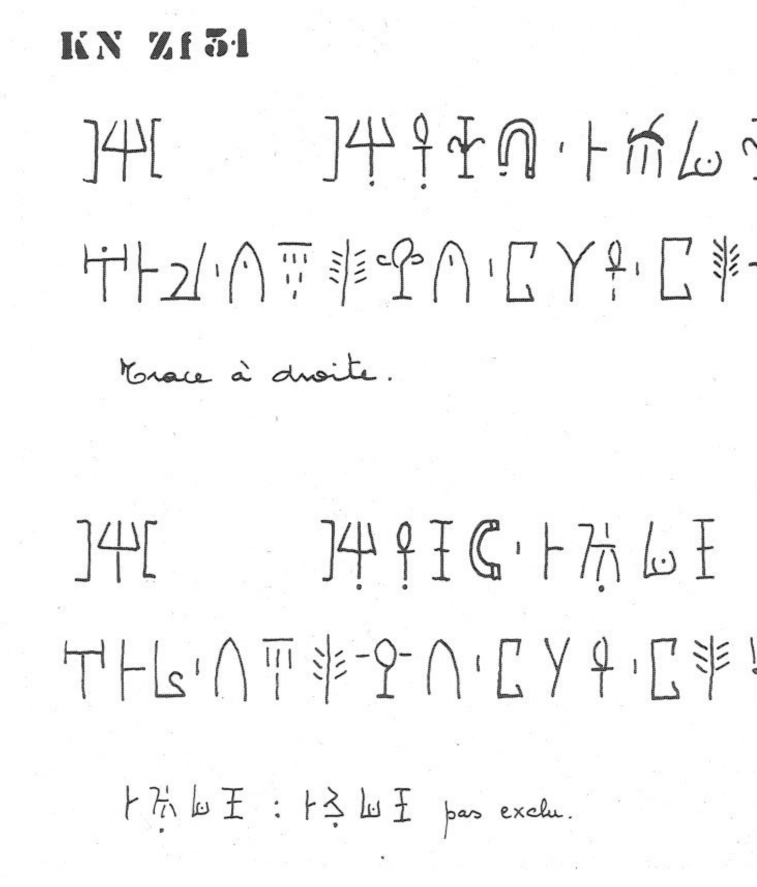

*GORILA IV p. 155 (PDF p. 198), KN Zf 31, turned upright, both copies: ]SI[ apart from ]SI ZA NE \*310.* (GORILA IV (L. Godart and J.-P. Olivier 1982), © École française d'Athènes)

### PH(?) 31a .3 — a divider for a lost element of NE

On the tip the record has a divider token before NE (token 14). GORILA I p. 319 (PDF p. 355) prints in both copies `]` and NE with a small bracket pair stacked under it, then the numeral 1; nothing stands before NE but the break, and neither copy has a divider. V p. 180 (PDF p. 233) lists `]24` at PH(?) 31a.3, unstarred. Younger has `a.3 •]+NE 1`, in the logogram column: Younger's lost element stands to the left of NE, joined by `+`, and GORILA's under it.

This pull request drops the divider token and the divider glyph from both strings. NE stays as it is. The lost element is not written, because the editions set it on different sides and no sign in a word is lost.

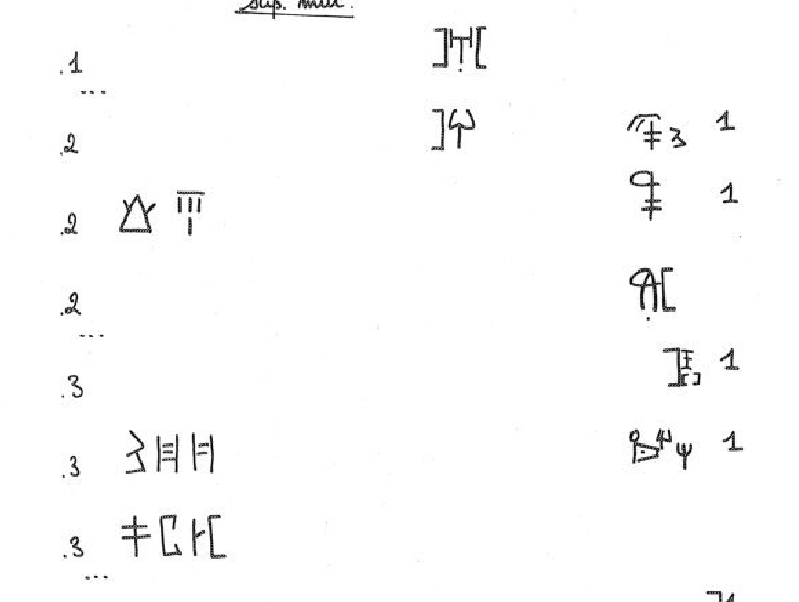

*GORILA I p. 319 (PDF p. 355), PH(?) 31a, tabular copy: on row .3, ] and NE over a small bracket pair, then 1; no divider.* (GORILA I (L. Godart and J.-P. Olivier 1976), © École française d'Athènes)

### PK Za 8 b — two fragments written as one word

On the tip the record has `JA-SA-U-NA-KA-NA-SI` (token 8). GORILA IV p. 26 (PDF p. 69) prints in both copies `JA SA[`, a wide blank with no dot and no divider, then `]U NA KA NA SI[ ]`. V p. 228 (PDF p. 281) indexes `57-31[` at PK Za 8b, and V p. 167 (PDF p. 220) files the right-hand fragment under the whole group `10-06-77-06-41` at KO Za 1c, PK Za 8b, SY Za 2b and TL Za 1b. Younger has `b: JA-SA-[ ] U-NA-KA-NA-SI[ ]`, also two fragments.

This pull request stores `JA-SA` and `U-NA-KA-NA-SI` as two tokens; both glyph strings stay. U-NA-KA-NA-SI takes the site's gloss 'requesting', as at its six other occurrences. Word numbers after the split rise by one.

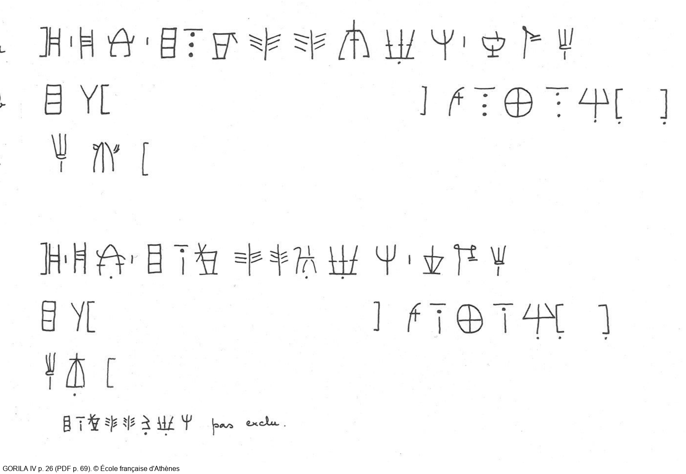

*GORILA IV p. 26 (PDF p. 69), PK Za 8, turned upright, both copies: on line b, JA SA[ and ]U NA KA NA SI[ ] with a wide blank between them.* (GORILA IV (L. Godart and J.-P. Olivier 1982), © École française d'Athènes)

### KH 94 — `I-ZA` runs across two broken lines

On the tip the record has `I-ZA` (token 6). KH 94 is not in GORILA. Its first edition, Hallager, Vlasakis and Markoulakis 1991 (`papers/KH94.pdf`), p. 37 (PDF p. 4), prints `.2 ]17 AB 28[` and `.3 ] AB 17[`: AB 28 (I) closes line 2 at a break, and AB 17 (ZA) stands alone on line 3 between two breaks. Nothing joins them. Younger has `.2-3 I [ ] ZA [`, one entry over two lines, with an uncounted gap and no hyphens, ZA underlined. The layout differs; neither prints I-ZA. The record's own transcription already breaks there.

This pull request stores `I` and `ZA` as two tokens. Both glyph strings stay, and the word numbers after token 6 rise by one.

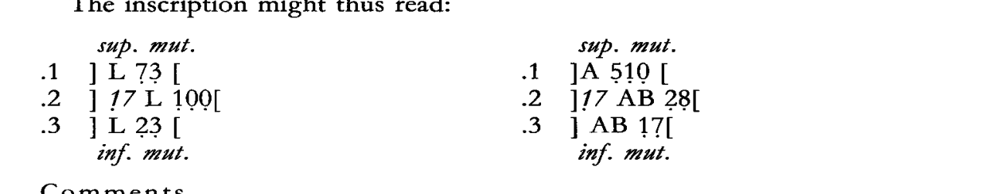

*First edition, p. 37 (PDF p. 4): .2 ]17 AB 28[ and .3 ] AB 17[.* (E. Hallager, M. Vlasakis and S. Markoulakis, 'New and hitherto unpublished Linear A documents from Kastelli, Khania', 1991; lineara.xyz `papers/KH94.pdf`)

## Commit 2: Write lost signs in words the site stores whole

*Plain: 9 records, 3 files.*

The token stays. Its transliteration gains the lost sign, and the marks in `words` and both strings follow the count. No word number moves and no box moves. A token whose lost sign stands inside it loses its key in `wordsInCorpus`; a token whose lost signs stand at its edge keeps its key. Tags stay as they are, except for the two records that have an explicit list.

### HT 9b .1 — `WA-JA-PI` becomes `WA-JA-PI-[?]`

On the tip the record has `WA-JA-PI` (token 3). GORILA I p. 19 (PDF p. 55) prints `WA JA PI-[ ]` in both copies, the three signs underdotted, an empty bracket pair after the hyphen, with the apparatus '.1 Traces en fin de ligne' and a sign 'pratiquement exclu'. GORILA V p. 71 (PDF p. 124), row HT 9b.1, amends the tabular column only, to `WA JA PI-[·]`, one dot in the brackets. The index has `54-57-39-[.]` at HT 9b.1, unstarred (V p. 222, PDF p. 275). Younger has `b.1 WA-JA-PI-[ ]`, all three underlined, with no count.

The count of one is GORILA V's alone (V pp. 71, 222): I p. 19 and Younger print an uncounted `[ ]`. This pull request takes GORILA V's count and writes `WA-JA-PI-[?]`. Only the two transliteration arrays change: the token already ends in its mark.

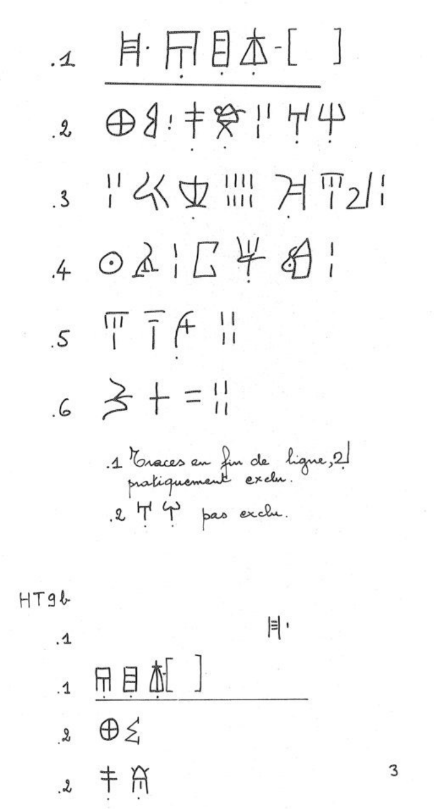

*GORILA I p. 19 (PDF p. 55), HT 9b: PI-[ ] in both copies, with an empty bracket pair.* (GORILA I (L. Godart and J.-P. Olivier 1976), © École française d'Athènes)

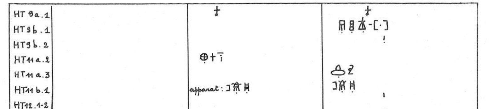

*GORILA V p. 71 (PDF p. 124), corrigenda to volume I: in row HT 9b.1 the tabular column has WA JA PI-[·].* (GORILA V (L. Godart and J.-P. Olivier 1985), © École française d'Athènes)

### HT 115b .4 — `A-I` becomes `A-I-[?]-[?]`

On the tip the record has `A-I` (token 23). GORILA I p. 191 (PDF p. 227) prints `.4 A I-[· ·]` and the numeral 1 in both copies, I underdotted, two dots in one bracket pair, no divider. The apparatus offers two four-sign readings, 'possibles mais assez douteux'; V p. 161 (PDF p. 214) indexes `08-28-[· ·]` at HT 115b.4, unstarred, and the two readings with a star. Younger has `b.4 A-I-[••]` 1, and 'b.4 or: A-I-TI-KI'.

This pull request writes `A-I-[?]-[?]`. `words` and `parsedInscription` gain a mark, and the transcription loses its divider.

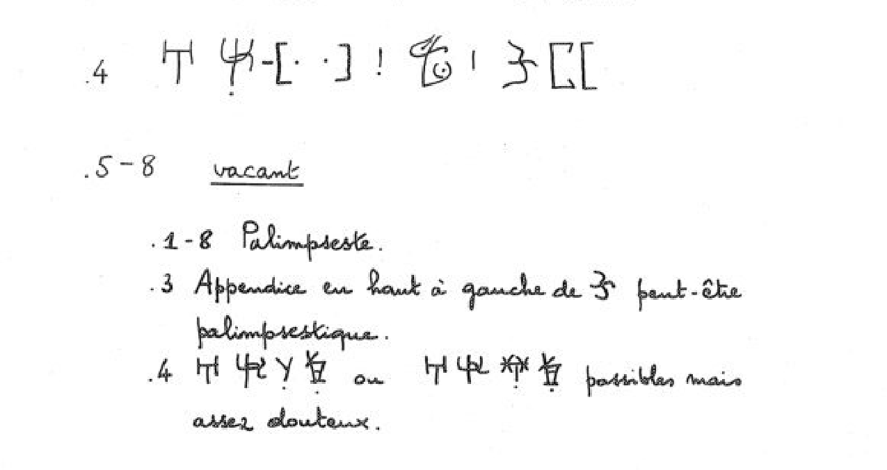

*GORILA I p. 191 (PDF p. 227), HT 115b, normalised copy and apparatus: .4 A I-[· ·], two dots.* (GORILA I (L. Godart and J.-P. Olivier 1976), © École française d'Athènes)

### KN Zc 6 .3 — the lost sign before I-ZU

On the tip the record has `JU-KU-NA-PA-KU-NU-U-I-ZU` (token 7). The sources differ here. GORILA IV p. 121 (PDF p. 164) has two illegible signs and U only in its apparatus: the tabular copy reads `KU NU-[· ·]-I ZU '`, NU underdotted, two dots with a hyphen on each side; the normalised copy draws the seventh sign against a `[`, then `]I ZU`; the apparatus reads '.3 s.7' and sign 10, underdotted, 'possible', and 's.8 non identifiable'. The drawing on p. 120 (PDF p. 163) has the seventh sign in clear strokes and the eighth as a stippled patch one sign wide. GORILA V prints `[..]`: `65-81-06-03-81-55-[..]-28-79` at KN Zc 6.3, unstarred (p. 225, PDF p. 278; p. 243, PDF p. 296), and the pages of sign 10, V pp. 167–168 (PDF pp. 220–221), have no row for KN Zc 6, plain or starred. Younger reads U: `JU-KU-NA-PA-KU-NU-U[-•]-I-ZU •`, NU and U underlined, with the note 'GORILA draws but omits (from its transcription) the 4th sign from the end; if this is U, it is reversed.'

The record reads U, as Younger does. This pull request writes `JU-KU-NA-PA-KU-NU-U-[?]-I-ZU`, transliteration only. That is exact for Younger and fits GORILA's apparatus; it is not GORILA's text, which reads two illegible signs. The form that follows GORILA's text, `-NU-[?]-[?]-I-ZU`, needs a glyph and a box taken away against Younger and is not taken. The evidence for #14 left this lost sign for this follow-up.

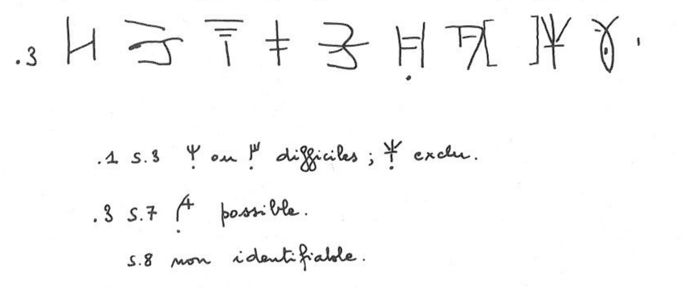

*GORILA IV p. 121 (PDF p. 164), KN Zc 6, normalised copy of .3 and apparatus: the seventh sign drawn against the bracket; '.3 s.7' possible, 's.8 non identifiable'.* (GORILA IV (L. Godart and J.-P. Olivier 1982), © École française d'Athènes)

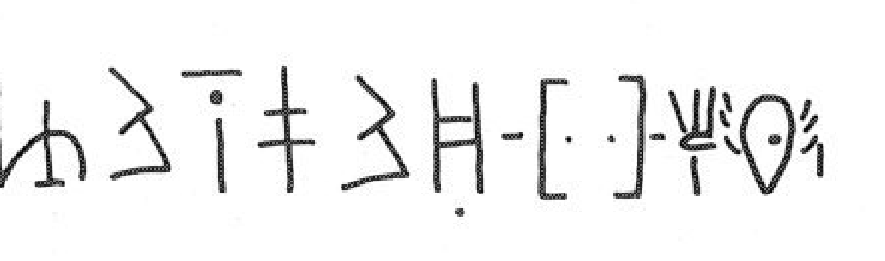

*Same page, tabular copy: NU-[· ·]-I ZU, two dots with a hyphen on each side.* (GORILA IV (L. Godart and J.-P. Olivier 1982), © École française d'Athènes)

### MA 4b .1 — `[[A-JA]]` becomes `[[A-[?]-[?]-[?]-JA]]`

On the tip the record has `[[A-JA]]` (token 0). GORILA I p. 273 (PDF p. 309) prints the whole face between erasure brackets, with `A-[· · ·]-JA` in both copies: three dots, a hyphen on each side. V p. 160 (PDF p. 213) indexes `08-[· · ·]-57` at MA 4⟦b⟧, unstarred, and the rows below it have two dots and one, so the dots count. The row MA 4b.1 on V p. 75 (PDF p. 128) is one tick in the tabular column and touches nothing here. Younger has `b.1 [[A-[...]-JA`, three dots, written so on this page alone.

This pull request writes `[[A-[?]-[?]-[?]-JA]]`, and `words` and both strings take the third mark. It keeps its tags: see [Tags](#tags).

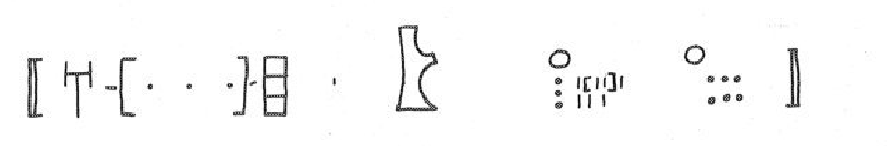

*GORILA I p. 273 (PDF p. 309), MA 4b: A-[· · ·]-JA, three dots, inside the erasure brackets.* (GORILA I (L. Godart and J.-P. Olivier 1976), © École française d'Athènes)

### PK Za 12 c — a gap in `A-NE`

On the tip the record has `A-NE` (token 7). GORILA IV p. 38 (PDF p. 81) prints `A[ ]-NE` in the normalised copy and `]A[ ]-NE` in the tabular copy, no dot in the gap, a hyphen only after the closing bracket, with the apparatus 'Traces devant NE compatibles avec' A. V p. 160 (PDF p. 213) indexes `]08[ ]-24`, and its starred row `]08[ ]08-24` holds that A. Younger has `c: ]A-[ 2? ]-NE`, with a hyphen on each side and a query on the 2.

GORILA prints `[ ]` and Younger `[ 2? ]`, an estimate; this pull request writes the uncounted form, `A-[ ]-NE`, with the stored marks unchanged. The hyphen after A is Younger's: GORILA prints none there.

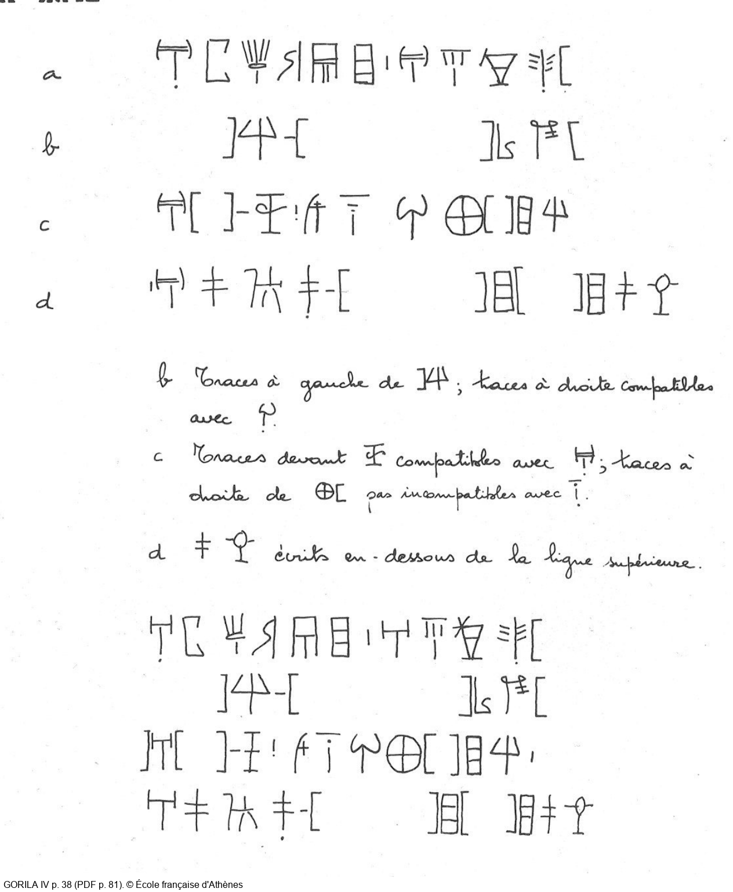

*GORILA IV p. 38 (PDF p. 81), PK Za 12, both copies and apparatus. Line c: A[ ]-NE, and U NA RU KA[ ]JA SI; neither gap holds a dot.* (GORILA IV (L. Godart and J.-P. Olivier 1982), © École française d'Athènes)

### PK Za 12 c — a gap in `U-NA-RU-KA-JA-SI`

On the tip the record has `U-NA-RU-KA-JA-SI` (token 9). On the same line GORILA IV p. 38 (PDF p. 81) prints `U NA RU KA[ ]JA SI` in both copies, a narrow `[ ]` with no dot and no hyphen, and its apparatus has 'traces à droite de' KA[ 'pas incompatibles avec' NA. V p. 167 (PDF p. 220) indexes `10-06-26-77[ ]57-41` at PK Za 12c, and its starred row `10-06-26-77-06-57-41` puts one sign, NA, in the gap. Younger has `c: U-NA-RU-KA[ 1? ]JA-SI •`, and offers the same sign: 'U-NA-RU-KA-NA-JA-SI • possible'.

GORILA prints `[ ]` here too, and Younger `[ 1? ]`; GORILA's apparatus offers NA. Both editions offer one sign, so this pull request writes a counted lost sign, `U-NA-RU-KA-[?]-JA-SI`, and not `[ ]`. Neither edition prints a hyphen at this gap. `words`, `parsedInscription` and `transcription` lose one of their two marks.

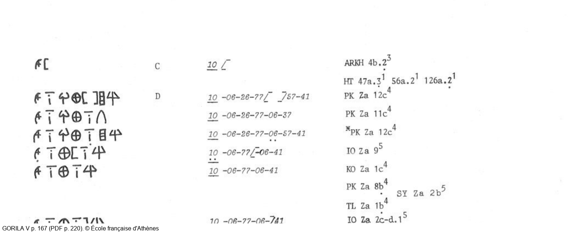

*GORILA V p. 167 (PDF p. 220), index of sign 10: 10-06-26-77[ ]57-41 at PK Za 12c, and the starred row with one sign, 06 (NA), in the gap.* (GORILA V (L. Godart and J.-P. Olivier 1985), © École française d'Athènes)

### PR Za 1 — a gap inside `TA-NA-SU-TE-KE`

On the tip the record has `TA-NA-SU-TE-KE` (token 0). GORILA IV p. 48 (PDF p. 91) prints `TA NA SU TE[ ]-KE` in both copies: no dot in the brackets, both brackets underdotted, a hyphen only after the closing bracket. V p. 235 (PDF p. 288) indexes it as one group, `59-06-58-04[ ]-44` at PR Za 1a, with no starred row beside it. Younger has `a: TA-NA-SU-TE[ ]-KE`, and quotes 'Davis 2011, 476, suggests DA or RO for the 5th sign'.

Both editions print a gap that neither counts. This pull request writes `TA-NA-SU-TE-[ ]-KE`, with the stored marks unchanged. Neither edition prints the hyphen between TE and the gap: that hyphen is the notation.

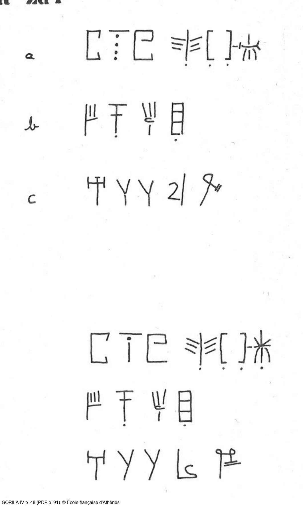

*GORILA IV p. 48 (PDF p. 91), PR Za 1, both copies: on line a, TE[ ]-KE, no dot in the brackets.* (GORILA IV (L. Godart and J.-P. Olivier 1982), © École française d'Athènes)

### THE Zb 13 — `KA-A-SI-TE` becomes `KA-A-SI-[[[?]-[?]-TE]]`

On the tip the record has `KA-A-SI-TE` (token 3). THE Zb 13 is not in GORILA, and Younger has no page for it. Its first edition, Karnava and Nikolakopoulou 2005 (`papers/THEZb13.pdf`), transnumerates it on p. 219 (PDF p. 7) as `'21' '588' 120 77-08-41-[[•-•-04]]`: AB 77 KA, 08 A, 41 SI, 04 TE, with the double brackets opening before the first bullet and closing after 04. On the same page the editors write 'The distortion itself takes up enough space to have allowed for another two signs, the remains of which can be seen inside it' and 'The total length of the inscription, including the erased signs, is 0,138m.' On p. 221 (PDF p. 9): 'The sign-group formed by signs 77-08-41-[[•-•-04]] is a new sign-group.'

This pull request writes one token, `KA-A-SI-[[[?]-[?]-TE]]`: a sign-group only partly erased keeps the `[[ ]]` inside the token, which no token on the tip does. The glyph strings gain one mark, and no word number moves. The old key goes from `wordsInCorpus` and no new key comes, so the erased TE is not counted. The evidence for #14 left the two lost signs and the brackets for this follow-up.

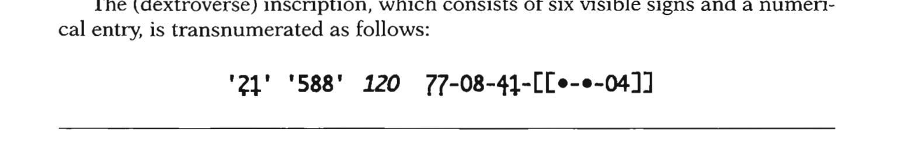

*First edition, p. 219 (PDF p. 7): the transnumeration, 77-08-41-[[•-•-04]].* (A. Karnava and I. Nikolakopoulou, 'A pithos fragment with a Linear A inscription from Akrotiri, Thera', 2005; lineara.xyz `papers/THEZb13.pdf`)

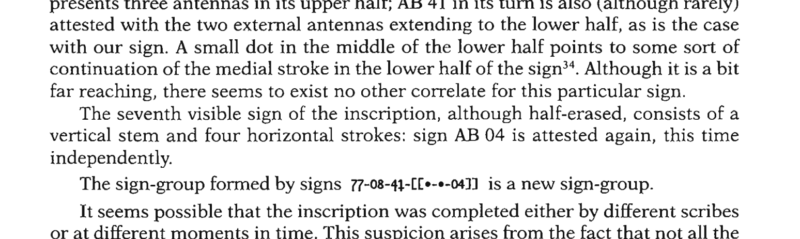

*First edition, p. 221 (PDF p. 9): 'The sign-group formed by signs 77-08-41-[[•-•-04]] is a new sign-group.'* (A. Karnava and I. Nikolakopoulou, 'A pithos fragment with a Linear A inscription from Akrotiri, Thera', 2005; lineara.xyz `papers/THEZb13.pdf`)

### TY 2 .1a, .2a, .4 — three lost signs written in place

On the tip the record has `*309B-*34-PU-PI` (token 0), `*309B-KI-PU` (token 6) and `*309C-DA-JU` (token 24). GORILA V p. 76 (PDF p. 129) replaces the tabular copy of I p. 325 (PDF p. 361): `.1α [·]-*34 PU PI`, `.2α [·]-KI PU`, `.4 RI DA-[·]-JU`. The index has `[.]-34-50-39` at TY 2.1 (V p. 199, PDF p. 252) and `53-01-[.]-65` at TY 2.4 (V p. 243, PDF p. 296), unstarred. GORILA I p. 325 has at .1 an empty `[ ]` over the vase in both copies; at .2 `[·]-KI PU` in the tabular copy, and rays at the vase's head in the normalised copy; at .4 `DA-[·]-JU` in the normalised copy, and in the tabular copy an empty bracket and JU, with no DA. Younger has `.1 *309b+[ ]-34-PU-PI`, `.2 *309b+[•]+KI+PU` and `.4 *309c+DA-[•]-JU`.

This pull request writes `*309B-[?]-*34-PU-PI`, `*309B-[?]-KI-PU` and `*309C-DA-[?]-JU`, in the site's tokens and order, with no split; the glyph strings of the last two take a mark. At .1a only GORILA V counts (V pp. 76, 199); Younger and I p. 325 print `[ ]`, and the token takes GORILA V's count. At .4 V pp. 76 and 243 read an underdotted RI before DA, which the token leaves out. GORILA V's layout of the whole text is not taken: see [Checked, not changed](#checked-not-changed). The notebook's copy of TY 2 in `items_analysis/inscriptions.json` has 82 tokens where the record has 84, as on master, so it keeps its word arrays; nothing reads those fields there.

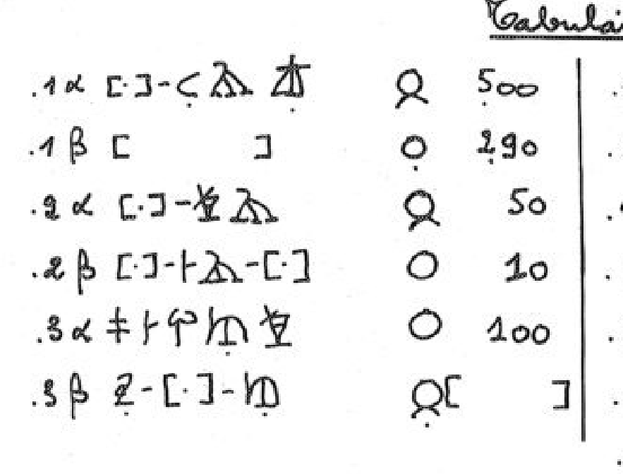

*GORILA V p. 76 (PDF p. 129), the new tabular copy of TY 2, left column: .1α [·]-\*34 PU PI, .2α [·]-KI PU.* (GORILA V (L. Godart and J.-P. Olivier 1985), © École française d'Athènes)

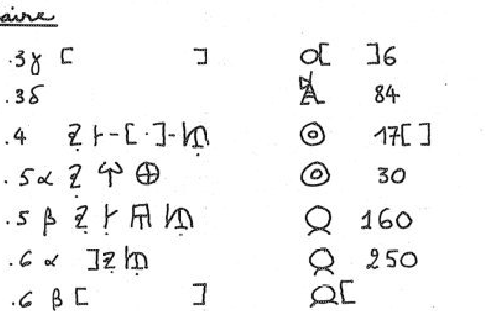

*Same page, right column: .4 RI DA-[·]-JU; .5α RI RU KA; .5β RI DA WA JU.* (GORILA V (L. Godart and J.-P. Olivier 1985), © École française d'Athènes)

### ZA 6a .9-10 — `I-SE` becomes `I-SE-[?]`

On the tip the record has `I-SE` (token 33). GORILA III p. 157 (PDF p. 182) has in its normalised copy `.9 ]= I SE` and `.10 [·][`, and in its tabular copy `.9-10 I SE-[`, with no dot. V p. 188 (PDF p. 241) indexes `28-09-[` at ZA 6a.9-10, no dot, unstarred. Younger has `a.9-10 I-SE-[•`, the bracket left open.

III p. 157's normalised copy and Younger count one sign; GORILA's tabular copy and V p. 188 print a hyphen and a break. The copies differ in counting, not in reading. This pull request takes the count and writes `I-SE-[?]`, transliteration only: the glyph token already ends in the mark, and the transcription already has the mark alone on .10.

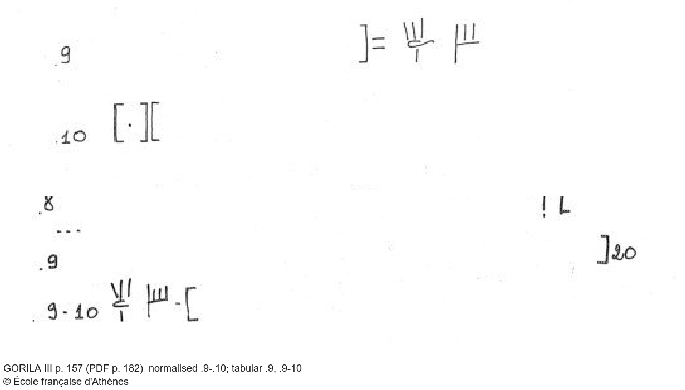

*GORILA III p. 157 (PDF p. 182), ZA 6a: normalised .9-.10, with [·][ opening .10; tabular .9-10 I SE-[, no dot.* (GORILA III (L. Godart and J.-P. Olivier 1976), © École française d'Athènes)

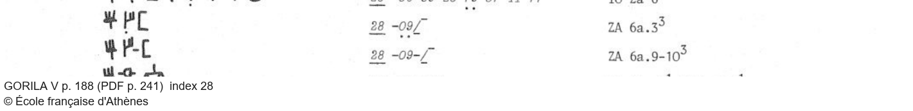

*GORILA V p. 188 (PDF p. 241), index of sign 28: 28-09-[ at ZA 6a.9-10, no dot.* (GORILA V (L. Godart and J.-P. Olivier 1985), © École française d'Athènes)

## Commit 3: Join words cut or ended by a divider for a lost sign

*Plain: 41 records, 46 files.*

A divider token that stands for a lost sign joins its word. In the sections below the divider token goes from the three word arrays and the divider glyph from both strings, both image maps lose a box-less `*900` entry, and the later word numbers fall. Where two words become one, their boxes light up together; no box moves. `wordsInCorpus` loses the divider's count; a word joined across a lost sign also loses its parts' counts and takes no new key, and a word with the lost sign at its edge keeps its key. `annotations.js` takes an explicit list for each record, and the tabulations and item pages follow.

**Five places take only the divider here:** HT 29 .4, HT 31, HT 72, IO Za 2 and KH 7a. The divider is false on every reading. The `[?]` or the join takes a side against GORILA V, so it is in commit 5, which is optional.

**A `[?]` at the head of a token does not say that a word began there.** GORILA's tabular copy and index print a break before it at HT 62+73 .2, HT 49a .1, HT 108, HT 135b, HT Zb 158a, KH 90 and KN Za 18's first group. HT 29 .2 is a lone sign, and at HT 29 .4 neither copy prints a break before `[·]`.

A record's other lost signs go with it, so that one record is in one plain commit: HT 62+73's SA-RA, HT 29's and KN Za 18's lone signs. At HT 11a, HT 79+83 and HT 126a the numeral after the lost sign loses its leading mark in `words`, as both strings have it.

### ARKH 4a .3-4 — `DE-SU 𐄁 *47-TE` is one word

On the tip the record has `DE-SU` `𐄁` `*47-TE` (tokens 14–16). GORILA III p. 13 (PDF p. 38), tabular copy: `.3-4 DE SU-[·]-*47 TE` 5, one dot with a hyphen on each side, no divider. The normalised copy ends .3 with `SU-[` and opens .4 with `*47 TE`. V p. 212 (PDF p. 265) indexes `45-58-[·]-47-04` at ARKH 4a.3-4, unstarred. V p. 78 (PDF p. 131), row ARKH 4a.3, reads 'apparat: supprimer la note': it takes away III p. 13's note on a possible sign after SU, so this lost sign is left with no alternative reading. Younger has `a.3-4 DE-SU-[•]-*47-TE`, 5 underlined.

This pull request writes `DE-SU-[?]-*47-TE`.

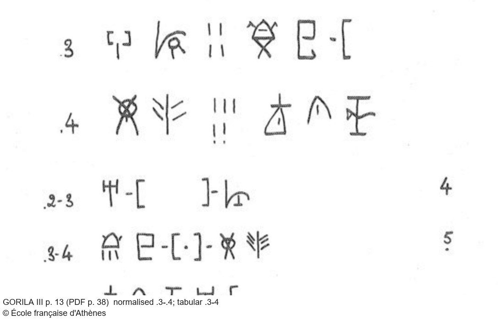

*GORILA III p. 13 (PDF p. 38), ARKH 4a: normalised .3-.4, the line ending SU-[ and the next opening \*47 TE; tabular .3-4 DE SU-[·]-\*47 TE.* (GORILA III (L. Godart and J.-P. Olivier 1976), © École française d'Athènes)

### ARKH 4a .2-3 — `A 𐄁 JU` becomes `A-[?]-[?]-JU`

On the tip the record has `A` `𐄁` `JU` (tokens 9–11). The count of two is GORILA V's index and Younger's; III p. 13's tabular copy counts nothing. That copy (PDF p. 38) prints `.2-3 A-[    ]-JU` 4, a blank gap with no dot. The normalised copy ends .2 with `A-[` and opens .3 with small brackets round one short stroke, then JU; the drawing on III p. 12 (PDF p. 37) has one upright stroke at the head of .3. V p. 160 (PDF p. 213) and V p. 243 (PDF p. 296) index `08-[··]-65` at ARKH 4a.2-3, two dots, unstarred; the rows beside it on V p. 160 have three dots and one, so the dots count. Younger has `a.2-3 A-[•]-•-JU` 4. No source has a divider here.

This pull request takes that count and writes `A-[?]-[?]-JU`, the first lost sign at the end of .2 and the second at the head of .3. The gloss 'flour' on JU goes.

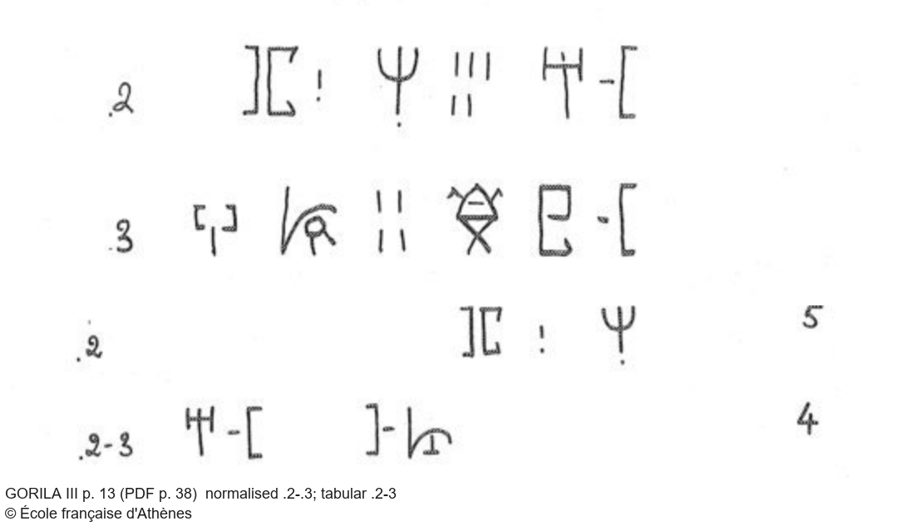

*GORILA III p. 13 (PDF p. 38), ARKH 4a: normalised .2-.3 and tabular .2-3, where the gap holds no dot.* (GORILA III (L. Godart and J.-P. Olivier 1976), © École française d'Athènes)

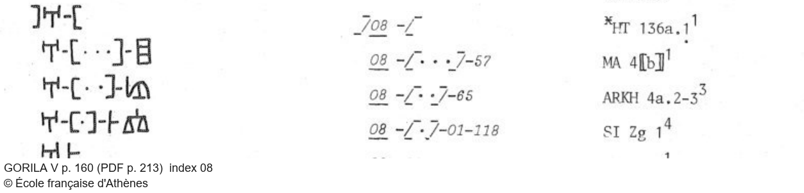

*GORILA V p. 160 (PDF p. 213), index of sign 08: 08-[· ·]-65 at ARKH 4a.2-3, two dots, between rows with three dots and one.* (GORILA V (L. Godart and J.-P. Olivier 1985), © École française d'Athènes)

### HT 11a .1 — `A-RU-RA 𐄁` becomes `A-RU-RA-[?]`

On the tip the record has `A-RU-RA` `𐄁`, then the numeral `3` with a leading mark in `words` (tokens 0–2). GORILA I p. 23 (PDF p. 59), normalised copy: `.1 A RU RA-[·]`, the numeral 3 opening .2. The tabular copy has `.1-2 A RU RA-[` in the sign column and `]3` in the numeral column, the bracket open across the table and no dot. The apparatus offers two signs for the last place, and V p. 182 (PDF p. 235) indexes `08-26-60-[.]` at HT 11a.1, unstarred, with those two starred. Younger has `a.1-2 A-RU-RA-[•]`, `]3` underlined, and 'a.1: A-RU-RA-SU or A-RU-RA-TA'.

This pull request writes `A-RU-RA-[?]`. The numeral loses its leading mark in `words`, as both strings already have it: the lost sign stands at the break that the tabular copy and Younger print, and the one mark shows both. The numeral's transliteration does not change.

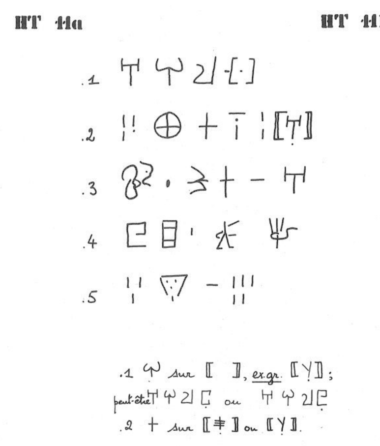

*GORILA I p. 23 (PDF p. 59), HT 11a, normalised copy and apparatus: .1 A RU RA-[·].* (GORILA I (L. Godart and J.-P. Olivier 1976), © École française d'Athènes)

### HT 29 .4 — the divider before `KI-TA` goes

On the tip the record has a divider token before `KI-TA` (token 15). GORILA I p. 55 (PDF p. 91) prints `[·]-KI TA[` in both copies (normalised .4, tabular .4-5), a hyphen after the dot, no divider, the numeral 2 after the word. Younger has `.4-5 [•]-KI-TA` 2. GORILA V reads the sign as A 340 ([commit 5](#commit-5-optional-readings-where-the-editions-differ)). On every reading no divider stands here. At this place neither copy prints a break before `[·]`.

Commit 3 takes only the divider, and `KI-TA` keeps its mark. The `[?]`, which takes a side, is in commit 5.

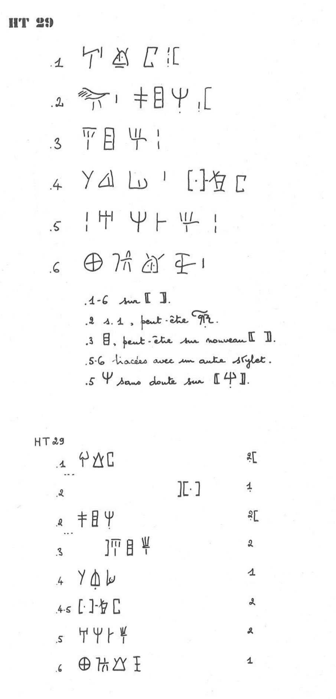

*GORILA I p. 55 (PDF p. 91), HT 29, normalised copy, apparatus and tabular copy: .4-5 [·]-KI TA[; .2 ][·] in the logogram column.* (GORILA I (L. Godart and J.-P. Olivier 1976), © École française d'Athènes)

### HT 29 .2 — a divider for a lone lost sign

On the tip the record has a divider token on line .2 (token 3). GORILA I p. 55 (PDF p. 91), tabular copy: `.2 ][·]`, the numeral 1 after it, in the logogram column, then `.2 PA JA RE` 2[. The normalised copy draws a damaged sign before the numeral, and the apparatus has '.2 s.1, peut-être' with a sign. Younger has `.2 ][•]` 1, in the logogram column, and '.2 perhaps: ]QI f'. Neither has a divider. HT 29 .2 is a lone sign: `][·]` stands in the tabular copy's logogram column, and the index does not list lone illegible signs.

This pull request writes a trace-only token `[?]`; both strings lose the divider glyph and keep one mark. It is here, and not in commit 4, so that the record stays in one commit. The crop above shows this line.

### HT 31 .1 — the divider before `TI-SA` goes

On the tip the record has a divider token before `TI-SA` (token 0). GORILA I p. 59 (PDF p. 95) prints `.1 [·]-TI SA · PU KO ·` in both copies, a hyphen after the dot, the first divider only after SA. Younger has `.1 [•]-TI-SA • PU-KO •`. GORILA V reads the sign as I ([commit 5](#commit-5-optional-readings-where-the-editions-differ)). On every reading no divider stands before TI.

Commit 3 takes only the divider. `TI-SA` keeps its mark, and `parsedInscription` and `transcription` keep one mark before TI.

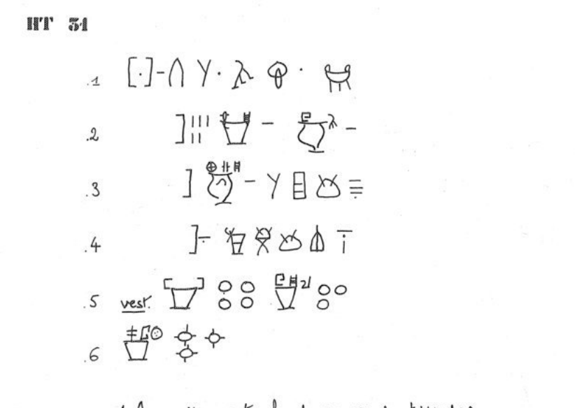

*GORILA I p. 59 (PDF p. 95), HT 31, normalised copy: .1 [·]-TI SA · PU KO ·.* (GORILA I (L. Godart and J.-P. Olivier 1976), © École française d'Athènes)

### HT 37 .6 — `𐄁 QE` becomes `[?]-QE`

On the tip the record has `𐄁` `QE` (tokens 27–28). GORILA I p. 71 (PDF p. 107) prints `.6 [·]-QE` 17 in both copies, a hyphen after the dot, no divider, with the apparatus '.6 Peut-être' JA QE. V p. 72 (PDF p. 125), row HT 37.6, amends only that apparatus. V p. 260 (PDF p. 313) indexes `[.]-78` at HT 37.6, unstarred, and V p. 261 (PDF p. 314) has `57-78` starred. Younger has `.6 [•]-QE` 17, and '.6 or: JA-QE'.

This pull request writes `[?]-QE`.

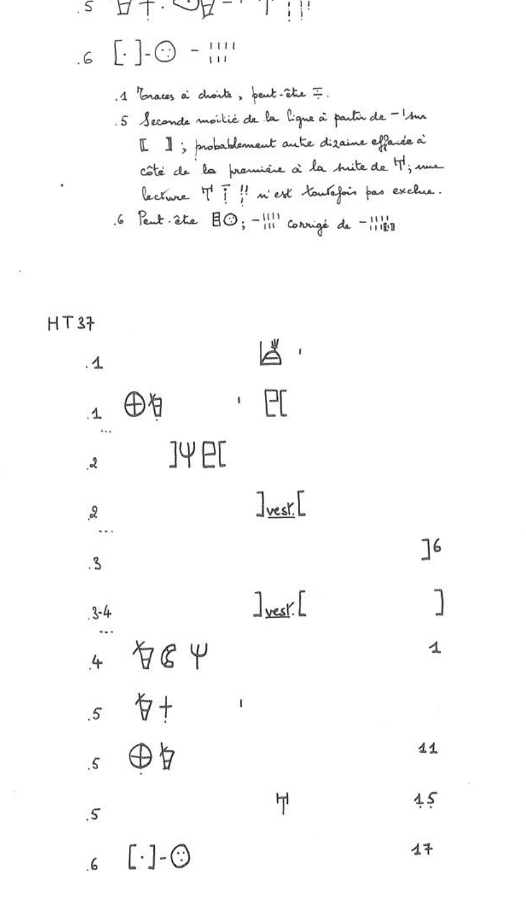

*GORILA I p. 71 (PDF p. 107), HT 37, both copies and apparatus: .6 [·]-QE.* (GORILA I (L. Godart and J.-P. Olivier 1976), © École française d'Athènes)

### HT 45b .3 — `PA 𐄁 A` is one word

On the tip the record has `PA` `𐄁` `A` (tokens 23–25). GORILA I p. 87 (PDF p. 123) prints `PA-[·]-A` in both copies (normalised .3, tabular .3-4), a hyphen on each side of the one dot, no divider, then the numeral 20. Its apparatus offers a sign for the place, 'possible'. V p. 146 (PDF p. 199) indexes `03-[.]-08` at HT 45b.3, unstarred, and `03-41-08` with a star. Younger has `b.3-4 PA-[•]-A` 20.

This pull request writes `PA-[?]-A`. The real divider on .4, before KU, stays.

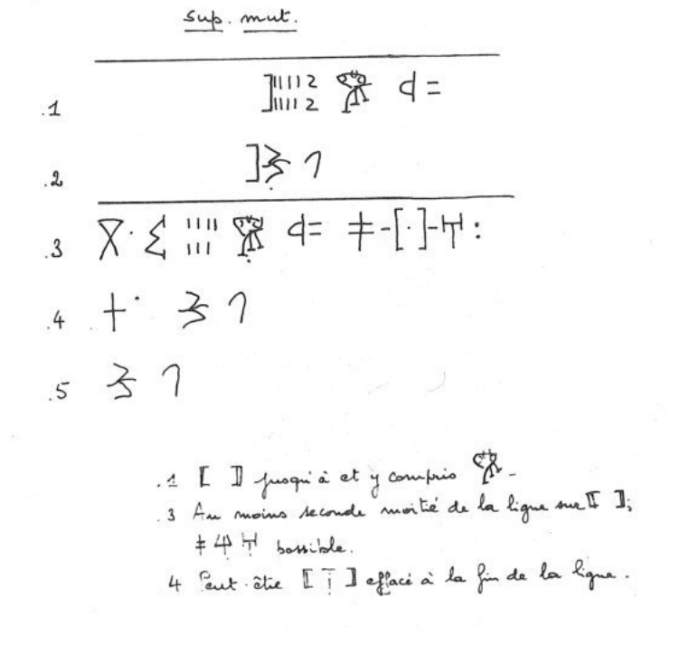

*GORILA I p. 87 (PDF p. 123), HT 45b, normalised copy: PA-[·]-A at the end of .3, a hyphen on each side of the dot.* (GORILA I (L. Godart and J.-P. Olivier 1976), © École française d'Athènes)

### HT 62+73 .2 — `𐄁 NA` becomes `[?]-NA`

On the tip the record has `𐄁` `NA` (tokens 6–7). GORILA I p. 117 (PDF p. 153) prints `.2 [·]-NA` in the normalised copy and `.2 ][·]-NA` in the tabular copy, GRA 15 after it, one dot, a hyphen, no divider. V p. 155 (PDF p. 208) indexes `][.]-06` at HT 62[+]73.2, unstarred. Younger has `.2 ][•]-NA`.

This pull request writes `[?]-NA`. The tabular copy, the index and Younger print a break before the lost sign, so the `[?]` does not say that a word began here. #14's commit 11 added these lines to the transcription, which takes the same edit as `parsedInscription`.

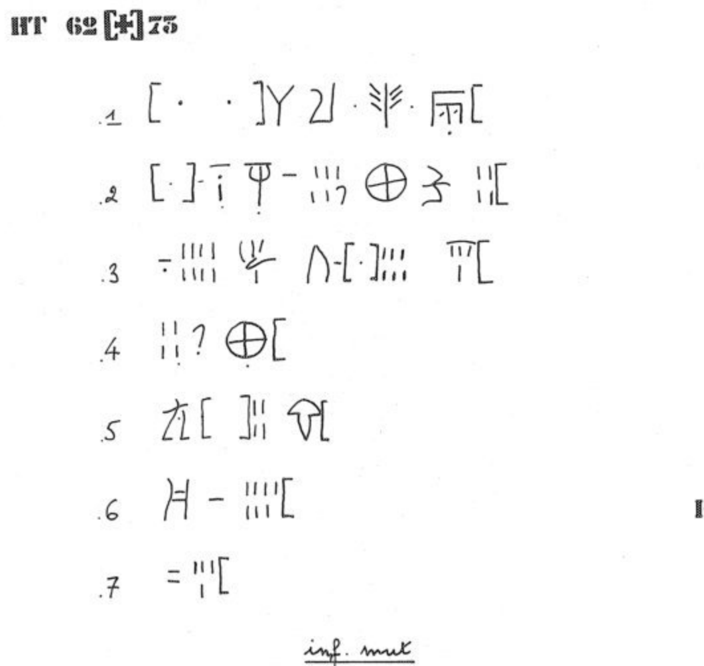

*GORILA I p. 117 (PDF p. 153), HT 62+73, normalised copy: .1 [· ·]SA RA, .2 [·]-NA, .3 \*28B TI-[·].* (GORILA I (L. Godart and J.-P. Olivier 1976), © École française d'Athènes)

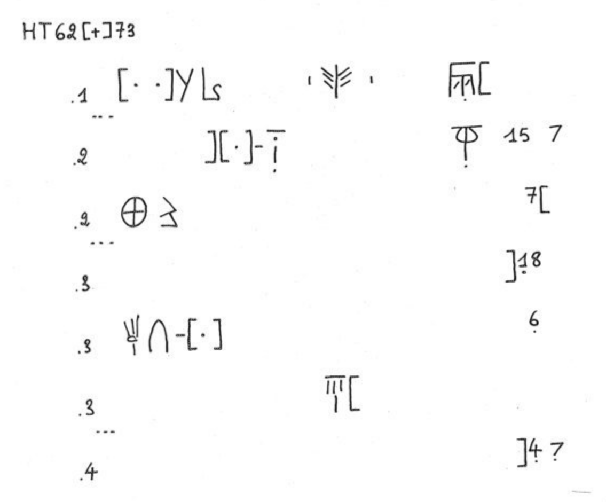

*Same page, tabular copy: .1 [· ·]SA RA, .2 ][·]-NA, .3 \*28B TI-[·] 6.* (GORILA I (L. Godart and J.-P. Olivier 1976), © École française d'Athènes)

### HT 62+73 .3 — `*28B-TI 𐄁` becomes `*28B-TI-[?]`

On the tip the record has `*28B-TI` `𐄁` (tokens 17–18). GORILA I p. 117 (PDF p. 153) prints `.3 *28B TI-[·]`, then 6, in both copies. V p. 73 (PDF p. 126), row HT 62[+]73.3, redraws \*28B and prints `*28B TI-[·]` again in both copies. V p. 200 (PDF p. 253) indexes `28b-37-[.]`, unstarred. Younger has `.3 Ib-TI-[•]` 6.

This pull request writes `*28B-TI-[?]`; both strings lose the divider. The crops of HT 62+73 .2 show this line.

### HT 62+73 .1 — `SA-RA` becomes `[?]-[?]-SA-RA`

On the tip the record has `SA-RA` (token 0). GORILA I p. 117 (PDF p. 153) prints `.1 [· ·]SA RA · TE · VIN[` in both copies, two dots in one bracket pair. V p. 197 (PDF p. 250) indexes `[..]-31-60` at HT 62[+]73.1, unstarred. Younger has `.1 [•-•]SA-RA • TE • VINa[`.

This pull request writes `[?]-[?]-SA-RA`, with one more mark in `words` and both strings. No divider stands at this place; the change is here so that the record's lost signs are in one commit. The crops of HT 62+73 .2 show this line.

### HT 68 .1 — `𐄁 JU` becomes `[?]-JU`

On the tip the record has `𐄁` `JU` (tokens 0–1). GORILA I p. 123 (PDF p. 159) prints `.1 [·]-JU ·` and a VIR-type sign in both copies: one dot, a hyphen, the real divider only after JU. V p. 243 (PDF p. 296) indexes `[.]-65` at HT 68.1, unstarred. The row HT 68.2 on V p. 73 (PDF p. 126) is the apparatus of .2. Younger has `.1 [•]-JU • VIR[`.

This pull request writes `[?]-JU`. The gloss 'flour' on JU goes.

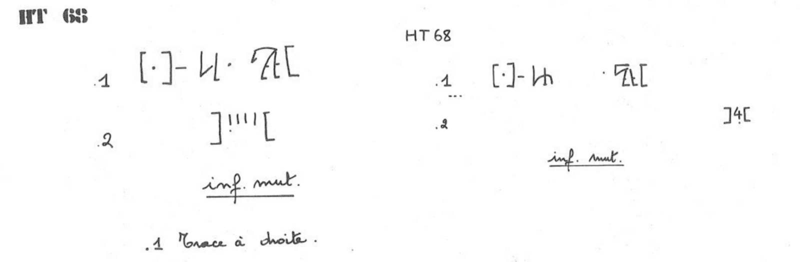

*GORILA I p. 123 (PDF p. 159), HT 68, both copies: .1 [·]-JU, then the divider.* (GORILA I (L. Godart and J.-P. Olivier 1976), © École française d'Athènes)

### HT 72 .1 — the divider after `SI-VIR+[?]` goes

On the tip the record has `SI-VIR+[?]` `𐄁` `𐝫` (tokens 0–2). GORILA I p. 125 (PDF p. 161) prints `.1 SI VIR-[·][` in both copies (the second sign a VIR-type sign), the dot inside closed brackets, and no divider. Younger has `.1 SI-VIR-[•][`. GORILA V withdraws the dot ([commit 5](#commit-5-optional-readings-where-the-editions-differ)). On every reading no divider stands here.

Commit 3 takes only the divider; `SI-VIR+[?]` and its trace-only token stay.

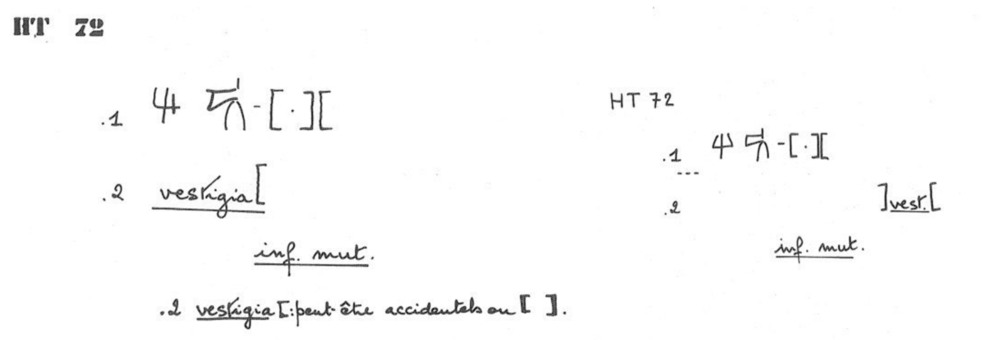

*GORILA I p. 125 (PDF p. 161), HT 72, both copies: .1 SI VIR-[·][, the dot inside closed brackets.* (GORILA I (L. Godart and J.-P. Olivier 1976), © École française d'Athènes)

### HT 79+83 .2 — `TU 𐄁` becomes `TU-[?]`

On the tip the record has `TU` `𐄁`, then the numeral `3` with a leading mark in `words` (tokens 12–14). GORILA I p. 127 (PDF p. 163), tabular copy: `.2 ]TU-[·]` 3, one dot, a hyphen, no divider. The normalised copy prints after `]TU` a sign in half-brackets, then 3, with the apparatus that this sign is 'peut-être sur [[ ]]'. The drawing on I p. 126 (PDF p. 162) has TU whole and then a second sign with its top stippled, and V p. 73 (PDF p. 126), row HT 79[+]83.2, redraws that sign and half-brackets it in the normalised column, and leaves the tabular column blank. V p. 249 (PDF p. 302) indexes `]69-[.]` at HT 79[+]83.2, unstarred. Younger has `.2 ]TU-[•]` 3.

This pull request writes `TU-[?]`, as the tabular copy, the index and Younger have it; the normalised copy, the drawing and V p. 73 show remains of the sign, which no edition reads. The numeral loses its leading mark in `words`, as both strings have it: GORILA prints no break there.

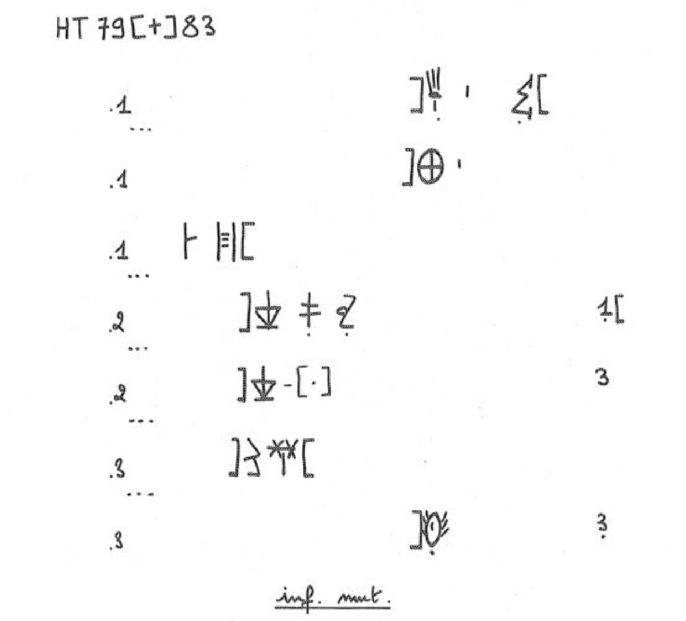

*GORILA I p. 127 (PDF p. 163), HT 79+83, tabular copy: .2 ]TU-[·] 3.* (GORILA I (L. Godart and J.-P. Olivier 1976), © École française d'Athènes)

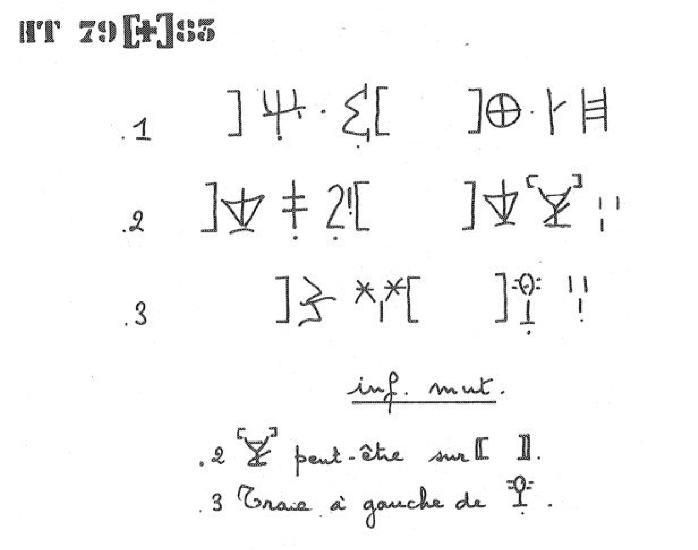

*Same page, normalised copy and apparatus: after ]TU, a sign in half-brackets, then 3.* (GORILA I (L. Godart and J.-P. Olivier 1976), © École française d'Athènes)

### HT 87 .5 — `A-RA 𐄁 A-TU` is one word in the main text

On the tip the record has `A-RA` `𐄁` `A-TU` (tokens 20–22). GORILA I p. 137 (PDF p. 173) prints `.5 A RA-[·]A TU` 1 in both copies: a hyphen before the bracket, none after it, one dot, no divider. Its apparatus adds '.5 Peut-être A RA-[·]! A TU ! ; le troisième signe n'est plus identifiable', two entries, each with a numeral. The index has the main text as one group, `08-60-[.]08-69`, unstarred, and stars the two entries: `08-60-[.]` on V p. 239 (PDF p. 292), `]08-69` on V p. 250 (PDF p. 303). Younger has `.5 A-RA-[•]-A-TU` 1.

This pull request writes `A-RA-[?]-A-TU`, the main text of both editions. GORILA's apparatus allows two entries, A-RA-[?] and A-TU.

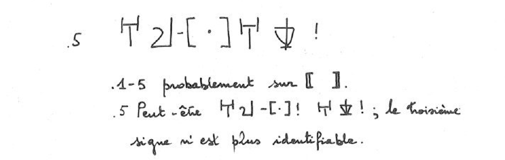

*GORILA I p. 137 (PDF p. 173), HT 87, normalised copy and apparatus: .5 A RA-[·]A TU, and the apparatus's two entries.* (GORILA I (L. Godart and J.-P. Olivier 1976), © École française d'Athènes)

### HT 93a .6-7 — `O-TI 𐄁` becomes `O-TI-[?]`

On the tip the record has `O-TI` `𐄁` (tokens 38–39). GORILA I p. 147 (PDF p. 183): the normalised copy ends .6 with `O TI` and opens .7 with `[·]` and the numeral; the tabular copy has `.6-7 O TI-[·]` 3, one dot, a hyphen, no divider. The apparatus has O TI and a third sign 'n'est pas impossible', and two other signs 'sont exclus'. V p. 201 (PDF p. 254) indexes `61-37-[.]` at HT 93a.6-7, unstarred, and `61-37-02` with a star; 02 is RO. Younger has `a.6-7 O-TI-[•]` 3, and 'a.6-7 or: O-TI-RO'.

This pull request writes `O-TI-[?]`. RO is both editions' alternative; neither reads it in its text.

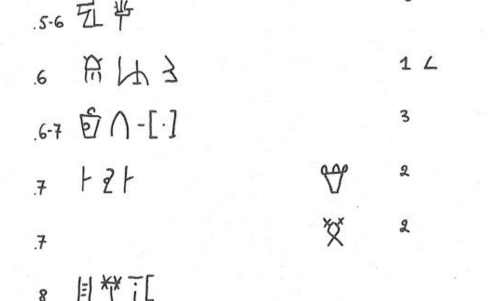

*GORILA I p. 147 (PDF p. 183), HT 93a, tabular copy: .6-7 O TI-[·] 3.* (GORILA I (L. Godart and J.-P. Olivier 1976), © École française d'Athènes)

### HT 94b .5 — `RA 𐄁 DE-ME-TE` is one word

On the tip the record has `RA` `𐄁` `DE-ME-TE` (tokens 24–26). GORILA I p. 153 (PDF p. 189) prints `.5 RA-[·]-DE ME TE` 1 in both copies, a hyphen on each side of the dot; the real divider stands only after \*86. Its apparatus has '.5 Peut-être RA RI DE ME TE.' V p. 239 (PDF p. 292) indexes `60-[.]-45-13-04` at HT 94b.5, unstarred, and `60-53-45-13-04` with a star. Younger, who numbers this line b.4, has `RA-[•]-DE-ME-TE` 1, and 'b.4 or: RA-RI-DE-ME-TE'.

This pull request writes `RA-[?]-DE-ME-TE`. RI is both editions' alternative; neither reads it in its text.

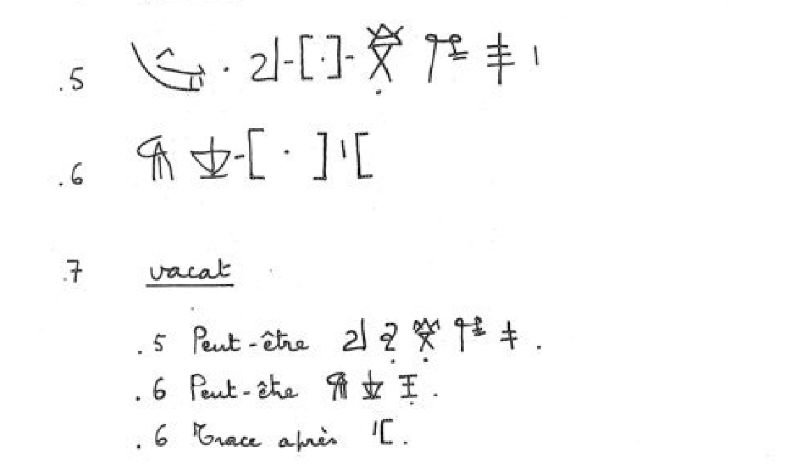

*GORILA I p. 153 (PDF p. 189), HT 94b, normalised copy and apparatus: .5 RA-[·]-DE ME TE; .6 \*21F TU-[·]1[.* (GORILA I (L. Godart and J.-P. Olivier 1976), © École française d'Athènes)

### HT 94b .6 — `*21F-TU 𐄁` becomes `*21F-TU-[?]`

On the tip the record has `*21F-TU` `𐄁` (tokens 29–30). GORILA I p. 153 (PDF p. 189) prints `.6 *21F TU-[·]` and `1[` in both copies, with the apparatus '.6 Peut-être \*21F TU NE.' and '.6 Trace après 1['. V p. 249 (PDF p. 302) indexes `21F-69-[.]` at HT 94b.6, unstarred, and stars 94b.6 under `21F-69-24`. Younger, who numbers this line b.5, has `QIf-TU-[•]` 1, and 'b.5: QIf-TU-NE?'.

This pull request writes `*21F-TU-[?]`. NE is both editions' alternative; neither reads it in its text. The crop of HT 94b .5 shows this line.

### HT 97a .6 — `DE 𐄁` becomes `DE-[?]`, and two line breaks move

On the tip the record has `DE` `𐄁` ⏎ ⏎ `3` `A` `5` `𐝫` (tokens 37–44). GORILA I p. 159 (PDF p. 195), normalised copy: `.6 DE-[·]3[   ]A 5`; tabular copy: `.6 DE-[·]` 3[, then a new row `.6 ]A` 5. One dot, a hyphen, no divider. V p. 212 (PDF p. 265) indexes `45-[.]` at HT 97a.6, unstarred. Younger has `a.6 DE-[•]` 3[ and `a.6 ]A` 5.

This pull request writes `DE-[?]`. The two line-break tokens that stand inside the entry move after the 3 and after the 5, where `parsedInscription` has them and as GORILA's tabular rows run, so the tokens become `DE-[?]` `3` ⏎ `A` `5` ⏎ `𐝫`. #14's commit 11 corrected the same fault at MI 2 and PH 28b.

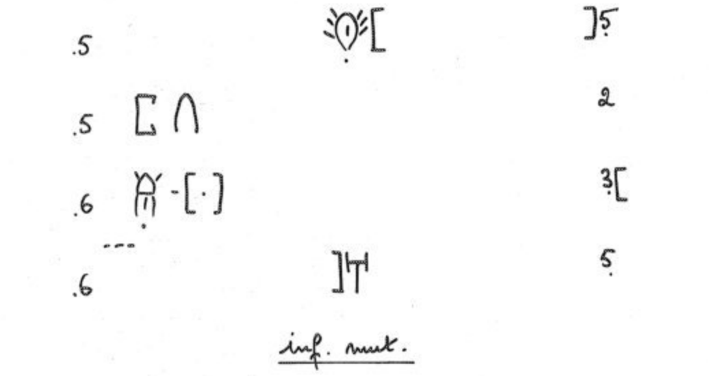

*GORILA I p. 159 (PDF p. 195), HT 97a, tabular copy: .6 DE-[·] 3[, then .6 ]A 5.* (GORILA I (L. Godart and J.-P. Olivier 1976), © École française d'Athènes)

### HT 106 .3 — `DA 𐄁` becomes `DA-[?]`

On the tip the record has `DA` `𐄁` (tokens 13–14). GORILA I p. 173 (PDF p. 209) prints `.3 DA-[·]` and `8[` in both copies, a hyphen, one dot, no divider. The apparatus has DA ME, ME underdotted, 'difficile mais non impossible'. V p. 141 (PDF p. 194) indexes `01-[·]` at HT 106.3, unstarred, and stars 106.3 under DA-ME. Younger has `.3 DA-[•]` 8[, and '.3 or: DA-ME'.

This pull request writes `DA-[?]`. Its two line-break tokens stay: they stand between DA and the 8, where GORILA and `parsedInscription` have the 8 on DA's line. So the line does not print as GORILA has it, and this pull request does not claim that it does.

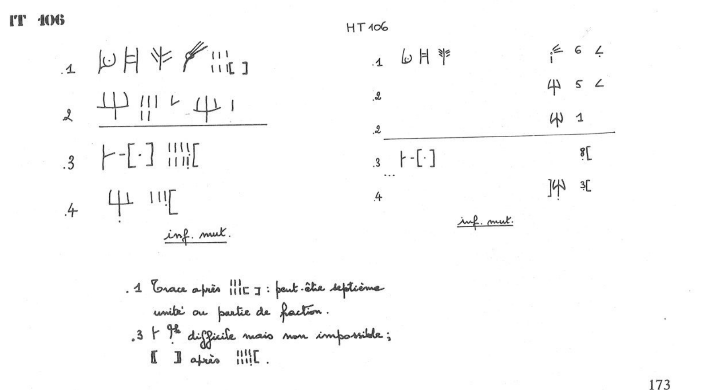

*GORILA I p. 173 (PDF p. 209), HT 106, both copies and apparatus: .3 DA-[·] 8[.* (GORILA I (L. Godart and J.-P. Olivier 1976), © École française d'Athènes)

### HT 108 .3 — `𐄁 RA₂-TI` becomes `[?]-RA₂-TI`

On the tip the record has `𐄁` `RA₂-TI` (tokens 15–16). GORILA I p. 175 (PDF p. 211) prints `.3 [·]-RA2 TI` 10 in the normalised copy and `.3 ][·]-RA2 TI` 10 in the tabular copy, one dot, a hyphen, no divider. The apparatus offers two signs for the place; V p. 74 (PDF p. 127), row HT 108.3, amends that apparatus and leaves the text. V p. 256 (PDF p. 309) indexes `][.]-76-37` at HT 108.3, unstarred, with the break of the tabular copy, and stars the two signs. Younger has `.3 [•]-RA2-TI` 10, and '.3 or: QA-RA2-TI or: ZU-RA2-TI'.

This pull request writes `[?]-RA₂-TI`. The tabular copy and the index print a break before the dot, so the lost sign stands before RA2-TI and the `[?]` does not say that a word began here.

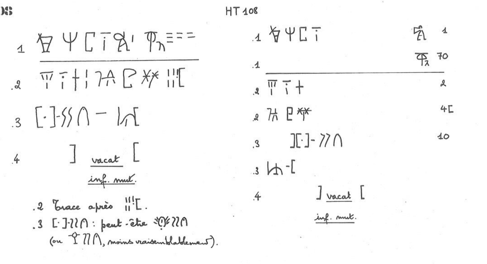

*GORILA I p. 175 (PDF p. 211), HT 108, both copies and apparatus: .3 [·]-RA2 TI, and ][·]-RA2 TI in the tabular copy.* (GORILA I (L. Godart and J.-P. Olivier 1976), © École française d'Athènes)

### HT 122a .2-3 — `PA 𐄁` becomes `PA-[?]-[?]`

On the tip the record has `PA` `𐄁` (tokens 10–11). GORILA I p. 207 (PDF p. 243), tabular copy: `.2-3 PA-[· ·][`, no numeral, three short dashes, then `.3 ]-DI` 1. The normalised copy differs: .2 ends in PA, and .3 opens `vest.[ ]-DI`. By I p. XXXV (PDF p. 35) the three dashes between two entries mark a break in the text, 'une solution de continuité — certaine ou possible — dans le texte'. The drawing on I p. 206 (PDF p. 242) has two stroke remains at the head of .3, then broken surface, then DI. V p. 146 (PDF p. 199) indexes `03-[· ·][` at HT 122a.2-3, a row that ends at the bracket. Younger has `a.2-3 PA-[••][` and `a.3 ]-DI` 1.

This pull request writes `PA-[?]-[?]`, and `]-DI` 1 stays a word of its own. The count rests on the tabular copy, V p. 146, Younger and the drawing, not on both copies.

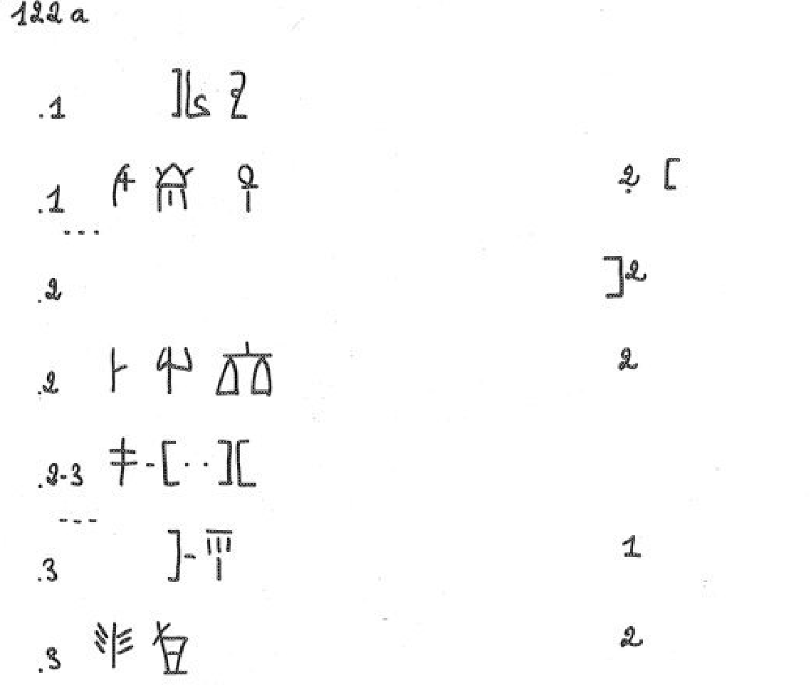

*GORILA I p. 207 (PDF p. 243), HT 122a, tabular copy: .2-3 PA-[· ·][, three dashes, .3 ]-DI 1.* (GORILA I (L. Godart and J.-P. Olivier 1976), © École française d'Athènes)

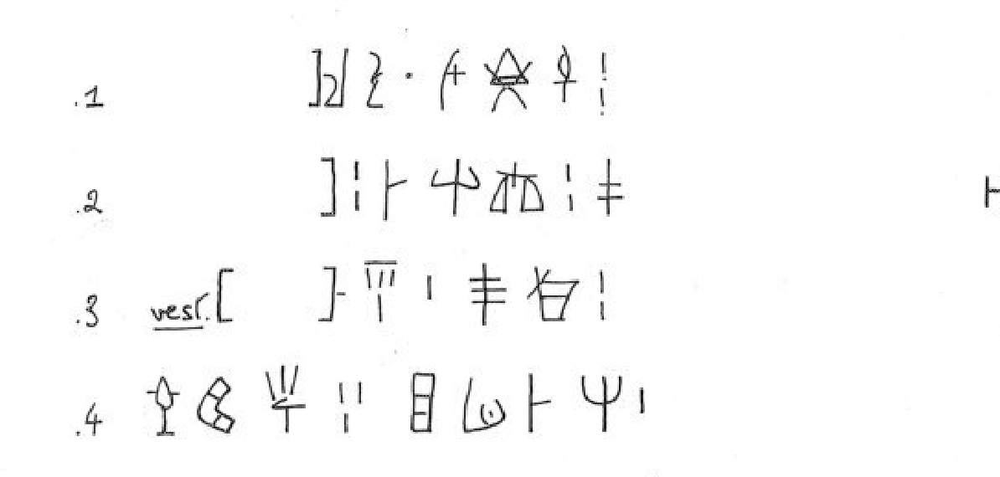

*Same page, normalised copy: .2 ends in PA; .3 opens vest.[ ]-DI.* (GORILA I (L. Godart and J.-P. Olivier 1976), © École française d'Athènes)

### HT 126a .2 — `A-NA 𐄁` becomes `A-NA-[?]`

On the tip the record has `A-NA` `𐄁`, then the numeral `1` with a leading mark in `words` (tokens 5–7). GORILA I p. 217 (PDF p. 253) prints `.2 A NA-[·]`, the numeral 1 underdotted, and `U[` in both copies: one dot, a hyphen, no divider, no break before the numeral. The apparatus reads 'A NA-[·] : un caillou rend le signe difficilement identifiable'. V p. 74 (PDF p. 127), row HT 126a.2, adds to the apparatus 'A NA' and QA, underdotted, 'possible'. V p. 161 (PDF p. 214) indexes `08-06-[·]` at HT 126a.2, unstarred, and `08-06-16` with a star. Younger has `a.2 A-NA-[•]` 1, and 'a.2 or: A-NA-QA'.

This pull request writes `A-NA-[?]`. The numeral loses its leading mark in `words`, as both strings have it: GORILA prints no break there.

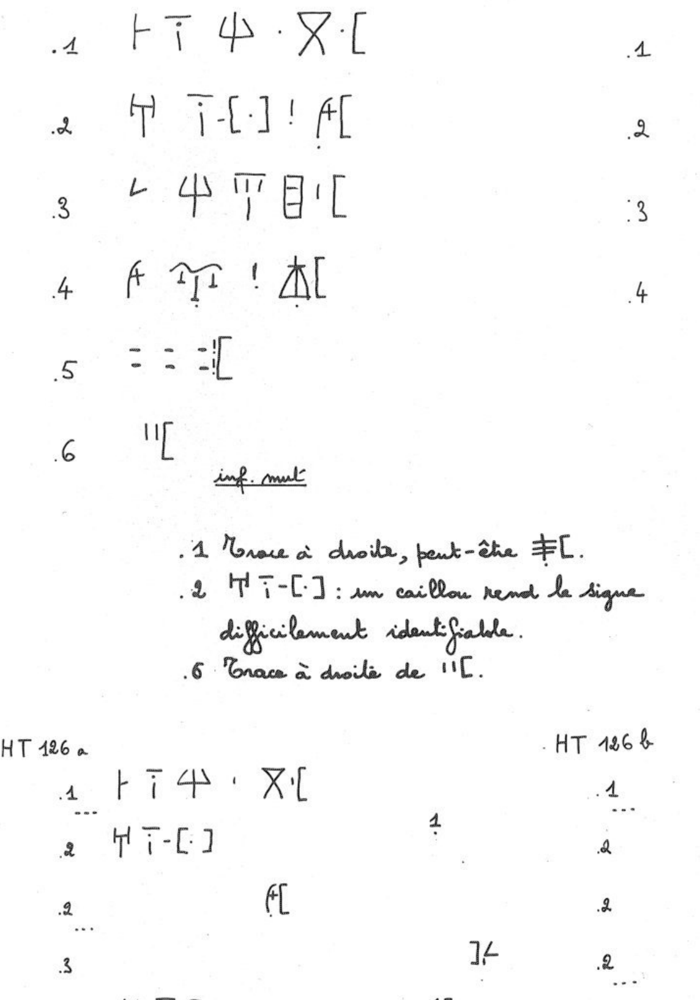

*GORILA I p. 217 (PDF p. 253), HT 126a, both copies and apparatus: .2 A NA-[·].* (GORILA I (L. Godart and J.-P. Olivier 1976), © École française d'Athènes)

### HT 128b .2 — `RU`, a divider and a mark become `RU-[?]-[?]`

On the tip the record has `RU` `𐄁` `𐝫` (tokens 7–9). GORILA I p. 221 (PDF p. 257) prints `.2 RU-[· ·]` GRA+KU 6 in both copies: a hyphen, two dots, no divider. Its apparatus has two forms, each RU and two signs; V p. 74 (PDF p. 127), row HT 128b.2, amends it. V p. 182 (PDF p. 235) indexes `26-[· ·]` at HT 128b.2, unstarred, and stars both forms. Younger has `b.2 RU-[••]` GRA+KU 6, and 'b.2: RU-WA-DA or RU-WA-U'.

This pull request writes `RU-[?]-[?]`: the word, the divider and the trace-only token become one token.

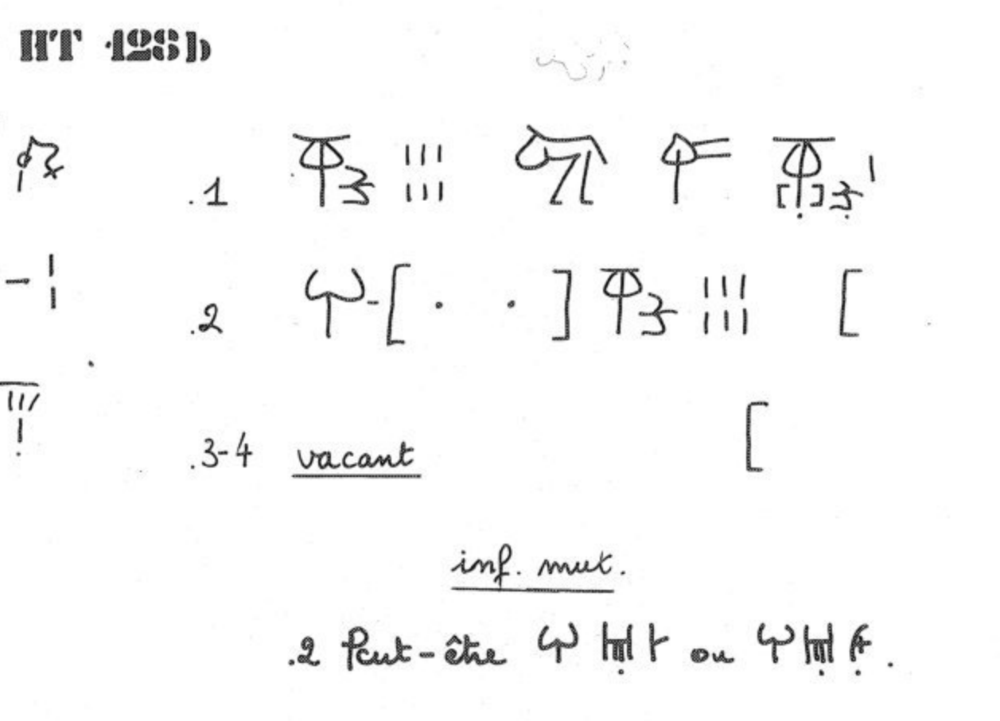

*GORILA I p. 221 (PDF p. 257), HT 128b, normalised copy and apparatus: .2 RU-[· ·].* (GORILA I (L. Godart and J.-P. Olivier 1976), © École française d'Athènes)

### HT 135b .1 — `𐄁 TA-NE` becomes `[?]-[?]-TA-NE`

On the tip the record has `𐄁` `TA-NE` (tokens 2–3). GORILA I p. 231 (PDF p. 267) prints `.1 [· ·]-TA NE[` in the normalised copy and `.1 ][· ·]-TA NE[` in the tabular copy, two dots, a hyphen, no divider. Its apparatus has '.1 Peut-être' `[·]`, then \*34 underdotted, then TA NE[: one `[·]` and one uncertain sign, still two sign places. V p. 237 (PDF p. 290) indexes `][· ·]-59-24[` at HT 135b.1, unstarred, and `][·]-34-59-24[` with a star. Younger has `b.1 ][••]-TA-NE[`, and 'b.1 or: ][•]-\*34-TA-NE['.

This pull request writes `[?]-[?]-TA-NE`. The tabular copy, the index and Younger print a break before the dots, so the `[?]` signs do not say that a word began here.

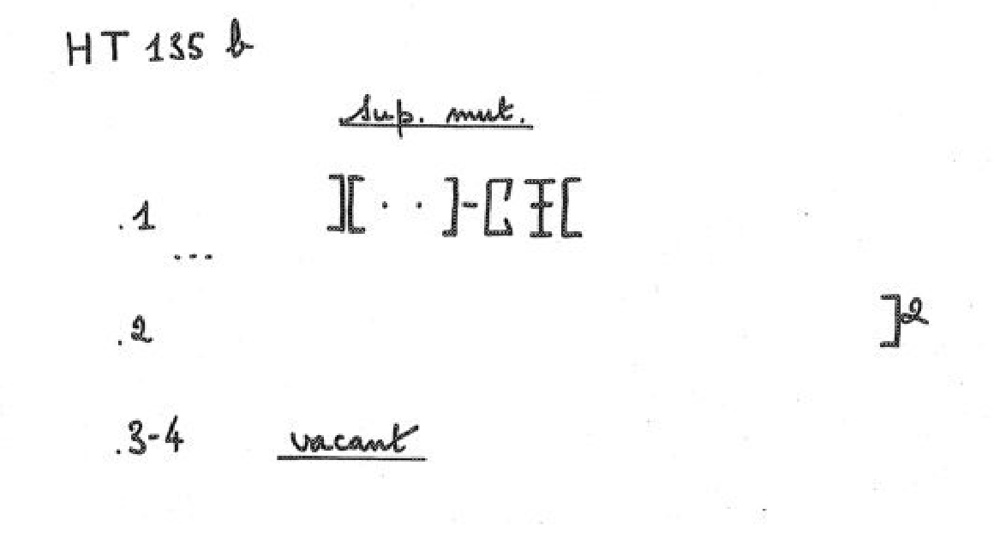

*GORILA I p. 231 (PDF p. 267), HT 135b, tabular copy: .1 ][· ·]-TA NE[.* (GORILA I (L. Godart and J.-P. Olivier 1976), © École française d'Athènes)

### HT Zb 158a — `𐄁 TU-SE-SU-KI` becomes `[?]-TU-SE-SU-KI`

On the tip the record has `𐄁` `TU-SE-SU-KI` (tokens 0–1). GORILA IV p. 64 (PDF p. 107) prints `][·]-TU SE SU KI` in both copies, TU underdotted: one dot, a hyphen, no divider. V p. 249 (PDF p. 302) indexes `][.]-69-09-58-67` at HT Zb 158a, unstarred. Younger has `a: ][•]-TU-SE-SU-KI`, TU underlined.

This pull request writes `[?]-TU-SE-SU-KI`. GORILA and Younger print a break before the lost sign, so the `[?]` does not say that a word began here.

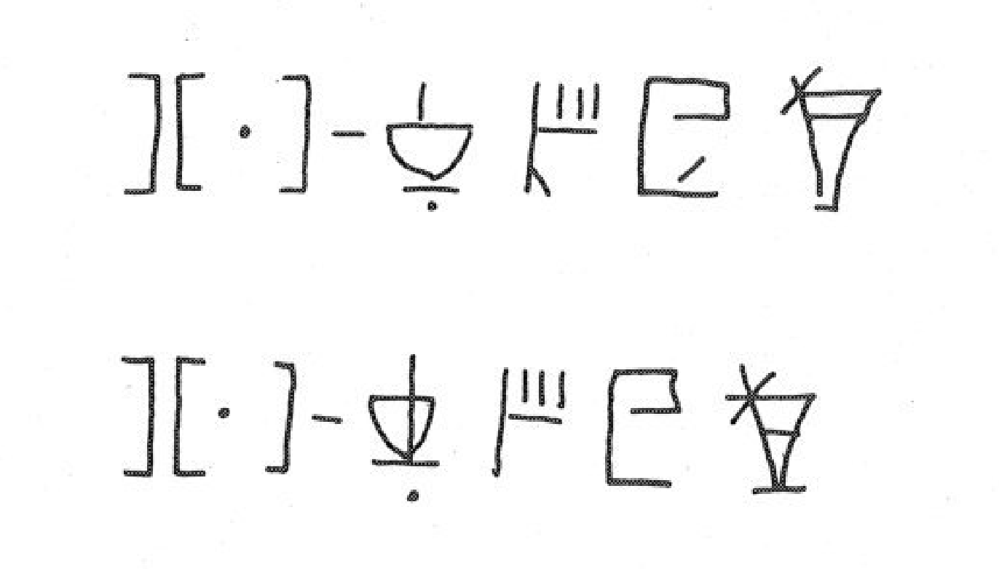

*GORILA IV p. 64 (PDF p. 107), HT Zb 158a, both copies: ][·]-TU SE SU KI.* (GORILA IV (L. Godart and J.-P. Olivier 1982), © École française d'Athènes)

### IO Za 2 .2 — the divider after `I` goes

On the tip the record has `I` `𐄁` (tokens 15–16). GORILA V p. 19 (PDF p. 72): the normalised copy has `... NU · I` on side b.2 and `DA-[` on side c.2; the tabular copy reads `... NU ' I DA-[`. The only divider stands before I. V p. 188 (PDF p. 241) indexes `28-01-[` at IO Za 2b-c.2, unstarred. Younger has `TA-NA-RA-TE-U-TI-NU • I-•-•[`. On every reading no divider stands after I.

Commit 3 takes only the divider: `I` keeps its mark, and both strings keep one mark after it. Younger's count is in commit 5.

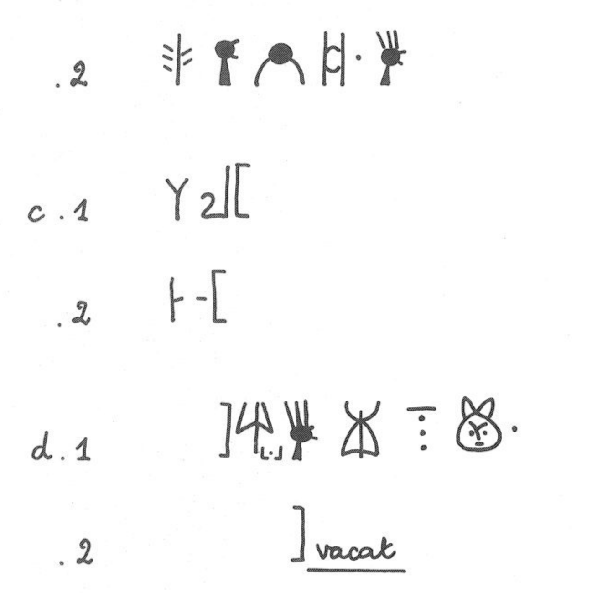

*GORILA V p. 19 (PDF p. 72), IO Za 2, normalised copy by sides: b.2 ends TE U TI NU · I; c.2 DA-[.* (GORILA V (L. Godart and J.-P. Olivier 1985), © École française d'Athènes)

### KH 7a .1 — the divider between `NE` and `KI` goes

On the tip the record has `NE` `𐄁` `KI` (tokens 0–2). GORILA III p. 29 (PDF p. 54) prints `]NE-[·]-KI` in both copies, NE underdotted, one dot, no divider. Younger has `a.1 ]NE-[•]-KI`. GORILA V replaces the group with a composite sign, with no divider either ([commit 5](#commit-5-optional-readings-where-the-editions-differ)). On every reading no divider stands here.

Commit 3 takes only the divider; `NE` and `KI` stay apart.

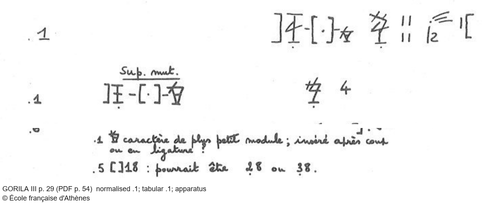

*GORILA III p. 29 (PDF p. 54), KH 7a: normalised .1, tabular .1 and the apparatus on KI.* (GORILA III (L. Godart and J.-P. Olivier 1976), © École française d'Athènes)

### KH 7a .4-5 — `KU 𐄁 KO-E` is one word

On the tip the record has `KU` `𐄁` `KO-E` (tokens 36–38). GORILA III p. 29 (PDF p. 54): the normalised copy ends .4 with KU and opens .5 with `[·]-KO E`; the tabular copy has `.4-5 KU-[·]-KO E`. One dot, no divider. V p. 267 (PDF p. 320) indexes `81-[·]-70-38` at KH 7a.4-5, unstarred. Younger has `a.4-5 KU-[•]-KO-E`.

This pull request writes `KU-[?]-KO-E`.

*GORILA III p. 29 (PDF p. 54), KH 7a: normalised .4-.5 and tabular .4-5.* (GORILA III (L. Godart and J.-P. Olivier 1976), © École française d'Athènes)

### KH 11 .1 — `A-DU 𐄁 ZA` is one word

On the tip the record has `A-DU` `𐄁` `ZA` (tokens 0–2). GORILA III p. 39 (PDF p. 64) prints `.1 A DU-[·]-ZA`, then CYP T, in both copies: one dot, a hyphen on each side, no divider. Its apparatus has '.1 A DU RE ZA possible'. V p. 162 (PDF p. 215) indexes `08-51-[·]-17` at KH 11.1, unstarred, and `08-51-27-17` with a star. V p. 78 (PDF p. 131) has rows at KH 11.2 and .4 only. Younger has `.1 A-DU-[•]-ZA`, and '.1: A-DU-RE-ZA possible'.

This pull request writes `A-DU-[?]-ZA`. The gloss '"assessment"?' on A-DU goes.

*GORILA III p. 39 (PDF p. 64), KH 11: normalised .1, apparatus, tabular .1.* (GORILA III (L. Godart and J.-P. Olivier 1976), © École française d'Athènes)

### KH 50 .2 — `QE 𐄁` becomes `QE-[?]`

On the tip the record has `QE` `𐄁` (tokens 8–9). GORILA III p. 75 (PDF p. 100) prints `QE-[·]` and the numeral 1 in both copies, one dot, a hyphen, no divider, the closing bracket before the numeral. V p. 260 (PDF p. 313) indexes `78-[·]` at KH 50.2, unstarred. Younger has `.2 QE-[•]` 1.

This pull request writes `QE-[?]`.

*GORILA III p. 75 (PDF p. 100), KH 50, both copies: .2 QE-[·] 1.* (GORILA III (L. Godart and J.-P. Olivier 1976), © École française d'Athènes)

### KH 90 .1 — `𐄁 JA` becomes `[?]-JA`

On the tip the record has `𐄁` `JA` (tokens 2–3). GORILA V p. 43 (PDF p. 96) prints `.1 [·]-JA[` in the normalised copy and `.1 ][·]-JA[` in the tabular copy, no divider, with the apparatus '.1 Traces à droite.' V p. 230 (PDF p. 283) indexes `][.]-57[` at KH 90.1, unstarred. Younger has `.1 ][•]-JA[`.

This pull request writes `[?]-JA`, and the stored mark after JA stays. The tabular copy, the index and Younger print a break before the lost sign, so the `[?]` does not say that a word began here.

*GORILA V p. 43 (PDF p. 96), KH 90, both copies: .1 [·]-JA[ and ][·]-JA[.* (GORILA V (L. Godart and J.-P. Olivier 1985), © École française d'Athènes)

### KN 22c .1 — a second divider before `NA`

On the tip the record has `𐝫` `𐄁` `NA` (tokens 2–4). GORILA I p. 261 (PDF p. 297) prints `.1 ]MA SU MI · [·]-NA[` in the normalised copy, and `.1 ]MA SU MI '` then `.1 [·]-NA[` in the tabular copy: one real divider after MI, one dot, a hyphen. The rows at KN 22c on V p. 75 (PDF p. 128) touch `]MA SU MI` and line .2. V p. 155 (PDF p. 208) indexes `[·]-NA[` at KN 22c.1, unstarred. Younger has `c.1 ]MA-SU-MI • [•]-NA[`.

This pull request writes `[?]-NA`: the trace-only token, the second divider and NA become one token. The real divider, token 1, stays, and the token keeps its trailing mark for the break.

*GORILA I p. 261 (PDF p. 297), KN 22c, both copies: ]MA SU MI, one divider, [·]-NA[.* (GORILA I (L. Godart and J.-P. Olivier 1976), © École française d'Athènes)

### KN Za 10 — `DA-WA 𐄁 DU-WA-TO` is one word

On the tip the record has `DA-WA` `𐄁` `DU-WA-TO` (tokens 5–7). GORILA IV p. 9 (PDF p. 52), line b and the tabular copy: `NA · DA WA-[·]-DU WA TO · I JA[`, one dot, a hyphen on each side. V p. 222 (PDF p. 275) indexes one sequence, `01-54-[.]-51-54-05`, at KN Za 10b, unstarred. Younger has `DA-WA-[•]-DU-WA-TO`, DU and TO underlined.

This pull request writes `DA-WA-[?]-DU-WA-TO`.

*GORILA IV p. 9 (PDF p. 52), KN Za 10, line b and the tabular copy: DA WA-[·]-DU WA TO.* (GORILA IV (L. Godart and J.-P. Olivier 1982), © École française d'Athènes)

### KN Za 18 — three places on one line

On the tip the record has `𐄁` `JA` (tokens 0–1), `𐝫` `𐄁` `JA` (tokens 3–5) and `𐄁` (token 8), with the dividers at tokens 2 and 6 between them. GORILA IV p. 13 (PDF p. 56) prints in both copies `][· ·]-JA ! [· · ·]-JA ! JA WA-[`, a gap, then `][·][`: two dots, three and one; `!` is a divider tick with a dot under it. V p. 230 (PDF p. 283) indexes `][..]-57` and `[...]-57` at KN Za 18, unstarred. Younger has `][• •]-JA • [• • •]-JA • JA-WA-[ ]`, then `[•][`.

This pull request writes `[?]-[?]-JA`, `[?]-[?]-[?]-JA` and a lone trace-only `[?]`, apart from JA-WA. The two dividers between the groups stay; GORILA underdots them, Younger does not. The index does not list lone illegible signs, so the third place rests on IV p. 13 and Younger. GORILA and Younger print a break before the first group, so the `[?]` signs do not say that a word began here.

*GORILA IV p. 13 (PDF p. 56), KN Za 18, both copies: ][· ·]-JA, [· · ·]-JA, JA WA-[, and ][·][ apart.* (GORILA IV (L. Godart and J.-P. Olivier 1982), © École française d'Athènes)

### KN Zc 7 .2 — `WI-PI 𐄁` becomes `WI-PI-[?]`

On the tip the record has `WI-PI` `𐄁` (tokens 9–10). GORILA IV p. 125 (PDF p. 168) prints `.2 ... NE ' WI PI-[·]` in both copies: a hyphen, one dot, the closing bracket, and the text ends. V p. 206 (PDF p. 259) indexes `40-39-[.]` at KN Zc 7.2, unstarred. Younger has `WI-PI-[•]`.

This pull request writes `WI-PI-[?]`.

*GORILA IV p. 125 (PDF p. 168), KN Zc 7, both copies: .2 ends WI PI-[·].* (GORILA IV (L. Godart and J.-P. Olivier 1982), © École française d'Athènes)

### PH 1b .1 — `𐄁 NA` becomes `[?]-NA`

On the tip the record has `𐄁` `NA` (tokens 0–1). GORILA I p. 287 (PDF p. 323) prints `.1 [·]-NA` in both copies, the dot visible, NA underdotted, a hyphen, no divider, with the apparatus '.1 Peut-être' a sign and NA, 'traces à droite'. V p. 155 (PDF p. 208) indexes `[·]-NA` at PH 1b.1, unstarred. Younger has `b.1 [•]-NA` 1, and 'b.1 perhaps: DU-NA'.

This pull request writes `[?]-NA`.

*GORILA I p. 287 (PDF p. 323), PH 1b, normalised copy and apparatus: .1 [·]-NA.* (GORILA I (L. Godart and J.-P. Olivier 1976), © École française d'Athènes)

### PH Zb 48 — `QA-*305 𐄁` becomes `QA-*305-[?]`

On the tip the record has `QA-*305` `𐄁` (tokens 0–1). GORILA IV p. 95 (PDF p. 138) prints QA, \*305 and `[·]` in both copies, both signs underdotted in the tabular copy, one dot, no divider. V p. 172 (PDF p. 225) indexes `16-305-[·]` at PH Zb 48. Younger has `QA-*305-[•]`, QA and \*305 underlined.

This pull request writes `QA-*305-[?]`.

*GORILA IV p. 95 (PDF p. 138), PH Zb 48, drawing and both copies: two signs, then [·].* (GORILA IV (L. Godart and J.-P. Olivier 1982), © École française d'Athènes)

### PK 1 .1 — `SI 𐄁 NE-TI` is one word

On the tip the record has `SI` `𐄁` `NE-TI` (tokens 0–2). GORILA I p. 281 (PDF p. 317) prints `.1 SI-[·]-NE TI` 1, then KA QA 2, in both copies: a hyphen on each side of the dot, no divider. V p. 207 (PDF p. 260) indexes `41-[.]-24-37` at PK 1.1, unstarred, one group, and the row PK 1.1 on V p. 75 (PDF p. 128) prints `SI-[·]-NE TI` again. Younger has `.1 SI-[•]-NE-TI` 1.

This pull request writes `SI-[?]-NE-TI`.

*GORILA I p. 281 (PDF p. 317), PK 1, both copies: .1 SI-[·]-NE TI.* (GORILA I (L. Godart and J.-P. Olivier 1976), © École française d'Athènes)

### PK Za 9 .2 — `JA-U-PA-MA-I-DA 𐄁 DI` is one word

On the tip the record has `JA-U-PA-MA-I-DA` `𐄁` `DI` (tokens 2–4). GORILA IV p. 29 (PDF p. 72) prints `.2 ]JA U PA MA I DA [·] DI[` in both copies, one dot, no divider and no hyphen; the apparatus reads '.2 Septième signe peut-être' \*301, underdotted, so the dot is the seventh sign of the group. V p. 228 (PDF p. 281) indexes `]57-10-03-80-28-01[·]07[` at PK Za 9.2, one group, no hyphen on either side of the bracket, and with a star the same group with 301. Younger has `.2 ]JA-U-PA-MA-I-DA-[•]-DI[`.

This pull request writes `JA-U-PA-MA-I-DA-[?]-DI`. The join rests on the one index group, the apparatus's 'seventh sign' and Younger's hyphens; GORILA prints no hyphen here.

*GORILA IV p. 29 (PDF p. 72), PK Za 9, both copies and apparatus: .2 ]JA U PA MA I DA [·] DI[.* (GORILA IV (L. Godart and J.-P. Olivier 1982), © École française d'Athènes)

### PK Za 11 a-b — two dividers for the two signs at the corner

On the tip the record has `A-DI-KI-TE-TE` `𐄁` ⏎ `𐄁` `RE` `𐄁` (tokens 2–7). GORILA IV p. 34 (PDF p. 77): the normalised copy ends face a with `A DI KI TE TE-[·]` and opens face b with `[·]-DA`, DA underdotted, then a tick; the tabular copy runs on, `A DI KI TE TE-[· ·]-DA '`. No divider stands at the corner. V p. 161 (PDF p. 214) indexes `08-07-67-04-04-[··]-01` at PK Za 11a-b, one group, and with a star three groups with U, DU or KU in the first lost place. Younger has `a: ... A-DI-KI-TE-TE-[•`, `b: •]-RE •`, RE underlined, and writes that the second sign 'is probably RE (GORILA reads DA)'.

RE is Younger's reading, DA GORILA's; the tip reads RE, and it stays. This pull request writes `A-DI-KI-TE-TE-[?]-[?]-RE`, the real divider and the line break. `parsedInscription` moves its break after the divider, and the transcription keeps the corner as a line break with one mark on each side. #14's commit 9 joined A-SA-SA-RA-ME across the next corner in the same way. The word numbers after it fall by three, and the gloss 'from Dikte' on A-DI-KI-TE-TE goes.

*GORILA IV p. 34 (PDF p. 77), PK Za 11, normalised copy, faces a and b: TE TE-[·] at the end of a, [·]-DA at the head of b.* (GORILA IV (L. Godart and J.-P. Olivier 1982), © École française d'Athènes)

*Same page, tabular copy: TE TE-[· ·]-DA, then a tick.* (GORILA IV (L. Godart and J.-P. Olivier 1982), © École française d'Athènes)

### PK Za 11 d — `SI-RU`, a divider and a mark become `SI-RU-[?]`

On the tip the record has `SI-RU` `𐄁` `𐝫` (tokens 19–21). GORILA IV p. 34 (PDF p. 77), face d, both copies: `SI RU-[·] ' I NA JA PA QA`, one tick, after the bracket. The apparatus has '.d SI RU DU n'est pas exclu', DU underdotted. V p. 207 (PDF p. 260) indexes `41-26-[·]` at PK Za 11d, and `41-26-51` with a star. Younger has `d: SI-RU-[•] • I-NA-JA-PA-QA`.

This pull request writes `SI-RU-[?]`: the word, the false divider and the trace-only token become one token, and the real divider after it stays.

*GORILA IV p. 34 (PDF p. 77), PK Za 11, face d and the apparatus: SI RU-[·], one tick, I NA JA PA QA.* (GORILA IV (L. Godart and J.-P. Olivier 1982), © École française d'Athènes)

### PL Zf 1 — a mark, a divider, `I` and a divider become `[?]-I-[?]`

On the tip the record has `𐝫` `𐄁` `I` `𐄁` (tokens 12–15). GORILA IV p. 161 (PDF p. 204), set sideways: both copies end `NI NU NI ' [·]-I-[·]`, a hyphen on each side of I, a tick before the group and none after it. The apparatus has `[·]`-I and a sign, underdotted, 'est à la rigueur possible'; V p. 189 (PDF p. 242) indexes `[·]-28-[·]` at PL Zf 1, and `[·]-28-80` with a star. Younger has `NI-NU-NI • [•]-I-[•]`, and no divider after it.

This pull request writes the four tokens as one, `[?]-I-[?]`. The real divider before them stays.

*GORILA IV p. 161 (PDF p. 204), PL Zf 1, turned upright, the end of the second copy: NI NU NI, a tick, [·]-I-[·].* (GORILA IV (L. Godart and J.-P. Olivier 1982), © École française d'Athènes)

### SI Zg 1 — `A 𐄁 DA-*118` is one word

On the tip the record has `A` `𐄁` `DA-*118` (tokens 0–2). GORILA IV p. 168 (PDF p. 211) prints `A-[·]-DA *118` in both copies, a hyphen on each side of the dot, no divider; the drawing has one worn sign between A and DA. V p. 160 (PDF p. 213) indexes `08-[·]-01-118` at SI Zg 1, one group. Younger has `A-[•]-DA-*118`, and 'The second sign, according to Mikhaelidou fig. 18b, may be DU'.

This pull request writes `A-[?]-DA-*118`.

*GORILA IV p. 168 (PDF p. 211), SI Zg 1, drawing and both copies: A-[·]-DA \*118.* (GORILA IV (L. Godart and J.-P. Olivier 1982), © École française d'Athènes)

### TY 3a .3 — `A-DU`, a divider and a mark become `A-DU-[?]-[?]`

On the tip the record has `A-DU` `𐄁` `𐝫` (tokens 23–25). GORILA I p. 327 (PDF p. 363) prints `.3 A DU-[· ·]`, then OLE+KI 51, in both copies, two dots in one bracket pair, no divider. The apparatus reads '.3 Traces de deux signes après A DU-['. The row TY 3a.3 on V p. 76 (PDF p. 129) prints `A DU-[· ·]` again. Younger has `a.3 A-DU-[••]` OLE+KI 51.

This pull request writes `A-DU-[?]-[?]`. The word is longer, so the gloss '"assessment"?' goes.

*GORILA I p. 327 (PDF p. 363), TY 3a, normalised copy and apparatus: .3 A DU-[· ·], and 'Traces de deux signes après A DU-['.* (GORILA I (L. Godart and J.-P. Olivier 1976), © École française d'Athènes)

### ZA 4a .2 — `PI 𐄁 SE` is one word

On the tip the record has `PI` `𐄁` `SE` (tokens 6–8). GORILA III p. 149 (PDF p. 174) prints `.2 PI-[·]-SE[` in the normalised copy and `.2 ]PI-[·]-SE[` in the tabular copy, one dot, a hyphen on each side, no divider. The apparatus has '.2 PI RU SE[ possible'. V p. 204 (PDF p. 257) indexes `]39-[·]-09[` at ZA 4a.2, unstarred, and `]39-26-09[` with a star. Younger has `a.2 ]PI-[•]-SE[`, and 'a.2: ]PI-RU-SE[ possible.'

This pull request writes `PI-[?]-SE`.

*GORILA III p. 149 (PDF p. 174), ZA 4a: normalised .2, apparatus, tabular .2.* (GORILA III (L. Godart and J.-P. Olivier 1976), © École française d'Athènes)

### ZA 4a .4 — `𐄁 TU-ME-SE` becomes `[?]-TU-ME-SE`

On the tip the record has `𐄁` `TU-ME-SE` (tokens 20–21). GORILA III p. 149 (PDF p. 174): the normalised copy has `[·]-TU ME SE` in .4 after the stroke of the numeral 1, and the tabular copy `.4 [·]-TU ME SE` 18, one dot, no divider. V p. 249 (PDF p. 302) indexes `[·]-69-13-09` at ZA 4a.4, unstarred. Younger has `a.4 [•]-TU-ME-SE` 18.

This pull request writes `[?]-TU-ME-SE`.

*GORILA III p. 149 (PDF p. 174), ZA 4a: normalised .4; tabular .3-4 and .4.* (GORILA III (L. Godart and J.-P. Olivier 1976), © École française d'Athènes)

### ZA 9 .4-5 — two dividers become `A-TA-NA-[?]` and `[?]-MA-JU`

On the tip the record has `A-TA-NA` `𐄁` `𐝫` (tokens 15–17) and `𐄁` `MA-JU` (tokens 21–22). GORILA III p. 167 (PDF p. 192): the normalised copy ends .4 with `A TA NA-[·]` and has in .5 `QI+SI` 2 `[·]-MA JU`; the tabular copy has `.4-5 A TA NA-[·]` QI+SI 2 and `.5 [·]-MA JU` \*21F 2. One dot each, no divider, QI+SI 2 between them. The apparatus has '.4 A TA NA TE possible'. V p. 163 (PDF p. 216) indexes `08-59-06-[·]` at ZA 9.4, and V p. 264 (PDF p. 317) `[·]-80-65` at ZA 9.5, unstarred. Younger has `.4-5 A-TA-NA-[•]` and `.5 [•]-MA-JU`.

This pull request writes `A-TA-NA-[?]` and `[?]-MA-JU`, two words.

*GORILA III p. 167 (PDF p. 192), ZA 9: normalised .4-.6 and apparatus, then the tabular copy.* (GORILA III (L. Godart and J.-P. Olivier 1976), © École française d'Athènes)

### ZA 22 .3 — `RA`, a divider and a mark become `RA-[?]`

On the tip the record has `RA` `𐄁` `𐝫` (tokens 9–11). GORILA III p. 199 (PDF p. 224) prints `RA-[·]`, then \*21F and the underdotted numeral, in both copies at .3: one dot, a hyphen, the closing bracket before the logogram, no divider. V p. 239 (PDF p. 292) indexes `60-[·]` at ZA 22.3, unstarred. Younger has `.3 RA-[•]`, OVISf.

This pull request writes `RA-[?]`.

*GORILA III p. 199 (PDF p. 224), ZA 22: normalised .3 and tabular .3, RA-[·].* (GORILA III (L. Godart and J.-P. Olivier 1976), © École française d'Athènes)

## Commit 4: Write lost signs that stand alone

*Plain: 6 records, 11 files.*

A divider that stands for a sign with no word to join becomes a trace-only token with `[?]`. This is new on the site: no token on the tip is a bare `[?]`. The token loses its word number and the later numbers fall by one; both maps lose a box-less `*900` entry. A lone `[?]` has no glyphs, so hovering or clicking it acts as on a bare break mark: the count and the filter are those of all empty tokens.

### HT 95b .2 — a lone illegible sign

On the tip the record has `𐝫` `𐄁` `𐝫` on a line of its own (tokens 6–8). GORILA I p. 155 (PDF p. 191): the normalised copy has `.2 [·]DA ME` 10, and the tabular copy `.2 [·]` alone on its row, then `.2 DA ME` 10. One dot, no divider. The apparatus reads '.2 [·] : difficilement lisible; ou' GRA, 'ou' a ring on a stem, 'ou' KA, all three underdotted: three candidates, GRA, KA and one sign more. The index does not list lone illegible signs. Younger has `b.2 [•]` alone, in the logogram column, then `b.2 DA-ME` 10.

This pull request writes one trace-only token, `[?]`. `parsedInscription` also loses the line break after it: without the break the line would go empty when the generator strips the marks, and the last five lines of the tabulation would run together. `words` keeps its tokens on their lines.

*GORILA I p. 155 (PDF p. 191), HT 95b, tabular copy: .2 [·] alone on its row, then DA ME 10.* (GORILA I (L. Godart and J.-P. Olivier 1976), © École française d'Athènes)

*Same page, normalised copy and apparatus: .2 [·]DA ME, and the three candidates.* (GORILA I (L. Godart and J.-P. Olivier 1976), © École française d'Athènes)

### KH 91 .1 — a divider beside a lone illegible sign

On the tip the record has `𐝫` `𐄁` `𐝫` (tokens 2–4). GORILA V p. 45 (PDF p. 98): the normalised copy has `.1 [·] GRA ! VIN[`, and the tabular copy `.1 ][·]` on its own row, then GRA 1, then `VIN[`. One dot, no divider. Younger has `.1 ][•]`, then GRA 1.

This pull request writes one trace-only token, `[?]`, with one mark: the divider and the bare mark beside it go, because a lost sign at a break takes no second mark, as at HT 95b.

*GORILA V p. 45 (PDF p. 98), KH 91, both copies: .1 [·] GRA, and ][·] on its own row.* (GORILA V (L. Godart and J.-P. Olivier 1985), © École française d'Athènes)

### KN Za 19 .1 — a lone lost sign

On the tip the record has a divider token on line .1 (token 1). GORILA IV p. 15 (PDF p. 58) prints `.1 ]-KE JU MI[   ][·][` in both copies: one dot, brackets on both sides, nothing joining it to the word, no divider. Younger has `.1 ]-KE-JU-MI[ ][•][`.

This pull request writes a trace-only token, `[?]`, apart from KE-JU-MI.

*GORILA IV p. 15 (PDF p. 58), KN Za 19, both copies: .1 ]-KE JU MI[ ][·][.* (GORILA IV (L. Godart and J.-P. Olivier 1982), © École française d'Athènes)

### MI 2 .3 — a divider for two lone signs

On the tip the record has a divider token on line .3 (token 6). GORILA V p. 57 (PDF p. 110) prints `.3 ][· ·] *401+RA[` in both copies, two dots in one bracket pair, no divider. Younger has `.3 ][••] *401VAS+RA[`.

This pull request writes a trace-only token of two marks, `[?]-[?]`.

*GORILA V p. 57 (PDF p. 110), MI 2, first copy and apparatus: .1 PU[; .3 ][· ·] \*401+RA[. The second copy, below it on the page, prints the same.* (GORILA V (L. Godart and J.-P. Olivier 1985), © École française d'Athènes)

### PH 1a .1 — a divider for the sign before L2

On the tip the record has a divider token before L2 (token 2). GORILA prints `[ ]`, at every place it has this line: an empty bracket pair over L2 in both copies of I p. 287 (PDF p. 323), where PH 1b's `[·]` on the same page shows its dot; the row PH 1a.1 on V p. 75 (PDF p. 128); and `[ ]L2` at PH 1a.1 on V p. 322 (PDF p. 375). The drawing on I p. 286 (PDF p. 322) has a stippled patch with faint strokes above L2, and no divider tick. Younger prints `[•]`: `a.1 ]DI-RA-DI-NA` \*316 `[•]` L2 `[`.

This pull request writes a trace-only token, `[?]`, which takes Younger's count. On every reading no divider stands here. `parsedInscription`, which has no mark here on the tip, gains one, and the transcription keeps one of its two.

*GORILA I p. 287 (PDF p. 323), PH 1a, normalised copy: .1 ends \*316, then an empty [ ] over L2.* (GORILA I (L. Godart and J.-P. Olivier 1976), © École française d'Athènes)

*GORILA V p. 322 (PDF p. 375), index of L2: [ ]L2 at PH 1a.1, with no dot.* (GORILA V (L. Godart and J.-P. Olivier 1985), © École française d'Athènes)

### PK Za 17 — a second divider after `I-DA`

On the tip the record has `I-DA` `𐄁` `𐄁` (tokens 0–2). GORILA IV p. 43 (PDF p. 86) prints `]I DA ' [·][` in both copies: one divider, one dot, a further `[`. Younger has `]I-DA • [•][`.

This pull request writes the second divider as a trace-only token, `[?]`. The first divider is real and stays. The one mark shows the lost sign and the break after it.

*GORILA IV p. 43 (PDF p. 86), PK Za 17, both copies: ]I DA, a divider, [·][.* (GORILA IV (L. Godart and J.-P. Olivier 1982), © École française d'Athènes)

## Commit 5: Optional: readings where the editions differ

*Optional: 9 records, 6 files.*

Each change here takes a side, and each section says which. Five places take their second step: HT 29 .4, HT 31, HT 72, IO Za 2 and KH 7a, where commit 3 took the false divider. The others are places where one edition counts a sign and the other does not. The commit can be left out: no false divider and no false word stays, and the marks stay right at all five places. The count lines of commits 6 and 7 above it then need a rebase (3 conflicts in the test, all visible, no wrong line).

### HT 29 .4 — `KI-TA` becomes `[?]-KI-TA`, against GORILA V's A 340

After commit 3 the token is `KI-TA`, with its mark. GORILA I p. 55 (PDF p. 91) and Younger print an illegible sign: `[·]-KI TA[` and `.4-5 [•]-KI-TA`. GORILA V reads the sign as A 340: `340-67-59` at HT 29.4, with no star and no bracket (V p. 247, PDF p. 300); sign 340 has a heading of its own with this one entry (V p. 303, PDF p. 356), and a cell in the table of signs (V p. XXIII, PDF p. 24). The corrigenda have no row at HT 29, so only the index shows this reading. The drawing on I p. 54 (PDF p. 90) has a looped trace before KI.

This commit writes `[?]-KI-TA`, which takes I p. 55 and Younger's text against GORILA V. `*340-KI-TA` is not taken: a new glyph and a box no edition forces.

*GORILA V p. 247 (PDF p. 300), index of sign 67: 340-67-59 at HT 29.4, unstarred.* (GORILA V (L. Godart and J.-P. Olivier 1985), © École française d'Athènes)

*GORILA V p. 303 (PDF p. 356): sign 340 with its one entry, HT 29.4.* (GORILA V (L. Godart and J.-P. Olivier 1985), © École française d'Athènes)

*GORILA I p. 54 (PDF p. 90), drawing of HT 29, line .4: a looped trace before KI.* (GORILA I (L. Godart and J.-P. Olivier 1976), © École française d'Athènes)

### HT 31 .1 — `TI-SA` becomes `[?]-TI-SA`, against GORILA V's I TI SA

After commit 3 the token is `TI-SA`, with its mark. GORILA I p. 59 (PDF p. 95) prints `[·]-TI SA`. GORILA V p. 72 (PDF p. 125), row HT 31.1, reads `I TI SA` in the normalised and the tabular column, with no underdot and no bracket, and V p. 188 (PDF p. 241) and p. 200 (PDF p. 253) index `28-37-31` at HT 31.1, unstarred. Younger's text has `.1 [•]-TI-SA`, and the note '.1: [•]-TI-SA may be I-TI-SA'.

This commit writes `[?]-TI-SA`, which takes I p. 59 and Younger's text against V p. 72's I TI SA. The strings stay as they are. `I-TI-SA` needs a new sign and an image-map box and is not taken.

*GORILA V p. 72 (PDF p. 125), corrigenda to volume I: row HT 31.1 reads I TI SA in both columns.* (GORILA V (L. Godart and J.-P. Olivier 1985), © École française d'Athènes)

### HT 72 .1 — `SI-VIR+[?]` and a mark become `SI-VIR+[?]-[?]`, against GORILA V

After commit 3 the record has `SI-VIR+[?]` and a trace-only `𐝫`. GORILA I p. 125 (PDF p. 161) prints `.1 SI VIR-[·][` in both copies, and Younger `.1 SI-VIR-[•][`. GORILA V withdraws the dot: V p. 73 (PDF p. 126), row HT 72.1, prints `SI VIR-[` in both copies, with no dot and no closing bracket, and V p. 208 (PDF p. 261) indexes `41-100/102-[` at HT 72.1, unstarred. The drawing on I p. 124 (PDF p. 160) keeps a looped trace at the broken edge, and V p. 73 leaves the drawing unchanged: its drawing column is empty in that row. The site's photo is too coarse to read that edge.

This commit writes one token, `SI-VIR+[?]-[?]`, which takes I p. 125 and Younger against V pp. 73 and 208. `VIR+[?]` is the site's label for the sign; the last `-[?]` is the lost sign.

*GORILA V p. 73 (PDF p. 126), corrigenda to volume I, rows HT 72.1 and HT 79[+]83.2: SI VIR-[ in both copies, with no dot.* (GORILA V (L. Godart and J.-P. Olivier 1985), © École française d'Athènes)

*GORILA V p. 208 (PDF p. 261), index of sign 41: 41-100/102-[ at HT 72.1, unstarred.* (GORILA V (L. Godart and J.-P. Olivier 1985), © École française d'Athènes)

*GORILA I p. 124 (PDF p. 160), drawing of HT 72: a looped trace at the broken right edge.* (GORILA I (L. Godart and J.-P. Olivier 1976), © École française d'Athènes)

### IO Za 2 .2 — `I` becomes `I-[?]-[?]`, against GORILA V's I DA-[

After commit 3 the token is `I`, with its mark. GORILA V reads I DA-[: the normalised copy of V p. 19 (PDF p. 72) has `I` at the end of b.2 and `DA-[` on c.2, its tabular copy `I DA-[`, and V p. 188 (PDF p. 241) indexes `28-01-[` at IO Za 2b-c.2, unstarred. Younger has `I-•-•[`, and writes 'for the second sign, GORILA reads DA, but it could be something else'.

This commit writes `I-[?]-[?]`, and both strings take the second mark. It takes Younger's count against V p. 19. The first `[?]` is GORILA's DA; the second has no counterpart there, only a hyphen and a break. DA would add a glyph and is not taken.

*GORILA V p. 19 (PDF p. 72), IO Za 2, tabular copy, turned upright: the end of line .2, ... NU, a tick, I DA-[.* (GORILA V (L. Godart and J.-P. Olivier 1985), © École française d'Athènes)

### KH 7a .1 — `NE` `KI` becomes `NE-[?]-KI`, against GORILA V's A 641

After commit 3 the record has `NE` and `KI` apart. GORILA III p. 29 (PDF p. 54) prints `]NE-[·]-KI` in both copies, with the apparatus '.1 KI caractère de plus petit module; inséré après coup ou en ligature ?', and Younger has `a.1 ]NE-[•]-KI`. GORILA V's line is ]NE (underdotted), A 641, 4. V p. 78 (PDF p. 131), row KH 7a.1, prints a tall sign, underdotted, with a small KI against it, and no bracket and no dot: the `[·]` is read as sign 317. The index makes them, with \*334, one composite, A 641, `'317''67'''334'` at KH 7a.1 (V p. 248, PDF p. 301; V p. 296, PDF p. 349; V p. 301, PDF p. 354), and V p. 180 (PDF p. 233) keeps ]NE apart, `]24` at KH 7a.1.

This commit writes `NE-[?]-KI`, which takes III p. 29 and Younger against GORILA V's A 641 (V pp. 78, 248). A 641 would need glyph and map edits and is not taken. Leaving this commit out keeps NE and KI apart, which is closer to GORILA V than the join.

*GORILA V p. 78 (PDF p. 131), corrigenda to volume III, rows KH 7a and KH 7a.1: a tall sign and a small sign, no bracket.* (GORILA V (L. Godart and J.-P. Olivier 1985), © École française d'Athènes)

*GORILA V p. 248 (PDF p. 301), index of sign 67: A 641 at KH 7a.1.* (GORILA V (L. Godart and J.-P. Olivier 1985), © École française d'Athènes)

*GORILA V p. 180 (PDF p. 233), index of sign 24: ]24 lists KH 7a.1.* (GORILA V (L. Godart and J.-P. Olivier 1985), © École française d'Athènes)

### ARKH 4a .4-5 — `PI-TI-NE-A` becomes `PI-TI-NE-A-[?]`

On the tip the record has `PI-TI-NE-A` (after commit 3, token 15). GORILA prints a hyphen and a break: normalised `.5 A-[`, tabular `.4-5 PI TI NE A-[` on III p. 13 (PDF p. 38), no dot; V p. 204 (PDF p. 257) and V p. 180 (PDF p. 233) index `39-37-24-08-[` at ARKH 4a.4-5, no dot, unstarred. Younger has `a.4-5 PI-TI-NE-A-•[`. The drawing on III p. 12 (PDF p. 37) has a short wavy stroke after A along the broken edge, which fits that bullet.

This commit writes `PI-TI-NE-A-[?]`, transliteration only. The counted sign is Younger's alone; it takes that count against GORILA's break.

*GORILA III p. 13 (PDF p. 38), ARKH 4a: normalised .5 and tabular .4-5: A-[, with no dot.* (GORILA III (L. Godart and J.-P. Olivier 1976), © École française d'Athènes)

*GORILA III p. 12 (PDF p. 37), drawing of ARKH 4a, the end of .5: a short wavy stroke after A.* (GORILA III (L. Godart and J.-P. Olivier 1976), © École française d'Athènes)

### MI 2 .1 — `PU` becomes `PU-[?]`

On the tip the record has `PU` (token 0). GORILA V p. 57 (PDF p. 110) prints `.1 PU[` in both copies, with the apparatus '.1 Trace de signe à droite.' Younger has `.1 PU-•[`, and a note on Brice's readings, PU-RO or PU-TU.

This commit writes `PU-[?]`, transliteration only. Both point to one sign, but GORILA's text prints only the break and the sign is in its apparatus; the count is Younger's. The crop of MI 2 .3 shows this line and the apparatus.

### SY Za 1 — `JA` becomes `JA-[?]`

On the tip the record has `JA` (token 4). GORILA V p. 63 (PDF p. 116) prints `]A TA I *301 WA JA · I DA MI · JA-[` in both copies: a hyphen and a break, no `[·]`. The drawing on V p. 62 (PDF p. 115) has JA at the broken edge and nothing after it. Younger has `]A-TA-I-*301-WA-JA • I-DA-MI • JA-•-[`.

This commit writes `JA-[?]`, transliteration only. The sign is Younger's alone: GORILA prints a hyphen and a break, and counts nothing. Younger's page names ArchEph 2008 in its heading and does not say that the bullet comes from it; that edition was not consulted, and I do not attribute the sign to it. The site's drawing is the same as V p. 62, and its photograph is too rough at that end to judge.

*GORILA V p. 63 (PDF p. 116), SY Za 1, both copies: the line ends JA-[, with no dot.* (GORILA V (L. Godart and J.-P. Olivier 1985), © École française d'Athènes)

### TY 2 .5a, .5b — two signs GORILA V reads and Younger leaves as gaps

On the tip the record has `*309C-RU-KA` and `*309-RI-WA-JU` (tokens 27 and 30). GORILA V p. 76 (PDF p. 129) prints `.5α RI RU KA` and `.5β RI DA WA JU`, RI underdotted each time, with no lost sign at either place. GORILA I p. 325 (PDF p. 361) has at .5α a hook on the vase, RU, KA, with no gap, and at .5β an empty `[ ]` before WA. Younger has `.5 *309c+[ ]-RU-KA` and `.5 *309a+RI+[ ]-WA-JU`, both with an empty bracket.

This commit writes `*309C-[?]-RU-KA` and `*309-RI-[?]-WA-JU`, in place, with a mark in the glyph strings. The `[?]` takes GORILA V's count and withholds its reading; Younger prints an uncounted `[ ]`.

*GORILA I p. 325 (PDF p. 361), TY 2, tabular rows .4 and .5: at the first .5 row a hook on the vase, RU, KA, and no gap; at the second an empty [ ] before WA.* (GORILA I (L. Godart and J.-P. Olivier 1976), © École française d'Athènes)

## Commit 6: Lost signs whose first editions were not consulted

*Can be left out: 14 records, 13 files.*

I found these records nowhere in GORILA. Each change rests on Younger's text, and its source was not consulted, unless the section says otherwise: KN Wc 43's rests on the site's own picture as well, and KN Ze 44's on a reading that Younger quotes and doubts. They are checked here against that text and the site's pictures only, as HT Zb 162 was in #14. Every drawing cited in this commit is the site's. The commit can be left out: no other data commit touches its records, and the count lines of commit 7 above it need a rebase (2 conflicts in the test, all visible, no wrong line).

### GO 2 r.4 — `SE` becomes `[?]-SE`

On the tip the record has `SE` (token 15). Younger has `r04. •-SE[`. GO 2 is not in GORILA, and Younger's source, Watrous et al. 2015, was not consulted. The site's drawing has on the fourth line one long curved stroke, the upper part of a sign, then the slanted strokes of SE, then the break, and no dot between them.

This commit writes `[?]-SE`, transliteration only. The word's two stored marks stand for the lost sign and for the break after SE.

*`GO2r-Facsimile.jpg`, enlarged: on the fourth line, one long curved stroke, then SE, at the broken lower edge.* (lineara.xyz image; the record credits no source)

### IO Za 11 .a — `NA 𐄁 DA-DA 𐄁` becomes one word

On the tip the record has `NA` `𐄁` `DA-DA` `𐄁` (tokens 0–3). Younger has `.a (upper line): ]-NA-[•]-DA-DA-[• • •][  ]`, and quotes 'Davis 2011, 449: upper line, sign 2 could be MI or PI, and sign 5 could be KI; lower line, sign 8 could be MI'. The record is not in GORILA, and Younger's source, Karetsou, Godart and Olivier 1985, was not consulted. The site's drawing has in the upper line NA, one full-height curved stroke in stipple, DA, DA, then three separate traces, and no dot.

This commit writes one token, `NA-[?]-DA-DA-[?]-[?]-[?]`. Younger's trailing `[  ]` is not written: it stands at the line's end, where the stored mark shows the break.

*`IOZa11-Facsimile.jpg`, enlarged: upper line NA, a damaged sign, DA, DA, three traces; lower line, read from the right, ...NU, a ring dot, I NA I DA and one trace.* (lineara.xyz image; the record credits no source)

### IO Za 11 .b — `I-NA-I-DA` becomes `I-NA-I-DA-[?]`

On the tip the record has `I-NA-I-DA` (token 7). Younger has `.b (lower line, retrograde): ]U-TI-NU • I-NA-I-DA-•[`, U underlined. The site's drawing has one trace after DA, then stipple and the break. Younger's source was not consulted.

This commit writes `I-NA-I-DA-[?]`, transliteration only: the token already ends in its mark. The drawing above shows this line.

### IO Za 12 .a — a divider for two lone signs

On the tip the record has a divider token at the head of the record (token 0), then a second divider. Younger has `.a: ][• •] • JA-SA-`. The record is not in GORILA, and Younger's source, Karetsou, Godart and Olivier 1985, was not consulted. The site's drawing has two small traces under the stipple, a clear ring dot, then JA and SA.

This commit writes a trace-only token of two marks, `[?]-[?]`. The second divider, the ring dot, stays.

*`IOZa12-Facsimile.jpg`, enlarged, face a at the left: two traces, a ring dot, JA, SA.* (lineara.xyz image; the record credits no source)

### IO Za 13 — `𐄁 MA-I` becomes `[?]-MA-I`

On the tip the record has `𐄁` `MA-I` (tokens 0–1). Younger has `][•]-MA-I-[`, and names 'Kar.-God.-Ol. 1985'. The record is not in GORILA, and that edition was not consulted. The site's drawing has one damaged sign, its top in stipple, then MA, I and the broken edge, and no dot between the damaged sign and MA.

This commit writes `[?]-MA-I`.

*`IOZa13-Facsimile.jpg`, enlarged: a damaged sign, MA, I.* (lineara.xyz image; the record credits no source)

### KAM Zb 1 — three unread signs as two dividers

On the tip the record has `𐄁` `𐄁` (tokens 1–2). Younger has `NU-RO •-•-•`, the three bullets underlined and joined to each other by hyphens, with no hyphen to NU-RO; Younger's sources, Festòs I, 831, and Raison and Pope 1994, p. 225, were not consulted. GORILA V's concordance has no KAM (V pp. 128–129, PDF pp. 181–182), and the site has no picture.

This commit writes one trace-only token of three marks, `[?]-[?]-[?]`. All three bullets are underlined.

*GORILA V pp. 128–129 (PDF pp. 181–182), concordance by site: no Kamilari, Kannia, Petras or Gortyn; Pyrgos with tablets only.* (GORILA V (L. Godart and J.-P. Olivier 1985), © École française d'Athènes)

### KAN Za 1 — `A 𐄁 I` is one word

On the tip the record has `A` `𐄁` `I` (tokens 0–2). This rests on Younger's text alone: `a. A-[•]-I`, `b. [ ] vestigia`, `c. vestigia`, citing Levi 1959 and Raison and Pope 1994. Raison and Pope was not consulted. Levi (`papers/KANZa1.pdf`), p. 249 (PDF p. 13), gives no reading. No picture tests the reading, and neither Levi's figure nor the site's picture is cited here. I did not find the record in GORILA: it has no site heading in V's concordance (V p. 104, PDF p. 157), Younger cites no GORILA page, and GORILA's site lists have no Kannia or Gortyn (V pp. 128–129, PDF pp. 181–182; IV pp. vii–viii, PDF pp. 8–9).

This commit writes `A-[?]-I`.

### KN Wc 43 — side b's sign stored as a divider

On the tip the record has `𐝫` `𐄁`: a bare mark and a divider (tokens 0–1). This does not rest on Younger alone. Younger has 'not in GORILA', `a: vestigia`, `b: [•]`, after Brice 1961 and Hallager 1996. The site's own picture, a cut from an edition, prints '[.]' under the drawing of side b and 'vest. [' under side a. The first editions were not consulted.

This commit writes a trace-only token, `[?]`, for side b. Token 0's bare mark stays: it is side a's vestiges. The record's only tabulation row goes, so its page has an empty reading.

*`KNWc43-Facsimile.jpg`, enlarged: 'sup. mut.' and 'vest. [' at side a, '[.]' at side b.* (lineara.xyz image; the record credits no source)

### KN Ze 44 — `I-WA-JA` becomes `I-[?]-WA-JA`

On the tip the record has `I-WA-JA` (token 0). KN Ze 44 has no Younger page of its own and is not in GORILA V's concordance (V p. 109, PDF p. 162). Younger's KH Zb 98 page quotes the reading: 'Owens 1993c sees ... and, following Boskamp 1990, the perplexing drawing on a (ProtoPalatial?) stone block at the NW corner of the KN palace (PM I fig. 98) as another inscription, KN Ze 44, I-•-WA-JA.' Younger doubts that it is writing: 'the latter is still to be seen on site and, to JGY, if it must be interpreted as anything, it looks like an architectural plan.' Owens and Boskamp were not consulted.

This commit writes `I-[?]-WA-JA`, transliteration only: the glyph string holds a mark there. `[?]` means unidentified here, not lost. I do not cite the site's pictures as showing the reading, and show none here: the drawing and the photograph do not show the same marks.

### PE 2 .2 — a gap inside `RU-PI-*305-MI`

On the tip the record has `RU-PI-*305-MI` (token 5). Younger has `.2 RU-PI[ ]-*305-MI` 1 F, a gap with no count. The first edition, Tsipopoulou and Hallager 1996, was not consulted. On the site's drawing the stretch between PI and the next sign is about four sign-widths long and holds broken traces, none a complete sign; on its photo the tablet's upper break dips into the line across that stretch.

This commit writes `RU-PI-[ ]-*305-MI`, with the stored marks unchanged. A stretch of that length can hold more than one sign, so a word end inside it cannot be excluded: SigLA reads two words here. The one token is the tip's and follows Younger's hyphen after the gap.

*`PE2-Facsimile.jpg`, enlarged: on the second line RU, PI, a stretch of traces, then the next signs.* (lineara.xyz image; the record credits no source)

### PE Zg 6 — `I-NA 𐄁 TE` is one word

On the tip the record has `I-NA` `𐄁` `TE` (tokens 0–2). Younger has `I-NA-[•]-TE`. The record is not in GORILA, and its first edition was not consulted. The site's drawing and photograph have four sign places in line 1: the third is an incised curved outline with a tail, fairly complete but not identifiable, and no dot stands between NA and TE.

This commit writes `I-NA-[?]-TE`. `[?]` means unidentified here, not lost.

*`PEZg6-Facsimile.png`, enlarged: line 1 with the unidentified third sign between NA and TE.* (lineara.xyz image; the record credits no source)

### PYR Wc 4 a — `TI 𐄁 I-SI` is one word

On the tip the record has `TI` `𐄁` `I-SI` (tokens 0–2). Younger has `a.1-2: TI-[•]-I-SI`, and asks: 'Might the unknown sign be the right-hand part of DU, written small as a ligature against the right "leg" of TI? Thus: TI+DU ?'. The record is not in GORILA, and the sources, Rehak and Younger 1995 and Hallager 1996, were not consulted. The site's photograph has a small closed loop against the right leg of the large sign, a sign form and not a dot.

This commit writes `TI-[?]-I-SI`. Younger's own TI+DU ? stays open: `[?]` writes the unknown sign as a separate sign. Token 3, `*829`, stays.

*`PYRWc4-Inscription.jpg`, enlarged: the large sign, with a small closed loop against its right leg.* (lineara.xyz image; the record credits no source)

### SY Za 8 — `JA-JA` becomes `JA-JA-[?]-[?]-[?]`

On the tip the record has `JA-JA` (token 2). Younger has `A-TA-]I-*301-WA-JA • JA-JA[-•-]•-•[`. The record is not in GORILA, and Younger's source, ArchEph 2008, was not consulted. The site's drawing has, after the second JA, a stippled stretch about one sign wide, then two separate traces, then the break.

This commit writes `JA-JA-[?]-[?]-[?]`, with two more marks. The first of the three is a sign counted in a gap, not read; the other two are traces.

*`SYZa8-Facsimile.jpg`, enlarged: JA, a dot, JA, JA, a stippled stretch, two traces.* (lineara.xyz image; the record credits no source)

### SY Za 12 — `A` becomes `A-[?]`

On the tip the record has `A` (token 1). Younger has `] • A-•[`, the first bullet and A underlined. The record is not in GORILA, and Younger's source, ArchEph 2008, was not consulted. The drawing set into the site's photograph has a slanted stroke, A, and a short horizontal stroke in stipple at the break.

This commit writes `A-[?]`, transliteration only. Token 0's divider stands for Younger's first bullet and stays: see [Checked, not changed](#checked-not-changed).

*The inset drawing of `SYZa12-Inscription.jpg`, enlarged: a slanted stroke, A, a short stroke at the break.* (lineara.xyz image; the record credits no source)

### SY Zb 7 — `RA-KI-NI-SE` becomes `[?]-RA-KI-[?]-NI-SE`

On the tip the record has `RA-KI-NI-SE` (token 0). Younger has `•-RA-KI-•-NI-SE`, SE underlined, with 'the first sign could be any with a single upright hastus (DA, A, MU, SA etc.); the 4th sign could be ZU over WA'. The record is not in GORILA, and Younger's source, ArchEph 2008, was not consulted. The site's picture, a cut of an edition's plate, has six places in its drawing and photograph, and no dot. In the drawing the star-like head can look like a seventh sign; in the photograph its stroke runs into the stem of the same sign.

This commit writes `[?]-RA-KI-[?]-NI-SE`, with a mark between KI and NI in `words` and both strings.

*The drawing in `SYZb7-Facsimile.jpg`, enlarged: an upright stroke at the left break, RA, KI, an overwritten sign, a branching sign, a trace at the break.* (lineara.xyz image; the record credits no source)

## Commit 7: Replace signs the records read where the sources read none

*Can be left out: 4 records, 10 files.*

HT 6b's RE, HT 49a's KI and `*370`, and KN Wa 51's MI go, with KN Wb 51's divider for the same unread sign and HT 49a's other place. A letter goes, so each needs its map entries and explorer areas taken out, the only change in this pull request to `imagemaps.js`. This commit removes readings the site shows, so it is the one most likely to be argued. It is the top data commit, so it drops clean, with no conflict and no wrong line. The overlays show the boxes that go, on the pictures at the tip, whose files this pull request does not change.

### HT 6b .2-3 — `MA-RI-RE-I` becomes `MA-RI-[?]-I`

On the tip the record has `MA-RI-RE-I` (token 7). GORILA I p. 13 (PDF p. 49), tabular copy: `.2-3 MA RI-[·]-I` 3. The normalised copy draws the damaged sign, with the apparatus '.3 Signe 2, peut-être Ψ remodelé à partir d'un †, l'appendice à droite étant peut-être palimpsestique', and a note under the tabular copy gives MA RI, Ψ underdotted, I as 'Peut-être'; Ψ is sign 27, RE (V p. 185, PDF p. 238). V p. 70 (PDF p. 123) has a row HT 6b.3, 'Trou accidentel à la fin de la ligne', a note on a hole with no change of reading. V p. 263 (PDF p. 316) and V p. 220 (PDF p. 273) index `80-53-[.]-28` at HT 6b.2-3, unstarred, and `80-53-27-28` with a star. Younger has `b.2-3 MA-RI-[•]-I` 3, and 'b.2-3 or: MA-RI-RE-I'.

This commit writes `MA-RI-[?]-I`. RE's glyph becomes the mark in `words` and both strings, and RE's entry 12 (word 5) and area 12 go from both images. RE is both editions' alternative; neither reads it in its text. Without the `[?]` the change would make a false word, MA-RI-I.

*GORILA I p. 13 (PDF p. 49), HT 6b, both copies, apparatus and the note under the tabular copy: tabular .2-3 MA RI-[·]-I.* (GORILA I (L. Godart and J.-P. Olivier 1976), © École française d'Athènes)

*GORILA V p. 263 (PDF p. 316), index of sign 80: 80-53-[.]-28 at HT 6b.2-3, and the starred row with sign 27.* (GORILA V (L. Godart and J.-P. Olivier 1985), © École française d'Athènes)

*`HT6b-Facsimile`: before, entry 12 (green), RE, word 5, with explorer area e12 on the same sign; after, both are gone, and the later entries and areas are numbered one lower. No other box moves.* (lineara.xyz image, a crop of the GORILA I plate, © École française d'Athènes; boxes from `items_image_map.js` and `imagemaps.js` before and with this commit)

*`HT6b-Inscription`: the same on the photo. Its last entry, the fraction, has no box, so it pairs 33 areas with 34 letters before and 32 with 33 after.* (lineara.xyz image, a crop of the GORILA I plate, © École française d'Athènes; boxes from `items_image_map.js` and `imagemaps.js` before and with this commit)

### HT 49a .1 — `𐄁 RA₂-DU` becomes `[?]-RA₂-DU`

On the tip the record has `𐄁` `RA₂-DU` (tokens 2–3). GORILA I p. 93 (PDF p. 129) prints `.1 [·]-RA2 DU[` in the normalised copy and `.1 ][·]-RA2 DU[` in the tabular copy, DU underdotted, no divider, with the apparatus '.1 Premier signe incertain' and a sign 'possible'. V p. 256 (PDF p. 309) indexes `][.]-76-51[` at HT 49a.1, unstarred, and `]16-76-51[` with a star. V p. 72 (PDF p. 125) has no row at .1. Younger has `a.1 [•]-RA2-DU[`, and 'a.1 or: ]QA-RA2-DU'.

This commit writes `[?]-RA₂-DU`. The tabular copy and the index print a break before the lost sign, so the `[?]` does not say that a word began here. The right-hand mark stays for the break after DU, apart from the lost sign. This place goes with the rest of the record, so that one record is in one commit.

*GORILA I p. 93 (PDF p. 129), HT 49a, normalised copy and apparatus: .1 [·]-RA2 DU[; .3 SU KI; .6 the U-like sign.* (GORILA I (L. Godart and J.-P. Olivier 1976), © École française d'Athènes)

*Same page, tabular copy: .1 ][·]-RA2 DU[; .3 SU KI[; .6 the two logograms.* (GORILA I (L. Godart and J.-P. Olivier 1976), © École française d'Athènes)

### HT 49a .3 — `SU-KI` becomes `SU-[?]`

On the tip the record has `SU-KI` (token 14). GORILA I p. 93 (PDF p. 129) reads `.3 SU KI`, KI underdotted, and in the tabular copy `SU KI[`. GORILA V p. 72 (PDF p. 125), row HT 49a.3, replaces it: normalised `SU-[·]`, tabular `SU-[·][`, and in the apparatus SU KI, SU TU and SU PU2 are 'difficiles'. V p. 233 (PDF p. 286) indexes `58-[.][` at HT 49a.3, unstarred, with no SU-KI row. Younger has `a.3 SU-[•][`.

This commit writes `SU-[?]`, as GORILA V's corrigendum and Younger have it, against I p. 93. KI's glyph goes from `words` and both strings, and the token keeps its one mark, which shows the lost sign and the break after it. KI's entry 11 (word 7) and area 9 go from both images.

*GORILA V p. 72 (PDF p. 125), corrigenda to volume I: rows HT 49a.3 (SU-[·], SU-[·][, and the apparatus) and HT 49a.6 ([·] in both columns).* (GORILA V (L. Godart and J.-P. Olivier 1985), © École française d'Athènes)

### HT 49a .6 — `*370` becomes `[?]`

On the tip the record has `*370` (token 30). GORILA I p. 93 (PDF p. 129) has at .6 a U-like sign, underdotted, with 1, then an arrow-like sign with 1. GORILA V p. 72 (PDF p. 125), row HT 49a.6, replaces the first by `[·]` in both columns, and its apparatus calls two shapes 'difficiles'. V p. 310 (PDF p. 363) has sign 370 at HT Wa 1854 only. Younger has `a.6 [•]` 1 in the logogram column, then \*312 1.

This commit writes a trace-only token, `[?]`, as GORILA V's corrigendum and Younger have it, against I p. 93. The glyph of `*370`, which no edition reads here, goes from all three glyph fields; its entry 23 (word 15) and area 21 go from both images, and the later word numbers fall. The crops of HT 49a .1 and .3 show this line. The overlays below show the boxes of all three places.

*`HT49a-Facsimile`: before, entries 11 (KI, word 7) and 23 (\*370, word 15), in green, with explorer areas e9 and e21; after, all four are gone. The word numbers fall by one for the divider at the head of the record, and by one more after \*370, whose `[?]` is a trace-only token. No other box moves.* (lineara.xyz image, a crop of the GORILA I plate, © École française d'Athènes; boxes from `items_image_map.js` and `imagemaps.js` before and with this commit)

*`HT49a-Inscription`: the same on the photo.* (lineara.xyz image, a crop of the GORILA I plate, © École française d'Athènes; boxes from `items_image_map.js` and `imagemaps.js` before and with this commit)

### KN Wa 51 — `MI` becomes `[?]`

On the tip the record has `MI` (token 0). KN Wa 51 is not in GORILA. Its first edition, E. Hallager, 'Four inscribed hanging nodules in the Heraklion Museum' (1995; `papers/KNWa50.pdf`), p. 10 (PDF p. 4), prints 'Side C (Fig.3b): two incised lines, Linear A inscription ?: vest.' and writes: 'It is not certain that these incisions are from a Linear A inscription: they do not fit with any known signs on hanging nodules, but AB 73 (MI), with the upper part rather closed as found on several Hagia Triada tablets, would not be incompatible with the remains on Wa 51.' Fig. 3c on p. 11 (PDF p. 5) has two strokes and no complete sign. Younger has no page under this number; the commentary's KN Wb 51 is the same nodule, HM 369, with 'a: •'.

This commit writes `[?]`. It is `[?]` and not a bare mark, which is how the site stores vestiges, because Younger's bullet counts one sign; Hallager prints 'vest.' and counts nothing. The gloss 'liquid?' goes, and the sign's entry and area go from both images, which leaves both lists empty. The page has an empty reading, with commit 8 too: its only sign is unread.

*First edition, p. 10 (PDF p. 4): 'two incised lines, Linear A inscription ?: vest.', and the paragraph on the inscription.* (E. Hallager, 'Four inscribed hanging nodules in the Heraklion Museum', Proceedings of the Danish Institute at Athens I, Athens 1995; lineara.xyz `papers/KNWa50.pdf`)

*First edition, p. 11 (PDF p. 5), Fig. 3: a, face A with the seal impression; b, face C with the inscription; c, the facsimile.* (E. Hallager, 'Four inscribed hanging nodules in the Heraklion Museum', Proceedings of the Danish Institute at Athens I, Athens 1995; lineara.xyz `papers/KNWa50.pdf`)

*`KNWa51-Facsimile`: before, entry 0 (green), MI, and explorer area e0; after, both lists are empty.* (lineara.xyz image, Hallager 1995, Fig. 3c; the record credits 'Hallager'; boxes from `items_image_map.js` and `imagemaps.js` before and with this commit)

*`KNWa51-Inscription`: the same on the photo.* (lineara.xyz image, Hallager 1995, Fig. 3; the record credits 'Hallager'; boxes from `items_image_map.js` and `imagemaps.js` before and with this commit)

### KN Wb 51 — the same nodule, its bullet stored as a divider

On the tip the record has a divider token, the record's only token (token 0). Younger has 'KN Wb 51 (HMs 369; findspot unknown)', `a: •`, and a ring impression on side b. Hallager's KN Wa 51 (p. 10, PDF p. 4) is HM 369 too, with the same seal subject. A lone bullet with nothing to divide is no divider. The count of one is Younger's, as at KN Wa 51.

This commit writes a trace-only token, `[?]`, in all three arrays. The record stays. It has no image map, so no box moves; its only tabulation row goes, so its page has an empty reading, with commit 8 too.

## Commit 8: Optional: item pages show the lost sign

*Optional: 63 item pages and 4 other files, 67 files.*

Item pages never read the transliteration: they print the tabulation in `items_analysis/supplement.json`, which has no cell for a lost sign. Without this commit 33 words print without an inner lost sign or gap, 19 of them new: 18 joined words such as PA-A, and HT 6b's MA-RI-I (the tip prints PA `*900` A there), and 14 as they already do. 49 more do not show a lost sign at an edge, and 14 lone tokens show nothing.

This commit is the first change to the site's code in either pull request: eight lines added and two removed in the notebook's cells 3 and 8, a row U+1076B `[?]` in `items_analysis/syllables.txt` and `ideograms.js`, 101 tabulation cells in `items_analysis/supplement.json`, and 63 item pages regenerated, all among the 81 records. It touches no map: a lost-sign cell takes no entry, so `items_image_map.js` stays as commit 7 leaves it, and it does not touch `wordsInCorpus`. Each of the 101 cells prints in all four reading blocks, `[?]` in the ASCII blocks and the mark in the Linear A blocks, so PA-A prints PA-[?]-A. Taking the cells out of the 63 pages gives commit 7's pages byte for byte. The screenshots are under [The notation on the explorer and the item pages](#the-notation-on-the-explorer-and-the-item-pages).

The 14 lone tokens (18 signs) and the 3 gaps get no cell and do not print, so KN Wa 51, KN Wb 51 and KN Wc 43 have empty readings with this commit too: their only signs are unread. PE 2's and PR Za 1's pages do not change.

The commit can be left out, with no effect on the data. Its cells stand in the records of commits 2 to 7, so each of these can be left out only with it left out or rebuilt. Keeping it with one of those left out gives no reliable warning. Without commit 6, `supplement.json` has 5 conflicts, and 5 more records merge clean and wrong, with 8 lost-sign cells for signs those records do not hold. Without commit 5 it has 1 conflict, and 8 more records merge so, with 10 such cells. Commit 7's 3 cells all conflict. Commit 2 never touches `supplement.json`, so its 14 cells merge clean and wrong, in 8 records. Without commit 4, MI2's one cell conflicts, in `supplement.json` and on MI2's page. I can provide that rebuild.

## The notation on the explorer and the item pages

Screenshots from Chrome, with the site served locally and its own fonts. "On the tip" is #14's tip; "with this pull request" is the record after commit 8, which differs from commit 7 only on the item pages.

*The explorer on the tip, HT 45b: PA is hovered; the word stops at the divider.* (lineara.xyz page; the pictures are crops of GORILA plates, © École française d'Athènes)

*With this pull request: `PA-[?]-A` is one word. In the glyph row the mark is a patch between PA and A, both boxes light up, and the tooltip shows the tags of a word new to the corpus.* (lineara.xyz page; the pictures are crops of GORILA plates, © École française d'Athènes)

*The item page on the tip: PA, the divider (`*900` in the ASCII blocks) and A.* (lineara.xyz page; the pictures are crops of GORILA plates, © École française d'Athènes)

*With commit 8: `PA-[?]-A` in the ASCII blocks, and a patch in the Linear A blocks.* (lineara.xyz page; the pictures are crops of GORILA plates, © École française d'Athènes)

*PK Za 12 with this pull request: `A-[ ]-NE` and `U-NA-RU-KA-[?]-JA-SI`, the second hovered.* (lineara.xyz page; the pictures are crops of GORILA plates, © École française d'Athènes)

*The same record's item page with commit 8: the counted sign prints; the gap does not.* (lineara.xyz page; the pictures are crops of GORILA plates, © École française d'Athènes)

*THE Zb 13 with this pull request: `KA-A-SI-[[[?]-[?]-TE]]`, one token with the `[[ ]]` inside it.* (lineara.xyz page; the pictures are from the record's first edition, Karnava and Nikolakopoulou 2005)

*HT 95b with this pull request: the lone `[?]` hovered, on a line of its own in the word rows.* (lineara.xyz page; the pictures are crops of GORILA plates, © École française d'Athènes)

*KN Wa 51 with this pull request: the lone `[?]`, with the tooltip of a bare mark and no box.* (lineara.xyz page; the pictures are from the record's first edition, Hallager 1995)

*KN Wa 51's item page with commit 8: the readings are empty, because its only sign is unread.* (lineara.xyz page; the pictures are from the record's first edition, Hallager 1995)

## What changes elsewhere on the site

### `wordsInCorpus`

`wordsInCorpus` leaves out words with a lost sign inside, defined on hyphen slots, so it differs from a recount there; a word with its lost signs at an edge keeps its key. #14 already says that the table is no recount.

### Charts and clicks

`wordsInCorpus` leaves these words out, but the charts and a click compare stripped glyphs. A-[?]-[?]-JU, A-[?]-I, A-DU-[?]-ZA and, with commit 5, NE-[?]-KI join A-JU, A-I, A-DU-ZA and TY 3a's NE-KI+[?]; `[[A-[?]-[?]-[?]-JA]]` and A-[ ]-NE stay with A-JA and A-NE, as on the tip. In the charts' Words view 15 more words with a lost sign inside stand as groups of their remaining signs, such as the group of PA-A for PA-[?]-A. Only a change to `stripErased` would alter this, and it would cut IO Za 2's JA-SA-SA-RA-ME off that word.

Charts, all six views and Words and Characters again with photos on, all pictures drawn: 0 page errors on the tip, with commit 7 and with commit 8. Only records of the 81 move, and commit 7 equals commit 8 in every group. `charts/test.html`: only commit 7's four letters differ.

### Tags

Corpus-wide tags stay as computed, as in #14. A word with a lost sign inside takes the tags of a word new to the corpus, and a new word with an assigned number also takes 'place name'. A token stored whole keeps its tags, also where `wordsInCorpus` no longer counts it under its old key, so MA 4b's `[[A-[?]-[?]-[?]-JA]]` keeps 'Appears at 3 find sites' and PK Za 12's `A-[ ]-NE` keeps 'Palaikastro' and 'Thera'.

### Search

`[?]-QE` finds the record but highlights only in quotes, as `VIR+[?]` does on the tip. `[?]` alone hits every `?` in the corpus: 167 records, against 111 on the tip. `-[?]-` finds 34, `[?]-` 57 and `-[?]` 54. In 131 search terms with `[?]`, `[ ]`, `[[` and quotes, typed in Chrome, no exception arises that the tip does not have.

### Pages left as they are

`network/transactions.js`, `relations/` and `inscriptionsandwords` are left as they are. 22 of the 81 records are in `network/transactions.js`, and 20 of them match their record on the tip. 16 of those change their token count, which puts 187 indexed entries out of step: on the page 88 of its 816 edges now light other words, with no error. On `relations/`, 53 node labels stop occurring in the corpus, beside the 74 already stale on the tip:

`*21F-TU` `*28B-TI` `*309-RI-WA-JU` `*309B-*34-PU-PI` `*309B-KI-PU` `*309C-DA-JU` `*309C-RU-KA` `*47-TE` `A-DI-KI-TE-TE` `A-I` `A-NA` `A-RU-RA` `A-TA-NA` `A-TU` `DA-*118` `DA-DA` `DA-WA` `DE-ME-TE` `DE-SU` `DU-WA-TO` `I-NA` `I-NA-I-DA` `I-WA-JA` `I-ZA` `JA-DI-WI` `JA-SA-U-NA-KA-NA-SI` `JA-U-PA-MA-I-DA` `KA-A-SI-TE` `KI-TA` `KO-E` `MA-I` `MA-JU` `MA-RI-RE-I` `NE-TI` `O-TI` `PI-TI-NE-A` `QA-*305` `RA-KI-NI-SE` `RA₂-DU` `RA₂-TI` `RU-PI-*305-MI` `SA-RA` `SI-SI-ZA-NE-*310` `SI-VIR+[?]` `SU-KI` `TA-NA-SU-TE-KE` `TA-NE` `TI-SA` `TU-ME-SE` `TU-SE-SU-KI` `U-NA-RU-KA-JA-SI` `WA-JA-PI` `WI-PI`

On `inscriptionsandwords`, HT 122a's PA and HT 62+73's SA-RA stop matching, on 4 of its 107 edges.

These pages ran in Chrome on the tip, with commit 7 and with commit 8. 43 of the network page's 816 edges throw 'p.i is not iterable' on hover on the tip and after, and `relations/` throws on hover on the tip and after, on all 206 of its 3,080 edges tried: its nodes are words, and `showTablet` looks them up as inscriptions. `broken/` fails at load the same way at all three.

### Glosses that go

A word that gets longer or loses a sign takes its transliteration as `translatedWords`, so these hand glosses go: JU 'flour' in ARKH 4a and HT 68, A-DU '"assessment"?' in KH 11 and TY 3a, A-DI-KI-TE-TE 'from Dikte' in PK Za 11, and MI 'liquid?' in KN Wa 51. PK Za 8's U-NA-KA-NA-SI takes the site's 'requesting'. If you prefer to keep a hand gloss, I can put it back.

### Item pages

With commit 8 the pages print the lost sign. If commit 8 is dropped, the pages print the word without the lost sign, with the figures given under [commit 8](#commit-8-optional-item-pages-show-the-lost-sign). KN Wa 51, KN Wb 51 and KN Wc 43's pages have empty readings, with commit 8 too: their only signs are unread.

### What was run

On the tip, with commit 7 and with commit 8, in Chrome 156: the explorer on all 1,721 records with the real pictures, 0 page errors; 6,370 tokens hovered in all three rows and 16,224 boxes hovered with commit 7 and 8 (6,458 and 16,232 on the tip), each tooltip right; 12,740 clicks on tokens with commit 7, each leaving the clicked record shown and the token lit; all 1,720 item pages, 0 page errors from the pages. Against the tip 16,224 boxes keep their letter, 0 change letter, and 8 go, commit 7's. 149 boxes sit on another word, in 22 records, all among the 81, each word holding the letter. On the 1,639 untouched pages readings, boxes, maps and specs are the same.

That pass ran before a last correction to six tags in `annotations.js` (the 'place name' above); the corrected build was checked in Chrome on those six tokens, in all three rows, with 0 errors, and its dumps of the records and maps are the same. The trees with commit 5 or commit 6 left out were built and checked by script, and not opened in Chrome. No other browser, no phone width and no visitor's local Aegean font was tried, nor the real GitHub Pages. The drop figures above come from `git merge-file` on each commit above the one left out.

## Checked, not changed

Places a reader may expect to see here and will not, with the reason. The sources are cited as above; none of these changes in this pull request.

### The places that keep a divider between two marks

Five places keep `𐝫𐄁𐝫` in `parsedInscription`, and those five and ZA 20 in the transcription.

- **HT 27b .6, `VIN 𐄁 GRA`.** Neither copy of GORILA I p. 51 (PDF p. 87) prints anything between them. Younger has `b.6 VINa [•] GRA • SA 4`, and V p. 277 (PDF p. 330) draws the dot between them in A 597 at HT 27b.2.6. There is no lost sign and no split word here, only a divider that Younger restores and GORILA V's index supports.
- **HT 62+73, HT 73 .2.** A real divider: GORILA I p. 117 (PDF p. 153) has a tick, and Younger `.2 ] •`.
- **HT 140 .2, `U-*34-SI 𐄁`.** The record follows GORILA I p. 237 (PDF p. 273), `U-*34-SI`, half-brackets, `*86-SI-*118-KA` 3, and Younger's first table. Younger's second layout has `[•]-SI-*118`.
- **HT W 231c, `𐝫 𐄁 𐝫`.** Younger's page HT154N has `]•[` for HT W 231C, after Raison and Pope 1994, 149: a bare bullet between breaks, written both for a divider and for an unread sign. It is not in GORILA as far as I found, and no first edition was consulted.
- **IO Za 2, `U-NA-KA-NA-SI 𐄁 I-PI-NA-MA`.** GORILA V p. 19 (PDF p. 72) has `]SI`, a divider in half-brackets, `I PI NA MA ·`. A real, damaged divider.
- **ZA 20 .2, in the transcription.** GORILA III p. 193 (PDF p. 218) has `]MI[` and `]4` in its tabular copy, no divider, and the apparatus '.2 Traces de trois signes après MI'. Younger has `.2 ]•` 4 in the logogram column. If that bullet is one of GORILA's traces, the divider is a lone lost sign; the place is not settled.

### Bullets that stay dividers

- **Younger's bullet beside a break, where GORILA, or at SKO Zc 1 the first edition, prints a divider:** HT 144 (GORILA I p. 239, PDF p. 275), HT 154b (I p. 245, PDF p. 281), KH 83 (III p. 99, PDF p. 124), ZA 18a (III p. 191, PDF p. 216), AP Za 1 (IV p. 3, PDF p. 46), ARKH 1a (III p. 3, PDF p. 28), and SKO Zc 1, whose first edition (`papers/SKOZc1.pdf`, p. 325, PDF p. 7) has 'a probable punctuation mark'. GORILA prints a divider at the six it holds, often underdotted.
- **SY Za 12, token 0.** The divider stands for Younger's first bullet, `] •`, underlined, with a space after it and no hyphen to A; the drawing in the site's picture has a slanted stroke, not a dot. If it is a sign, it is the fault this pull request repairs at KN Wb 51 and KN Wc 43; if it is a divider, it stays. ArchEph 2008 was not consulted, so I cannot decide it, and I leave it.
- **HT 123+124a .7-9.** Younger reads the divider as erased, `[[•]]`; GORILA I p. 211 (PDF p. 247) keeps a tick. A divider either way.
- **HT Zd 157+156.** GORILA IV p. 135 (PDF p. 178) has a full-height stroke before WI in all three copies, and a dot after it in the normalised copy only; Younger has one bullet. #14's commit 10 holds a divider here, and nothing shows a lost sign.

### Readings where the sources differ and the record follows one of them

- **PH(?) 31b .4, `RI-RU-MA-TI`.** GORILA I p. 319 (PDF p. 355) and V p. 75 (PDF p. 128) have an illegible sign, with RI only in the apparatus; Younger reads RI, underlined. The record follows Younger, the site's text source, so this is not HT 6b's case, where both editions print the illegible sign. If taken: `[?]-RU-MA-TI`, and RI's glyph, entry and area go.
- **TY 2 .2b, .3b, `*309-DA-PU`, `*309-RI-JU`.** GORILA V p. 76 (PDF p. 129) prints `.2β [·]-DA PU-[·]` and `.3β RI-[·]-JU`; Younger has `.2 *309a+DA+PU[ ]` and `.3 *309a+RI-JU[`. These are signs only GORILA V prints, and the tip's trailing marks already say the group is damaged.
- **TY 2's layout.** GORILA V p. 76 sets each group in the word column and the vase in the logogram column; Younger writes ligatures throughout, and the record does the same. Taking GORILA V's layout would need eight splits and one rearranged pair, 39 → 47 tokens, in both maps. It is an edition's choice on a larger scale, so the lost signs go in place only.
- **MI 2 .4, `KA`.** The record follows GORILA V p. 57 (PDF p. 110), `]KA[`; Younger has `] • [`, underlined.
- **PK Za 15.** GORILA IV p. 41 (PDF p. 84) has a trace and a divider before JA, with 'Trace de signe à gauche'; Younger has `]-•`. The record has neither, and I leave it.
- **HT 28b .6.** GORILA I p. 53 (PDF p. 89) has `E[ ]`; V p. 71 (PDF p. 124), row HT 28b.6, has `[·] ?` in the tabular column; Younger has a bullet in the logogram column. No word is affected, and the sign's place is not settled.
- **HT 49a .7, `TU-SU-PU₂`.** GORILA I p. 93 (PDF p. 129) has `[·]-SU PU2` in its tabular copy and draws a sign before SU in its normalised copy; V p. 72 (PDF p. 125), row HT 49a.7, puts TU in the tabular column, Younger's reading. The tip stands.
- **SY Za 3.** Younger's second fragment holds three bullets and a `[•]`, on a reading of which Younger writes 'SE and the following TE are rather doubtful'. GORILA V p. 67 (PDF p. 120) has the first fragment only. A separate small fault stays too: the glyph strings hold a TE that the token lists lack.

### Marks that are not lost signs

- **Restored signs.** IO Za 2's JA-SA-SA-RA-ME and U-NA-KA-NA-SI, IO Za 9's JA-SA-SA-RA-ME and U-NA-KA-NA-SI, IO Za 14's and IO Za 15's SI-RU-TE, IO Za 16's U-NA-RU-KA-NA-SI, SY Za 8's A-TA-I-\*301-WA-JA and TL Za 1's I-PI-NA-MA and SI-RU-TE: the mark is the edge of signs Younger restores from the formula, not a lost sign. GORILA prints less (V p. 19, PDF p. 72; V p. 33, PDF p. 86; IV p. 59, PDF p. 102), and a fix needs glyph, map and explorer edits.
- **Lost elements of one sign.** KH 13's `*304-CYP`, where the mark is the lost lower part of the ligature (GORILA III p. 43, PDF p. 68, apparatus: \*304+PA), KH 94's QA-PU (one damaged compound sign, a candidate for a later reading fix), and complex signs such as `*180+[•]`, `VIR+[•][` in Younger, which the tip already writes with `+[ ]`, `+[?]` or a sign number.
- **ZA 11a.** The mark is a small destroyed space between ME and TA₂, at most a word divider (GORILA III p. 173, PDF p. 198). No sign is lost.
- **ARKH 2 .3-4.** Younger's `[•]` is a conjecture in a note, not in the text or GORILA's.

### Other things seen on the way

Two numerals differ, outside this pull request's class, with no edit. KH 50 .2, the numeral after JE: GORILA III p. 75 (PDF p. 100) prints 1 in both copies and the drawing on III p. 74 (PDF p. 99) has one stroke; the tip and Younger have 2, and V p. 78 (PDF p. 131) has no row. HT 62 .2, the numeral after KA-KU: the tabular copy on I p. 117 (PDF p. 153) reads `7[` and its apparatus credits it to Pugliese Carratelli 1945; the normalised copy has four strokes; Younger and the tip have 4.

### What this does not cover

The list of places comes from comparing the records with Younger, with the glyph strings and with SigLA, so an illegible sign that only GORILA prints is found only if one of those also carries it. A scan of GORILA V's index, pp. 141–322, closes this for groups, not for lone illegible signs, which the index does not list. The 509 trace-only tokens that stand alone on their line were not read one by one: ZA 4a .1 is an example, normalised `][.][`, tabular `]vest.[`, Younger `] vest. [`; the tip's bare mark stays. 257 further differences between the strings and the tokens in how they write a lacuna were not read on the page. At KH Wa 1020, KN 49, PSI Za 2 and THE tablet 5, Younger's bullet beside a break was not checked against a first text, and at KH 12, KH Wc 2066, KH Wc 2070, ZA 1a, PH 12a and HT 25b Younger's dividers were not read in either edition; nothing is proposed for them. The first editions of the records in commit 6 were not consulted. This pull request does not claim to be complete.
